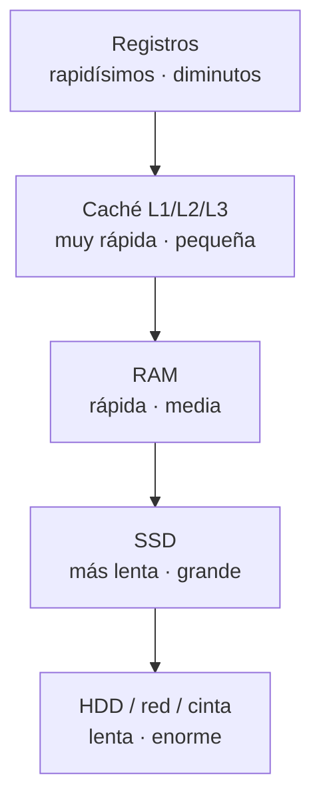

# 01 · Componentes del ordenador

Un ordenador es un conjunto de piezas que **mueven datos** y **ejecutan instrucciones**. En esta
página conoces cada componente, qué hace y cómo encajan entre sí. Es el vocabulario que usarás el
resto de tu carrera: memoria, disco, CPU, buses.

## Objetivos de aprendizaje

Al terminar esta página deberías ser capaz de:

- Identificar y explicar la función de la **CPU, la RAM, el almacenamiento, la placa base, la GPU,
  la fuente de alimentación y los buses**.
- Entender qué es la **jerarquía de memoria** y por qué existe.
- Diferenciar **RAM** de **almacenamiento** y **HDD** de **SSD**.
- Usar comandos básicos para inspeccionar el hardware de tu máquina.

**Tiempo estimado: 60-90 min.**

## Requisitos previos

- **[00 · Ética y legalidad](../00-etica-y-legalidad.md)**: dónde puedes practicar.
- Portada del módulo: **[Arquitectura de ordenadores](index.md)**.

## Explicación

### Analogía: un ordenador es una cocina

Para no perderse, piensa en una cocina de restaurante:

| Cocina | Ordenador | Para qué sirve |
| --- | --- | --- |
| El **cocinero** | **CPU** | Ejecuta las "recetas" (instrucciones). |
| La **encimera** | **RAM** | Espacio de trabajo temporal: lo que estás cocinando *ahora*. |
| La **despensa / nevera** | **Almacenamiento** (disco) | Guarda todo de forma permanente. |
| Los **pasillos entre zonas** | **Buses** | Transportan los datos de un sitio a otro. |
| La **mesa de montaje de todo** | **Placa base** | Conecta todas las piezas entre sí. |
| Un **cocinero especializado en postres** | **GPU** | Hace en paralelo un trabajo muy repetitivo. |
| La **toma de corriente** | **Fuente de alimentación** | Da energía a todo. |

Clave de la analogía: la **encimera** (RAM) es pequeña y se vacía al terminar; la **despensa**
(disco) es grande y conserva todo. Si no cabe en la encimera, el cocinero va lento yendo y viniendo a
la despensa. Esto explica la **jerarquía de memoria**.

### La CPU (unidad central de proceso)

La **CPU** (*Central Processing Unit*) es el "cerebro": ejecuta las **instrucciones** de los programas.
Se compone de:

- **Unidad de control**: decide qué instrucción toca y la ordena ejecutar.
- **ALU** (*Arithmetic Logic Unit*): hace las operaciones aritméticas y lógicas (sumar, comparar…).
- **Registros**: memoria ultrarrápida y minúscula **dentro** de la CPU.
- **Caché** (L1, L2, L3): memoria rápida intermedia para no ir siempre a la RAM.

Se mide por:

- **Núcleos** (*cores*): cuántas "tareas" puede ejecutar a la vez de verdad.
- **Hilos** (*threads*): tareas simultáneas por núcleo (con *hyperthreading* o *SMT*).
- **Frecuencia** (GHz): miles de millones de ciclos por segundo. **Más GHz no siempre es más
  rápido**: también importan núcleos, caché y arquitectura.

### La RAM (memoria de acceso aleatorio)

La **RAM** (*Random Access Memory*) es la **memoria de trabajo**: ahí viven los programas y datos
**mientras se usan**. Es:

- **Volátil**: al apagar, se vacía.
- **Rápida**: mucho más rápida que el disco.
- **Limitada**: hoy lo habitual es 8, 16 o 32 GB, y se nota cuando falta.

Cuando abres muchos programas y el sistema se vuelve lento "porque no hay memoria", es la RAM la que
se ha llenado.

### El almacenamiento (HDD y SSD)

El **almacenamiento** guarda datos de forma **permanente**: sistema operativo, programas, fotos,
documentos. Dos tecnologías principales:

| | **HDD** (disco duro) | **SSD** (unidad de estado sólido) |
| --- | --- | --- |
| Componentes | Platos magnéticos y cabezal móvil | Chips de memoria flash (NAND) |
| Partes móviles | Sí | No |
| Velocidad | Más lento | Mucho más rápido |
| Ruido / vibración | Sí | No (silencioso) |
| Resistencia a golpes | Baja | Alta |
| Precio por GB | Más barato | Más caro |
| Consumo | Mayor | Menor |
| Uso típico | Almacenamiento masivo barato | Sistema operativo y programas |

!!! info "NVMe frente a SATA"
    Existen dos formas de conectar un SSD: **SATA** (interfaz antigua, más lenta) y **NVMe** (usa el
    bus PCIe, mucho más rápido). Ambos son SSDs; el NVMe es notablemente más veloz.

### La placa base (motherboard)

Es la **placa principal** que conecta todos los componentes: el zócalo de la CPU, las ranuras de RAM,
los conectores de disco, los puertos USB y las ranuras de expansión (**PCIe**). Entre sus piezas está
el **chipset**, que gestiona las comunicaciones entre componentes.

### La GPU (unidad de proceso gráfico)

La **GPU** (*Graphics Processing Unit*) está especializada en hacer **muchas operaciones simples a la
vez** (paralelismo). Sirve para gráficos y juegos, pero también para tareas pesadas como
**inteligencia artificial** o **cálculo científico** y, en seguridad, para **romper hashes** con
herramientas especializadas (`hashcat`, por ejemplo).

### La fuente de alimentación (PSU)

Convierte la corriente alterna de la pared en corriente continua estable para las piezas. Se mide en
**vatios (W)**. Si es insuficiente o de baja calidad, el sistema se apaga solo o arranca mal.

### Los buses

Un **bus** es el conjunto de "carreteras" que transportan datos. Los más importantes:

- **Bus de sistema / front side bus**: conecta CPU y memoria.
- **PCIe** (*PCI Express*): conecta GPU, discos NVMe y tarjetas de expansión a alta velocidad.
- **USB, SATA**: conectan periféricos y discos.

### Jerarquía de memoria

Los datos no viven en un solo sitio: hay una **pirámide** que va de **más rápida y pequeña** a **más
lenta y grande**:



| Nivel | Velocidad | Tamaño típico | Se borra al apagar |
| --- | --- | --- | --- |
| Registros | Extrema | Bytes | Sí |
| Caché | Muy alta | KB-MB | Sí |
| RAM | Alta | GB | Sí |
| SSD | Media | Cientos de GB a TB | No |
| HDD / red | Baja | TB o más | No |

La CPU intenta **anticipar** qué datos necesitará y los sube de nivel (de disco a RAM, de RAM a caché,
de caché a registros). Cuanto mejor lo hace, más rápido va todo.

## Ejemplos prácticos

Comandos para **inspeccionar el hardware** en Linux. Todos son **de solo lectura**: no rompen nada.

```bash
# Procesador: modelo, núcleos, hilos, frecuencia
lscpu

# Memoria RAM total, usada y disponible (unidades legibles)
free -h

# Discos y particiones con su uso
df -h

# Lista de discos (bloques) con tamaño
lsblk

# ¿Es disco mecánico (1) o estado sólido (0)?
lsblk -d -o NAME,ROTA,SIZE
```

- `lscpu` — resumen de la **CPU**: `Model name`, `CPU(s)` (nº de CPUs lógicas), `Core(s) per socket`,
  `Thread(s) per core`, `CPU max MHz`.
- `free -h` — fila `Mem:` con `total`, `used`, `free` y `available` en GB/MB legibles.
- `df -h` — cada **sistema de archivos** montado, su tamaño, uso y punto de montaje.
- `lsblk` — árbol de **discos y particiones** (`sda`, `nvme0n1`…).
- `lsblk -d -o NAME,ROTA,SIZE` — la columna `ROTA` vale `1` en **HDD** (disco giratorio) y `0` en
  **SSD**.

!!! note "Salida de ejemplo"
    Los nombres concretos (`sda`, `nvme0n1`, `eth0`…) dependen de tu máquina. No esperes ver los
    mismos valores que en un tutorial; fíjate en **qué mide cada columna**.

## Errores comunes

| Error | Por qué está mal | Solución |
| --- | --- | --- |
| Confundir RAM con almacenamiento. | Una es temporal y volátil; la otra, permanente. | Repasa la tabla comparativa y el "tú mismo": apagar borra la RAM, no el disco. |
| Creer que más GHz = siempre más rápido. | Núcleos, caché y arquitectura también importan. | Mira el conjunto: núcleos, hilos, caché y generación. |
| Pensar que un SSD "se desgasta como un HDD". | Un SSD no tiene partes móviles, pero sí ciclos de escritura finitos. | Usa el SSD para el sistema y no lo llenes al 100 %; para archivo masivo, un HDD va bien. |
| Ignorar la fuente de alimentación. | Una PSU floja provoca reinicios y cuelgues misteriosos. | Calcula el consumo y elige una PSU con margen y buena eficiencia. |
| Llenar la RAM "porque el disco libre sobra". | El sistema usa el disco como *swap*, que es lentísimo comparado con la RAM. | Amplía la RAM si trabajas con muchas máquinas virtuales. |

## Ejercicios

1. **Vocabulario.** Une cada pieza con su función: CPU, RAM, SSD, GPU, PSU.

   ??? success "Solución"
       - **CPU**: ejecuta las instrucciones de los programas.
       - **RAM**: memoria de trabajo temporal y volátil.
       - **SSD**: almacenamiento permanente rápido sin partes móviles.
       - **GPU**: cálculo masivamente paralelo (gráficos, IA, romper hashes).
       - **PSU**: convierte y suministra energía eléctrica a las piezas.

2. **RAM vs almacenamiento.** Explica con la analogía de la cocina por qué al apagar el ordenador no
   se pierden los archivos pero sí lo que tenías abierto sin guardar.

   ??? success "Solución"
       La **encimera (RAM)** es el espacio de trabajo temporal: al "cerrar la cocina" (apagar) se
       vacía, así que lo que no hayas pasado a la **despensa** se pierde. La **despensa (disco)**
       conserva todo de forma permanente, por eso los archivos guardados siguen ahí.

3. **HDD o SSD.** Quieres montar un laboratorio con varias máquinas virtuales. ¿Qué tipo de
   almacenamiento eliges y por qué?

   ??? success "Solución"
       Un **SSD** (mejor NVMe): las máquinas virtuales arrancan y responden mucho más rápido y podrás
       tener varias a la vez sin que el disco se convierta en cuello de botella. El HDD sirve para
       almacenamiento masivo y copias, no para el sistema ni las VMs.

4. **Jerarquía de memoria.** Ordena de más rápida a más lenta: RAM, registros, caché, HDD.

   ??? success "Solución"
       **Registros → caché (L1/L2/L3) → RAM → HDD.** Además, de más rápida a más lenta suele ir de
       **más pequeña a más grande**.

5. **Inspección real.** Ejecuta `free -h` y `lsblk -d -o NAME,ROTA,SIZE` en tu máquina. ¿Cuánta RAM
   tienes y tus discos son SSD o HDD?

   ??? success "Solución"
       Con `free -h` leerás el total de RAM en la fila `Mem:` (por ejemplo, `16Gi`). Con
       `lsblk -d -o NAME,ROTA,SIZE`, la columna `ROTA` indica `0` = **SSD** y `1` = **HDD**. La
       respuesta exacta depende de tu equipo; lo importante es **saber leerlo**.

6. **Buses.** ¿Por qué un SSD NVMe conectado por PCIe es más rápido que uno por SATA?

   ??? success "Solución"
       Porque **PCIe** ofrece mucha más **velocidad de transferencia** que **SATA**. SATA se diseñó
       para discos mecánicos; PCIe se aprovecha del bus de alta velocidad de la placa, y el NVMe está
       optimizado para explotarlo.

## Resumen

- **CPU**: ejecuta instrucciones; importa núcleos, hilos, frecuencia y caché.
- **RAM**: memoria de trabajo **volátil** y rápida; se vacía al apagar.
- **Almacenamiento**: permanente; **HDD** (barato, lento, mecánico) frente a **SSD** (rápido,
  silencioso, sin partes móviles; **NVMe** más rápido que **SATA**).
- **Placa base**: conecta todo (CPU, RAM, discos, PCIe, USB).
- **GPU**: cálculo paralelo (gráficos, IA, hashcat).
- **Fuente (PSU)**: alimenta el sistema con corriente estable.
- **Buses**: PCIe, USB, SATA y el bus de sistema mueven los datos.
- **Jerarquía de memoria**: registros < caché < RAM < almacenamiento, de rápida/pequeña a lenta/grande.

## Checklist

- [ ] Sé explicar qué hace cada componente principal.
- [ ] Distingo RAM (temporal) de almacenamiento (permanente).
- [ ] Sé comparar HDD y SSD, y NVMe con SATA.
- [ ] Entiendo la jerarquía de memoria y por qué existe.
- [ ] He ejecutado `lscpu`, `free -h` y `lsblk` y sé leer su salida.

## Para ir más allá

- [man7.org](https://man7.org) — manuales de Linux, útiles para entender `lsblk`, `lscpu` y más.
  **Gratis**, inglés (EN).
- [MDN Web Docs](https://developer.mozilla.org) — referencia técnica general, útil para conceptos de
  hardware y software. **Gratis**, varios idiomas (incluye español).
- [Glosario de UJACKING](../../glosario.md) — términos de hardware en claro. **Gratis**, español.

## Siguiente paso

Ahora que sabes qué piezas hay, toca entender **cómo se representan los números por dentro**:
**[02 · Sistemas de numeración](02-sistemas-de-numeracion.md)**.
