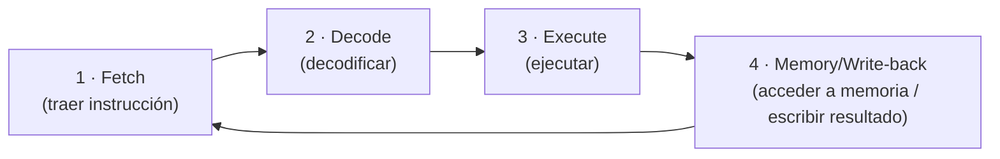

# 03 · Bits, bytes y representación

Un ordenador no guarda letras ni fotos: guarda **bits**. En esta página ves cómo los bits se agrupan
en bytes, cómo se representan texto y números, cómo arranca y ejecuta instrucciones la CPU y qué
diferencia hay entre el **modo usuario** y el **modo kernel**. Es el puente entre "piezas" y
"programas".

## Objetivos de aprendizaje

Al terminar esta página deberías ser capaz de:

- Definir **bit, byte, nibble** y los **múltiplos** de información (KB, MB, GB, TB) frente a los
  **binarios** (KiB, MiB, GiB).
- Explicar el **endianness** (*big-endian* y *little-endian*) con un ejemplo.
- Entender **ASCII** y **Unicode/UTF-8** a alto nivel.
- Describir el **ciclo de la CPU** (fetch-decode-execute) y qué son los **registros**.
- Distinguir **pila (stack)** y **heap** a nivel introductorio.
- Diferenciar **modo kernel** y **modo usuario**, y **32 vs 64 bits**.

**Tiempo estimado: 75-90 min.**

## Requisitos previos

- **[00 · Ética y legalidad](../00-etica-y-legalidad.md)**.
- **[01 · Componentes del ordenador](01-componentes-del-ordenador.md)**: CPU, RAM y jerarquía de
  memoria.
- **[02 · Sistemas de numeración](02-sistemas-de-numeracion.md)**: necesitarás el binario y el
  hexadecimal.

## Explicación

### Bit, byte y nibble

- **Bit**: la unidad mínima. Vale **0 o 1** (apagado/encendido).
- **Nibble**: **4 bits**. Equivale a **1 dígito hexadecimal**.
- **Byte**: **8 bits**. Es la unidad básica de información; un byte puede valer de **0 a 255**
  (2⁸ = 256 valores distintos).

Relación con lo que ya sabes: **1 byte = 2 dígitos hexadecimales** (porque cada dígito es un nibble).

```text
1 byte = 8 bits = 2 nibbles = 2 dígitos hex
Ejemplo:  1011 0110   =   B     6   =  0xB6
```

### Múltiplos: decimal (SI) frente a binario (IEC)

Aquí hay una trampa clásica. Existen **dos familias** de múltiplos:

| Decimal (SI) | Valor | Binario (IEC) | Valor |
| --- | --- | --- | --- |
| 1 KB (kilobyte) | 1 000 bytes | 1 KiB (kibibyte) | 1 024 bytes |
| 1 MB (megabyte) | 1 000 000 bytes | 1 MiB (mebibyte) | 1 024 KiB = 1 048 576 bytes |
| 1 GB (gigabyte) | 10⁹ bytes | 1 GiB (gibibyte) | 1 024 MiB |
| 1 TB (terabyte) | 10¹² bytes | 1 TiB (tebibyte) | 1 024 GiB |

!!! warning "¿Por qué mi disco de 500 GB aparece más pequeño?"
    Los **fabricantes de discos** suelen usar **GB decimales (10⁹)**, mientras que muchos sistemas
    operativos muestran el tamaño contando en **GiB (1024³)** aunque lo llamen "GB". Como
    1 GiB > 1 GB, el número que ves parece menor. No te están engañando: son **dos convenciones**
    distintas. Por claridad, aquí distinguimos **KB/MB/GB/TB** (decimal) de **KiB/MiB/GiB/TiB**
    (binario).

### Endianness (orden de los bytes)

Cuando un número ocupa **varios bytes**, hay que decidir en qué orden se guardan en memoria. Eso es el
**endianness**:

- **Big-endian**: primero el byte **más significativo** (el "grande").
- **Little-endian**: primero el byte **menos significativo** (el "pequeño").

Ejemplo con el número `0x12345678` (4 bytes):

| | Byte 1 | Byte 2 | Byte 3 | Byte 4 |
| --- | --- | --- | --- | --- |
| **Big-endian** | 12 | 34 | 56 | 78 |
| **Little-endian** | 78 | 56 | 34 | 12 |

!!! info "¿Cuál usa mi máquina?"
    La arquitectura **x86/x86-64** (la mayoría de PCs) es **little-endian**. Entenderlo importa al
    analizar binarios, protocolos de red o volcados de memoria. Los protocolos de red suelen usar
    **big-endian** ("orden de red").

### Representación de texto: ASCII y Unicode

- **ASCII**: un conjunto de **128 caracteres** (7 bits) que asigna un número a cada letra, dígito y
  símbolo. Algunos de referencia:

  | Carácter | Decimal | Hex |
  | --- | --- | --- |
  | `A` | 65 | 0x41 |
  | `a` | 97 | 0x61 |
  | `0` | 48 | 0x30 |
  | espacio | 32 | 0x20 |

  Como solo cubre el inglés, quedó corto.

- **Unicode**: un estándar que asigna un **code point** (número) a los caracteres de **prácticamente
  todos los idiomas** (incluidos acentos, emojis, etc.).
- **UTF-8**: una forma muy usada de **codificar** Unicode. Es de **longitud variable** (1 a 4 bytes por
  carácter) y es **compatible con ASCII**: los primeros 128 caracteres se guardan igual. Por eso una
  `A` en ASCII (`0x41`) y en UTF-8 ocupa lo mismo.

En resumen: **Unicode** es la "lista de caracteres"; **UTF-8** es cómo se guardan en bytes.

### El ciclo de la CPU: fetch-decode-execute

La CPU ejecuta programas en un ciclo repetido. Las fases clásicas:



1. **Fetch**: la CPU trae la siguiente instrucción desde memoria (usando el **PC**, *program counter*).
2. **Decode**: descifra qué operación es y sobre qué datos.
3. **Execute**: la **ALU** hace el cálculo o la comparación.
4. **Memory / Write-back**: accede a memoria si hace falta y guarda el resultado en un **registro**.

El ciclo se repite miles de millones de veces por segundo.

### Registros

Los **registros** son la memoria **más rápida** del sistema, diminuta y **dentro** de la CPU. Guardan
los datos con los que se está trabajando *ahora*. Algunos conceptualmente importantes:

- **PC / IP** (*program counter* / *instruction pointer*): dirección de la **siguiente instrucción**.
- **SP** (*stack pointer*): apunta a la **cima de la pila**.
- **Registros de propósito general**: operandos y resultados (nombres como `RAX`, `RBX` en x86-64).
- **Flags**: bits de estado (por ejemplo, "el resultado fue cero").

### Pila (stack) y heap (introducción)

Cuando un programa se ejecuta, su memoria se organiza por zonas. Dos de las más citadas:

| | **Pila (stack)** | **Heap** |
| --- | --- | --- |
| Estructura | **LIFO** (último en entrar, primero en salir) | Área "libre" para reservar bloques |
| Qué guarda | Variables **locales**, direcciones de retorno, marcos de función | Datos **dinámicos** (tamaño decidido al vuelo) |
| Crecimiento | Ordenado y predecible | Desordenado, según se pide y libera |
| Velocidad | Muy rápida | Más lenta |
| Gestión | **Automática** (al salir de la función) | Manual (C/C++) o por *garbage collector* (Java, Python…) |
| Riesgo típico | *Stack overflow* (desbordamiento de pila) | *Memory leak* (fuga: memoria que no se libera) |

A nivel introductorio quédate con esto: la **pila** es rápida y se limpia sola al terminar cada
función; el **heap** es flexible pero más lento y hay que gestionarlo bien.

### Modo kernel y modo usuario

La CPU tiene **niveles de privilegio**. Los dos relevantes:

- **Modo kernel** (privilegiado): el sistema operativo manda. Puede ejecutar **todas** las
  instrucciones, acceder a cualquier memoria y a los dispositivos.
- **Modo usuario** (sin privilegios): donde corren tus programas. Tienen **limitado** el acceso al
  hardware y a la memoria de otros procesos.

Cuando un programa en modo usuario necesita algo del sistema (leer un fichero, enviar datos por la
red), pide un **system call** (llamada al sistema): la CPU cambia a modo kernel, el SO hace el trabajo
y vuelve a modo usuario. Esta separación es la base de la **seguridad**: evita que cualquier programa
haga lo que quiera con la máquina.

### 32 bits frente a 64 bits

Se refiere al **tamaño** de los registros y de las **direcciones de memoria**:

| | **32 bits** | **64 bits** |
| --- | --- | --- |
| Direcciones posibles | 2³² ≈ 4,29 mil millones | 2⁶⁴ (astronómico) |
| RAM direccionable | Hasta ~4 GiB | Muchísima más (miles de GiB) |
| Tamaño de un puntero | 4 bytes | 8 bytes |
| Uso actual | Legado | Estándar en equipos modernos |

Implicación práctica: un sistema **32 bits** no puede usar más de ~4 GiB de RAM de forma directa, y un
programa compilado para 32 bits no aprovecha los registros extra de 64. Hoy lo normal es **64 bits**
(por ejemplo, `x86_64`).

## Ejemplos prácticos

Comandos **de solo lectura** para comprobar todo esto en tu máquina.

```bash
# Arquitectura (x86_64 = 64 bits, i686 = 32 bits, aarch64 = ARM 64)
uname -m

# Nº de bits del sistema (32 o 64)
getconf LONG_BIT

# Tipo de un ejecutable (muestra "64-bit" o "32-bit" y el endianness)
file /bin/ls

# Ver los bytes reales de un texto (hex): A = 0x41, B = 0x42
printf 'AB' | od -An -tx1

# Máximo de direcciones con 32 bits
echo $((2**32))     # 4294967296
```

- `uname -m` — arquitectura de la máquina (salida de ejemplo: `x86_64`).
- `getconf LONG_BIT` — devuelve `64` o `32` según el sistema.
- `file /bin/ls` — describe el binario: por ejemplo `ELF 64-bit LSB executable, x86-64`. La parte
  **LSB** significa *Least Significant Byte* first = **little-endian**.
- `printf 'AB' | od -An -tx1` — muestra los **bytes en hexadecimal** del texto; verás
  `41 42` (`A`=0x41, `B`=0x42).
- `echo $((2**32))` — imprime `4294967296`: el número de direcciones distintas de 32 bits.

!!! note "Salida de ejemplo"
    El resultado exacto de `file` depende del binario y del sistema. Céntrate en si pone **32-bit** o
    **64-bit** y en si aparece **LSB** (little-endian) o **MSB** (big-endian).

## Errores comunes

| Error | Por qué está mal | Solución |
| --- | --- | --- |
| Decir que 1 KB = 1024 bytes sin matizar. | Eso es en realidad 1 **KiB**. | Usa **KB = 1000** y **KiB = 1024**. |
| Confundir bit y byte. | 1 byte = **8 bits**. | Fíjate en la "b" minúscula (bit) o "B" mayúscula (byte). |
| Creer que el orden de bytes es siempre el mismo. | Depende del **endianness** de la máquina/protocolo. | Recuerda: x86 es little-endian; la red suele ser big-endian. |
| Pensar que ASCII cubre todos los idiomas. | ASCII es solo **128 caracteres**. | Esos casos usan **Unicode/UTF-8**. |
| Asumir que un programa de usuario toca el hardware directamente. | Solo el **kernel** puede. | El programa usa **system calls**. |
| Instalar software de 32 bits en un sistema de 64 y esperar la máxima RAM. | Los binarios de 32 bits están limitados. | Usa la versión de **64 bits**. |

## Ejercicios

1. **Unidades.** ¿Cuántos bits hay en 3 bytes? ¿Y cuántos valores distintos se pueden representar con
   1 byte?

   ??? success "Solución"
       3 bytes × 8 bits = **24 bits**. Con 1 byte (8 bits) hay 2⁸ = **256** valores distintos
       (de 0 a 255).

2. **KB o KiB.** Un programa dice que un archivo ocupa "4 KiB". ¿Cuántos **bytes** son?

   ??? success "Solución"
       4 KiB × 1024 bytes/KiB = **4096 bytes**. Si fuera 4 **KB** (decimal), serían 4000 bytes.

3. **Endianness.** ¿Cómo se guarda el número `0x1234` (2 bytes) en **little-endian** y en
   **big-endian**?

   ??? success "Solución"
       Big-endian (primero el byte significativo): `12 34`.
       Little-endian (primero el menos significativo): `34 12`.

4. **Ciclo de la CPU.** Enumera las fases del ciclo y di qué hace cada una en una línea.

   ??? success "Solución"
       1. **Fetch**: traer la instrucción de memoria (usando el PC).
       2. **Decode**: descifrar qué operación es.
       3. **Execute**: realizarla con la ALU.
       4. **Memory/Write-back**: acceder a memoria si hace falta y guardar el resultado.

5. **Stack vs heap.** Clasifica: (a) variable local de una función; (b) objeto creado en tiempo de
   ejecución cuyo tamaño no se sabe hasta ese momento; (c) dirección de retorno de una llamada.

   ??? success "Solución"
       (a) **Pila (stack)**: las variables locales viven en el marco de la función.
       (b) **Heap**: tamaño decidido en ejecución → reserva dinámica.
       (c) **Pila (stack)**: la dirección de retorno se guarda ahí para volver al llamador.

6. **Modo kernel.** ¿Por qué es importante que los programas de usuario **no** puedan acceder
   directamente a cualquier memoria o al hardware?

   ??? success "Solución"
       Porque así un programa con errores o malicioso **no puede** leer ni corromper los datos de otros
       programas ni controlar los dispositivos a su antojo. Esa separación (modo usuario frente a modo
       kernel) es una **barrera de seguridad fundamental** del sistema operativo.

7. **32 vs 64 bits.** ¿Cuál es el motivo matemático de que un sistema de 32 bits no pueda direccionar
   más de ~4 GiB de RAM?

   ??? success "Solución"
       Con 32 bits hay 2³² = **4 294 967 296** direcciones posibles. Si cada dirección apunta a 1 byte,
       el máximo direccionable es de unos **4 GiB**. Con 64 bits el número de direcciones es
       incomparablemente mayor.

## Resumen

- **Bit** (0/1), **nibble** (4 bits) y **byte** (8 bits, 256 valores).
- **KB/MB/GB/TB** son **decimales** (1000); **KiB/MiB/GiB/TiB** son **binarios** (1024).
- El **endianness** decide el orden de los bytes: big-endian (significativo primero) o little-endian
  (lo contrario). x86 es little-endian.
- **ASCII** son 128 caracteres; **Unicode** cubre todos los idiomas y **UTF-8** lo codifica (1-4 bytes,
  compatible con ASCII).
- La CPU repite **fetch → decode → execute → (memory/write-back)**, apoyándose en **registros**.
- La **pila** es rápida y automática; el **heap** es flexible y más lento.
- **Modo kernel** (privilegiado) frente a **modo usuario** (restringido), unidos por **system calls**.
- **32 bits** direccionan ~4 GiB; **64 bits** mucho más. Hoy domina **64 bits**.

## Checklist

- [ ] Distingo bit, nibble y byte y sé convertir entre ellos.
- [ ] Sé explicar la diferencia entre KB y KiB.
- [ ] Entiendo big-endian y little-endian con un ejemplo.
- [ ] Sé qué son ASCII, Unicode y UTF-8 a alto nivel.
- [ ] Puedo describir el ciclo de la CPU y el papel de los registros.
- [ ] Distingo pila y heap, y modo kernel y modo usuario.
- [ ] Sé qué significa que un sistema sea de 32 o de 64 bits.

## Para ir más allá

- [MDN Web Docs](https://developer.mozilla.org) — documentación clara sobre codificación de caracteres
  y Unicode. **Gratis**, varios idiomas (incluye español).
- [man7.org](https://man7.org) — manuales de `od`, `file` y syscalls de Linux. **Gratis**, inglés (EN).
- [RFC Editor](https://www.rfc-editor.org) — estándares de Internet (incluye UTF-8 en RFC 3629).
  **Gratis**, inglés (EN).
- [Glosario de UJACKING](../../glosario.md) — bit, byte, endianness y más, en claro. **Gratis**,
  español.

## Siguiente paso

Ya sabes cómo se representan los datos. Ahora toca **cómo arranca un ordenador y cómo virtualizarlo**:
**[04 · Arranque y virtualización](04-arranque-y-virtualizacion.md)**.
