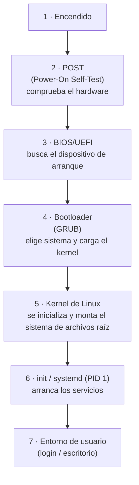

# 04 · Arranque y virtualización

Cuando pulsas el botón de encendido pasan muchas cosas **antes** de que aparezca tu escritorio. En esta
página recorres el **arranque** de un ordenador (BIOS/UEFI, POST, GRUB, kernel, init) y descubres la
**virtualización**, la herramienta que te permitirá montar tu laboratorio de seguridad sin riesgo.

Es la última página del módulo y el puente hacia sistemas operativos.

## Objetivos de aprendizaje

Al terminar esta página deberías ser capaz de:

- Distinguir **BIOS** y **UEFI** y decir ventajas de UEFI.
- Describir el **proceso de arranque**: POST, bootloader (**GRUB**), kernel e **init/systemd**.
- Explicar qué es la **virtualización** y qué es un **hipervisor**.
- Diferenciar **hipervisor tipo 1** y **tipo 2**.
- Entender la diferencia general entre **máquina virtual** y **contenedor**.
- Justificar por qué la virtualización es la base de un **laboratorio** de seguridad.

**Tiempo estimado: 75-90 min.**

## Requisitos previos

- **[00 · Ética y legalidad](../00-etica-y-legalidad.md)**.
- **[01 · Componentes del ordenador](01-componentes-del-ordenador.md)**.
- **[03 · Bits, bytes y representación](03-bits-bytes-y-representacion.md)**: modo kernel/usuario y
  memoria, para entender qué hace el kernel.

## Explicación

### BIOS frente a UEFI

Al encender, la máquina necesita un pequeño programa que compruebe el hardware y sepa **de dónde
arrancar**. Ese firmware es la **BIOS** o su sucesor moderno, **UEFI**:

| | **BIOS** (clásica) | **UEFI** (moderna) |
| --- | --- | --- |
| Antigüedad | Antigua (firmware heredado) | Moderna, sucesora de la BIOS |
| Interfaz | Texto simple | Gráfica, con ratón |
| Tabla de particiones | **MBR** | **GPT** |
| Discos grandes (> 2 TB) | Limitada | Soportada |
| Arranque | 16 bits, limitado | 32/64 bits, más rápido |
| Seguridad | Básica | **Secure Boot** (verificación de firmware/cargadores firmados) |
| Partición de arranque | — | **ESP** (EFI System Partition) |

UEFI **no es "otra BIOS"**, es su reemplazo. Hoy lo normal en equipos modernos es UEFI.

!!! info "Secure Boot"
    **Secure Boot** es una función de UEFI que **solo permite arrancar** cargadores y kernels con firma
    verificada. Aumenta la seguridad, pero puede complicar el arranque de sistemas no firmados (algo
    habitual en laboratorios). Aprenderás a manejarlo al montar tus máquinas.

### El proceso de arranque

Resumen en un diagrama:



Paso a paso:

1. **Encendido**: se da corriente a los componentes.
2. **POST** (*Power-On Self-Test*): la BIOS/UEFI comprueba que el hardware esencial responde (RAM, CPU,
   dispositivos). Si algo falla, oyes pitidos o ves un aviso.
3. **Selección de arranque**: el firmware busca un dispositivo de arranque (disco, USB, red) según el
   **orden de arranque**.
4. **Bootloader (GRUB)**: es el **cargador de arranque** más habitual en Linux. Muestra el menú para
   elegir sistema operativo y carga el **kernel** en memoria.
5. **Kernel**: es el **núcleo** del sistema operativo. Se inicializa, detecta hardware, monta el
   **sistema de archivos raíz** y lanza el primer proceso.
6. **init / systemd (PID 1)**: el primer proceso en modo usuario. En los sistemas modernos, **systemd**
   arranca los **servicios** (red, registro, etc.) según las dependencias. Un **target** es un estado
   del sistema (por ejemplo, `multi-user.target` = modo multiusuario sin entorno gráfico).
7. **Entorno de usuario**: login de texto o **display manager** gráfico.

!!! note "GRUB, systemd… ¿son obligatorios?"
    No. Existen otros cargadores (LILO, systemd-boot) y otros sistemas de init (SysV init, OpenRC).
    Nos centramos en **GRUB + systemd** porque son los más comunes en las distribuciones de Linux
    habituales.

### Virtualización e hipervisores

**Virtualizar** es ejecutar un sistema operativo **dentro** de otro, como si fuera una máquina
completa. El software que lo hace posible es el **hipervisor**. Conceptos:

- **Anfitrión** (*host*): la máquina física.
- **Huésped** (*guest*): la máquina virtual (VM) que corre dentro.
- **Hipervisor**: capa que reparte CPU, RAM, disco y red entre las VM.

Tipos de hipervisor:

| | **Tipo 1 (bare-metal)** | **Tipo 2 (hosted)** |
| --- | --- | --- |
| Dónde corre | Directamente sobre el hardware | Sobre un sistema operativo anfitrión |
| Rendimiento | Mayor | Algo menor |
| Uso típico | Servidores y centros de datos | Escritorio, aprendizaje, pruebas |
| Ejemplos | VMware ESXi, Xen, KVM (usado en servidores) | VirtualBox, VMware Workstation |

Para tu **laboratorio personal** lo habitual es un hipervisor **tipo 2** (cómodo y sencillo) o
**KVM/QEMU** en Linux.

### Máquina virtual frente a contenedor

No confundas una **máquina virtual** con un **contenedor**:

| | **Máquina virtual (VM)** | **Contenedor** |
| --- | --- | --- |
| Qué incluye | Sistema operativo **completo** y su propio kernel | Solo la **aplicación** y sus dependencias |
| Kernel | Propio (invitado) | **Comparte** el kernel del anfitrión |
| Peso | Pesada (GB) | Ligera (MB) |
| Arranque | Segundos/minutos | Casi instantáneo |
| Aislamiento | Mayor | Menor |
| Uso típico | Laboratorios, distintos SO, análisis de malware | Empaquetar y desplegar aplicaciones |

Idea clave: la **VM** simula un ordenador entero; el **contenedor** aísla un **proceso** reutilizando
el kernel del anfitrión. Para practicar distintos sistemas operativos y análisis aislado, la **VM** es
la reina; para reproducir un servicio rápido, el contenedor es más práctico. Puedes profundizar más
adelante en [docs.docker.com](https://docs.docker.com).

### Por qué la virtualización es clave para tu laboratorio

- **Aislamiento**: si rompes la VM, tu equipo real sigue intacto.
- **Snapshots**: guardas un estado y **vuelves a él** en segundos si algo sale mal.
- **Varios sistemas a la vez**: atacante (Kali, Parrot, etc.) y objetivo, en la misma máquina física.
- **Redes internas**: puedes crear una red **solo entre tus VM**, sin salir a Internet, ideal para
  practicar sin riesgo.
- **Pruebas seguras**: es el entorno correcto para analizar programas sospechosos o practicar
  exploits **contra tus propias máquinas**.

!!! danger "Recuerda"
    Todo lo ofensivo se practica **solo** en tu laboratorio aislado o en plataformas que lo autorizan.
    Virtualizar **no** te da permiso para atacar sistemas ajenos.

## Ejemplos prácticos

Comandos **de solo lectura** para ver cómo arranca tu sistema. Algunos pueden pedir permisos, pero no
modifican nada.

```bash
# ¿Estoy en UEFI o en BIOS clásica?
[ -d /sys/firmware/efi ] && echo "UEFI" || echo "BIOS"

# Opciones con las que arrancó el kernel
cat /proc/cmdline

# Versión de systemd (el PID 1 de sistemas modernos)
systemctl --version

# Lista de targets del sistema (estados de arranque)
systemctl list-units --type=target

# Contenido de /boot (kernel y cargador de arranque)
ls -l /boot

# ¿Qué cargador de arranque tengo? (efibootmgr solo en UEFI)
command -v efibootmgr && efibootmgr || echo "efibootmgr no disponible"
```

- `[ -d /sys/firmware/efi ] && echo "UEFI" || echo "BIOS"` — si existe `/sys/firmware/efi`, arrancaste
  en **UEFI**; si no, en BIOS clásica.
- `cat /proc/cmdline` — los **parámetros** pasados al kernel (por ejemplo, `root=UUID=...`).
- `systemctl --version` — la versión de **systemd**.
- `systemctl list-units --type=target` — los **targets** activos (estados de arranque).
- `ls -l /boot` — verás el kernel (`vmlinuz-...`), la imagen de arranque (`initrd`/`initramfs`) y GRUB.
- `efibootmgr` — lista las **entradas de arranque UEFI** (solo en sistemas UEFI).

!!! note "Salida de ejemplo"
    Los nombres concretos (`vmlinuz-6.x.x`, UUID…) varían según la distribución y la versión. **No
    esperes los mismos valores**; fíjate en **qué significa** cada línea.

## Errores comunes

| Error | Por qué está mal | Solución |
| --- | --- | --- |
| Decir "BIOS" cuando en realidad es UEFI. | Son firmware distintos. | Comprueba con `[ -d /sys/firmware/efi ]`. |
| Creer que GRUB es el kernel. | GRUB es el **cargador**; el kernel es otro. | GRUB elige y carga el kernel; el kernel *es* el núcleo del SO. |
| Pensar que un contenedor tiene su propio kernel. | Comparte el kernel del anfitrión. | Para kernels distintos, usa una **VM**. |
| Analizar programas sospechosos en la máquina real. | Riesgo de infección. | Analiza **solo** en una VM aislada, **sin red** con el anfitrión. |
| Arrancar la VM conectada a la red "para que tenga Internet". | Puede alcanzar otros equipos. | Usa **red interna/NAT controlado** y aísla el laboratorio. |
| Olvidar los snapshots. | Si rompes algo, reinstalas. | Haz un **snapshot** antes de cada práctica. |

## Ejercicios

1. **BIOS vs UEFI.** Da dos ventajas de UEFI sobre la BIOS clásica.

   ??? success "Solución"
       Ejemplos: (1) soporta **GPT** y discos de **más de 2 TB**; (2) es **más rápido** (32/64 bits) y
       ofrece **Secure Boot** para verificar firmware y cargadores. También interfaz más moderna.

2. **Ordena el arranque.** Ordena: kernel, POST, GRUB, init/systemd, BIOS/UEFI.

   ??? success "Solución"
       **BIOS/UEFI → POST → GRUB → kernel → init/systemd.** (El POST lo ejecuta el firmware al
       arrancar; luego busca el dispositivo, GRUB carga el kernel y el kernel lanza init/systemd.)

3. **Hipervisores.** Clasifica como tipo 1 o tipo 2: VirtualBox, VMware ESXi, KVM, VMware Workstation.

   ??? success "Solución"
       **Tipo 1 (bare-metal):** VMware ESXi y KVM.
       **Tipo 2 (hosted):** VirtualBox y VMware Workstation.

4. **VM o contenedor.** Para analizar un programa sospechoso con aislamiento fuerte, ¿qué eliges y por
   qué?

   ??? success "Solución"
       Una **máquina virtual**: tiene su propio **kernel** y ofrece **mayor aislamiento** que un
       contenedor (que comparte el kernel del anfitrión). Mejor aún, con **red aislada** y sin acceso a
       tus datos reales.

5. **Snapshots.** ¿Por qué hacer un *snapshot* antes de una práctica arriesgada es más eficiente que
   reinstalar la máquina?

   ??? success "Solución"
       Porque restaurar un **snapshot** devuelve la máquina a ese estado exacto en **segundos**, sin
       volver a instalar el sistema ni reconfigurar nada. Reinstalar tarda mucho más y puede perder
       configuraciones útiles.

6. **Tu laboratorio.** Diseña en 3 líneas una red de laboratorio con una VM atacante y una objetivo,
   aislada de tu red doméstica.

   ??? success "Solución"
       Ejemplo: (1) crear una **red interna/solo-anfitrión** en el hipervisor; (2) conectar la VM
       **atacante** y la **objetivo** a esa red; (3) **no** permitir salida a la red doméstica
       (sin NAT hacia tu LAN), de forma que solo se vean entre ellas. Así practicas sin riesgo.

## Resumen

- **BIOS** (clásica, MBR) y **UEFI** (moderna, GPT, Secure Boot) son el firmware que inicia el arranque.
- Proceso de arranque: **POST → BIOS/UEFI → GRUB → kernel → init/systemd → entorno de usuario**.
- **GRUB** es el cargador; el **kernel** es el núcleo; **systemd** es el PID 1 en sistemas modernos.
- **Virtualizar** = ejecutar SO dentro de otro con un **hipervisor**: **tipo 1** (bare-metal) o **tipo 2**
  (sobre un SO anfitrión).
- La **VM** simula un ordenador completo (kernel propio, más aislada y pesada); el **contenedor**
  comparte el kernel (ligero y rápido, menos aislado).
- La virtualización es la base de un **laboratorio** seguro: aislamiento, snapshots y varias máquinas
  a la vez.

## Checklist

- [ ] Distingo BIOS de UEFI y sé dos diferencias.
- [ ] Puedo explicar el arranque desde el POST hasta init/systemd.
- [ ] Sé qué es un hipervisor y distingo tipo 1 y tipo 2.
- [ ] Distingo máquina virtual de contenedor.
- [ ] He comprobado si mi sistema usa UEFI o BIOS.
- [ ] Sé por qué el laboratorio se monta con máquinas virtuales aisladas.

## Para ir más allá

- [man7.org](https://man7.org) — manuales de `systemctl`, `boot` y el kernel de Linux. **Gratis**,
  inglés (EN).
- [Ubuntu](https://ubuntu.com) — documentación oficial de una distribución muy usada. **Gratis**, inglés
  (EN).
- [Debian](https://www.debian.org) — documentación y manuales. **Gratis**, varios idiomas.
- [VirtualBox](https://www.virtualbox.org) — hipervisor **tipo 2** gratuito para tu laboratorio.
  **Gratis**, varios idiomas.
- [VMware](https://www.vmware.com) — soluciones de virtualización (incluye productos **de pago** y
  pruebas). **De pago / Freemium**, inglés (EN).
- [docs.docker.com](https://docs.docker.com) — introducción a contenedores. **Gratis**, inglés (EN).
- [Glosario de UJACKING](../../glosario.md) — kernel, bootloader, VM y contenedor en claro. **Gratis**,
  español.

## Siguiente paso

Has terminado el módulo de **Arquitectura de ordenadores**. El siguiente es el
**[Módulo 02 · Redes](../02-redes/index.md)**, donde todo lo aprendido (bytes, direcciones,
endianness) cobra vida en la red.
