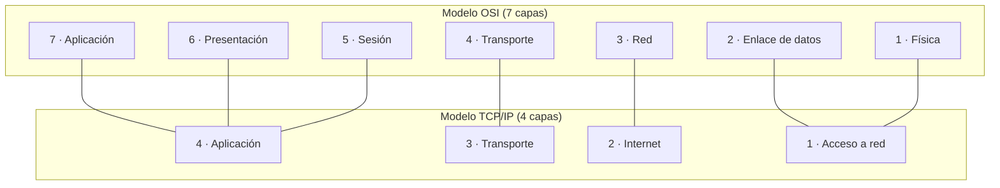
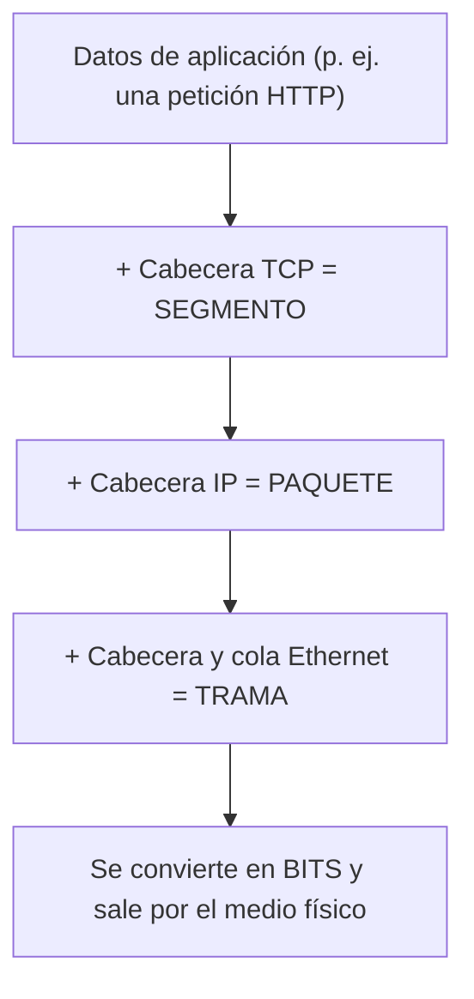

# Modelos OSI y TCP/IP

**Resumen.** Para que dos máquinas se entiendan hay que trocear el problema en capas: cada una se
ocupa de una parte y ofrece un servicio a la de arriba. Aquí verás las 7 capas del modelo OSI, las 4
del modelo TCP/IP, cómo encajan entre sí y cómo se va "envolviendo" el dato (encapsulación) desde que
pulsas Enter hasta que sale un tren de bits por el cable.

## Objetivos de aprendizaje

- Nombrar y ordenar las **7 capas del modelo OSI** y explicar qué hace cada una.
- Nombrar las **4 capas del modelo TCP/IP** y su **correspondencia** con OSI.
- Entender la **encapsulación** y desencapsulación y qué es una **PDU**.
- Identificar la PDU de cada capa: bits, trama, paquete, segmento y datos.
- Explicar con una analogía el viaje completo de un paquete.

**Tiempo estimado: 60–90 min**

## Requisitos previos

- **[Portada del módulo](index.md)**, para conocer el orden de estudio.
- Ideas básicas de bit y byte del módulo de arquitectura; si no las tienes, no pasa nada, no hacen
  falta para esta página.

## Explicación

### El problema que resuelven los modelos

Imagina que tienes que mandar una carta muy larga a otro país. No lo haces todo tú: escribes el
contenido, lo metes en un sobre, escribes la dirección, se lo das a la oficina de correos y ellos se
encargan de moverlo por carreteras y aviones. **Cada actor hace solo su parte** y confía en el de
abajo.

En redes es igual. En lugar de una sola pieza gigante de software, se divide el trabajo en **capas**.
Cada capa:

- Hace **una cosa concreta**.
- Usa los servicios de la capa **inferior**.
- Ofrece un servicio a la capa **superior**.
- Se comunica, en la práctica, con **la misma capa** en la máquina del otro extremo.

Ventajas: si cambias el cable por WiFi, no cambias la aplicación. Si cambias el navegador, no cambias
la tarjeta de red. Cada pieza evoluciona por separado.

### Modelo OSI: 7 capas

OSI (Open Systems Interconnection) es un **modelo de referencia**, no un protocolo. Sirve para
nombrar y ordenar el trabajo. De abajo arriba:

| Nº | Capa | Qué se ocupa |
| --- | --- | --- |
| 7 | **Aplicación** | Lo que ve el usuario: HTTP, DNS, correo. |
| 6 | **Presentación** | Formato de los datos: cifrado, compresión, codificación. |
| 5 | **Sesión** | Abrir, mantener y cerrar la "conversación" entre dos procesos. |
| 4 | **Transporte** | Fiabilidad y control: TCP y UDP. Segmentación y reensamblado. |
| 3 | **Red** | Direcciones lógicas y encaminamiento entre redes: IP, routers. |
| 2 | **Enlace de datos** | Direcciones físicas, tramas y acceso al medio: Ethernet, switches. |
| 1 | **Física** | Voltaje, cables, ondas, bits en bruto. |

!!! tip "Regla mnemotécnica (de abajo arriba)"
    **F**ísica, **E**nlace, **R**ed, **T**ransporte, **S**esión, **P**resentación, **A**plicación.
    Piensa en "**F**íjate **E**n **R**edes **T**an **S**encillas **P**ara **A**prender".

### Modelo TCP/IP: 4 capas

El modelo **TCP/IP** es el que de verdad usa Internet. Es más práctico: agrupa varias capas de OSI en
una sola.

| Nº | Capa TCP/IP | Equivale a (OSI) | Protocolos típicos |
| --- | --- | --- | --- |
| 4 | **Aplicación** | Aplicación + Presentación + Sesión | HTTP/HTTPS, DNS, SMTP, SSH, FTP… |
| 3 | **Transporte** | Transporte | TCP, UDP |
| 2 | **Internet** | Red | IP (IPv4/IPv6), ICMP, ARP\* |
| 1 | **Acceso a red** (Enlace) | Enlace + Física | Ethernet, WiFi, PPP |

\* ARP se suele situar entre la capa de enlace y la de red; en el modelo TCP/IP práctico se estudia
junto a Internet porque trabaja con direcciones IP.

### Correspondencia entre los dos modelos



### PDU: cómo se llama el dato en cada capa

**PDU** (Protocol Data Unit, unidad de datos de protocolo) es solo el nombre que recibe el dato según
la capa en la que esté. Es una convención para entenderse:

| Capa | Nombre del dato (PDU) |
| --- | --- |
| Aplicación | Datos (data) |
| Transporte | **Segmento** (TCP) / **Datagrama** (UDP) |
| Red | **Paquete** (o datagrama IP) |
| Enlace | **Trama** (frame) |
| Física | **Bits** |

### Encapsulación: el dato se va "envolviendo"

Cuando una aplicación quiere enviar algo, la información **baja por las capas** y cada una le añade
su propia cabecera (y a veces una cola). Eso es **encapsular**. Al llegar al destino, el proceso se
invierte: cada capa **quita** su cabecera y entrega el contenido a la de arriba. Eso es
**desencapsular**.



Visto "por dentro", un segmento TCP encapsulado en un paquete IP y luego en una trama Ethernet se
parece a esto (de fuera hacia dentro):

```text
[ Cab. Ethernet | Cab. IP | Cab. TCP | DATOS | Cola Ethernet ]
```

Al recibir, el receptor lee la cabecera Ethernet, ve que es para él, quita esa cabecera, mira la
cabecera IP, quita, mira la TCP… hasta entregar los datos al programa correcto.

### La analogía del envío de un paquete

Piensa en enviar una **carta certificada**:

1. **Aplicación:** escribes el texto de la carta (los datos).
2. **Transporte:** metes las hojas numeradas en un sobre y anotas cuántas van y en qué orden (TCP
   numera los segmentos y garantiza que lleguen todas).
3. **Red:** escribes la dirección de destino completa, calle, ciudad y país (la IP lógica, que
   permite cruzar entre redes distintas).
4. **Enlace:** en cada oficina de correos por la que pasa, le ponen una etiqueta con el siguiente
   destino físico concreto (la MAC, que sirve solo dentro del tramo local).
5. **Física:** el camión, el avión, la carretera: el transporte real (los bits por el medio).

Y al revés en destino: quitan la etiqueta local, comprueban la dirección IP, abren el sobre, ordenan
las hojas y leen la carta.

!!! note "Una capa no necesita entender a las demás"
    La capa de red no sabe si dentro va una web o un correo: solo ve "un paquete para tal IP". Esa
    independencia es justo lo que hace a las redes tan flexibles… y también lo que permite ataques
    que abusan de una capa concreta.

## Ejemplos prácticos

### Ver la configuración de red "como la ve cada capa"

```bash
ip -brief address
```

Salida de ejemplo:

```text
lo               UNKNOWN        127.0.0.1/8 ::1/128
enp3s0           UP             192.168.1.50/24 fe80::1a2b:3c4d:5e6f:7a8b/64
```

Línea a línea:

- `lo` es la **interfaz de loopback** (capa 1/3): la máquina hablándose a sí misma. Su dirección es
  `127.0.0.1` (IPv4) y `::1` (IPv6). Verás `lo` en redes, no es un error.
- `enp3s0` es la tarjeta de red física (Ethernet). `UP` significa que está activa.
- `192.168.1.50/24` es la **dirección IP de capa 3** y su prefijo (`/24`). El `/24` lo estudiarás a
  fondo en la página de subnetting.
- `fe80::.../64` es una **IPv6 link-local**, que se autoconfigura sola.
- `127.0.0.0/8` y `::1/128` son las direcciones reservadas para el propio equipo.

### Ver las capas en una captura

Cuando capturas tráfico (lo harás en **[Wireshark](11-wireshark.md)**), la típica vista "en árbol" de
un paquete muestra las capas de arriba abajo: `Frame` (enlace), `Ethernet II`, `IP`, `TCP` y por
último la aplicación (HTTP/DNS). Ese orden **es** literalmente el modelo de capas.

## Errores comunes

- **Creer que OSI "es" Internet.** No: OSI es un modelo de referencia para ordenar el estudio; el que
  se usa de verdad es TCP/IP.
- **Pensar que las capas son programas separados.** Son funciones del sistema operativo y del
  software; no hay un "programa de capa 3" corriendo solo.
- **Confundir PDU con protocolo.** La PDU es el *nombre del dato*; el protocolo es *la regla* (TCP,
  IP…).
- **Olvidar que la dirección MAC solo sirve en el tramo local.** Cambia en cada salto; la IP, en
  principio, no. Lo verás claro en la página de direccionamiento.

## Ejercicios

### Ejercicio 1

¿En qué capa OSI trabaja un **switch** tradicional y en cuál un **router**?

??? success "Solución"
    Un switch Ethernet tradicional trabaja en **capa 2 (Enlace)**, porque reenvía tramas usando
    direcciones MAC. Un router trabaja en **capa 3 (Red)**, porque reenvía paquetes usando direcciones
    IP y decide por dónde enviarlos.

### Ejercicio 2

¿Qué protocolos del modelo TCP/IP sitúas en la capa de **Transporte** y cuál en la de **Internet**?

??? success "Solución"
    **Transporte:** TCP y UDP (gestionan la entrega entre procesos, con puertos).
    **Internet:** IP (IPv4/IPv6) y, en la práctica, ICMP (mensajes de control como ping). ARP se suele
    estudiar en la frontera entre enlace y red.

### Ejercicio 3

Indica el nombre de la PDU en cada una de estas capas: red, transporte (TCP), enlace y física.

??? success "Solución"
    - Red → **paquete**
    - Transporte (TCP) → **segmento**
    - Enlace → **trama**
    - Física → **bits**

### Ejercicio 4

Ordena **de arriba abajo** estas capas: transporte, aplicación, red, enlace, física.

??? success "Solución"
    Aplicación → Transporte → Red → Enlace → Física.
    (En TCP/IP: Aplicación → Transporte → Internet → Acceso a red.)

### Ejercicio 5

Una aplicación envía 1000 bytes. Describe, con tus palabras, qué le añade cada capa por el camino y en
qué se convierte en cada paso.

??? success "Solución"
    Ejemplo de respuesta: la aplicación entrega 1000 bytes; la capa de transporte (TCP) añade su
    cabecera (puertos, números de secuencia) y forma un **segmento**; la capa de red (IP) añade su
    cabecera (IP origen y destino) y forma un **paquete**; la capa de enlace (Ethernet) añade cabecera
    y cola (MAC origen y destino, control de errores) y forma una **trama**; la capa física lo
    serializa y lo emite como **bits**. En el destino se recorre el camino inverso quitando cada
    cabecera.

### Ejercicio 6

Explica, usando la analogía de la carta, por qué la dirección MAC "cambia en cada salto" y la IP no.

??? success "Solución"
    La etiqueta que pone cada oficina de correos indica el **siguiente destino físico concreto**
    (esa oficina, ese camión). En cada tramo se pone una nueva. Eso es la **MAC**: identifica el
    siguiente equipo dentro de la red local. La **dirección IP** es como el país, la ciudad y la calle
    finales: no cambian durante todo el viaje, porque identifican el destino global.

## Resumen

- Los modelos de capas **dividen el problema** de comunicar dos máquinas en partes manejables.
- **OSI** tiene 7 capas (Aplicación, Presentación, Sesión, Transporte, Red, Enlace, Física).
- **TCP/IP** tiene 4 capas (Aplicación, Transporte, Internet, Acceso a red) y es el que usa Internet.
- La **PDU** cambia de nombre según la capa: datos, segmento/datagrama, paquete, trama, bits.
- La **encapsulación** añade cabeceras al bajar; la **desencapsulación** las quita al subir.

## Checklist

- [ ] Sé nombrar y ordenar las 7 capas de OSI.
- [ ] Sé nombrar las 4 capas de TCP/IP.
- [ ] Sé corresponder cada capa de OSI con una de TCP/IP.
- [ ] Sé qué es una PDU y cómo se llama en cada capa.
- [ ] Puedo explicar la encapsulación con un ejemplo.

## Para ir más allá

- **RFC 1122 — Requirements for Internet Hosts** — texto oficial que describe las capas del modelo
  TCP/IP. Tipo: documentación técnica · Inglés (EN) · **Gratis**. <https://www.rfc-editor.org>
- **MDN Web Docs** — para cuando quieras bajar a protocolos concretos de aplicación. Tipo: referencia ·
  Español/Inglés (EN) · **Gratis**. <https://developer.mozilla.org>
- **Wireshark** — captura tráfico y verás las capas "en vivo". Tipo: herramienta · Inglés (EN) ·
  **Gratis**. <https://www.wireshark.org>

## Siguiente paso

Ahora que tienes el mapa, toca entender **cómo se nombra cada equipo**: pasa a
**[02 · Direccionamiento IP y MAC](02-direccionamiento-ip-y-mac.md)**.
