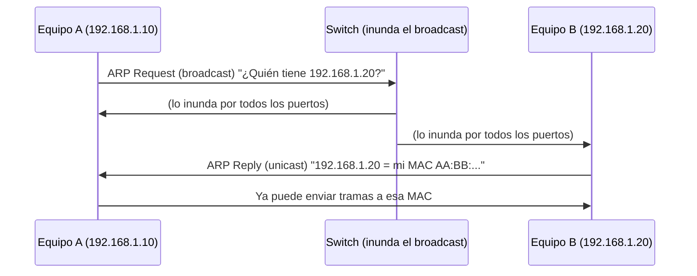

# Capa de enlace

**Resumen.** La capa de enlace es la que entrega los datos "salto a salto" dentro de la red local:
convierte paquetes en **tramas**, usa **direcciones MAC** y funciona con **switches**. Aquí verás cómo
son las tramas Ethernet, cómo aprende un switch, qué son los dominios de colisión y de broadcast, y
cómo funciona **ARP** para traducir IP a MAC (y por qué ARP es tan fácil de engañar).

## Objetivos de aprendizaje

- Entender el funcionamiento de **Ethernet** y la estructura de una **trama**.
- Explicar cómo un **switch** reenvía tramas usando su **tabla CAM/MAC**.
- Diferenciar **dominios de colisión** y **dominios de broadcast**.
- Explicar el funcionamiento de **ARP** paso a paso.
- Entender, a nivel **conceptual**, qué es el **ARP spoofing** y por qué es peligroso.

**Tiempo estimado: 60–90 min**

## Requisitos previos

- **[02 · Direccionamiento IP y MAC](02-direccionamiento-ip-y-mac.md)**: necesitas tener claras las
  direcciones MAC y la diferencia con las IP.
- **[01 · Modelos OSI y TCP/IP](01-modelos-osi-y-tcp-ip.md)**: esta es la capa 2 de OSI, "Enlace de
  datos", que en TCP/IP corresponde al "Acceso a red".

!!! danger "Recordatorio ético"
    El ARP spoofing se explica aquí **solo de forma teórica**, para entender cómo ataca un atacante y
    cómo defenderse. Practica exclusivamente en tu laboratorio aislado o en plataformas que lo
    autorizan (ver **[00 · Ética y legalidad](../00-etica-y-legalidad.md)**). Atacar una red ajena es
    un delito.

## Explicación

### Ethernet

**Ethernet** es el estándar de facto en redes de área local (LAN). Define:

- El **formato de la trama** a nivel de enlace.
- El uso de **direcciones MAC** de 48 bits.
- Las velocidades típicas (100 Mbps, 1 Gbps, 10 Gbps…).

Ethernet es la "capa 2" que hay detrás de casi todos los cables de tu casa y tu oficina. La variante
moderna se conoce como **Ethernet II** (o DIX), con esta trama:

| Campo | Tamaño | Para qué |
| --- | --- | --- |
| Preámbulo + SFD | 8 bytes | Sincroniza al receptor. |
| MAC destino | 6 bytes | A quién va la trama. |
| MAC origen | 6 bytes | De quién viene. |
| Tipo/Ethertype | 2 bytes | Qué protocolo va dentro (0x0800 = IPv4). |
| **Datos (payload)** | 46 – 1500 bytes | El paquete IP encapsulado. |
| FCS (CRC) | 4 bytes | Comprueba que no hay errores. |

!!! info "MTU"
    La carga máxima de Ethernet es **1500 bytes** (la **MTU**). Paquetes mayores se fragmentan. Este
    dato aparece constantemente en diagnóstico de redes.

### Switches y la tabla CAM

Un **switch** (conmutador) es un dispositivo de capa 2 con varios puertos. Funciona así:

1. Recibe una trama por un puerto.
2. Lee la **MAC origen** y la **apunta** en su **tabla CAM** (Content-Addressable Memory, o tabla
   MAC) asociada a ese puerto.
3. Lee la **MAC destino** y busca en la tabla:
   - Si está → envía la trama **solo por ese puerto** (reenvío selectivo).
   - Si no está → la **inunda** (flood) por todos los puertos menos el de entrada (aún no sabe dónde
     está el destino).
4. Si el destino es **broadcast** o **multicast**, la inunda siempre.

Así el switch **aprende** quién está en cada puerto sin que nadie se lo configure.

### Dominios de colisión y de broadcast

- **Dominio de colisión:** conjunto de equipos que comparten el mismo medio y pueden chocar entre sí
  al transmitir a la vez. En Ethernet con switches, **cada puerto es su propio dominio de colisión**.
  Un **hub** (concentrador) antiguo, en cambio, tenía **todo** el equipo en un mismo dominio de
  colisión: por eso ya no se usa.
- **Dominio de broadcast:** conjunto de equipos que reciben una trama de broadcast (`FF:FF:FF:FF:FF:FF`)
  enviada por otro. Un switch **no** corta los broadcast: **todos los puertos están en el mismo
  dominio de broadcast**. Para dividirlo hacen falta **VLAN** o **routers**.

| Dispositivo | Divide dominio de colisión | Divide dominio de broadcast |
| --- | --- | --- |
| Hub | No | No |
| Switch | Sí (por puerto) | No |
| Router | Sí | Sí |

### ARP: de IP a MAC

Ya sabes que un paquete necesita la IP final y la MAC del siguiente salto. Pero, ¿cómo sabe un equipo
la MAC del que tiene al lado si solo conoce su IP? Con **ARP** (Address Resolution Protocol).

Funcionamiento (ejemplo: A quiere hablar con B en la misma red):

1. A comprueba su **caché ARP**. Si ya tiene la MAC de B, la usa directamente.
2. Si no la tiene, A envía un **ARP Request** (petición) en **broadcast**
   (`FF:FF:FF:FF:FF:FF`): "¿Quién tiene la IP 192.168.1.20? Dímelo".
3. Solo B reconoce "su" IP y responde con un **ARP Reply** (respuesta) **unicast** a A:
   "La 192.168.1.20 la tengo yo, esta es mi MAC".
4. A guarda la respuesta en su caché ARP y ya puede enviar la trama.



!!! note "Si el destino está en otra red"
    El equipo no pide la MAC del destino final, sino la de su **puerta de enlace** (el router). El
    router hace su propio ARP para el siguiente salto. Eso lo verás en la capa de red.

### ARP spoofing (conceptual)

ARP **no tiene autenticación**: cualquiera puede responder a una petición diciendo "esa IP soy yo". Un
atacante abusa de esto:

1. Envía respuestas ARP falsas diciendo que **la IP de la puerta de enlace** corresponde a **su** MAC.
2. Las víctimas actualizan su caché y empiezan a mandar su tráfico (incluida la salida a Internet) al
   atacante.
3. El atacante se coloca **en medio** de la comunicación: eso es un **Man-in-the-Middle (MitM)**.

Consecuencias: puede espiar tráfico no cifrado, modificarlo o cortar la conexión. Es un ataque de
**capa 2**, muy típico en redes locales.

Cómo **defenderse** (a nivel general):

- **DHCP snooping** y **Dynamic ARP Inspection (DAI)** en switches gestionables.
- **Segmentación** de la red (VLAN) para reducir el alcance.
- **Cifrado** del tráfico (HTTPS, VPN) para que, aunque te escuchen, no lean el contenido.
- Monitorización para detectar cambios ARP sospechosos.

!!! danger "Esto es teoría, no un manual"
    Aquí solo se describe *qué hace* el ataque para poder defenderlo. No se incluyen comandos para
    lanzarlo. Practicar esto fuera de un laboratorio propio autorizado es ilegal.

## Ejemplos prácticos

### Ver tu tabla ARP

```bash
ip neigh
```

Salida de ejemplo:

```text
192.168.1.1 dev enp3s0 lladdr aa:bb:cc:dd:ee:01 REACHABLE
192.168.1.20 dev enp3s0 lladdr aa:bb:cc:dd:ee:02 STALE
```

Cada línea es una entrada de caché: IP ↔ MAC en tu red local. `REACHABLE` significa que hace poco se
confirmó; `STALE` que la entrada es antigua pero probablemente válida.

### Ver la MAC de tu interfaz

```bash
ip link show
```

Salida de ejemplo:

```text
2: enp3s0: <BROADCAST,MULTICAST,UP,LOWER_UP> mtu 1500 qdisc ... state UP mode DEFAULT
    link/ether 00:1a:2b:3c:4d:5e brd ff:ff:ff:ff:ff:ff
```

- `mtu 1500`: la MTU de Ethernet.
- `link/ether 00:1a:2b:3c:4d:5e`: tu MAC.
- `brd ff:ff:ff:ff:ff:ff`: la dirección de broadcast.

### Capturar ARP con Wireshark

En **[Wireshark](11-wireshark.md)** puedes filtrar por `arp` y ver el par petición/respuesta. Verás el
Request en broadcast y el Reply en unicast, tal como se describe arriba.

## Errores comunes

- **Confundir switch con router.** El switch mueve tramas dentro de la LAN (capa 2); el router mueve
  paquetes entre redes (capa 3).
- **Pensar que un switch separa el broadcast.** No lo hace: para eso hacen falta VLAN o routers.
- **Creer que ARP es seguro.** No tiene autenticación; está pensado para redes de confianza.
- **Pensar que la MAC viaja de extremo a extremo.** Solo identifica el siguiente salto local.
- **Olvidar la MTU.** Un paquete mayor de 1500 bytes (sin fragmentar) no cabe en una trama Ethernet.

## Ejercicios

### Ejercicio 1

¿En qué capa OSI trabaja un switch y qué dirección usa para reenviar?

??? success "Solución"
    En **capa 2 (Enlace)**. Reenvía tramas usando la **dirección MAC** de destino, consultando su
    tabla CAM/MAC.

### Ejercicio 2

Explica qué hace un switch cuando recibe una trama hacia una MAC que **no está** en su tabla.

??? success "Solución"
    La **inunda** (flood): la envía por todos sus puertos menos por el que la recibió. Además, antes
    apunta la **MAC origen** y el puerto de entrada en su tabla, para aprender.

### Ejercicio 3

¿Cuántos dominios de colisión y de broadcast hay en un switch con 8 puertos en una sola VLAN?

??? success "Solución"
    **8 dominios de colisión** (uno por puerto) y **1 único dominio de broadcast** (el switch no
    separa broadcast; todos los puertos están en el mismo).

### Ejercicio 4

A (`192.168.1.10`) quiere enviar a B (`192.168.1.20`). Describe el intercambio ARP.

??? success "Solución"
    1. A mira su **caché ARP**; si no tiene la MAC de B, envía un **ARP Request** en **broadcast**
       ("¿Quién tiene 192.168.1.20?").
    2. B responde con un **ARP Reply** en **unicast** con su MAC.
    3. A guarda la entrada y envía la trama a esa MAC.

### Ejercicio 5

Explica, sin dar comandos, en qué consiste el ARP spoofing y por qué es posible.

??? success "Solución"
    Consiste en enviar respuestas ARP **falsas** asociando la IP de la puerta de enlace (o de otra
    víctima) con la MAC del atacante. Es posible porque **ARP no autentica** quién responde: cualquier
    equipo puede contestar y las víctimas actualizan su caché sin verificar. Así el atacante se
    interpone y puede interceptar el tráfico (Man-in-the-Middle).

### Ejercicio 6

Nombra **dos defensas** contra el ARP spoofing en una red de empresa.

??? success "Solución"
    Por ejemplo: **Dynamic ARP Inspection (DAI)** o **DHCP snooping** en switches gestionables (que
    validan las respuestas ARP/DHCP), y **cifrado del tráfico** (HTTPS/VPN) para que, aunque se
    intercepte, no se pueda leer. También vale la **segmentación con VLAN**.

### Ejercicio 7

¿Qué campo de la trama Ethernet indica que dentro va un paquete IPv4?

??? success "Solución"
    El campo **Ethertype** (o Tipo). Para IPv4 vale **0x0800**.

## Resumen

- **Ethernet** define tramas con MAC origen/destino, Ethertype y datos (hasta 1500 bytes).
- Un **switch** aprende MAC origen y reenvía según la MAC destino usando la **tabla CAM**.
- Cada puerto de switch es un **dominio de colisión**; el switch **no** divide el **broadcast**.
- **ARP** traduce IP a MAC: petición en broadcast, respuesta en unicast.
- **ARP spoofing**: respuestas ARP falsas → **Man-in-the-Middle**. Se defiende con DAI, DHCP
  snooping, cifrado y segmentación.

## Checklist

- [ ] Sé describir la estructura de una trama Ethernet.
- [ ] Explico cómo aprende un switch y cuándo inunda.
- [ ] Diferencio dominio de colisión y de broadcast.
- [ ] Puedo describir el funcionamiento de ARP paso a paso.
- [ ] Entiendo el ARP spoofing a nivel conceptual y sus defensas.

## Para ir más allá

- **RFC 826 — An Ethernet Address Resolution Protocol (ARP)** — especificación oficial de ARP. Tipo:
  documentación oficial · Inglés (EN) · **Gratis**. <https://www.rfc-editor.org>
- **Wireshark** — para ver tramas Ethernet y ARP con tus propios ojos. Tipo: herramienta ·
  Inglés (EN) · **Gratis**. <https://www.wireshark.org>
- **OWASP** — guías de seguridad generales aplicables a redes. Tipo: documentación · Inglés (EN) ·
  **Gratis**. <https://owasp.org>

## Siguiente paso

Ahora que sabes cómo se entrega una trama dentro de la red, sube un nivel y aprende a **cruzar entre
redes**: sigue con **[05 · Capa de red](05-capa-de-red.md)**.
