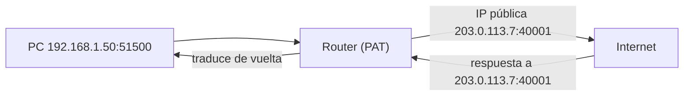

# Capa de red

**Resumen.** La capa de red (capa 3) es la que decide **por dónde** va un paquete para llegar de una
red a otra. Sus protagonistas son el protocolo **IP**, los **routers**, las **tablas de rutas**, la
**puerta de enlace**, **NAT** y los mensajes de control **ICMP** (el `ping` y el `traceroute`).

## Objetivos de aprendizaje

- Explicar qué hace un **router** y en qué se diferencia de un switch.
- Leer y entender una **tabla de rutas** y qué es la **ruta por defecto**.
- Saber qué es la **puerta de enlace** (gateway).
- Entender **NAT** y **PAT** y por qué existen.
- Usar **ICMP** con `ping` y `traceroute` e interpretar el **TTL**.

**Tiempo estimado: 60–90 min**

## Requisitos previos

- **[03 · Subnetting](03-subnetting.md)**: la capa de red trabaja con direcciones y máscaras; hay que
  dominarlas mínimamente.
- **[04 · Capa de enlace](04-capa-de-enlace.md)**: la diferencia switch/router se entiende mejor tras
  ver cómo se reenvían tramas.

## Explicación

### Qué hace un router

Un **router** conecta **redes distintas** y decide por dónde enviar cada paquete. Para ello:

- Mira la **IP de destino** del paquete.
- Consulta su **tabla de rutas**.
- Reenvía el paquete por la mejor interfaz hacia el siguiente salto (*next hop*).

Diferencias clave switch vs router:

| | Switch | Router |
| --- | --- | --- |
| Capa | 2 (enlace) | 3 (red) |
| Dirección que usa | MAC | IP |
| Une | Equipos en una **misma** red | **Redes diferentes** |
| Divide broadcast | No (salvo VLAN) | **Sí** |
| Tabla | CAM (MAC) | Rutas (redes) |

Cada salto de router se llama **hop**. Un paquete hasta un servidor de Internet puede pasar por 10–20
routers.

### Tabla de rutas

La **tabla de rutas** dice, para cada red de destino, por dónde enviarla. Ejemplo típico:

```text
default via 192.168.1.1 dev enp3s0
192.168.1.0/24 dev enp3s0 proto kernel scope link src 192.168.1.50
10.8.0.0/24 via 192.168.1.1 dev enp3s0
```

Línea a línea:

- `default via 192.168.1.1` → la **ruta por defecto**: si no encaja ningún destino concreto, manda el
  paquete al router `192.168.1.1` (tu puerta de enlace).
- `192.168.1.0/24 dev enp3s0` → tu red local: se entrega directamente por tu interfaz.
- `10.8.0.0/24 via 192.168.1.1` → una red remota a la que se llega a través de la puerta de enlace.

El router elige siempre la ruta **más específica** (la que tiene el prefijo más largo, es decir, más
concreta) que coincida con la IP de destino. Eso se llama **longest prefix match**.

### Puerta de enlace (gateway)

La **puerta de enlace por defecto** es el router al que envías todo el tráfico que **no** es para tu
red local. En una casa es el router del operador; en una empresa puede ser un firewall o un router
grande. Sin puerta de enlace configurada, tu equipo solo se comunica con su propia subred.

Concepto importante para el diagnóstico: si no tienes salida a Internet pero sí a la red local, lo
primero que se revisa es la **puerta de enlace** (el campo `default via ...`).

### NAT y PAT

**NAT** (Network Address Translation) traduce direcciones. Existe porque las direcciones IPv4
públicas son escasas: en tu red usas IPs **privadas** y el router las convierte a su IP **pública**
cuando sales a Internet.

- **NAT estático:** una IP privada ↔ una IP pública fija. Se usa para publicar servidores internos.
- **NAT dinámico:** se asigna una IP pública de un pool según se necesita.
- **PAT** (Port Address Translation), también llamado *NAT con sobrecarga*: **muchas** IPs privadas
  comparten **una sola** IP pública, distinguiéndose por el **puerto**. Es lo que hace el router de
  tu casa: tu móvil, tu PC y tu televisor salen al mismo tiempo con la misma IP pública, pero con
  puertos distintos.

Cómo funciona PAT al salir:



El router guarda una **tabla de traducciones** para saber a qué equipo interno devolver cada
respuesta.

!!! warning "Implicación de seguridad"
    NAT **no es un firewall**. Da la sensación de "ocultar" los equipos internos, pero no es una
    defensa por sí mismo. Un firewall sí aplica reglas explícitas de permitir/bloquear.

### ICMP: ping y traceroute

**ICMP** (Internet Control Message Protocol) no transporta datos de usuario: transporta **mensajes de
control y error**. Su uso más famoso es el `ping` (mensajes *Echo Request* / *Echo Reply*).

- **`ping`** comprueba si un equipo responde y cuánto tarda (RTT, *round-trip time*).
- **`traceroute`** (en Windows `tracert`) descubre la **lista de routers** por los que pasa el paquete.

### TTL (Time To Live)

El campo **TTL** es un contador que cada paquete lleva en su cabecera IP:

- Cada router que reenvía el paquete **resta 1** al TTL.
- Si el TTL llega a **0**, el router **descarta** el paquete y devuelve un mensaje ICMP *Time Exceeded*
  al origen. Así se evita que un paquete dé vueltas para siempre.

`traceroute` se basa precisamente en esto: envía paquetes con TTL 1, 2, 3… y así cada router del
camino responde "aquí me quedé sin TTL". Los valores iniciales típicos son 64 (Linux) o 128 (Windows);
observar el TTL de llegada en un `ping` da pistas sobre cuántos saltos ha recorrido.

!!! note "ICMP y firewalls"
    Muchos cortafuegos **bloquean ICMP**. Por eso "no responde a ping" **no** significa "está apagado":
    puede estar vivo pero filtrando. Es un error de diagnóstico muy habitual.

## Ejemplos prácticos

### Ver tu tabla de rutas

```bash
ip route show
```

Salida de ejemplo:

```text
default via 192.168.1.1 dev enp3s0 proto dhcp src 192.168.1.50 metric 100
192.168.1.0/24 dev enp3s0 proto kernel scope link src 192.168.1.50
```

Línea a línea:

- `default via 192.168.1.1`: tu **puerta de enlace** (todo lo que no sea local va aquí).
- `192.168.1.0/24 dev enp3s0`: tu red local, accesible directamente por tu interfaz.
- `src 192.168.1.50`: la IP de origen que usarás en esa ruta.

### Hacer ping

```bash
ping -c 4 192.168.1.1
```

Salida de ejemplo:

```text
PING 192.168.1.1 (192.168.1.1) 56(84) bytes of data.
64 bytes from 192.168.1.1: icmp_seq=1 ttl=64 time=0.512 ms
64 bytes from 192.168.1.1: icmp_seq=2 ttl=64 time=0.498 ms
...
--- 192.168.1.1 ping statistics ---
4 packets transmitted, 4 received, 0% packet loss, time 3004ms
rtt min/avg/max/mdev = 0.498/0.505/0.512/0.006 ms
```

Línea a línea:

- `-c 4`: envía solo 4 paquetes y termina (en Linux el ping no para solo).
- `icmp_seq`: número de secuencia del paquete.
- `ttl=64`: TTL del paquete **de respuesta**; 64 sugiere origen a pocos saltos (o Linux).
- `time=0.512 ms`: el **RTT**, ida y vuelta.
- `0% packet loss`: no se perdió ninguno.
- `rtt min/avg/max`: mínimo, media y máximo del tiempo.

### Trazar la ruta

```bash
traceroute example.com
```

Salida de ejemplo:

```text
traceroute to example.com (93.184.216.34), 30 hops max, 60 byte packets
 1  _gateway (192.168.1.1)  0.421 ms  0.398 ms  0.512 ms
 2  10.0.0.1 (10.0.0.1)  6.213 ms  6.101 ms  6.299 ms
 3  93.184.216.34 (93.184.216.34)  12.554 ms  12.102 ms  12.876 ms
```

Cada línea numerada es un **hop** (un router). Los tres tiempos son tres mediciones. Si ves `* * *`,
significa que ese router no responde a ICMP (no que no exista).

## Errores comunes

- **Concluir que un host está caído porque no responde a ping.** Puede estar filtrando ICMP.
- **Confundir NAT con firewall.** NAT traduce, no filtra reglas de seguridad.
- **Olvidar la ruta por defecto.** Sin `default` no hay salida a otras redes.
- **Pensar que `traceroute` muestra siempre todo el camino.** Los routers que bloquean ICMP aparecen
  como `*`.
- **Creer que el TTL es tiempo en segundos.** Es un **número de saltos** restantes.

## Ejercicios

### Ejercicio 1

¿Qué diferencia principal hay entre un switch y un router?

??? success "Solución"
    El **switch** conecta equipos dentro de la **misma red** y trabaja con **MAC** (capa 2). El
    **router** conecta **redes distintas** y trabaja con **IP** (capa 3), además de dividir el dominio
    de broadcast.

### Ejercicio 2

En la tabla de rutas `default via 192.168.1.1 dev enp3s0`, ¿qué es `192.168.1.1`?

??? success "Solución"
    Es la **puerta de enlace** (gateway), el router al que se envían todos los paquetes cuyo destino no
    coincide con ninguna ruta más específica.

### Ejercicio 3

Tu PC (`192.168.1.50`) abre tres pestañas a tres webs. El router usa PAT. ¿Cuántas IPs públicas se
usan y cómo distingue las conexiones?

??? success "Solución"
    Se usa **una sola IP pública**, la del router. Las tres conexiones se distinguen por el **puerto**
    de origen traducido: cada conexión recibe un puerto distinto en la tabla de traducciones, para que
    las respuestas vuelvan a la pestaña correcta.

### Ejercicio 4

¿Para qué sirve el TTL y qué pasa cuando llega a 0?

??? success "Solución"
    Evita que un paquete circule indefinidamente. Cada router resta 1; cuando llega a 0, el router
    **descarta** el paquete y devuelve un mensaje ICMP *Time Exceeded* al origen. `traceroute` se basa
    en este mecanismo.

### Ejercicio 5

Explica por qué `traceroute` puede mostrar `* * *` en un hop.

??? success "Solución"
    Porque ese router **no responde a los mensajes ICMP** (los filtra) o los limita. No significa que
    el router no exista ni que el paquete no haya pasado por él; simplemente no contesta.

### Ejercicio 6

Tu equipo no tiene Internet pero sí ve otros equipos de la LAN. ¿Qué revisas primero en la tabla de
rutas?

??? success "Solución"
    La **ruta por defecto** (`default via ...`). Si falta o apunta a una IP equivocada, no hay salida a
    otras redes aunque la red local funcione.

### Ejercicio 7

Un `ping` a un servidor devuelve `ttl=54`. Si el origen era Linux (TTL inicial 64), ¿cuántos saltos
aproximados hay?

??? success "Solución"
    \(64 − 54 = **10 saltos** aproximados. Cada router resta 1 al TTL, así que la diferencia respecto
    al valor inicial estima el número de routers recorridos.

## Resumen

- El **router** conecta redes y reenvía paquetes según su **tabla de rutas** (por IP).
- La **ruta por defecto** y la **puerta de enlace** permiten salir a otras redes.
- **NAT** traduce direcciones privadas a públicas; **PAT** comparte una IP pública usando puertos.
- **ICMP** transporta control y errores: `ping` (Echo) y `traceroute` (TTL incremental).
- El **TTL** limita los saltos; cada router resta 1 y descarta a 0.
- NAT **no es** un firewall.

## Checklist

- [ ] Sé diferenciar switch y router.
- [ ] Leo una tabla de rutas y localizo la ruta por defecto.
- [ ] Explico qué es la puerta de enlace.
- [ ] Entiendo NAT y PAT con un ejemplo.
- [ ] Uso `ping` y `traceroute` e interpreto sus salidas.
- [ ] Explico el TTL y su relación con `traceroute`.

## Para ir más allá

- **RFC 791 — Internet Protocol (IPv4)** — especificación de IP, incluye el campo TTL. Tipo:
  documentación oficial · Inglés (EN) · **Gratis**. <https://www.rfc-editor.org>
- **RFC 792 — Internet Control Message Protocol (ICMP)** — define los mensajes de control. Tipo:
  documentación oficial · Inglés (EN) · **Gratis**. <https://www.rfc-editor.org>
- **`ip` y `traceroute` en man7.org** — páginas de manual de los comandos. Tipo: documentación ·
  Inglés (EN) · **Gratis**. <https://man7.org>

## Siguiente paso

Ya sabes cómo un paquete cruza redes. Ahora averigua cómo se asegura de que llega **completo y en
orden**: sigue con **[06 · Capa de transporte](06-capa-de-transporte.md)**.
