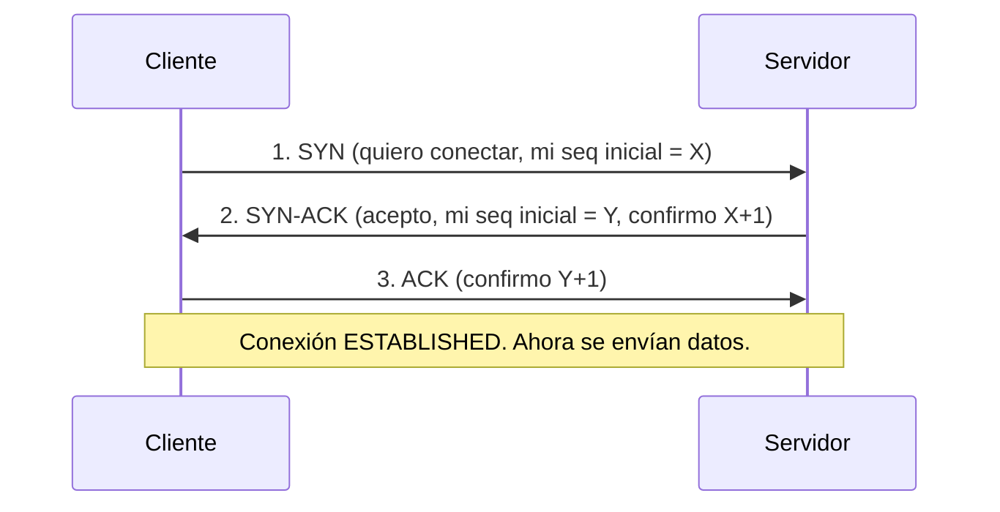

# Capa de transporte

**Resumen.** La capa de transporte lleva los datos **de un proceso concreto a otro proceso concreto**
del equipo destino, usando **puertos**. Sus dos protocolos son **TCP** (fiable, orientado a conexión)
y **UDP** (rápido, sin conexión). Aquí verás el *three-way handshake* de TCP, sus flags, el control de
flujo, UDP, la comparación entre ambos, los rangos de puertos y los estados de conexión.

## Objetivos de aprendizaje

- Explicar la diferencia entre **TCP** y **UDP**.
- Describir el **three-way handshake** de TCP y los flags de la cabecera.
- Entender los **números de secuencia** y el **control de flujo**.
- Clasificar los **puertos** en bien conocidos, registrados y dinámicos.
- Reconocer los **estados de conexión** típicos (LISTEN, ESTABLISHED, TIME_WAIT…).

**Tiempo estimado: 60–90 min**

## Requisitos previos

- **[05 · Capa de red](05-capa-de-red.md)**: TCP y UDP se encapsulan dentro de IP.
- **[01 · Modelos OSI y TCP/IP](01-modelos-osi-y-tcp-ip.md)**: recuerda que una **PDU** de transporte
  es un *segmento* (TCP) o un *datagrama* (UDP).

## Explicación

### Qué hace la capa de transporte

IP entrega paquetes **entre equipos** (de una IP a otra). Pero en un equipo hay muchos programas a la
vez: navegador, cliente de correo, reproductor… La capa de transporte añade los **puertos** para saber
a **qué programa** van los datos.

- **IP** = a qué **máquina**.
- **Puerto** = a qué **programa** dentro de esa máquina.

Una **conexión** se identifica por la combinación:

```text
IP origen : puerto origen  ↔  IP destino : puerto destino
```

### TCP: fiable y orientado a conexión

**TCP** (Transmission Control Protocol) garantiza que los datos:

- **Llegan** (si no, se retransmiten).
- **Llegan en orden**.
- **Sin errores** (comprueba con suma de control).
- Con **control de flujo** (no ahoga al receptor).

A cambio, tiene más sobrecarga y algo más de latencia. Se usa en: web (HTTP/HTTPS), correo, SSH, FTP…

### El three-way handshake (el "saludo" de TCP)

Antes de enviar datos, TCP establece la conexión con **tres pasos**:



- **1. SYN:** el cliente pide abrir conexión y manda su número de secuencia inicial.
- **2. SYN-ACK:** el servidor acepta y manda el suyo.
- **3. ACK:** el cliente confirma. A partir de aquí, la conexión está **ESTABLISHED**.

Para cerrar se usan **FIN** (y varios ACK) en las dos direcciones.

### Flags de TCP

Los **flags** son bits de la cabecera que indican la intención del segmento:

| Flag | Significado |
| --- | --- |
| **SYN** | Sincronizar: iniciar conexión. |
| **ACK** | Acuse de recibo: "recibido". |
| **FIN** | Finalizar: cerrar conexión ordenadamente. |
| **RST** | Reset: cortar la conexión de golpe (error o rechazo). |
| **PSH** | Push: entrega los datos a la aplicación de inmediato. |
| **URG** | Urgent: hay datos urgentes señalados. |

### Números de secuencia y acuse de recibo

Cada byte enviado tiene un **número de secuencia**. El receptor responde con un **ACK** indicando qué
número espera a continuación. Con esto:

- TCP sabe si falta algo (un hueco en la secuencia → **retransmite**).
- Puede **ordenar** los segmentos aunque lleguen desordenados.
- Puede **detectar duplicados**.

### Control de flujo y ventana

El receptor anuncia en su cabecera una **ventana** (window): cuántos bytes está dispuesto a recibir
antes de confirmar. El emisor **no envía más de la cuenta**, así evita saturar a un receptor lento.
La variante moderna, con **control de congestión**, ajusta el ritmo según la red.

### UDP: rápido y sin conexión

**UDP** (User Datagram Protocol):

- **No** establece conexión (no hay handshake).
- **No** garantiza entrega ni orden.
- **No** retransmite.
- Es **más ligero y rápido**.

Se usa donde prima la velocidad o donde la propia aplicación gestiona la fiabilidad: **DNS**, **DHCP**,
streaming de vídeo/audio, VoIP, juegos en línea, NTP…

### TCP vs UDP

| Característica | TCP | UDP |
| --- | --- | --- |
| Conexión | Orientado a conexión (handshake) | Sin conexión |
| Fiabilidad | Sí (retransmite) | No |
| Orden | Sí | No garantizado |
| Control de flujo/congestión | Sí | No |
| Velocidad | Menor (más sobrecarga) | Mayor |
| Cabecera | 20+ bytes | 8 bytes |
| Ejemplos | HTTP/HTTPS, SSH, SMTP, FTP | DNS, DHCP, VoIP, streaming |

### Puertos: rangos

Los puertos son números de 16 bits (0–65535) y se agrupan en tres rangos:

| Rango | Nombre | Uso |
| --- | --- | --- |
| 0 – 1023 | **Bien conocidos** (well-known) | Servicios estándar (80 HTTP, 22 SSH…). En Linux, abrirlos requiere privilegios. |
| 1024 – 49151 | **Registrados** | Aplicaciones concretas registradas ante la IANA (3306 MySQL…). |
| 49152 – 65535 | **Dinámicos / efímeros** | Puertos temporales que usa el cliente para sus conexiones salientes. |

Cuando tu navegador abre una web, usa un puerto **efímero** como origen (por ejemplo 51500) y el
puerto **80/443** como destino.

### Estados de conexión TCP

Un socket TCP pasa por distintos **estados**. Los más importantes al mirar `ss` o `netstat`:

| Estado | Significado |
| --- | --- |
| **LISTEN** | El servicio está escuchando en ese puerto, esperando conexiones. |
| **SYN-SENT** | Se envió el SYN y se espera el SYN-ACK. |
| **SYN-RECEIVED** | Se recibió un SYN y se respondió SYN-ACK. |
| **ESTABLISHED** | Conexión abierta; se intercambian datos. |
| **FIN-WAIT-1/2** | Se envió FIN y se espera cierre. |
| **CLOSE-WAIT** | El otro extremo pidió cerrar y esperas cerrar tú. |
| **CLOSING / LAST-ACK** | Estados de cierre poco frecuentes. |
| **TIME-WAIT** | Espera tras cerrar, para asegurar que los ACK finales llegan. |
| **CLOSED** | Sin conexión. |

!!! tip "Pista para pentesting"
    Ver **LISTEN** en un puerto es la señal de que hay un **servicio escuchando**. Eso es lo que busca
    un escáner de puertos (lo verás con Nmap en Nivel 2). Conocer los estados ayuda a interpretar el
    resultado de un escaneo.

## Ejemplos prácticos

### Ver puertos a la escucha y conexiones

```bash
ss -tuln
```

Salida de ejemplo:

```text
Netid State  Local Address:Port   Peer Address:Port
udp   UNCONN 0.0.0.0:68            0.0.0.0:*
tcp   LISTEN 0.0.0.0:22            0.0.0.0:*
tcp   LISTEN 127.0.0.1:631         0.0.0.0:*
```

Línea a línea:

- `-t` TCP, `-u` UDP, `-l` solo escuchas (LISTEN), `-n` muestra números (no nombres).
- `tcp LISTEN 0.0.0.0:22`: hay algo escuchando en el puerto **22 (SSH)** en **todas** las interfaces
  (`0.0.0.0`).
- `udp UNCONN 0.0.0.0:68`: puerto 68 de **DHCP** (cliente).
- `127.0.0.1:631`: escucha **solo** en loopback (servicio local de impresión), no accesible desde
  fuera.

### Ver conexiones establecidas

```bash
ss -tan state established
```

Salida de ejemplo:

```text
State       Recv-Q Send-Q  Local Address:Port    Peer Address:Port
ESTAB       0      0       192.168.1.50:49214    93.184.216.34:443
```

La conexión va de tu puerto **efímero** `49214` al puerto `443` (HTTPS) del servidor. Ese es el patrón
típico de una conexión saliente.

## Errores comunes

- **Confundir puerto con IP.** La IP identifica el equipo; el puerto, el programa.
- **Creer que UDP "es malo".** No: es la elección correcta cuando la rapidez importa más que la
  garantía de entrega.
- **Pensar que un puerto abierto = servicio vulnerable.** Abierto = hay algo escuchando; vulnerable es
  otra cosa.
- **Ver "SYN-RECEIVED" y asustarse.** Muchas veces es solo una conexión a medio establecer.
- **Olvidar que los puertos bien conocidos suelen estar por debajo de 1024.**

## Ejercicios

### Ejercicio 1

¿Por qué HTTP usa TCP y no UDP?

??? success "Solución"
    Porque las páginas web deben llegar **completas y en orden**: si falta un fragmento, la web se ve
    mal. TCP garantiza entrega, orden y retransmisión; UDP no.

### Ejercicio 2

Describe los tres pasos del three-way handshake y qué flags se usan en cada uno.

??? success "Solución"
    1. **SYN** del cliente (pide conexión + número de secuencia inicial).
    2. **SYN-ACK** del servidor (acepta + su número de secuencia + ACK del del cliente).
    3. **ACK** del cliente (confirma el del servidor). La conexión queda **ESTABLISHED**.

### Ejercicio 3

¿Qué diferencia hay entre un puerto bien conocido y uno dinámico? Pon un ejemplo de cada.

??? success "Solución"
    El **bien conocido** (0–1023) está reservado para servicios estándar y suele abrirlo el servidor;
    ejemplo: **443 (HTTPS)**. El **dinámico/efímero** (49152–65535) lo usa el cliente como puerto
    temporal de origen; ejemplo: **51500**.

### Ejercicio 4

¿Qué significan los flags RST, FIN y PSH?

??? success "Solución"
    - **RST**: reset, corta la conexión de golpe (por error o rechazo).
    - **FIN**: finaliza la conexión de forma ordenada.
    - **PSH**: push, entrega los datos a la aplicación inmediatamente sin esperar a llenar el búfer.

### Ejercicio 5

¿Para qué sirve el número de secuencia en TCP?

??? success "Solución"
    Para que el receptor sepa en qué orden van los segmentos, detecte **pérdidas** (huecos) y
    **duplicados**, y para que el emisor sepa qué debe **retransmitir**.

### Ejercicio 6

Observas un socket en estado **LISTEN** en el puerto 3306. ¿Qué indica a nivel de seguridad?

??? success "Solución"
    Que hay un **servicio escuchando** en el puerto 3306 (habitualmente MySQL). Desde el punto de vista
    de un pentester, es un objetivo a investigar; desde el de un administrador, algo a revisar (¿debería
    estar expuesto?, ¿está actualizado?, ¿está protegido por firewall?).

### Ejercicio 7

Ordena de menor a mayor velocidad esperada y justifica: TCP o UDP.

??? success "Solución"
    **UDP es más rápido** (menos sobrecarga: sin handshake, cabecera de 8 bytes, sin retransmisiones),
    pero también menos fiable. TCP es más lento porque garantiza entrega, orden y control de flujo y
    congestión.

## Resumen

- La capa de transporte usa **puertos** para llevar los datos al **programa** correcto.
- **TCP** es fiable y orientado a conexión: handshake (**SYN, SYN-ACK, ACK**), secuencias, ACK, control
  de flujo.
- **UDP** es sin conexión, ligero y rápido, pero sin garantías.
- Los **puertos** se reparten en bien conocidos (0–1023), registrados (1024–49151) y dinámicos
  (49152–65535).
- Los sockets pasan por **estados**: LISTEN, SYN-SENT, ESTABLISHED, TIME-WAIT…

## Checklist

- [ ] Explico por qué IP necesita puertos.
- [ ] Describo el three-way handshake con sus flags.
- [ ] Distingo los flags SYN, ACK, FIN, RST, PSH, URG.
- [ ] Comparo TCP y UDP y sé cuándo se usa cada uno.
- [ ] Clasifico un puerto en su rango.
- [ ] Reconozco los estados LISTEN, ESTABLISHED y TIME-WAIT.

## Para ir más allá

- **RFC 793 — Transmission Control Protocol (TCP)** — especificación oficial. Tipo: documentación
  oficial · Inglés (EN) · **Gratis**. <https://www.rfc-editor.org>
- **RFC 768 — User Datagram Protocol (UDP)** — especificación oficial. Tipo: documentación oficial ·
  Inglés (EN) · **Gratis**. <https://www.rfc-editor.org>
- **`ss` en man7.org** — página de manual del comando. Tipo: documentación · Inglés (EN) · **Gratis**.
  <https://man7.org>
- **Wireshark** — captura un handshake TCP y verás SYN, SYN-ACK y ACK reales. Tipo: herramienta ·
  Inglés (EN) · **Gratis**. <https://www.wireshark.org>

## Siguiente paso

Sube la última capa del modelo y descubre a qué puertos y de qué forma hablan los servicios reales:
**[07 · Protocolos de aplicación](07-protocolos-de-aplicacion.md)**.
