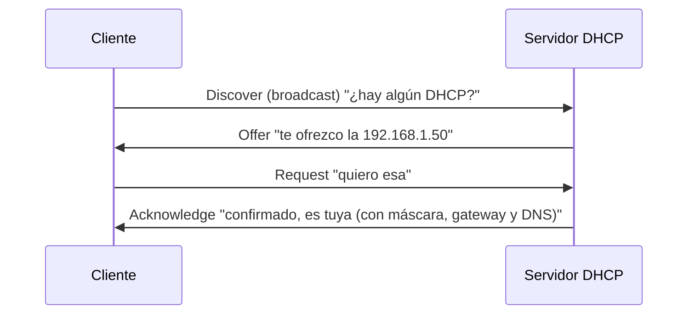

# Protocolos de aplicación

**Resumen.** Los protocolos de aplicación son los que hablan los servicios "de verdad": la web, el
correo, el DNS, los ficheros compartidos… Cada uno tiene uno o varios **puertos**, una **función** y
un nivel de **seguridad** (casi siempre, si no cifra, es inseguro). Esta página es una referencia: te
dará el puerto, para qué sirve y por qué algunos son un problema.

## Objetivos de aprendizaje

- Asociar cada protocolo con su **puerto(s)** habitual y su **función**.
- Distinguir los protocolos que **cifran** de los que van en **claro**.
- Conocer los **tipos de registros DNS** y cómo se resuelve un nombre.
- Entender **DHCP** y su secuencia DORA.
- Manejar lo básico de **HTTP/HTTPS** (métodos, códigos de estado, cabeceras, cookies).

**Tiempo estimado: 90–120 min**

## Requisitos previos

- **[06 · Capa de transporte](06-capa-de-transporte.md)**: conceptos de puerto, TCP y UDP.
- **[02 · Direccionamiento IP y MAC](02-direccionamiento-ip-y-mac.md)**: para entender DHCP y DNS.

!!! danger "Recordatorio ético"
    Conocer estos protocolos es imprescindible para defender y para auditar **con autorización**.
    Muchos de ellos (Telnet, FTP, SMB, SNMP) tienen debilidades conocidas; aquí se describen para
    diagnosticar y proteger, no para atacar. Ver **[00 · Ética y legalidad](../00-etica-y-legalidad.md)**.

## Explicación

### DNS — el "listín telefónico" de Internet

El **DNS** (Domain Name System) traduce **nombres** (`www.ejemplo.com`) a **direcciones IP**. Sin él,
tendrías que memorizar IPs.

- **Puerto:** 53, en **UDP** para consultas normales y en **TCP** para transferencias de zona y
  respuestas grandes.
- **Seguridad:** el DNS clásico **no cifra** ni autentica las respuestas, así que es vulnerable a
  suplantación (DNS spoofing) y a espiar qué dominios consultas. Existen variantes cifradas: **DoT**
  (DNS over TLS, puerto 853) y **DoH** (DNS over HTTPS, puerto 443), que sí protegen el contenido de
  la consulta.

**Tipos de registros DNS** principales:

| Registro | Para qué |
| --- | --- |
| **A** | Nombre → dirección **IPv4**. |
| **AAAA** | Nombre → dirección **IPv6**. |
| **CNAME** | Alias: un nombre apunta a **otro nombre**. |
| **MX** | Servidor de **correo** del dominio. |
| **TXT** | Texto libre: verificación de dominio, SPF, DKIM… |
| **NS** | Servidores **de nombres** (los que gestionan la zona). |
| **PTR** | Resolución **inversa**: IP → nombre. |
| **SOA** | Información de autoridad de la zona. |
| **SRV** | Servicio concreto en un host y puerto (habitual en AD). |

**Cómo se resuelve un nombre** (resumen):

1. El equipo mira su **caché** local. Si no está, pregunta a su **resolutor** (normalmente el router o
   el DNS del proveedor).
2. El resolutor, si no lo tiene en caché, pregunta a los servidores **raíz**, luego al del dominio de
   nivel superior (`.com`) y luego al **autoritativo** del dominio.
3. Devuelve la IP y se guarda en caché durante un tiempo (**TTL** del registro).

### DHCP — direcciones IP automáticas

El **DHCP** (Dynamic Host Configuration Protocol) reparte automáticamente direcciones IP y otros datos
(máscara, puerta de enlace, servidores DNS).

- **Puertos:** 67 (servidor) y 68 (cliente), sobre **UDP**.
- **Seguridad:** no autentica; un **Rogue DHCP** (servidor DHCP falso) puede repartir configuración
  maliciosa. Se mitiga con **DHCP snooping**.

La secuencia clásica se recuerda como **DORA**:



### HTTP y HTTPS — la web

**HTTP** (Hypertext Transfer Protocol) es el protocolo de la web.

- **Puertos:** 80 (HTTP) y 443 (HTTPS).
- **Seguridad:** HTTP va **en claro** (cualquiera en la red puede leerlo). **HTTPS** es HTTP dentro de
  **TLS**: cifrado, íntegro y autenticado con certificados. Hoy HTTPS es el estándar.

**Métodos HTTP** más comunes:

| Método | Para qué |
| --- | --- |
| **GET** | Pedir un recurso (una página, una imagen). No debe modificar nada. |
| **POST** | Enviar datos (formularios). Puede crear recursos. |
| **PUT** | Crear o reemplazar un recurso. |
| **PATCH** | Modificar parcialmente un recurso. |
| **DELETE** | Borrar un recurso. |
| **HEAD** | Como GET, pero solo cabeceras. |
| **OPTIONS** | Preguntar qué métodos admite el recurso (lo usa CORS). |

**Códigos de estado** (los verás a diario en seguridad web):

| Grupo | Significado | Ejemplos |
| --- | --- | --- |
| **1xx** | Informativos | 100 Continue |
| **2xx** | Éxito | 200 OK, 201 Created, 204 No Content |
| **3xx** | Redirecciones | 301 Moved Permanently, 302 Found, 304 Not Modified |
| **4xx** | Error del cliente | 400 Bad Request, 401 Unauthorized, 403 Forbidden, 404 Not Found, 405 Method Not Allowed |
| **5xx** | Error del servidor | 500 Internal Server Error, 502 Bad Gateway, 503 Service Unavailable |

**Cabeceras HTTP** (headers) frecuentes:

| Cabecera | Para qué |
| --- | --- |
| **Host** | Dominio solicitado (permite varios sitios en una IP). |
| **User-Agent** | Cliente que hace la petición (navegador, bot…). |
| **Accept** | Qué tipos de contenido acepta el cliente. |
| **Content-Type** | Tipo del contenido enviado (p. ej. `application/json`). |
| **Content-Length** | Tamaño del contenido. |
| **Cookie** | Cookies que el cliente envía al servidor. |
| **Set-Cookie** | Cookie que el servidor pide guardar en el cliente. |
| **Authorization** | Credenciales (por ejemplo, un token Bearer). |
| **Location** | URL de destino en redirecciones (3xx). |

**Cookies y sus atributos de seguridad:** el servidor las envía con `Set-Cookie`. Atributos
importantes:

- **HttpOnly**: la cookie **no** es accesible por JavaScript del navegador (mitiga robo por XSS).
- **Secure**: solo se envía por **HTTPS**.
- **SameSite** (`Strict`/`Lax`/`None`): limita el envío en peticiones de otros sitios (mitiga CSRF).
- **Domain** y **Path**: a qué dominio y ruta aplica.
- **Expires / Max-Age**: cuándo caduca.

### FTP, TFTP y SMB — transferencia de ficheros

- **FTP** (File Transfer Protocol): puerto **21** para el control y **20** para datos en modo activo.
  Va **en claro**, credenciales incluidas. Existe **FTPS** (FTP sobre TLS). Alternativa moderna y
  segura: **SFTP** (FTP sobre SSH) o **SCP**.
- **TFTP**: puerto **69/UDP**. Versión mínima de FTP, sin autenticación, usada para arrancar
  dispositivos. **Inseguro**; solo en redes de confianza.
- **SMB** (Server Message Block): puerto **445** (y NetBIOS 137–139 en versiones antiguas). Comparte
  ficheros e impresoras en Windows. Debe ir sobre redes internas; su versión **SMBv1** es obsoleta y ha
  acumulado vulnerabilidades críticas, por lo que se recomienda SMBv2/v3.

### Acceso remoto: SSH, Telnet, RDP

- **SSH** (Secure Shell): puerto **22**. Acceso remoto **cifrado** y autenticado. Es el estándar de
  administración segura en Linux. **Seguro** (si está bien configurado: sin contraseñas débiles).
- **Telnet**: puerto **23**. Acceso remoto **en claro**. **Inseguro**: cualquiera ve usuario y
  contraseña. Obsoleto; se usa hoy casi solo para depurar protocolos.
- **RDP** (Remote Desktop Protocol): puerto **3389**. Escritorio remoto de Windows. Cifra, pero es un
  objetivo habitual de ataques de fuerza bruta; se recomienda no exponerlo a Internet.

### Correo: SMTP, IMAP y POP3

- **SMTP** (envío): puerto **25** para servidor a servidor; **587** para envío autenticado por clientes
  (submission) y **465** para SMTP sobre TLS implícito. Por sí mismo va **en claro** en el 25.
- **IMAP** (recepción, sincroniza en el servidor): puerto **143**, o **993** con TLS.
- **POP3** (recepción, suele descargar y borrar del servidor): puerto **110**, o **995** con TLS.

Diferencia práctica: **IMAP** mantiene el correo en el servidor y lo sincroniza entre dispositivos;
**POP3** normalmente descarga a un solo equipo.

### SNMP, LDAP y NTP

- **SNMP** (Simple Network Management Protocol): puertos **161/UDP** (consultas) y **162** (traps o
  avisos). Gestiona y monitoriza dispositivos de red. Las versiones **v1 y v2c** usan una
  "community" que viaja en claro (mal); **v3** añade autenticación y cifrado.
- **LDAP** (Lightweight Directory Access Protocol): puerto **389**, o **636** con TLS (LDAPS).
  Consulta directorios, como **Active Directory**. Sin TLS, va en claro.
- **NTP** (Network Time Protocol): puerto **123/UDP**. Sincroniza el reloj. Fundamental para que los
  registros (logs) y los certificados cuadren. Sin protección (NTS) no autentica el origen del tiempo.

### Tabla resumen grande

| Protocolo | Puerto(s) | Función | ¿Cifra? | Nota de seguridad |
| --- | --- | --- | --- | --- |
| DNS | 53 (UDP/TCP) | Resolver nombres a IP | No (DoT/DoH sí) | Vulnerable a spoofing; usar DoT/DoH |
| DHCP | 67/68 (UDP) | Repartir IP automática | No | Riesgo de Rogue DHCP |
| HTTP | 80 | Web | No | Texto en claro |
| HTTPS | 443 | Web cifrada | Sí (TLS) | Estándar actual |
| FTP | 21 (+20 datos) | Transferir ficheros | No | Credenciales en claro; usar SFTP |
| TFTP | 69 (UDP) | Transferencia mínima | No | Sin autenticación |
| SFTP/SCP | sobre SSH (22) | Transferir ficheros cifrado | Sí | Recomendado |
| SSH | 22 | Acceso remoto | Sí | Estándar seguro |
| Telnet | 23 | Acceso remoto | No | Obsoleto e inseguro |
| RDP | 3389 | Escritorio remoto | Sí | Objetivo de fuerza bruta |
| SMTP | 25 / 587 / 465 | Enviar correo | No / No / Sí | 587 con STARTTLS, 465 con TLS |
| IMAP | 143 / 993 | Recibir correo (sincroniza) | No / Sí | Preferir 993 |
| POP3 | 110 / 995 | Recibir correo (descarga) | No / Sí | Preferir 995 |
| SMB | 445 (137–139) | Ficheros/impresoras | Según versión | Evitar SMBv1 |
| SNMP | 161 / 162 (UDP) | Monitorizar red | v3 sí | v1/v2c en claro |
| LDAP | 389 / 636 | Directorio | No / Sí | Preferir 636 (LDAPS) |
| NTP | 123 (UDP) | Sincronizar hora | No (NTS sí) | Sin NTS no autentica |
| Kerberos | 88 | Autenticación (AD) | Parcial | Núcleo de Active Directory |
| WHOIS | 43 | Datos de registro de dominios | No | Consulta pública |

!!! tip "Regla de oro de la seguridad de protocolos"
    **Si el nombre no lleva una "S" de seguro (HTTPS, SSH, LDAPS), sospecha.** Y aunque la lleve,
    comprueba que la configuración es correcta.

## Ejemplos prácticos

### Consultar registros DNS

```bash
dig MX ejemplo.com +short
```

Salida de ejemplo:

```text
10 mail.ejemplo.com.
```

Consulta los registros **MX** (servidores de correo) del dominio. `+short` muestra solo la respuesta
resumida. Si no tienes `dig`, usa `nslookup -type=MX ejemplo.com`.

### Ver la petición HTTP de una web (solo cabeceras)

```bash
curl -I https://example.com
```

Salida de ejemplo:

```text
HTTP/1.1 200 OK
Content-Type: text/html; charset=UTF-8
Content-Length: 1256
Date: ...
```

`-I` hace una petición **HEAD**: trae solo las cabeceras. Aquí ves el **código de estado** (`200 OK`),
el `Content-Type` y el `Content-Length`. Usa siempre tu propio dominio o uno público de pruebas;
consulta las condiciones de uso antes.

### Consultar SNMP (solo en tu laboratorio)

```bash
snmpwalk -v3 -l authPriv -u usuario -a SHA -A contraseña -x AES -X contraseña 192.168.1.1
```

Solo tiene sentido contra un dispositivo **tuyo**. Consulta el manual (`man snmpwalk`) para las
opciones; no inventes credenciales contra equipos ajenos.

## Errores comunes

- **Confundir HTTP con HTTPS.** El cifrado lo aporta **TLS**, no HTTP.
- **Pensar que el puerto 80 "es seguro" porque es común.** Va en claro como cualquier HTTP.
- **Usar Telnet o FTP "porque es más simple".** Estás enviando credenciales legibles por cualquiera.
- **Descuidar los atributos de las cookies.** Sin `Secure`, `HttpOnly` y `SameSite`, una sesión es
  mucho más fácil de robar.
- **Exponer RDP o SMB a Internet.** Son objetivos constantes de fuerza bruta y exploits.
- **Creer que SNMP es solo "de lectura".** Con community débil puede permitir cambiar configuración.

## Ejercicios

### Ejercicio 1

¿Qué registro DNS usarías para apuntar `blog.ejemplo.com` a `ejemplo.com`? ¿Y para indicar el servidor
de correo?

??? success "Solución"
    Para el alias, un **CNAME**: `blog.ejemplo.com` → `ejemplo.com`. Para el servidor de correo, un
    **MX**.

### Ejercicio 2

Explica la secuencia DORA de DHCP.

??? success "Solución"
    **D**iscover (el cliente busca un DHCP en broadcast), **O**ffer (el servidor ofrece una IP),
    **R**equest (el cliente pide esa IP), **A**cknowledge (el servidor confirma y envía máscara,
    puerta de enlace y DNS).

### Ejercicio 3

Un servidor responde `403 Forbidden`. ¿Es un error del cliente o del servidor? ¿Y `502`?

??? success "Solución"
    `403` es un **error del cliente** (grupo 4xx): el servidor entendió la petición pero **deniega** el
    acceso. `502 Bad Gateway` es un **error del servidor** (grupo 5xx): un proxy/gateway recibió una
    respuesta inválida de otro servidor.

### Ejercicio 4

¿Por qué HTTPS es más seguro que HTTP? Nombra dos propiedades.

??? success "Solución"
    Porque HTTP viaja dentro de **TLS**, que aporta: **confidencialidad** (cifrado, nadie lee el
    contenido), **integridad** (nadie lo modifica sin detectarse) y **autenticación** (el certificado
    acredita que hablas con el sitio correcto). Elige dos de estas tres.

### Ejercicio 5

¿Qué puerto usa IMAP con cifrado y qué ventaja tiene frente a POP3?

??? success "Solución"
    IMAP seguro usa el **993** (IMAPS). Ventaja: **sincroniza** el correo en el servidor, así lo ves
    igual desde varios dispositivos; POP3 normalmente **descarga** a un solo equipo.

### Ejercicio 6

Indica si cada protocolo cifra: Telnet, SSH, FTP, SFTP, HTTP, HTTPS.

??? success "Solución"
    - Telnet → **no** cifra.
    - SSH → **sí** cifra.
    - FTP → **no** cifra.
    - SFTP → **sí** cifra (va sobre SSH).
    - HTTP → **no** cifra.
    - HTTPS → **sí** cifra (TLS).

### Ejercicio 7

¿Qué atributo de cookie impide que JavaScript del navegador la lea? ¿Y cuál impide que se envíe por
HTTP sin cifrar?

??? success "Solución"
    **HttpOnly** impide el acceso por JavaScript (protege ante XSS). **Secure** impide enviarla por
    HTTP sin cifrar (solo por HTTPS).

### Ejercicio 8

¿Por qué SNMP v1/v2c se considera inseguro y qué lo mejora?

??? success "Solución"
    Porque usan una **community** (una especie de contraseña) que viaja **en claro** y se comparte,
    además de no cifrar los datos. **SNMPv3** añade **autenticación** y **cifrado**, por lo que es la
    versión recomendada.

## Resumen

- Cada servicio de aplicación tiene su **puerto** y su **nivel de seguridad**.
- **DNS** traduce nombres a IP (registros A, AAAA, CNAME, MX, TXT, NS…).
- **DHCP** reparte configuración con la secuencia **DORA**.
- **HTTP** va en claro; **HTTPS** lo cifra con TLS. Métodos, códigos 1xx–5xx y cookies con atributos
  de seguridad.
- **FTP/TFTP/Telnet/SNMP v1-v2c/LDAP sin TLS/SMTP-POP3-IMAP sin TLS** van **en claro**.
- **SSH, SFTP, HTTPS, IMAPS, POP3S, LDAPS, SNMPv3** aportan cifrado.

## Checklist

- [ ] Sé el puerto de los protocolos principales.
- [ ] Reconozco los tipos de registro DNS.
- [ ] Explico DORA y la función del DHCP.
- [ ] Distingo métodos HTTP y grupos de códigos de estado.
- [ ] Entiendo cabeceras y atributos de seguridad de cookies.
- [ ] Identifico a simple vista qué protocolos cifran y cuáles no.

## Para ir más allá

- **RFC 1035 (DNS)**, **RFC 2131 (DHCP)**, **RFC 9110 (HTTP Semantics)** — especificaciones oficiales.
  Tipo: documentación oficial · Inglés (EN) · **Gratis**. <https://www.rfc-editor.org>
- **MDN Web Docs** — referencia excelente de HTTP, cabeceras, métodos y códigos. Tipo: referencia ·
  Español/Inglés (EN) · **Gratis**. <https://developer.mozilla.org>
- **OWASP** — guías sobre seguridad web y de aplicaciones. Tipo: documentación · Inglés (EN) ·
  **Gratis**. <https://owasp.org>
- **Wireshark** — captura DNS, HTTP y DHCP y verás estos protocolos en acción. Tipo: herramienta ·
  Inglés (EN) · **Gratis**. <https://www.wireshark.org>

## Siguiente paso

Ya sabes qué protocolos hay y cuáles son inseguros. Aprende ahora **cómo se protege el tráfico que
viaja**: sigue con **[08 · Seguridad en tránsito](08-seguridad-en-transito.md)**.
