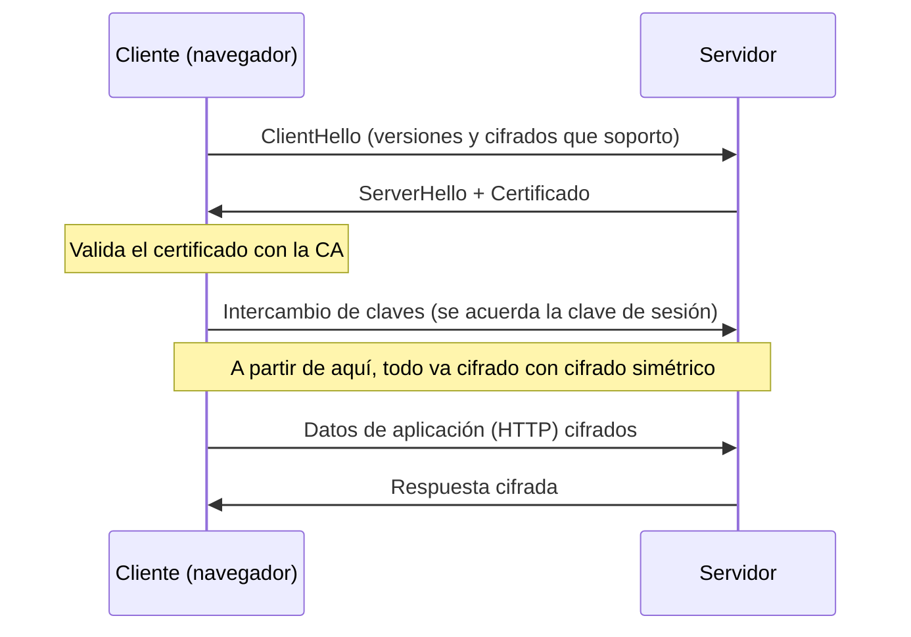

# Seguridad en tránsito

**Resumen.** Cuando los datos viajan por una red no confiable, hay que protegerlos. Para eso existen
el **cifrado** (simétrico y asimétrico), el **hashing**, los **certificados** y **TLS**, que es lo que
hay detrás del candado de HTTPS. Y para proteger todo el tráfico de una conexión, la **VPN**. Aquí
verás las ideas, sin fórmulas raras ni matemáticas inventadas.

## Objetivos de aprendizaje

- Diferenciar **cifrado simétrico** y **asimétrico** y por qué se usan juntos.
- Entender qué es un **hash** y para qué sirve.
- Explicar a grandes rasgos el **handshake de TLS** y qué aporta (confidencialidad, integridad,
  autenticación).
- Entender los **certificados digitales** y el papel de las **Autoridades de Certificación (CA)**.
- Saber qué es una **VPN** a nivel general.

**Tiempo estimado: 60–90 min**

## Requisitos previos

- **[07 · Protocolos de aplicación](07-protocolos-de-aplicacion.md)**: HTTPS, DoT/DoH y SFTP se apoyan en
  lo que verás aquí.
- **[06 · Capa de transporte](06-capa-de-transporte.md)**: TLS funciona sobre TCP.

## Explicación

### Los tres objetivos: CIA

La seguridad de la información se suele resumir en tres propiedades (la "triada CIA" en inglés):

- **Confidencialidad:** solo quien debe puede **leer** la información.
- **Integridad:** la información **no se altera** sin que se note.
- **Disponibilidad:** la información y los servicios están **accesibles** cuando se necesitan.

El cifrado y el hashing que ves aquí atacan sobre todo las dos primeras.

### Cifrado simétrico

En el **cifrado simétrico** se usa **una misma clave** para cifrar y para descifrar.

- **Ventaja:** es **rápido**, ideal para grandes cantidades de datos.
- **Inconveniente:** hay que **compartir la clave** de forma segura. Si alguien la intercepta, todo
  queda comprometido.
- **Ejemplos de algoritmos:** **AES** (estándar actual), ChaCha20. (Algoritmos antiguos como DES/3DES
  se consideran obsoletos.)

Analogía: es como una caja fuerte con una única llave, que hay que darle también a la otra persona.

### Cifrado asimétrico

En el **cifrado asimétrico** cada parte tiene **dos claves**:

- **Clave pública:** se puede repartir libremente.
- **Clave privada:** se guarda en secreto.

Están relacionadas matemáticamente: lo que se cifra con una, se descifra con la otra. Esto permite dos
cosas:

1. **Confidencialidad:** cifro con la **pública** del destinatario; solo su **privada** lo descifra.
2. **Firmas digitales:** firmo con mi **privada**; cualquiera verifica con mi **pública** que el
   mensaje es mío y no se ha alterado.

- **Ventaja:** no hay que compartir ninguna clave secreta de antemano.
- **Inconveniente:** es **mucho más lento** que el simétrico.
- **Ejemplos de algoritmos:** **RSA**, **ECDSA** (curvas elípticas).

Analogía: la pública es un buzón con ranura (cualquiera echa una carta), y la privada es la llave para
abrirlo (solo el dueño la tiene).

!!! tip "Cómo se combinan"
    Como el asimétrico es lento y el simétrico necesita intercambiar la clave, **se usan juntos**: el
    asimétrico sirve para **intercambiar de forma segura una clave simétrica**, y luego se cifra todo
    con esa clave simétrica (rápida). Esto es exactamente lo que hace TLS.

### Hashing

Una **función de hash** toma unos datos y produce una **huella** de tamaño fijo. Propiedades:

- **Determinista:** los mismos datos dan siempre el mismo hash.
- **Unidireccional:** del hash no se puede volver a los datos.
- **Sensible:** cambiar un solo bit cambia el hash por completo (efecto avalancha).
- **Resistente a colisiones:** es muy difícil encontrar dos entradas con el mismo hash.

**No es cifrado**: no se "descifra". Sirve para:

- Comprobar **integridad** (¿el fichero cambió?).
- Guardar **contraseñas** (se guarda el hash, no la contraseña; mejor con *sal* y algoritmos lentos).
- **Firmas digitales** (firmar el hash del mensaje).

Algoritmos comunes: **SHA-256**, **SHA-3**. Los antiguos **MD5** y **SHA-1** ya no son seguros para
usos de seguridad.

### Certificados y Autoridades de Certificación (CA)

El cifrado asimétrico resuelve el "cómo" cifrar, pero no el "¿con quién estoy hablando de verdad?".
Para eso están los **certificados digitales**:

- Un **certificado** asocia una **clave pública** con una **identidad** (un dominio, por ejemplo
  `ejemplo.com`), y va **firmado** por una entidad de confianza.
- Una **CA** (Certificate Authority, Autoridad de Certificación) es esa entidad de confianza. Los
  navegadores y sistemas llevan una lista de **CA raíz** de confianza.
- **Cadena de confianza:** la CA raíz firma una CA intermedia, que firma el certificado del sitio. El
  navegador valida toda la cadena.

Qué comprueba el navegador al recibir un certificado:

1. Que está firmado por una CA de confianza (cadena válida).
2. Que **no ha caducado** (fechas de validez).
3. Que el nombre coincide con el **dominio** al que te conectas.
4. Que **no está revocado** (listas CRL u OCSP).

Si algo falla, el navegador avisa con un error de certificado. **No lo ignores** sin motivo.

### TLS/SSL: qué es y qué aporta

**TLS** (Transport Layer Security) es el protocolo que cifra la comunicación en tránsito. Su
predecesor fue **SSL** (obsoleto; hoy se dice "SSL" por costumbre, pero se usa TLS). Aporta las tres
propiedades:

- **Confidencialidad** (cifrado).
- **Integridad** (no se altera sin detectarse).
- **Autenticación** (certificado del servidor).

Es lo que hay detrás del candado de **HTTPS**, pero también protege correo (SMTP/IMAP/POP3 con TLS),
**VPN**, etc.

### El handshake de TLS (alto nivel)

Antes de enviar datos, cliente y servidor "negocian". A grandes rasgos:



Puntos clave:

1. **Negociación:** cliente y servidor acuerdan versión de TLS y algoritmos.
2. **Autenticación:** el servidor presenta su **certificado**; el cliente lo valida.
3. **Acuerdo de clave:** se obtiene una **clave de sesión simétrica** sin que nadie más la conozca.
4. **Datos:** todo el tráfico va cifrado y con comprobación de integridad.

!!! note "Sobre las versiones"
    No afirmes "TLS 1.x es la última". Consulta siempre las versiones vigentes y recomendadas en
    fuentes oficiales como <https://www.rfc-editor.org> y la documentación del navegador o del
    servidor que uses.

### VPN: idea general

Una **VPN** (Virtual Private Network) crea un **túnel cifrado** entre tu equipo y una red remota a
través de una red no confiable (Internet). Usos típicos:

- **Acceso remoto:** teletrabajar y entrar en la red de la empresa como si estuvieras dentro.
- **Privacidad:** que el tráfico salga por otro punto y no lo vea la red local (WiFi público).
- **Site-to-site:** unir dos sedes de forma cifrada.

Concepto clave: todo el tráfico del túnel va **cifrado y autenticado**, de modo que quien lo
intercepte no puede leerlo. Ejemplos de tecnologías: **WireGuard**, **OpenVPN**, **IPsec**. Una VPN
**no** te hace anónimo ni te protege de malware: solo cifra el camino entre tú y el servidor VPN.

## Ejemplos prácticos

### Ver el certificado de un sitio con OpenSSL

```bash
openssl s_client -connect example.com:443 -servername example.com </dev/null
```

Salida de ejemplo (recortada):

```text
CONNECTED(00000003)
...
subject=CN = example.com
issuer=C = US, O = DigiCert Inc, CN = DigiCert Global G2 TLS RSA SHA256 ...
---
Verify return code: 0 (ok)
```

Línea a línea:

- `subject=CN = example.com`: el **titular** del certificado (a quién identifica). `CN` es *Common
  Name*.
- `issuer=...`: la **CA** que lo emitió (firmó).
- `Verify return code: 0 (ok)`: la validación de la cadena fue correcta.

Captura el certificado de **tu propio dominio** o de uno público de pruebas; no lo uses contra
servicios cuyo uso no tengas permitido.

### Calcular el hash de un fichero

```bash
sha256sum archivo.txt
```

Salida de ejemplo:

```text
a1b2c3d4e5f6...  archivo.txt
```

Si otra persona calcula el hash del mismo fichero y coincide, sabes que **no se ha alterado**. Si
cambia un solo carácter del fichero y repites el comando, el hash será **completamente distinto**.

## Errores comunes

- **Creer que el hash "se descifra".** No: el hash es unidireccional.
- **Pensar que HTTPS solo cifra.** También garantiza **integridad** y **autenticación**.
- **Ignorar avisos de certificado.** Un error de certificado puede indicar un ataque de
  intercepción; no lo saltes a la ligera.
- **Usar MD5/SHA-1 para seguridad.** Están obsoletos para firmas y contraseñas.
- **Confundir cifrado con hashing.** Cifrar es reversible (descifrar); el hash, no.
- **Creer que una VPN da anonimato total.** Cifra el túnel, pero el servidor VPN te ve y el proveedor
  de Internet ve que usas VPN.

## Ejercicios

### Ejercicio 1

¿Por qué TLS combina cifrado simétrico y asimétrico en lugar de usar solo uno?

??? success "Solución"
    Porque el **asimétrico** resuelve el intercambio seguro de una clave (aunque es lento), y el
    **simétrico** cifra los datos rápido. Juntos: se acuerda una clave simétrica mediante asimétrico y
    luego todo se cifra con esa clave rápida.

### Ejercicio 2

¿Cuál es la diferencia entre cifrar y aplicar un hash?

??? success "Solución"
    Cifrar es **reversible**: con la clave adecuada se recupera el mensaje original. El hash es
    **unidireccional**: no se puede volver atrás; solo sirve para comparar/comprobar.

### Ejercicio 3

¿Qué garantiza la firma digital que acompaña a un certificado?

??? success "Solución"
    Que el certificado lo emitió una **CA de confianza** y que **no ha sido alterado** desde que se
    emitió. Con la clave pública de la CA se verifica la firma.

### Ejercicio 4

Nombra las tres cosas que comprueba el navegador antes de aceptar un certificado.

??? success "Solución"
    (Elige tres) Que la **cadena de confianza** es válida (CA conocida), que **no ha caducado**, que el
    **nombre coincide** con el dominio, y que **no está revocado**.

### Ejercicio 5

¿Para qué sirve hashear una contraseña antes de guardarla?

??? success "Solución"
    Para no almacenar la contraseña en claro: si el atacante roba la base de datos, solo obtiene el
    hash, no la contraseña. Se usan **sales** (sal) y algoritmos **lentos** para dificultar los ataques
    por diccionario.

### Ejercicio 6

Explica con tus palabras qué hace una VPN y qué **no** hace.

??? success "Solución"
    **Hace:** crear un túnel **cifrado y autenticado** entre tu equipo y una red remota sobre Internet,
    protegiendo el tráfico. **No hace:** no te vuelve anónimo, no elimina el malware y no sustituye a
    un antivirus ni a un firewall.

### Ejercicio 7

Un navegador muestra un aviso de que el certificado ha caducado. ¿Qué haces y por qué?

??? success "Solución"
    **No** continuar sin verificar. La caducidad significa que la identidad ya no está respaldada por
    un certificado vigente; podría ser un error de administración **o** un intento de intercepción.
    Comprueba la fecha, el dominio y, si es tu servidor, renueva el certificado.

## Resumen

- **Confidencialidad, integridad y disponibilidad** son los tres objetivos básicos de la seguridad.
- **Cifrado simétrico:** una clave, rápido (AES). **Asimétrico:** par público/privado, lento (RSA,
  ECDSA); sirve también para **firmas**.
- **Hash:** huella unidireccional para integridad, contraseñas y firmas (SHA-256, SHA-3).
- **Certificados** y **CA** dan la **autenticación**; el navegador valida cadena, fechas, dominio y
  revocación.
- **TLS** combina todo: cifra (confidencialidad), protege (integridad) y autentica.
- **VPN**: túnel cifrado sobre una red no confiable; no es anonimato.

## Checklist

- [ ] Distingo cifrado simétrico y asimétrico.
- [ ] Explico por qué se combinan en TLS.
- [ ] Sé qué es un hash y en qué se diferencia del cifrado.
- [ ] Entiendo el papel de los certificados y las CA.
- [ ] Puedo describir el handshake de TLS a alto nivel.
- [ ] Explico qué es una VPN y qué no es.

## Para ir más allá

- **RFC 8446 — TLS 1.3** y **RFC 5280 — Certificados X.509** — especificaciones oficiales. Tipo:
  documentación oficial · Inglés (EN) · **Gratis**. <https://www.rfc-editor.org>
- **MDN Web Docs** — explicaciones claras de HTTPS y TLS orientadas a desarrolladores. Tipo:
  referencia · Español/Inglés (EN) · **Gratis**. <https://developer.mozilla.org>
- **OWASP** — guías de criptografía y buenas prácticas (Cheat Sheets). Tipo: documentación ·
  Inglés (EN) · **Gratis**. <https://owasp.org>
- **WireGuard** y **OpenVPN** — tecnologías de VPN de código abierto. Tipo: herramienta ·
  Inglés (EN) · **Gratis**. Enlaza solo al dominio raíz; si dudas, usa
  <https://www.kali.org> y <https://docs.docker.com> para practicar en laboratorio.

## Siguiente paso

Ya sabes cifrar y autenticar el tráfico. Ahora toca organizar y defender la red completa: sigue con
**[09 · Dispositivos, topologías y WiFi](09-dispositivos-topologias-y-wifi.md)**.
