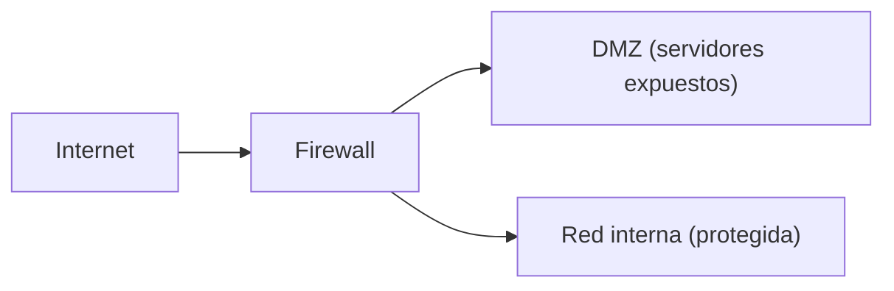

# Dispositivos, topologías y WiFi

**Resumen.** Una red no es solo cables y equipos: hay dispositivos que la **defienden** (firewall,
proxy, IDS/IPS), formas de **organizarla** (topologías) y una parte inalámbrica (WiFi) con su propia
seguridad. Aquí verás qué hace cada uno y cómo han evolucionado los estándares y los protocolos de
seguridad inalámbrica.

## Objetivos de aprendizaje

- Explicar qué hace un **firewall**, un **proxy**, un **IDS/IPS** y una **DMZ**.
- Reconocer las **topologías** de red más comunes y sus ventajas e inconvenientes.
- Conocer los **estándares WiFi** (802.11a/b/g/n/ac/ax) a nivel divulgativo.
- Diferenciar **WEP, WPA, WPA2 y WPA3** a nivel conceptual.

**Tiempo estimado: 60–90 min**

## Requisitos previos

- **[04 · Capa de enlace](04-capa-de-enlace.md)** y **[05 · Capa de red](05-capa-de-red.md)**: firewalls
  y topologías trabajan con MAC, IP, rutas y broadcast.
- **[08 · Seguridad en tránsito](08-seguridad-en-transito.md)**: la seguridad WiFi usa cifrado, así que
  conviene tenerlo fresco.

## Explicación

### Dispositivos de seguridad

**Firewall (cortafuegos):** controla qué tráfico puede pasar y cuál no, según **reglas**. Es la
primera línea de defensa en la frontera de una red.

- **Firewall de red:** filtra por IP, puerto y protocolo (capa 3/4). Los "stateful" recuerdan el estado
  de las conexiones.
- **Firewall de aplicación (WAF):** inspecciona el contenido HTTP para bloquear ataques web.
- **Firewall de host:** un programa en el propio equipo (por ejemplo, `ufw` o el de Windows).
- Política habitual: **denegar todo por defecto** y abrir solo lo necesario.

**Proxy:** intermediario entre los clientes y los servidores. El cliente habla con el proxy y el proxy
con el destino. Usos:

- **Filtrar** y registrar el tráfico de los usuarios (control de acceso a webs).
- **Cachear** contenido para ahorrar ancho de banda.
- **Anonimizar** o segmentar quién ve qué.
- Un **proxy inverso** protege y reparte carga entre servidores internos de cara al exterior.

**IDS/IPS (detección/prevención de intrusiones):**

- **IDS** (Intrusion Detection System): **detecta** y **avisa** (alerta) de actividad sospechosa. No
  bloquea.
- **IPS** (Intrusion Prevention System): además de detectar, **bloquea** en tiempo real.
- Detectan por **firmas** (patrones conocidos) o por **anomalías** (comportamiento raro).
- Un IPS mal ajustado genera **falsos positivos** y corta tráfico legítimo; hay que afinarlo.

**DMZ (Zona Desmilitarizada):** subred intermedia que se pone entre Internet y la red interna, para
colocar allí los servicios **expuestos** (web, correo). Si comprometen un servidor de la DMZ, el
atacante no está directamente en la red interna.



### Topologías de red

La **topología** es la forma en que se conectan los equipos.

| Topología | Descripción | Ventaja | Inconveniente |
| --- | --- | --- | --- |
| **Estrella** | Todos al nodo central (switch) | Fácil de gestionar; un fallo de un equipo no afecta al resto | Si falla el nodo central, cae todo |
| **Bus** | Todos comparten un único cable | Sencilla y barata | Colisiones; un corte de cable tumba la red |
| **Anillo** | Cada equipo conecta con dos vecinos, en círculo | Datos ordenados; detecta fallos | Un fallo puede afectar al anillo; más lenta |
| **Malla** | Todos conectados con todos | Muy tolerante a fallos | Cara y compleja |
| **Malla parcial** | Solo los nodos clave se enlazan entre sí | Buen equilibrio coste/tolerancia | Gestión más compleja |

Hoy lo habitual es la **estrella** con switches (y en el núcleo de Internet, mallas parciales entre
routers). También existe la **jerárquica** (acceso → distribución → núcleo) en empresas grandes.

### WiFi: estándares (IEEE 802.11)

Los estándares WiFi cambian el nombre comercial, pero por debajo son **802.11**. A nivel divulgativo:

| Estándar | Nombre comercial | Banda | Idea general |
| --- | --- | --- | --- |
| 802.11a | — | 5 GHz | Antigua, rápida para su época, poco alcance |
| 802.11b | — | 2,4 GHz | Antigua, lenta, buen alcance |
| 802.11g | — | 2,4 GHz | Mejora de b en velocidad |
| 802.11n | Wi-Fi 4 | 2,4 y 5 GHz | Introdujo MIMO (varias antenas) |
| 802.11ac | Wi-Fi 5 | 5 GHz | Mucho más rápida, pensada para 5 GHz |
| 802.11ax | Wi-Fi 6 | 2,4 y 5 GHz (y 6 GHz en 6E) | Más eficiente con muchos dispositivos |

!!! note "Detalle de las bandas"
    La banda de **2,4 GHz** tiene más alcance pero más interferencias y menos canales. La de **5 GHz**
    es más rápida y limpia, pero con menos alcance. Los estándares modernos usan ambas.

No afirmes cuál es "el último": consulta el estándar vigente en <https://www.rfc-editor.org> para
protocolos o en la documentación de los fabricantes.

### Seguridad WiFi: WEP, WPA, WPA2, WPA3

Todos estos protocolos cifran el tráfico entre tu dispositivo y el punto de acceso.

| Protocolo | Estado | Idea general |
| --- | --- | --- |
| **WEP** | **Obsoleto y roto** | Cifrado con claves débiles; se rompe con relativa facilidad. No usarlo. |
| **WPA** | Obsoleto (parche de transición) | Mejoró a WEP usando TKIP, pero ya no es seguro. |
| **WPA2** | Aún muy usado, aceptable | Robustecido con **AES-CCMP**. Su debilidad típica es una **contraseña débil**. |
| **WPA3** | El más moderno | Mejora el intercambio de claves y protege mejor frente a ataques de diccionario, entre otras mejoras. |

Ideas clave **conceptuales**:

- En **WPA2/WPA3-Personal**, la seguridad depende mucho de la **contraseña** (la PSK, *pre-shared
  key*). Una contraseña corta o común es el principal riesgo: si alguien captura el intercambio de
  conexión, puede intentar **adivinarla por diccionario** (ataque offline).
- En **WPA-Enterprise** (802.1X), cada usuario se autentica con credenciales propias a través de un
  servidor (habitualmente **RADIUS**). Es lo que se usa en empresas.
- **WEP** y **WPA** no deben usarse aunque el router los ofrezca: elige **WPA2 o WPA3**.
- Otras buenas prácticas: **WPS desactivado** (es un punto débil conocido), contraseñas largas,
  **red de invitados** separada y **firmware actualizado**.

!!! danger "Recordatorio ético"
    Auditar una red WiFi requiere **autorización por escrito** del propietario. Practicar contra WiFi
    ajeno es delito. Para aprender, usa tu propia red o plataformas que lo permiten (ver
    **[00 · Ética y legalidad](../00-etica-y-legalidad.md)**).

## Ejemplos prácticos

### Ver reglas de firewall en Linux (ufw)

```bash
sudo ufw status verbose
```

Salida de ejemplo:

```text
Status: active
Logging: on (low)
Default: deny (incoming), allow (outgoing), disabled (routed)
To                         Action      From
--                         ------      ----
22/tcp                     ALLOW IN    Anywhere
443/tcp                    ALLOW IN    Anywhere
```

Línea a línea:

- `Default: deny (incoming)` es la política **denegar por defecto** para conexiones entrantes.
- Cada línea de la tabla es una **regla**: puerto/protocolo, acción y desde dónde.
- Aquí solo se permite entrar a **SSH (22)** y **HTTPS (443)**; el resto se deniega.

### Ver interfaces y redes WiFi del sistema

```bash
nmcli device status
```

Salida de ejemplo:

```text
DEVICE   TYPE      STATE        CONNECTION
wlan0    wifi      connected    MiRed
enp3s0   ethernet  connected    Cable
lo       loopback  connected    (desconectado)
```

`wlan0` es la interfaz **WiFi**; `enp3s0`, la **Ethernet**. Con `nmcli` puedes gestionar conexiones
desde la terminal.

## Errores comunes

- **Confundir IDS con IPS.** El IDS **avisa**; el IPS **bloquea**.
- **Creer que un firewall "solo bloquea".** También permite pasar tráfico de forma controlada.
- **Poner los servidores expuestos en la red interna.** Deben ir en la **DMZ**.
- **Seguir usando WEP o WPA** "porque conecta". Están roto/obsoletos.
- **Confiar solo en el cifrado WiFi.** Se combina con HTTPS y hábitos seguros.
- **Pensar que WPA2 con contraseña "12345678" es seguro.** La clave es el eslabón débil.

## Ejercicios

### Ejercicio 1

¿Qué diferencia hay entre un IDS y un IPS?

??? success "Solución"
    El **IDS** **detecta** y **genera alertas**, pero no bloquea. El **IPS** además **bloquea** el
    tráfico malicioso en tiempo real.

### Ejercicio 2

¿Para qué se usa una DMZ y por qué no se ponen ahí los datos críticos?

??? success "Solución"
    Se usa para alojar los **servicios expuestos a Internet** (web, correo) en una **subred
    intermedia** entre Internet y la red interna. Si un servidor de la DMZ se ve comprometido, el
    atacante aún no está dentro de la red interna. No se ponen datos críticos porque la DMZ es
    precisamente la zona más expuesta.

### Ejercicio 3

Compara topología en **estrella** y **malla** en una frase cada una.

??? success "Solución"
    **Estrella:** todos los equipos cuelgan de un nodo central (switch); fácil de gestionar, pero si
    falla el centro cae toda la red. **Malla:** todos conectan con todos; muy tolerante a fallos, pero
    cara y compleja.

### Ejercicio 4

¿Por qué WEP está desaconsejado aunque "cifre"?

??? success "Solución"
    Porque su cifrado es **débil y se puede romper con relativa facilidad**. Que cifre no basta: hay
    que escoger un protocolo que resista ataques conocidos (WPA2 o WPA3).

### Ejercicio 5

En WPA2-Personal, ¿de qué depende principalmente la seguridad?

??? success "Solución"
    De la **contraseña** (PSK): una contraseña larga y aleatoria es esencial. Si es corta o común,
    puede ser adivinada por diccionario a partir de una captura de la conexión.

### Ejercicio 6

Nombra tres buenas prácticas para asegurar una red WiFi doméstica.

??? success "Solución"
    (Elige tres) Usar **WPA2 o WPA3**, **desactivar WPS**, usar una **contraseña larga**, separar una
    **red de invitados**, y mantener el **firmware** del router actualizado.

### Ejercicio 7

¿Qué aporta un proxy a la seguridad de una empresa? Da dos usos.

??? success "Solución"
    Por ejemplo: **filtrar y registrar** el acceso a webs (control de lo que se visita) y **cachear**
    contenido para ahorrar ancho de banda. También puede actuar de **proxy inverso** protegiendo
    servidores internos de cara al exterior.

## Resumen

- **Firewall**: filtra tráfico por reglas. **Proxy**: intermediario. **IDS**: detecta. **IPS**:
  detecta y bloquea. **DMZ**: zona intermedia para servicios expuestos.
- **Topologías**: estrella (central), bus (un cable), anillo (circular), malla (todos con todos).
- **WiFi**: estándares 802.11a/b/g/n/ac/ax (Wi-Fi 4/5/6).
- **Seguridad WiFi**: WEP (roto), WPA (obsoleto), **WPA2** (aceptable) y **WPA3** (el más moderno), con
  Personal (PSK) y Enterprise (RADIUS).

## Checklist

- [ ] Distingo firewall, proxy e IDS/IPS.
- [ ] Explico para qué sirve una DMZ.
- [ ] Reconozco las topologías estrella, bus, anillo y malla.
- [ ] Sé ordenar los estándares WiFi por generación.
- [ ] Diferencio WEP, WPA, WPA2 y WPA3 a nivel conceptual.
- [ ] Conozco buenas prácticas básicas de seguridad WiFi.

## Para ir más allá

- **IEEE 802.11 (estándar WiFi)** — si quieres el detalle formal; busca la especificación vigente en el
  sitio oficial correspondiente. Tipo: estándar · Inglés (EN) · **De pago / Gratis según versión**.
  TODO-UJACKING: verificar el enlace oficial estable al estándar 802.11 y añadirlo aquí.
- **OWASP** — buenas prácticas de seguridad aplicables a web y a infraestructura. Tipo: documentación ·
  Inglés (EN) · **Gratis**. <https://owasp.org>
- **`ufw` y `nmcli` en man7.org** — manuales de los comandos usados arriba. Tipo: documentación ·
  Inglés (EN) · **Gratis**. <https://man7.org>
- **Wireshark** — para observar tráfico de red (con autorización). Tipo: herramienta · Inglés (EN) ·
  **Gratis**. <https://www.wireshark.org>

## Siguiente paso

Ya tienes la teoría de dispositivos y WiFi. Ahora aprende a **diagnosticar** redes con comandos de
verdad: sigue con **[10 · Herramientas de diagnóstico](10-herramientas-de-diagnostico.md)**.
