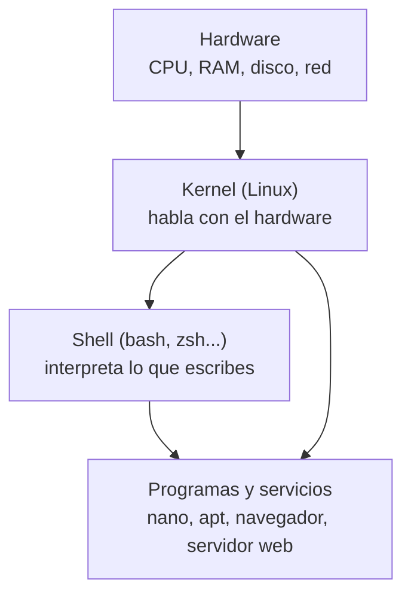

# Linux · fundamentos

**Linux está en todas partes**: servidores web, routers, contenedores, móviles (Android) y en tu futura
máquina de atacante. Esta página te enseña qué es realmente, cómo se organiza el sistema de ficheros,
cómo moverte por la línea de comandos, cómo editar ficheros y cómo instalar software con `apt`.

No es una página para memorizar: es una página para **tener un Linux delante** y trastear.

## Objetivos de aprendizaje

- Explicar la **filosofía Unix** y por qué Linux se organiza así.
- Distinguir **kernel**, **distribución** y **shell**.
- Moverte por el árbol de directorios y entender el estándar **FHS**.
- Navegar y manipular ficheros con comandos básicos (`ls`, `cd`, `pwd`, `cp`, `mv`, `rm`, `mkdir`).
- Editar ficheros con **nano** (a fondo) y dar los **primeros pasos con vim**.
- Instalar, actualizar y eliminar paquetes con **`apt`**.

**Tiempo estimado:** 90–120 min.

## Requisitos previos

- **[00 · Ética y legalidad](../00-etica-y-legalidad.md)**: reglas del laboratorio.
- **[04 · Arranque y virtualización](../01-arquitectura-de-ordenadores/04-arranque-y-virtualizacion.md)**:
  qué es una máquina virtual y cómo arranca un sistema.
- Un Linux en marcha: puede ser una **máquina virtual** (lo montamos en la
  [página 06](06-montar-kali-y-parrot.md)) o un sistema ya instalado. Si aún no tienes ninguno, puedes
  leer esta página y volver con la VM delante.

## Explicación

### ¿Qué es Linux, exactamente?

"Linux" es, en sentido estricto, el **kernel**: el núcleo del sistema que habla con el hardware, reparte
la memoria y decide qué programa se ejecuta en cada momento. Lo que tú usas es una **distribución**: el
kernel + un montón de programas + un instalador + un gestor de paquetes.



- **Kernel:** gestiona hardware, memoria, procesos y sistema de ficheros.
- **Distribución (distro):** Debian, Ubuntu, Kali, Parrot, Fedora… Todas comparten el kernel pero cambian
  programas, versiones y filosofía.
- **Shell:** el programa que **lee lo que escribes** y lo ejecuta. La más común es `bash`. La "terminal"
  es la ventana; la "shell" es el programa que corre dentro.

!!! note "Terminal, shell y consola"
    Se usan casi como sinónimos, pero no lo son. Lo estudiamos en detalle en
    **[01 · Terminal, shell y consola](../04-bash/01-terminal-shell-y-consola.md)** del módulo de Bash.
    Aquí quédate con que: escribes un comando → la shell lo interpreta → el kernel hace el trabajo.

### La filosofía Unix (por qué todo parece "raro")

Linux hereda de Unix una serie de ideas que explican casi todo lo que verás después:

1. **Todo es un fichero.** Dispositivos, discos, conexiones… muchos se representan como ficheros. Por eso
   en `/dev` aparece tu disco duro.
2. **Programas pequeños que hacen una cosa bien.** En lugar de un programa gigante, tienes cientos de
   comandos simples que puedes **combinar** (con tuberías, `|`).
3. **El texto es la interfaz universal.** La salida de un comando es texto que otro comando puede usar.
4. **Configuración en ficheros de texto.** Los ajustes del sistema suelen ser ficheros en `/etc` que
   puedes leer y editar.

Esta forma de trabajar (composición de herramientas simples) es exactamente la que usarás como pentester:
un comando escanea, otro filtra, otro formatea, y con dos tuberías tienes un script.

### Terminología y estructura de la línea de comandos

Cuando abres una terminal ves algo así:

```text
usuario@equipo:~$
```

Eso es el **prompt** (indicador). Se lee: usuario (`usuario`), en el equipo (`equipo`), en la carpeta
actual (`~`, que es tu carpeta personal) y un `$` final. Si en lugar de `$` ves `#`, estás como **root**.

La forma general de un comando es:

```text
comando [opciones] [argumentos]
```

- **comando**: el programa (`ls`, `cp`, `apt`).
- **opciones**: modifican el comportamiento; empiezan por `-` (cortas) o `--` (largas): `ls -l`, `ls --all`.
- **argumentos**: sobre qué actúa: `cp origen destino`.

Si no sabes qué hace un comando: `man ls` (manual) o `ls --help`.

### El árbol de directorios: estándar FHS

En Linux **no hay unidades `C:` y `D:`**. Hay un únicamente **árbol** que empieza en la raíz `/`. Todo
cuelga de ahí. El estándar que define qué va en cada carpeta se llama **FHS** (Filesystem Hierarchy Standard).

```text
/
├── bin/     comandos esenciales            (hoy suele ser un enlace a /usr/bin)
├── sbin/    comandos de administración     (enlace a /usr/sbin)
├── boot/    kernel y ficheros de arranque
├── dev/     dispositivos (discos, teclado...)
├── etc/     configuración del sistema
├── home/    carpetas personales de los usuarios
├── lib/     librerías del sistema          (enlace a /usr/lib)
├── media/   medios extraíbles (USB, DVD)
├── mnt/     montajes temporales/manuales
├── opt/     software de terceros
├── proc/    información de procesos y kernel (virtual, no ocupa disco)
├── root/    carpeta personal del usuario root
├── sbin/    binarios de administración
├── srv/     datos de servicios (web, ftp...)
├── sys/     información del kernel (virtual)
├── tmp/     ficheros temporales (se limpia al reiniciar)
├── usr/     programas y datos de usuario
└── var/     datos que cambian: logs, colas, bases de datos
```

| Carpeta | Para qué sirve | Ejemplo típico |
| --- | --- | --- |
| `/` | Raíz del sistema. Todo cuelga de aquí. | — |
| `/bin`, `/sbin` | Comandos del sistema. En distros modernas son enlaces a `/usr/bin` y `/usr/sbin` (**usrmerge**). | `/bin/ls`, `/sbin/ip` |
| `/etc` | **Toda** la configuración: la mayoría son ficheros de texto. | `/etc/passwd`, `/etc/apt` |
| `/home` | Carpetas personales de los usuarios. | `/home/ana` |
| `/root` | Carpeta personal de `root` (no está dentro de `/home`, por seguridad). | `/root` |
| `/var` | Datos **variables**: crecen con el uso. | `/var/log` (logs), `/var/www` (web) |
| `/usr` | Programas y librerías de usuario. | `/usr/bin`, `/usr/share` |
| `/tmp` | Temporales y de **escritura libre para todos**. Se borra al reiniciar. | `/tmp/prueba.txt` |
| `/opt` | Software instalado "a mano" o de terceros. | `/opt/herramienta` |
| `/proc`, `/sys` | Ficheros **virtuales**: el kernel los genera en memoria. | `/proc/cpuinfo` |
| `/dev` | Dispositivos representados como ficheros. | `/dev/sda`, `/dev/null` |
| `/boot` | Kernel y gestor de arranque. | `/boot/vmlinuz` |

!!! tip "Rutas absolutas y relativas"
    - **Absoluta:** empieza por `/` y describe el camino completo desde la raíz: `/etc/passwd`.
    - **Relativa:** parte de donde estás: `passwd` o `../etc/passwd`.
    - Atajos útiles: `.` (esta carpeta), `..` (carpeta padre), `~` (tu carpeta personal), `-` (carpeta anterior).

### Navegar y manipular ficheros

Los comandos que usarás el 99 % del tiempo:

| Comando | Qué hace |
| --- | --- |
| `pwd` | Muestra en qué carpeta estás (Print Working Directory). |
| `ls` | Lista ficheros. `-l` (detalle), `-a` (ocultos), `-h` (tamaños legibles). |
| `cd carpeta` | Cambia de carpeta. `cd` solo te lleva a `~`; `cd ..` sube un nivel. |
| `mkdir nombre` | Crea carpeta (`-p` crea toda la ruta necesaria). |
| `touch fichero` | Crea un fichero vacío o actualiza su fecha. |
| `cp origen destino` | Copia (`-r` para carpetas). |
| `mv origen destino` | Mueve; **también renombra** si destino es un nombre nuevo. |
| `rm fichero` | Borra (`-r` recursivo, `-f` sin preguntar). ¡No hay papelera! |
| `cat fichero` | Muestra el contenido completo. |
| `less fichero` | Muestra por páginas (sales con `q`). |
| `head`, `tail` | Primeras / últimas líneas (`-n 5` para 5 líneas). |

!!! danger "`rm` no perdona"
    En consola **no hay papelera de reciclaje**. `rm -rf /` o un `rm -rf` mal escrito puede destruir el
    sistema. Antes de borrar algo recursivo, ejecuta primero el `ls` con la misma ruta para ver qué vas
    a borrar.

### Editores de texto: nano y vim

Un sistema Linux **siempre** traerá un editor en consola. Los dos que debes conocer:

#### nano (fácil y suficiente al principio)

El comando `nano` abre un editor sencillo donde escribes directamente. Los atajos aparecen en la parte
inferior (`^` significa ++ctrl++).

| Atajo | Acción |
| --- | --- |
| ++ctrl+o++ , luego ++enter++ | **Guardar** (Write Out). |
| ++ctrl+x++ | **Salir** (te pregunta si guardas si hay cambios). |
| ++ctrl+w++ | Buscar (Where Is). |
| ++ctrl+\\++ | Buscar y **reemplazar**. |
| ++ctrl+k++ | Cortar la línea actual. |
| ++ctrl+u++ | Pegar la línea cortada. |
| ++ctrl+g++ | Ayuda. |
| ++ctrl+_++ | Ir a una línea concreta. |
| ++alt+u++ / ++alt+e++ | Deshacer / rehacer. |

#### vim (potente, al principio solo "sobrevivir")

`vim` tiene **modos**. Al principio esto confunde; el resumen mínimo es:

1. Abres con `vim fichero` y estás en modo **normal** (aquí las teclas son comandos, no texto).
2. Pulsas `i` para entrar en modo **inserción** y escribes.
3. Pulsas ++esc++ para volver a modo **normal**.
4. Escribes `:wq` y ++enter++ para **guardar y salir**.

| Comando (en modo normal) | Acción |
| --- | --- |
| `i` / `a` / `o` | Insertar antes / después / nueva línea debajo. |
| ++esc++ | Volver a modo normal. |
| `:w` | Guardar. |
| `:q` | Salir. `:q!` salir **sin guardar**. |
| `:wq` o `ZZ` | Guardar y salir. |
| `dd` / `yy` / `p` | Borrar línea / copiar línea / pegar. |
| `u` | Deshacer. |
| `/texto` y `n` | Buscar y siguiente coincidencia. |
| `gg` / `G` | Ir al principio / final del fichero. |
| `:set number` | Ver números de línea. |

!!! tip "¿Me quedo atascado en vim?"
    Si no sabes cómo salir: pulsa ++esc++ varias veces, escribe `:q!` y ++enter++. Eso sale siempre sin
    guardar. A nadie le pasa una sola vez.

### Gestión de paquetes con `apt`

Instalar software en Linux moderno **no se hace descargando un `.exe`**. Se hace con un **gestor de
paquetes** que descarga programas desde **repositorios** (servidores oficiales) y resuelve las
dependencias por ti.

`apt` (Advanced Package Tool) es el gestor de las distros basadas en Debian: Debian, Ubuntu, Kali y
Parrot. Los repositorios se configuran en `/etc/apt/sources.list` y en `/etc/apt/sources.list.d/`.

| Comando | Qué hace |
| --- | --- |
| `sudo apt update` | **Refresca el índice** de paquetes disponibles. **No instala nada.** |
| `sudo apt upgrade` | Actualiza los paquetes instalados a su versión nueva. |
| `sudo apt full-upgrade` | Como `upgrade`, pero puede **quitar** paquetes si hace falta (es el que se usa en Kali). |
| `sudo apt install paquete` | Instala. |
| `sudo apt remove paquete` | Desinstala (deja la configuración). |
| `sudo apt purge paquete` | Desinstala **y borra** su configuración. |
| `sudo apt autoremove` | Quita dependencias que ya no necesita nada. |
| `apt search palabra` | Busca paquetes. |
| `apt show paquete` | Muestra info detallada del paquete. |
| `apt list --installed` | Lista lo instalado (`| grep nombre` para filtrar). |

!!! warning "`update` no es `upgrade`"
    `apt update` **solo actualiza la lista** de lo que existe. Mucha gente cree que "ya actualizó el
    sistema" y no ha tocado ni un paquete. El orden es: primero `update`, luego `upgrade`/`full-upgrade`.

## Ejemplos prácticos

### 1. Moverse por el árbol

```bash
pwd
```

```text
/home/ana
```

*(salida de ejemplo)* Estás en la carpeta personal de `ana`.

```bash
ls -lah
```

```text
total 28K
drwxr-xr-x 4 ana  ana  4,0K oct 12 10:02 .
drwxr-xr-x 3 root root 4,0K oct 10 09:15 ..
-rw-r--r-- 1 ana  ana   220 oct 10 09:15 .bash_logout
-rw-r--r-- 1 ana  ana  3,7K oct 10 09:15 .bashrc
drwxr-xr-x 2 ana  ana  4,0K oct 12 09:58 documentos
```

*(salida de ejemplo)* Aquí ves: `-l` (detalle) `-a` (incluye ocultos, los que empiezan por punto) `-h`
(tamaños en K/M). Los permisos (`drwxr-xr-x`) los explicamos a fondo en la
[página de permisos](02-linux-usuarios-y-permisos.md). Fíjate en `.` y `..`: son la carpeta actual y la
padre.

### 2. Crear, copiar y mover

```bash
mkdir -p documentos/nivel1
cd documentos/nivel1
touch notas.txt
cp notas.txt respaldo.txt
mv respaldo.txt notas-importantes.txt
ls -l
```

```text
total 0
-rw-r--r-- 1 ana ana 0 oct 12 10:10 notas-importantes.txt
-rw-r--r-- 1 ana ana 0 oct 12 10:10 notas.txt
```

*(salida de ejemplo)* `mkdir -p` crea toda la ruta; `touch` crea el fichero; `cp` lo duplica; `mv` lo
renombra (el fichero no se llama "respaldo" porque su contenido es idéntico: `mv` cambia el **nombre**).

### 3. Ver un fichero del sistema

```bash
head -n 3 /etc/os-release
```

```text
PRETTY_NAME="Kali GNU/Linux rolling"
NAME="Kali GNU/Linux"
ID=kali
```

*(salida de ejemplo)* `/etc/os-release` es un fichero de texto en `/etc` (configuración), como casi todo
en Linux.

### 4. Instalar software con apt

```bash
sudo apt update
sudo apt install -y htop
```

```text
Leyendo lista de paquetes... Hecho
Creando árbol de dependencias... Hecho
...
Se instalarán los siguientes paquetes NUEVOS:
  htop
...
Configurando htop (3.2.2-2) ...
```

*(salida de ejemplo)* `-y` responde "sí" automáticamente. Después puedes ejecutar `htop` y verás los
procesos en vivo (lo estudiaremos en la [página 03](03-linux-procesos-servicios-y-logs.md)).

## Errores comunes

| Error | Por qué ocurre | Solución |
| --- | --- | --- |
| `Command 'htop' not found` | No está instalado. | `sudo apt install htop`. |
| `Permission denied` al escribir en `/etc` | No tienes permiso de escritura ahí. | Usa `sudo` con cabeza, o edita en tu `~`. |
| Confundir `apt update` con `apt upgrade` | Son cosas distintas. | `update` refresca índices; `upgrade` actualiza paquetes. |
| Borrar algo con `rm -rf` "a ver qué pasa" | Es irreversible. | Previsualiza con `ls` antes; nunca lo lances sobre `/`. |
| No poder salir de vim | vim tiene modos. | ++esc++ y `:q!` para salir sin guardar. |
| Editar un fichero de sistema sin copia | Un error deja el sistema inestable. | Copia antes: `sudo cp /etc/fichero /etc/fichero.bak`. |

## Ejercicios

1. **Explora y traduce.** Entra en `/` con `cd /`, ejecuta `ls` y localiza las carpetas `/etc`, `/home`,
   `/var` y `/tmp`. Explica en una línea para qué sirve cada una.
2. **Árbol propio.** En tu `~`, crea `laboratorio/pruebas` y dentro un fichero `hola.txt` con la palabra
   "hola" usando `nano`. Luego muéstralo con `cat`.
3. **Rutas relativas.** Estando en `~/laboratorio`, llega a `/etc` escribiendo una ruta **absoluta** y
   otra **relativa**. ¿Cambia el resultado?
4. **Busca un paquete.** Usa `apt search` para encontrar un paquete de un editor de texto que no sea
   nano ni vim, y mira su información con `apt show`.
5. **Diagnóstico.** Ejecuta `cp /etc/passwd /tmp/` y luego `ls -l /tmp/passwd`. ¿Con qué usuario y
   permisos ha quedado? ¿Sería distinto si lo copiaras sin `sudo` a `/root`?

??? success "Solución"
    1. `/etc` guarda la configuración; `/home` las carpetas personales; `/var` datos que cambian (logs,
       bases de datos, webs); `/tmp` ficheros temporales que se borran al reiniciar.
    2. Comandos: `mkdir -p ~/laboratorio/pruebas` → `cd ~/laboratorio/pruebas` → `nano hola.txt`
       (escribe `hola`, ++ctrl+o++, ++enter++, ++ctrl+x++) → `cat hola.txt` (debe imprimir `hola`).
    3. Absoluta: `cd /etc`. Relativa desde `~/laboratorio`: `cd ../../etc`. Ambos te llevan al mismo
       sitio; la absoluta funciona desde cualquier lugar, la relativa depende de dónde estés.
    4. Por ejemplo: `apt search editor` y luego `apt show micro` (o el que aparezca). Verás descripción,
       versión y dependencias.
    5. `cp` hereda tu usuario y los permisos por defecto (normalmente `-rw-r--r--`, es decir, 644). Al
       copiar a `/root` (carpeta solo accesible por `root`) sin `sudo` obtendrías `Permission denied`;
       con `sudo`, el fichero dentro de `/root` seguiría siendo propiedad del **usuario que copia** salvo
       que uses `sudo cp` y quede como root… por eso conviene revisar siempre propietario y permisos con
       `ls -l`.

## Resumen

- Linux = **kernel**; lo que instalas es una **distribución**; la **shell** interpreta tus comandos.
- Todo cuelga de `/` y sigue el estándar **FHS**: `/etc` configuración, `/home` usuarios, `/var` datos
  cambiantes, `/tmp` temporales…
- La consola usa el patrón `comando [opciones] [argumentos]`; `man` y `--help` son tu documentación.
- `nano` es el editor fácil; `vim` es potente pero requiere aprender sus **modos**.
- El software se instala con **`apt`**: primero `apt update`, luego `install`/`upgrade`.
- **`rm` no tiene papelera**: piensa antes de borrar.

## Checklist

- [ ] Sé explicar la diferencia entre kernel, distribución y shell.
- [ ] Conozco el propósito de `/etc`, `/home`, `/var`, `/tmp`, `/usr`, `/bin`, `/sbin` y `/proc`.
- [ ] Me muevo con `pwd`, `cd`, `ls` usando rutas absolutas y relativas.
- [ ] Creo, copio, muevo y borro ficheros y carpetas con `touch`, `mkdir`, `cp`, `mv`, `rm`.
- [ ] Edito y guardo un fichero con nano y sé salir de vim.
- [ ] Distingo `apt update` de `apt upgrade` y sé instalar y quitar paquetes.
- [ ] Uso `man`/`--help` para resolver dudas por mi cuenta.

## Para ir más allá

| Recurso | Tipo | Idioma | Precio |
| --- | --- | --- | --- |
| [Páginas man oficiales](https://man7.org) | Referencia | EN | Gratis |
| [linux.die.net](https://linux.die.net) | Manuales de comandos | EN | Gratis |
| [Documentación de Debian](https://www.debian.org) | Referencia y guías | Multi | Gratis |
| [Documentación de Ubuntu](https://ubuntu.com) | Guías para principiantes | Multi | Gratis |
| [Documentación de Kali](https://www.kali.org) | Guías propias de la distro | EN | Gratis |
| [OverTheWire · Bandit](https://overthewire.org) | Juego para practicar consola | EN | Gratis |

## Siguiente paso

Ahora que te mueves por el sistema, aprende a controlar **quién** puede hacer **qué**:
**[02 · Linux · usuarios y permisos](02-linux-usuarios-y-permisos.md)**.
