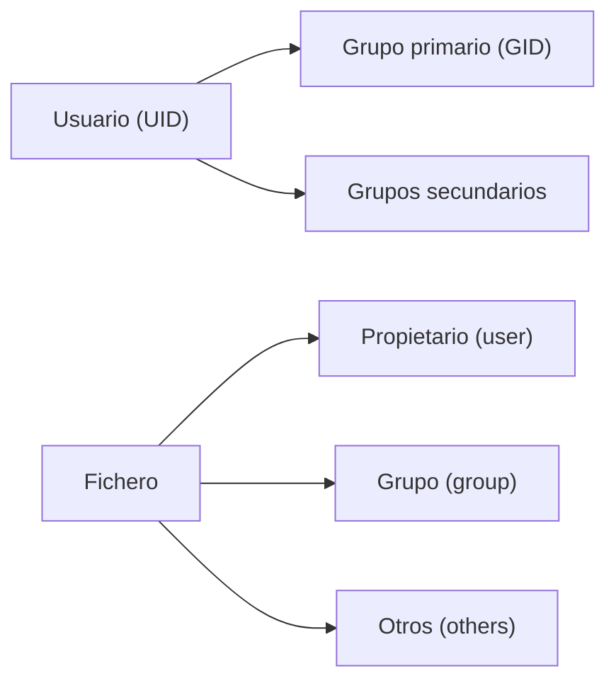

# Linux · usuarios y permisos

En Linux **todo pertenece a alguien**. Cada fichero tiene un dueño y un grupo, y una serie de permisos
que deciden quién puede leerlo, escribirlo o ejecutarlo. Entender esto es entender la seguridad del
sistema: la mayoría de las escaladas de privilegios (lo verás en Nivel 2) consisten en **abusar de un
permiso mal puesto**.

## Objetivos de aprendizaje

- Explicar qué son **usuarios**, **grupos** y el usuario **root**.
- Gestionar usuarios y grupos (`adduser`, `usermod`, `passwd`, `groups`).
- Leer e interpretar una línea de `ls -l` carácter a carácter.
- Aplicar permisos con **notación octal** (755, 644…) y **simbólica** (`u+x`, `go-w`…).
- Cambiar propietario y grupo con `chown` y `chgrp`.
- Entender `umask` y de dónde salen los permisos por defecto.
- Explicar los bits especiales **SUID**, **SGID** y **sticky** y por qué son peligrosos.
- Saber qué hay en `/etc/passwd` y `/etc/shadow` (a nivel básico).

**Tiempo estimado:** 90–120 min.

## Requisitos previos

- **[01 · Linux · fundamentos](01-linux-fundamentos.md)**: árbol de directorios y comandos básicos.
- Haber usado al menos una vez `ls -l` y `sudo`.

## Explicación

### Usuarios y grupos

Linux es **multiusuario**: varias personas pueden usar el mismo sistema a la vez. Para gestionarlo usa
tres conceptos:

- **Usuario:** cada persona o servicio tiene una cuenta con un nombre y un **UID** (User ID, número).
- **Grupo:** conjunto de usuarios. Sirve para dar permisos a varios a la vez. Tiene un **GID**.
- **root:** el superusuario (UID `0`). Puede hacer **cualquier cosa**. No se usa para el día a día.

Nunca dos cuentas comparten UID. Los usuarios del sistema (servicios como `www-data` o `sshd`) tienen
UIDs bajos y normalmente **no pueden iniciar sesión**; existen para que cada servicio corra con el mínimo
privilegio posible.



Comandos para ver quién eres y a qué grupos perteneces:

| Comando | Qué muestra |
| --- | --- |
| `whoami` | Tu nombre de usuario. |
| `id` | Tu UID, GID y grupos. |
| `groups` | Los grupos a los que perteneces. |
| `who` / `w` | Quién está conectado (y qué está haciendo). |
| `last` | Historial de inicios de sesión. |

### Gestionar usuarios y grupos

| Comando | Qué hace |
| --- | --- |
| `sudo adduser ana` | Crea el usuario `ana` de forma guiada (crea su `/home`). |
| `sudo useradd ana` | Variante de bajo nivel: **no** crea home ni pregunta contraseña. |
| `sudo passwd ana` | Cambia la contraseña de `ana`. |
| `sudo deluser ana` | Elimina un usuario (`--remove-home` borra su carpeta). |
| `sudo usermod -aG sudo ana` | Añade `ana` al grupo `sudo` (¡importante el `-a`!). |
| `sudo groupadd proyecto` | Crea el grupo `proyecto`. |
| `sudo gpasswd -a ana proyecto` | Añade `ana` al grupo `proyecto`. |

!!! danger "El `-a` de `usermod -aG` no se olvida"
    `sudo usermod -G sudo ana` **sin la `-a`** reemplaza todos los grupos secundarios de `ana` por
    `sudo`, sacándola de los demás. La forma correcta es `usermod -aG` (append + group).

El **superusuario no anda por ahí suelto**: en lugar de iniciar sesión como `root`, se usa `sudo`
("superuser do"), que ejecuta **un comando concreto** como root y queda registrado en los logs. Qué puede
usar cada usuario con `sudo` se define en `/etc/sudoers`, que se edita **siempre** con `visudo` (valida
la sintaxis antes de guardar).

### `/etc/passwd` y `/etc/shadow`

Son dos ficheros donde Linux guarda las cuentas.

**`/etc/passwd`** (legible por todos) tiene una línea por usuario con 7 campos separados por `:`:

```text
ana:x:1000:1000:Ana Pérez,,,:/home/ana:/bin/bash
```

| Campo | Valor | Significado |
| --- | --- | --- |
| 1 | `ana` | Nombre de usuario. |
| 2 | `x` | Antiguamente la contraseña; hoy indica "está en `/etc/shadow`". |
| 3 | `1000` | **UID**. |
| 4 | `1000` | **GID** del grupo primario. |
| 5 | `Ana Pérez,,,` | Comentario (normalmente el nombre completo). |
| 6 | `/home/ana` | Carpeta personal. |
| 7 | `/bin/bash` | Shell que se ejecuta al iniciar sesión. |

**`/etc/shadow`** (solo legible por root) guarda los **hashes** de las contraseñas y su caducidad:

```text
ana:$6$rL0...hash...:19600:0:99999:7:::
```

*(ejemplo ilustrativo)* Campos principales: nombre de usuario, **hash** de la contraseña (con `!` o `*`
delante si la cuenta no tiene contraseña válida / está bloqueada), días desde el 1-1-1970 del último
cambio, días mínimos y máximos hasta el próximo cambio, días de aviso antes de caducar, etc.

!!! warning "Nunca edites estos ficheros a mano"
    `passwd` y `shadow` se gestionan con las herramientas (`adduser`, `passwd`, `usermod`). Editarlos
    directamente puede **bloquear el acceso a todo el sistema**. Y nunca copies su contenido a un
    writeup o a un repositorio: los hashes son material sensible.

### Los permisos `rwx`

Cada fichero tiene permisos para **tres categorías**: **u** (propietario), **g** (grupo), **o** (otros).
Para cada una se definen tres permisos:

| Símbolo | Valor octal | Sobre un **fichero** | Sobre un **directorio** |
| --- | --- | --- | --- |
| `r` | 4 | Leer el contenido. | **Listar** los ficheros que contiene (`ls`). |
| `w` | 2 | Modificar el contenido. | Crear, borrar o renombrar ficheros dentro. |
| `x` | 1 | Ejecutarlo (si es un programa/script). | **Entrar** en él (`cd`) y acceder a sus ficheros. |
| `-` | 0 | Sin permiso. | Sin permiso. |

!!! note "El `x` en directorios"
    En un directorio, "ejecutar" significa **atravesarlo**. Si tienes `r` pero no `x`, puedes ver los
    nombres de los ficheros pero no abrirlos ni entrar. Es un detalle que se pregunta mucho y se olvida
    siempre.

### Leer `ls -l` línea a línea

```bash
ls -l /tmp/ejemplo.sh
```

```text
-rwxr-xr-- 1 ana proyecto 1456 oct 12 11:20 /tmp/ejemplo.sh
```

*(salida de ejemplo)* Vamos pieza a pieza:

| Parte | Valor | Significado |
| --- | --- | --- |
| Tipo | `-` | Es un fichero normal (`d` = directorio, `l` = enlace, `c`/`b` = dispositivo). |
| Permisos u | `rwx` | El propietario puede leer, escribir y ejecutar. |
| Permisos g | `r-x` | El grupo puede leer y ejecutar, **no** escribir. |
| Permisos o | `r--` | El resto solo puede leer. |
| Enlaces | `1` | Número de enlaces duros. |
| Propietario | `ana` | Usuario dueño. |
| Grupo | `proyecto` | Grupo dueño. |
| Tamaño | `1456` | Bytes. |
| Fecha | `oct 12 11:20` | Última modificación. |
| Nombre | `/tmp/ejemplo.sh` | Ruta. |

Ese patrón `rwxr-xr--` equivale en octal a **754** (7=rwx, 5=r-x, 4=r--).

### Notación octal y simbólica

**Octal** es un solo número de 3 cifras (una por categoría). Se suma: `r=4`, `w=2`, `x=1`.

| Octal | Permisos | Uso típico |
| --- | --- | --- |
| `644` | `rw-r--r--` | Ficheros normales: solo el dueño edita. |
| `600` | `rw-------` | Privados: claves, `~/.ssh/id_rsa`. |
| `755` | `rwxr-xr-x` | Programas y directorios: todos ejecutan/entran, solo el dueño edita. |
| `700` | `rwx------` | Directorio privado. |
| `777` | `rwxrwxrwx` | **Peligroso**: todo el mundo puede todo. Evítalo. |

**Simbólica** usa letras (`u`/`g`/`o`/`a`) y signos (`+` añadir, `-` quitar, `=` asignar exacto):

| Comando | Efecto |
| --- | --- |
| `chmod +x script.sh` | Añade ejecución a todos. |
| `chmod u+x script.sh` | Añade ejecución solo al propietario. |
| `chmod go-w fichero` | Quita escritura a grupo y otros. |
| `chmod u=rw,g=r,o= fichero` | Asigna exactamente `rw-r-----`. |
| `chmod -R 750 carpeta` | Aplica **recursivamente** a todo el contenido. |

### Propietario y grupo: `chown` y `chgrp`

| Comando | Qué hace |
| --- | --- |
| `sudo chown ana fichero` | Cambia el **propietario**. |
| `sudo chown ana:proyecto fichero` | Cambia propietario **y** grupo a la vez. |
| `sudo chgrp proyecto fichero` | Cambia solo el **grupo**. |
| `sudo chown -R ana:ana carpeta/` | Cambia recursivamente. |

Solo `root` puede **ceder** un fichero a otro usuario. Tú puedes cambiar el **grupo** de tus ficheros a
otro grupo al que pertenezcas.

### `umask`: los permisos por defecto

Al crear un fichero, ¿con qué permisos nace? Con los que el sistema calcula a partir de la **umask**
(máscara). La idea: se parte de un máximo y se **restan** los bits de la máscara.

- Base para ficheros nuevos: `666`. Base para directorios nuevos: `777`.
- Con `umask 022` (lo habitual): ficheros `666-022 = 644`, directorios `777-022 = 755`.

```bash
umask
```

```text
0022
```

*(salida de ejemplo)* El primer dígito (0) corresponde a los bits especiales. Para ver tu umask en modo
simbólico: `umask -S`.

### Bits especiales: SUID, SGID y sticky

Además de `rwx` existen tres bits especiales. Se colocan en la posición de usuario/grupo/otros:

| Bit | Octal | Dónde aparece en `ls -l` | Qué hace |
| --- | --- | --- | --- |
| **SUID** | 4000 | `s` en los permisos del **usuario** | El programa se ejecuta con los privilegios del **dueño** del fichero, no de quien lo lanza. |
| **SGID** | 2000 | `s` en los permisos del **grupo** | Igual, pero con el grupo. En directorios, los ficheros nuevos heredan el grupo del directorio. |
| **Sticky** | 1000 | `t` al final | En un directorio, solo el dueño del fichero (o root) puede borrarlo, aunque el directorio sea escribible por todos. |

```bash
ls -l /usr/bin/passwd
ls -ld /tmp
```

```text
-rwsr-xr-x 1 root root 68208 feb 10 12:00 /usr/bin/passwd
drwxrwxrwt 1 root root  4096 oct 12 11:30 /tmp
```

*(salida de ejemplo)* Mira:

- `/usr/bin/passwd` tiene **SUID** (`rws`): por eso un usuario normal puede cambiar **su** contraseña
  (escribe en `/etc/shadow`, que solo root puede tocar). El binario "presta" los privilegios de root de
  forma controlada.
- `/tmp` tiene **sticky** (`rwt`): todos pueden escribir, pero nadie puede borrar los ficheros de otro.

!!! danger "SUID es la joya de la escalada de privilegios"
    Un binario con SUID **mal configurado**, **antiguo** o **de fabricación propia** es una de las vías
    más típicas para conseguir ser root. Buscarlos es de las primeras cosas que se hace en un pentest:
    `find / -perm -4000 -type f 2>/dev/null`. Estudiarás cómo se explotan en
    **[Nivel 2 · Linux avanzado y escalada de privilegios](../../nivel-2-medio/01-linux-avanzado-y-privesc.md)**,
    **siempre** sobre tu laboratorio.

## Ejemplos prácticos

### 1. Ver tus identidades y grupos

```bash
id
```

```text
uid=1000(ana) gid=1000(ana) grupos=1000(ana),27(sudo),100(users)
```

*(salida de ejemplo)* `uid` = tu ID; `gid` = grupo primario; `grupos` = grupos secundarios. Estar en
`27(sudo)` es lo que te permite usar `sudo`.

### 2. Crear un fichero y ajustar permisos

```bash
cd ~
touch secreto.txt
ls -l secreto.txt
chmod 600 secreto.txt
chmod o+r secreto.txt
ls -l secreto.txt
```

```text
-rw-r--r-- 1 ana ana 0 oct 12 12:00 secreto.txt
-rw-r--r-- 1 ana ana 0 oct 12 12:00 secreto.txt
```

*(salida de ejemplo)* Nace con `644` (por la umask `022`). Tras `chmod 600` quedaría `-rw-------`; el
`chmod o+r` que hemos puesto después vuelve a dar lectura a otros (`-rw-r--r--`). El ejemplo muestra que
**el último cambio manda**; también puedes combinarlo en un solo paso: `chmod u=rw,g=,o= secreto.txt`.

### 3. Un directorio de trabajo para un grupo

```bash
sudo mkdir -p /srv/proyecto
sudo chown root:proyecto /srv/proyecto
sudo chmod 2770 /srv/proyecto
ls -ld /srv/proyecto
```

```text
drwxrws--- 1 root proyecto 4096 oct 12 12:05 /srv/proyecto
```

*(salida de ejemplo)* El `2` delante de `770` activa **SGID**: los ficheros creados dentro heredarán el
grupo `proyecto` automáticamente. La `s` en la posición del grupo lo confirma.

### 4. Buscar binarios con SUID

```bash
find / -perm -4000 -type f 2>/dev/null
```

```text
/usr/bin/passwd
/usr/bin/sudo
/usr/bin/mount
/usr/bin/su
```

*(salida de ejemplo, recortada)* El `2>/dev/null` oculta los errores de "permiso denegado". En un sistema
limpio verás una lista corta y conocida; cualquier binario **ajeno** en esa lista merece investigación.

## Errores comunes

| Error | Por qué ocurre | Solución |
| --- | --- | --- |
| `chmod 777` "para que funcione" | Resuelve el síntoma y abre un agujero. | Da **solo** el permiso necesario (p. ej. `755` o `640`). |
| `chmod` no hace nada | No eres el propietario. | Usa `sudo` o cambia primero el dueño con `chown`. |
| `usermod -G grupo user` sin `-a` | Sustituye todos los grupos del usuario. | Usa siempre `usermod -aG`. |
| El `x` en carpetas | Sin `x` no puedes entrar aunque tengas `r`. | Añade `x` al directorio: `chmod +x carpeta`. |
| Editar `/etc/shadow` a mano | Puedes dejar el sistema sin login. | Usa `passwd`, `usermod`, `chage`. |
| Confundir SUID con SGID | La `s` aparece en posición distinta. | `s` en user = SUID; `s` en group = SGID; `t` al final = sticky. |

## Ejercicios

1. **Traduce permisos.** ¿Qué significa `-r-xr-x---` en octal? ¿Y `640` en simbólico?
2. **De la mano.** Crea `~/ejercicio/privado.txt`, deja que **solo tú** puedas leerlo y escribirlo, y
   comprueba el resultado con `ls -l`.
3. **Grupo compartido.** Crea un directorio `~/compartido` con SGID y permisos `770`, y explica qué
   ventaja tiene el SGID en un directorio compartido.
4. **Investiga la umask.** Averigua tu umask actual, cambia el valor a `077` en la sesión y crea un
   fichero. ¿Con qué permisos nace?
5. **Caza un SUID.** Lista los binarios con SUID de tu sistema y elige uno: ¿por qué es seguro que tenga
   ese bit activado? ¿Qué pasaría si lo tuviera un binario que no conoces?

??? success "Solución"
    1. `-r-xr-x---` = `r-x` (5) + `r-x` (5) + `---` (0) → **550**, fichero normal propietario y grupo
       leen y ejecutan, otros nada. `640` = `rw-r-----` (dueño lee/escribe, grupo lee, otros nada).
    2. `mkdir -p ~/ejercicio && touch ~/ejercicio/privado.txt && chmod 600 ~/ejercicio/privado.txt`.
       `ls -l` debe mostrar `-rw-------`.
    3. `mkdir ~/compartido && chmod 2770 ~/compartido`. El SGID hace que **todos los ficheros nuevos**
       hereden el grupo del directorio, aunque los cree otro usuario. Así todo el equipo mantiene el
       mismo grupo y los permisos no se rompen.
    4. `umask` (probablemente `0022`). Con `umask 077`, un fichero nuevo nace `600` (`rw-------`) y un
       directorio `700`. Es decir, todo queda privado por defecto.
    5. `find / -perm -4000 -type f 2>/dev/null`. `passwd` es seguro porque está pensado para prestar
       privilegios de forma controlada (cambiar tu propia contraseña). Un binario con SUID que no
       reconozcas y no pertenezca a un paquete del sistema es sospechoso y, en un pentest, un candidato
       clarísimo a explotar.

## Resumen

- Todo en Linux pertenece a un **usuario** y un **grupo**; `root` (UID 0) lo puede todo.
- `sudo` permite ejecutar comandos puntuales como root sin iniciar sesión como root.
- `rwx` se aplica a **u**suario, **g**rupo y **o**tros; en directorios `x` = entrar, `w` = crear/borrar.
- Permisos en **octal** (suma de 4/2/1) o **simbólico** (`chmod u+x`, `go-w`).
- La **umask** determina los permisos por defecto (normalmente `022` → 644/755).
- **SUID/SGID/sticky** son bits especiales potentísimos y, mal usados, un agujero de seguridad.
- `/etc/passwd` guarda las cuentas; `/etc/shadow` guarda los hashes (solo root).

## Checklist

- [ ] Distingo usuario, grupo y root, y sé ver mis grupos con `id`.
- [ ] Sé crear un usuario y un grupo con `adduser` y `addgroup`.
- [ ] Interpreto una línea de `ls -l` completa.
- [ ] Paso de octal a simbólico y al revés sin dudar.
- [ ] Aplico `chmod`, `chown` y `chgrp` correctamente (y con `sudo` solo cuando toca).
- [ ] Entiendo mi `umask` y de dónde salen los permisos por defecto.
- [ ] Explico qué son SUID, SGID y sticky y por qué son delicados.
- [ ] Sé qué guarda `/etc/passwd` y qué guarda `/etc/shadow`.

## Para ir más allá

| Recurso | Tipo | Idioma | Precio |
| --- | --- | --- | --- |
| [Página man de `chmod`](https://man7.org) | Referencia | EN | Gratis |
| [linux.die.net](https://linux.die.net) | Manuales con ejemplos | EN | Gratis |
| [OverTheWire · Bandit](https://overthewire.org) | Práctica de permisos por niveles | EN | Gratis |
| [TryHackMe](https://tryhackme.com) | Rutas guiadas de Linux | EN | Freemium |
| [Documentación de Debian](https://www.debian.org) | Referencia del sistema | Multi | Gratis |

## Siguiente paso

Ahora que controlas quién puede hacer qué, mira el sistema **en movimiento**:
**[03 · Linux · procesos, servicios y logs](03-linux-procesos-servicios-y-logs.md)**.
