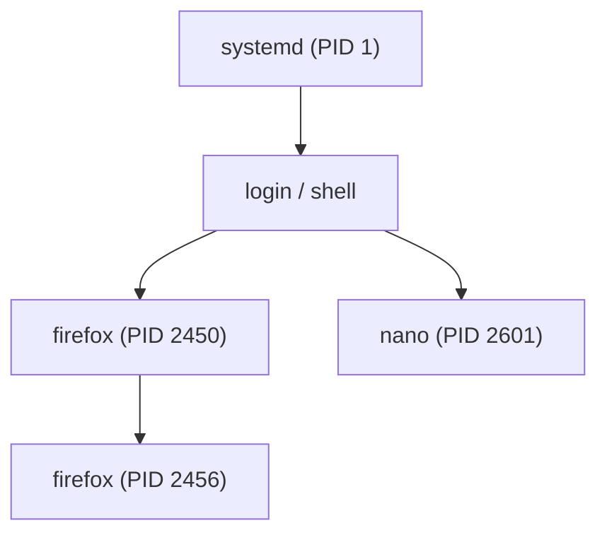

# Linux · procesos, servicios y logs

Un sistema operativo es un **herramienta de gestión de procesos**: programas que se ejecutan, servicios
que arrancan solos, y un registro (los **logs**) donde queda escrito todo lo que pasa. Esta página te
enseña a ver, controlar y detener procesos, a gestionar servicios con `systemd`, y a leer los logs para
entender qué demonios ha pasado en una máquina.

## Objetivos de aprendizaje

- Explicar qué es un **proceso**, un **PID** y un **servicio (daemon)**.
- Listar y filtrar procesos con `ps`, `pgrep` y `pidof`.
- Monitorizar el sistema en vivo con `top` y `htop`.
- Terminar procesos con `kill` y entender las **señales**.
- Poner trabajos en segundo plano (`&`, `jobs`, `fg`, `bg`, `nohup`).
- Gestionar servicios con **`systemctl`** (systemd).
- Leer logs del sistema: `/var/log` y **`journalctl`**.

**Tiempo estimado:** 90–120 min.

## Requisitos previos

- **[01 · Linux · fundamentos](01-linux-fundamentos.md)**.
- **[02 · Linux · usuarios y permisos](02-linux-usuarios-y-permisos.md)** (necesitas `sudo` para muchas de estas órdenes).

## Explicación

### ¿Qué es un proceso?

Un **proceso** es un programa **en ejecución**. El fichero `/usr/bin/firefox` está en disco (es un
programa); cuando lo abres, el kernel le asigna memoria, CPU y un número único llamado **PID** (Process
ID). Cada proceso tiene un **proceso padre** (su PPID) que lo lanzó, formando un árbol.



El **PID 1** es especial: es el primer proceso que arranca el sistema y el padre de todos los demás. En
distribuciones modernas, PID 1 es **systemd**.

Estados típicos de un proceso:

| Estado | Letra | Significado |
| --- | --- | --- |
| Ejecutando | `R` | Corriendo o listo para correr. |
| Durmiendo | `S` | Esperando un evento (lo normal). |
| En espera ininterrumpible | `D` | Esperando E/S (disco, red); no se puede matar fácilmente. |
| Detenido | `T` | Parado (p. ej. con ++ctrl+z++). |
| Zombi | `Z` | Terminó pero su padre no ha recogido su estado. |

### Ver procesos: `ps`, `top`, `htop`

| Comando | Para qué |
| --- | --- |
| `ps aux` | Foto **puntual** de todos los procesos (formato BSD). |
| `ps -ef` | Foto puntual (formato System V), muestra PPID. |
| `ps -eo pid,user,%cpu,%mem,cmd` | Elige **tú** las columnas. |
| `pgrep -a nombre` | Devuelve el PID (y la línea) de los procesos que coinciden. |
| `pidof nombre` | Todos los PIDs de un programa. |
| `top` | Monitor **en vivo** (se refresca solo). Sal con `q`. |
| `htop` | Igual pero más cómodo y con colores (se instala aparte). |
| `pstree -p` | Árbol de procesos con sus PIDs. |

En `ps aux` las columnas clave son:

| Columna | Significado |
| --- | --- |
| `USER` | Usuario que lo lanza. |
| `PID` | Identificador del proceso. |
| `%CPU` / `%MEM` | Consumo de CPU y memoria. |
| `STAT` | Estado (R, S, D, T, Z…). |
| `START` | Cuándo empezó. |
| `TIME` | Tiempo total de CPU consumido. |
| `COMMAND` | El comando y sus argumentos. |

En `top`, dentro de la interfaz, las teclas más útiles son: `M` (ordenar por memoria), `P` (por CPU),
`k` (matar un proceso), `q` (salir).

### Terminar procesos y señales

Detener un proceso **no** es "apagarlo": le envías una **señal**, y el proceso decide qué hacer. `kill`
envía señales por defecto a un PID. Las más importantes:

| Nº | Nombre | Qué significa | Uso típico |
| --- | --- | --- | --- |
| 1 | `SIGHUP` | "Reinicia/relee configuración" | `kill -1 PID` recarga un servicio. |
| 2 | `SIGINT` | Interrupción (equivale a ++ctrl+c++) | Parar algo interactivo. |
| 9 | `SIGKILL` | **Matar sí o sí** (el proceso no puede ignorarla) | Último recurso. |
| 15 | `SIGTERM` | "Termina cuando puedas" | **Por defecto** y forma correcta. |
| 18 | `SIGCONT` | Continuar un proceso detenido. | `kill -18 PID`. |
| 19 | `SIGSTOP` | Detener (no se puede ignorar). | `kill -19 PID`. |

| Comando | Qué hace |
| --- | --- |
| `kill PID` | Envía `SIGTERM` (15). |
| `kill -9 PID` | Envía `SIGKILL`: muerte forzosa. Sin limpieza. |
| `kill -l` | Lista todas las señales disponibles. |
| `pkill firefox` | Mata por **nombre**. |
| `killall firefox` | Igual (nombre exacto). |

!!! tip "Primero 15, luego 9"
    Usa `kill PID` (SIGTERM) y espera unos segundos. Solo si el proceso no responde, `kill -9`. Con
    `-9` el programa no puede guardar su estado ni cerrar ficheros: puede dejar datos corruptos.

También puedes gestionar prioridades: `nice -n 10 comando` arranca con menor prioridad, y
`renice -n 5 -p PID` la cambia. El rango va de `-20` (máxima prioridad) a `19` (mínima).

### Trabajos en segundo plano

Si lanzas un comando largo en la terminal, ésta queda bloqueada. Soluciones:

| Truco | Qué hace |
| --- | --- |
| `comando &` | Lo lanza en **segundo plano** y te devuelve el prompt. |
| ++ctrl+z++ | **Pausa** el proceso en primer plano (queda detenido). |
| `bg` | Reanuda en segundo plano el último proceso pausado. |
| `fg` | Lo devuelve al **primer plano**. |
| `jobs` | Lista los trabajos de esta terminal. |
| `nohup comando &` | Sigue vivo aunque cierres la terminal (ignora `SIGHUP`). |

### Servicios con systemd (`systemctl`)

Un **servicio** (o *daemon*) es un proceso que arranca solo al iniciar el sistema y se queda funcionando:
un servidor web, SSH, una base de datos… En distribuciones modernas los gestiona **systemd** a través de
`systemctl`.

| Comando | Qué hace |
| --- | --- |
| `systemctl status ssh` | Ver si un servicio está activo y sus últimos logs. |
| `sudo systemctl start ssh` | Arrancar ahora. |
| `sudo systemctl stop ssh` | Parar ahora. |
| `sudo systemctl restart ssh` | Reiniciar. |
| `sudo systemctl reload ssh` | Recargar configuración **sin** cortar el servicio (si lo soporta). |
| `sudo systemctl enable ssh` | Que arranque **automáticamente** al encender. |
| `sudo systemctl disable ssh` | Que **no** arranque solo. |
| `systemctl is-enabled ssh` | Ver si arranca solo. |
| `systemctl list-units --type=service` | Lista servicios y su estado. |
| `systemctl list-unit-files --state=enabled` | Lista lo habilitado. |
| `sudo systemctl daemon-reload` | Recarga systemd tras editar un fichero `.service`. |

!!! note "`start` no es `enable`"
    `start` arranca el servicio **ahora**, pero si reinicias la máquina no volverá. `enable` hace que
    arranque **solo** en cada arranque, pero no lo arranca en este momento. Para dejarlo bien: los dos.
    Y cuidado: para **atacar** no quieres servicios extra corriendo; cierra lo que no uses.

Los servicios se definen en ficheros de **unidad** `nombre.service`, normalmente en
`/usr/lib/systemd/system/` (los del sistema) y `/etc/systemd/system/` (los tuyos, que tienen prioridad).
Puedes leer uno con `systemctl cat ssh`.

### Logs: `/var/log` y `journalctl`

Un **log** es un registro de eventos con fecha y hora. Son oro puro: cuentan qué pasó, cuándo, quién lo
hizo y desde dónde. En Linux están sobre todo en `/var/log` y en el **journal** de systemd.

| Fichero | Contenido |
| --- | --- |
| `/var/log/syslog` | Registro general del sistema (en Debian/Ubuntu/Kali). |
| `/var/log/messages` | Equivalente general en distros tipo RHEL/Fedora. |
| `/var/log/auth.log` | Autenticación: inicios de sesión, `sudo`, SSH (Debian/Ubuntu). |
| `/var/log/secure` | Equivalente de auth en RHEL/Fedora. |
| `/var/log/kern.log` | Mensajes del kernel. |
| `/var/log/dpkg.log` | Instalaciones/desinstalaciones de paquetes. |
| `/var/log/apache2/` | Logs de Apache (`access.log`, `error.log`). |
| `/var/log/nginx/` | Logs de Nginx. |

Los logs se **rotan** (se archivan y comprimen) con `logrotate` para que no crezcan sin fin: por eso verás
ficheros como `syslog.1`, `syslog.2.gz`.

**`journalctl`** consulta los logs que recoge systemd:

| Comando | Qué hace |
| --- | --- |
| `journalctl -u ssh` | Logs de una unidad/servicio concreto. |
| `journalctl -f` | Sigue los logs **en vivo** (como `tail -f`). Sal con ++ctrl+c++. |
| `journalctl -b` | Solo del **arranque** actual (`-b -1` = anterior). |
| `journalctl --since "1 hour ago"` | Desde hace una hora. |
| `journalctl --since "2026-01-01" --until "2026-01-02"` | Por rango de fechas. |
| `journalctl -p err` | Solo errores y superiores. |
| `journalctl -n 50` | Las 50 últimas líneas. |
| `journalctl --disk-usage` | Cuánto ocupa el journal. |

!!! warning "Los logs son evidencia"
    En un incidente real, los logs son **pruebas**. Nunca los borres ni los modifiques "para limpiar".
    Copia y trabaja sobre una copia. Borrar logs en un sistema ajeno es, además de una mala práctica,
    un delito en muchos casos.

## Ejemplos prácticos

### 1. Ver los procesos que más consumen

```bash
ps aux --sort=-%cpu | head -n 6
```

```text
USER       PID %CPU %MEM    VSZ   RSS TTY      STAT START   TIME COMMAND
root       812  5.2  1.4 982340 58120 ?        Ss   09:01   0:12 /usr/sbin/apache2
ana       2450  3.1  4.0 3120456 162312 ?      Sl   09:35   0:45 /usr/bin/firefox
root         1  0.0  0.1 168832 13120 ?        Ss   09:01   0:03 /sbin/init
```

*(salida de ejemplo, recortada)* Ordenamos por CPU descendente con `--sort=-%cpu` y mostramos solo las
6 primeras. `STAT` `Ss` = durmiendo y líder de sesión; `Sl` = durmiendo y multihilo.

### 2. Buscar y matar un proceso concreto

```bash
pgrep -a firefox
kill 2450
ps -p 2450
```

```text
2450 /usr/bin/firefox
PID TTY          TIME CMD
```

*(salida de ejemplo)* `pgrep -a` nos dio el PID `2450`. `kill 2450` envió `SIGTERM`. `ps -p 2450` ya no
muestra nada: el proceso terminó (y cerró sus ficheros correctamente).

### 3. Gestionar un servicio

```bash
sudo systemctl status ssh
```

```text
● ssh.service - OpenBSD Secure Shell server
     Loaded: loaded (/lib/systemd/system/ssh.service; enabled; preset: enabled)
     Active: active (running) since Sat 2026-10-11 09:01:03 CET; 2h 30min ago
   Main PID: 745 (sshd)
```

*(salida de ejemplo)* Lectura: `loaded ... enabled` = arranca solo al encender; `active (running)` = está
corriendo; `Main PID: 745` = su proceso principal. Para pararlo: `sudo systemctl stop ssh`.

### 4. Leer los intentos de acceso SSH

```bash
sudo grep "Failed password" /var/log/auth.log | tail -n 3
```

```text
oct 12 13:02:11 kali sshd[1204]: Failed password for invalid user admin from 10.10.10.20 port 44210 ssh2
oct 12 13:02:15 kali sshd[1206]: Failed password for invalid user test from 10.10.10.20 port 44212 ssh2
oct 12 13:02:19 kali sshd[1208]: Failed password for invalid user root from 10.10.10.20 port 44214 ssh2
```

*(salida de ejemplo)* Tres intentos fallidos desde `10.10.10.20` en pocos segundos: sintoma de un
**escaneo o ataque de fuerza bruta**. Como analista, esa IP merece atención. Con `journalctl -u ssh -f`
también verías esto en vivo.

## Errores comunes

| Error | Por qué ocurre | Solución |
| --- | --- | --- |
| `kill` no para el proceso | Está en estado `D` o ignora `SIGTERM`. | Espera, y si sigue: `kill -9 PID`. |
| `systemctl start` pero tras reiniciar no arranca | No está `enabled`. | `sudo systemctl enable servicio`. |
| `journalctl` muestra "No entries" | Filtro muy estricto o journal no persistente. | Quita filtros; prueba `journalctl -b`. |
| Matar el proceso equivocado | PIDs que cambian o nombre ambiguo. | Confirma con `pgrep -a` / `ps` antes de `kill`. |
| Cerrar la terminal y perder el trabajo | Un `&` sin `nohup` muere con la shell. | Usa `nohup comando &`. |
| Borrar logs "para limpiar" | Destruyes evidencia. | Rota o archiva; nunca borres en un sistema ajeno. |

## Ejercicios

1. **Árbol de procesos.** Muestra el árbol de procesos de tu sistema con `pstree -p` y localiza el PID 1.
   ¿Qué es? ¿Qué cuelga directamente de él?
2. **Top tres.** Ordena los procesos por memoria y anota los tres que más consumen con su PID.
3. **Señales.** Abre `sleep 300`, páusalo con ++ctrl+z++, comprueba su estado con `ps`, reanúdalo en
   segundo plano y luego mátalo.
4. **Servicio.** Comprueba si tu sistema tiene el servicio `ssh` activo y habilitado. Si lo tiene,
   averigua su PID principal.
5. **Investigación de log.** Busca en los logs del sistema los intentos de inicio de sesión fallidos y
   resume: ¿cuántos hay, desde qué IPs y en qué franja horaria?

??? success "Solución"
    1. `pstree -p | head`. El PID 1 es `systemd`, del que cuelgan los servicios (network, ssh, cron…).
    2. `ps aux --sort=-%mem | head -n 4`. Las tres primeras líneas tras la cabecera son los tres procesos
       que más memoria usan; apunta `PID` y `%MEM`.
    3. `sleep 300`, ++ctrl+z++, `ps -o pid,stat,cmd -C sleep` (estado `T`), `bg`, `jobs`, y por último
       `pkill sleep` o `kill <PID>`.
    4. `systemctl status ssh`. La línea `Active:` indica si corre (`active`) o no (`inactive`); `Loaded:`
       indica si está `enabled`. El `Main PID` aparece en la propia salida.
    5. `sudo grep -i "failed" /var/log/auth.log | tail` (o `journalctl -u ssh | grep -i failed`). Resume
       contando líneas con `wc -l`, agrupando IPs con `grep -oE '([0-9]{1,3}\.){3}[0-9]{1,3}' | sort | uniq -c`
       y mirando las horas del principio de cada línea.

## Resumen

- Un **proceso** es un programa en ejecución, con **PID** y padre (**PPID**); el PID 1 es **systemd**.
- `ps aux` da una foto; `top`/`htop` dan monitorización en vivo.
- `kill` envía **señales**: usa `15` (SIGTERM) primero y `9` (SIGKILL) solo como último recurso.
- `&`, `jobs`, `fg`, `bg` y `nohup` gestionan trabajos en segundo plano.
- Los **servicios** se administran con `systemctl`; recuerda `start` vs `enable`.
- Los **logs** están en `/var/log` y en el journal; se consultan con `journalctl`.
- Los logs son **evidencia**: no se borran.

## Checklist

- [ ] Sé ver procesos con `ps aux` y filtrarlos.
- [ ] Uso `top`/`htop` y sé ordenar por CPU y memoria.
- [ ] Distingo `SIGTERM` (15) de `SIGKILL` (9) y sé cuándo usar cada uno.
- [ ] Manejo trabajos en segundo plano (`&`, `jobs`, `fg`, `bg`, `nohup`).
- [ ] Gestiono servicios con `systemctl` (status/start/stop/enable/disable).
- [ ] Sé consultar `/var/log` y filtrar con `grep`.
- [ ] Uso `journalctl` con filtros (`-u`, `-f`, `-b`, `--since`, `-p`).
- [ ] Entiendo por qué no se deben borrar los logs.

## Para ir más allá

| Recurso | Tipo | Idioma | Precio |
| --- | --- | --- | --- |
| [Página man de `systemctl`](https://man7.org) | Referencia | EN | Gratis |
| [linux.die.net](https://linux.die.net) | Manuales de `ps`, `kill`, `journalctl` | EN | Gratis |
| [Documentación de Debian](https://www.debian.org) | Guías del sistema | Multi | Gratis |
| [TryHackMe](https://tryhackme.com) | Rutas con salas de Linux | EN | Freemium |

## Siguiente paso

Linux ya no tiene secretos básicos para ti. Toca el otro gran sistema:
**[04 · Windows · básico](04-windows-basico.md)**.
