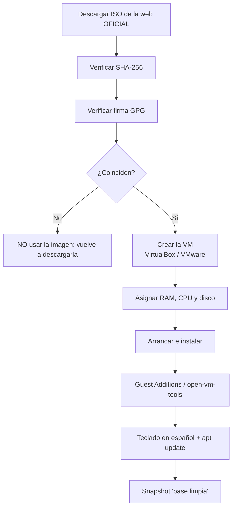

# Montar Kali y Parrot

Vamos a montar tu máquina de ataque **en una máquina virtual**. El proceso tiene dos partes: (1) descargar
la imagen **verificando** que es auténtica e íntegra, y (2) crearla en **VirtualBox** o **VMware** con
unos recursos sensatos. La verificación no es un capricho: si tu ISO viene manipulada o corrupta, todo tu
laboratorio parte de una base falsa.

!!! danger "Recordatorio ético"
    Esta máquina la usarás **solo** contra tu laboratorio o plataformas que te lo autoricen. Tener Kali o
    Parrot instalado no autoriza nada. Lee **[00 · Ética y legalidad](../00-etica-y-legalidad.md)**.

## Objetivos de aprendizaje

- Descargar Kali o Parrot **solo** desde su web oficial.
- **Verificar el checksum SHA-256** y la **firma GPG** de la descarga.
- Crear una máquina virtual en **VirtualBox** y en **VMware** paso a paso.
- Asignar **recursos** razonables y saber por qué.
- Instalar **Guest Additions** (VirtualBox) o **open-vm-tools** (VMware).
- Usar **snapshots** para no perder el trabajo.
- Configurar el **teclado en español** y **actualizar** el sistema.

**Tiempo estimado:** 90–120 min (más el tiempo de descarga).

## Requisitos previos

- **[05 · Elegir distro de hacking](05-elegir-distro-de-hacking.md)**: hazlo después de decidir qué distro usas.
- **[04 · Arranque y virtualización](../01-arquitectura-de-ordenadores/04-arranque-y-virtualizacion.md)**:
  entender qué es un hipervisor y activar la virtualización en la BIOS/UEFI.
- Conexión a Internet y **espacio en disco** suficiente (las imágenes ocupan varios GB; sé generoso).
- VirtualBox o VMware Workstation Player instalados en tu equipo.

## Explicación



### 1) Descargar solo de la web oficial

- Kali: [https://www.kali.org](https://www.kali.org)
- Parrot: [https://parrotsec.org](https://parrotsec.org)

Busca en cada web la sección de **descargas** y elige el formato. Para una máquina virtual normalmente
hay dos caminos:

- **Instalador (ISO):** descargas la ISO y haces la instalación como cualquier sistema.
- **Imagen de VM preconstruida:** descargas un fichero ya listo para VirtualBox o VMware. Es más rápido.

!!! warning "Nunca descargues de terceros"
    ISOs de distros de seguridad desde webs de descargas "rápidas", foros o enlaces acortados son un
    riesgo enorme: pueden venir con software manipulado. Descarga **solo** del dominio oficial.

### 2) Verificar el checksum (SHA-256)

Un **checksum** es una huella: un valor que se calcula a partir del fichero. Si alguien cambia un solo
byte, la huella cambia. Las webs oficiales publican la huella **SHA-256** de cada imagen.

**En Linux/macOS:**

```bash
sha256sum kali-linux-2026.1-installer-amd64.iso
```

**En Windows (PowerShell):**

```powershell
Get-FileHash .\kali-linux-2026.1-installer-amd64.iso -Algorithm SHA256
```

Compara el valor obtenido **carácter a carácter** con el publicado por la distro. Si coinciden, la
descarga es íntegra y auténtica (asumiendo que la web oficial no esté comprometida, para eso está la GPG).

A veces la distro publica un fichero de sumas (por ejemplo `SHA256SUMS`) que puedes comprobar
automáticamente:

```bash
sha256sum -c SHA256SUMS
```

```text
kali-linux-2026.1-installer-amd64.iso: La suma coincide
```

*(salida de ejemplo; el nombre del fichero depende de la versión descargada)*

### 3) Verificar la firma GPG

La firma **GPG** (GNU Privacy Guard) es más fuerte que el checksum: demuestra que **el fichero de sumas
lo publicó realmente la distro** y no un atacante que manipuló la web. El procedimiento general es:

1. Descargar de la **web oficial** el fichero de sumas **y su firma** (por ejemplo `SHA256SUMS` y
   `SHA256SUMS.gpg`).
2. **Importar** la clave pública de la distro (te la descargas de la web oficial).
3. Verificar la firma del fichero de sumas.

```bash
# 1) Importa la clave pública descargada de la web OFICIAL
gpg --import clave-oficial-de-la-distro.asc

# 2) Verifica la firma del fichero de sumas
gpg --verify SHA256SUMS.gpg SHA256SUMS
```

```text
gpg: Firma correcta de "Kali Linux <devel@kali.org>" [desconocido]
gpg:                 usando RSA con ID 1234ABCD5678EF90
Firma válida.
```

*(salida de ejemplo; los nombres, IDs y algoritmos varían)* Lo que importa es ver **"Firma correcta" /
"Good signature"** y que el **fingerprint** coincida con el que publica la distro.

!!! warning "PENDIENTE (TODO-UJACKING)"
    Añadir aquí el **fingerprint real** de las claves oficiales de firma de Kali y Parrot, copiado
    literalmente de sus webs oficiales (https://www.kali.org y https://parrotsec.org). No debe escribirse
    de memoria ni inventarse.

!!! note "GPG en Windows"
    Si usas Windows, instala **Gpg4win** (o usa WSL) y verifica igual. La idea es la misma: importar la
    clave oficial y comprobar la firma del fichero de sumas.

### 4) Crear la máquina virtual en VirtualBox

Pasos (los nombres exactos pueden variar ligeramente según la versión):

1. **Nueva** máquina → nombre (`Kali`), tipo **Linux**, versión **Debian (64-bit)**.
2. **Memoria RAM:** asigna un valor sensato (ver más abajo). Deja RAM libre para tu sistema anfitrión.
3. **Disco duro:** crea uno nuevo, tipo **VDI**, reserva **dinámica**, tamaño **generoso**.
4. **Configuración → Almacenamiento:** monta la ISO descargada en la unidad óptica.
5. **Configuración → Sistema → Procesador:** asigna 2 (o más) CPUs si tu equipo lo permite. Marca
   "Habilitar VT-x/AMD-V" si aparece.
6. **Configuración → Red:** deja **NAT** por ahora (para actualizar). El laboratorio lo montamos en la
   [página 07](07-laboratorio-red-virtual.md).
7. **Arranca** y sigue el instalador de la distro.
8. **Guest Additions:** con la VM encendida, menú **Dispositivos → Insertar imagen de CD de las Guest
   Additions** y ejecuta el instalador; o instala los paquetes de guest que la distro empaqueta.

### 5) Crear la máquina virtual en VMware

VMware (Workstation Player/Pro en Windows/Linux, Fusion en macOS) es muy parecido:

1. **Crear nueva máquina virtual** → modo típico (o personalizado si quieres control fino).
2. Selecciona el **instalador (ISO)** que descargaste.
3. Tipo de sistema: **Linux**, versión **Debian 64-bit**.
4. Nombre y ubicación; disco **nuevo** con tamaño generoso.
5. **Personalizar hardware:** RAM, CPUs.
6. Arranca e instala.
7. **open-vm-tools** para que funcionen la integración (portapapeles, redimensionar pantalla, carpetas
    compartidas…).

### 6) Recursos recomendados

Aquí los números **dependen de tu equipo** y de la edición. Como **orientación** (no oficial):

| Recurso | Orientación | Comentario |
| --- | --- | --- |
| RAM de la VM de ataque | 2–4 GB | Con 4 GB trabaja más cómoda. Deja RAM para el anfitrión. |
| CPUs | 2 | Más CPUs ayudan en escaneos, pero quitan potencia al equipo. |
| Disco | Desde ~20–40 GB | Las herramientas y el sistema ocupan bastante. Dinámico. |
| Vídeo | 128 MB | Con 3D si el escritorio lo necesita. |

!!! warning "PENDIENTE (TODO-UJACKING)"
    Confirmar y añadir los **requisitos oficiales mínimos y recomendados** de Kali y Parrot copiados de
    sus webs oficiales, para sustituir estas cifras orientativas por las reales.

!!! tip "Regla de oro de la RAM"
    La suma de RAM de todas las VMs encendidas **nunca** debe acercarse a la RAM total de tu equipo. Si
    tienes 8 GB y quieres Kali + un objetivo, usa 2 GB + 1 GB y deja el resto al anfitrión. ¿Vas justo de
    recursos? Da menos RAM a los objetivos.

### 7) Snapshots: tu máquina del tiempo

Un **snapshot** es una foto del estado de la VM (disco y memoria). Si rompes algo practicando, vuelves al
snapshot en segundos.

- **Cuándo hacer snapshots:** justo después de instalar y configurar ("base limpia"), y antes de cada
  práctica o cambio arriesgado.
- **VirtualBox:** con la VM seleccionada → **Herramientas → Instantáneas** → *Tomar*.
- **VMware:** menú **VM → Instantánea → Tomar instantánea**.

!!! warning "Los snapshots no sustituyen a las copias de seguridad… y engordan"
    Cada snapshot ocupa espacio en disco. No acumules cientos: elimina los que ya no necesites. Y no
    confundas snapshot con backup: si se corrompe el disco virtual, se pierden los dos.

### 8) Teclado en español

En Kali (Xfce), por interfaz: **Aplicaciones → Configuración → Teclado → Distribución**, añade **Español**.

Por consola:

```bash
sudo dpkg-reconfigure keyboard-configuration
```

Y para aplicarlo en la sesión gráfica actual:

```bash
setxkbmap es
```

Para que quede fijo en consola, revisa/edita `/etc/default/keyboard` (busca la opción que sirva a tu
versión) — si dudas, **compruébalo en la documentación oficial** de la distro.

### 9) Actualizar el sistema

En Kali y Parrot (basadas en Debian) se usa `apt`:

```bash
sudo apt update
sudo apt full-upgrade
```

En Kali se recomienda **`full-upgrade`** (no `upgrade`) porque puede resolver dependencias quitando
paquetes que ya no encajan. Si quieres limpiar:

```bash
sudo apt autoremove
```

### 10) Imágenes de VM preconstruidas y dual boot

**Imágenes preconstruidas ("prebuilt"):**

- Son ficheros ya instalados para VirtualBox o VMware. **Ventaja:** funcionan en minutos.
- **Aviso de seguridad:** las creadas de serie suelen traer **credenciales por defecto** y servicios
  activados. Cámbialas antes de usarlas y, sobre todo, no las expongas a la red.
- Comprueba siempre el formato que necesitas (VirtualBox / VMware) y **verifica el checksum** como con la
  ISO.

!!! warning "PENDIENTE (TODO-UJACKING)"
    Confirmar las **credenciales por defecto** de las imágenes preconstruidas actuales de Kali y Parrot
    (usuario/contraseña) desde sus webs oficiales, en vez de darlas por sabidas.

**Dual boot (arranque dual):**

Consiste en instalar Kali/Parrot **junto a** tu sistema actual en el mismo disco. Da mejor rendimiento
(acceso directo al hardware), pero tiene **riesgos reales**:

- Repartir el disco mal escrito puede **borrar** tu sistema existente.
- Windows y Linux comparten el **gestor de arranque** (GRUB); una actualización puede desconfigurarlo.
- Con **BitLocker** (cifrado de Windows), cambiar el arranque puede pedir la clave de recuperación. Tenla
  a mano antes de empezar.
- **Secure Boot** y el "inicio rápido" de Windows a veces interfieren.

**Recomendación:** empieza **siempre** con máquina virtual. El dual boot déjalo para cuando domines el
tema y tengas una **copia de seguridad completa** de tus datos.

## Ejemplos prácticos

### Verificar en una línea (Linux)

```bash
sha256sum kali-linux-2026.1-installer-amd64.iso
```

```text
a1b2c3d4e5f6...  kali-linux-2026.1-installer-amd64.iso
```

*(salida de ejemplo; el valor real es el que publica la web oficial)* Compara esa cadena con la de la web.
Si no coincide **exactamente**, borra el fichero y vuelve a descargarlo.

### Comprobar la virtualización en Linux

```bash
lscpu | grep -i "virtualization"
```

```text
Virtualization:                  VT-x
```

*(salida de ejemplo)* Si aparece `VT-x` (Intel) o `AMD-V`, tu CPU lo soporta. Si no puedes crear la VM,
actívalo en la **BIOS/UEFI**.

### Instalar open-vm-tools (VMware)

```bash
sudo apt update && sudo apt install -y open-vm-tools open-vm-tools-desktop
```

```text
Configurando open-vm-tools (12:12.3.0-1) ...
Configurando open-vm-tools-desktop (12:12.3.0-1) ...
```

*(salida de ejemplo)* Con esto tendrás portapapeles compartido, pantalla que se adapta y demás. En
VirtualBox, el equivalente es instalar las **Guest Additions**.

## Errores comunes

| Error | Por qué ocurre | Solución |
| --- | --- | --- |
| La VM no arranca / "VT-x is disabled" | Virtualización desactivada. | Actívala en BIOS/UEFI y reinicia. |
| El checksum no coincide | Descarga incompleta o manipulada. | Borra y vuelve a descargar de la web oficial. |
| "Falta la clave pública" al verificar GPG | No has importado la clave. | Importa la clave oficial y repite `gpg --verify`. |
| El teclado escribe raro (`@`, `"`) | Distribución de teclado incorrecta. | `setxkbmap es` y configúralo de forma permanente. |
| No se puede redimensionar la pantalla | Faltan las guest tools. | Instala Guest Additions / open-vm-tools. |
| La VM va lentísima | Demasiada RAM/CPU asignada o poco disco libre. | Baja recursos, cierra otras VMs, libera disco. |
| Pantalla compartida con el anfitrión filtrando ficheros | Carpetas compartidas. | Desactívalas entre anfitrión y máquinas **objetivo**. |

## Ejercicios

1. **Verificación completa.** Descarga una ISO oficial y verifica su SHA-256. Anota el valor publicado y
   el obtenido.
2. **Firma GPG.** Importa la clave oficial de tu distro y verifica el fichero de sumas. ¿Qué te dice
   exactamente la salida cuando la firma es válida?
3. **Crea la VM.** Monta tu Kali/Parrot en VirtualBox **o** VMware con 2 CPUs y la RAM que puedas
   permitirte, y documéntalo (RAM, disco, red).
4. **Guest tools.** Instala Guest Additions u open-vm-tools y comprueba que la pantalla se adapta a la
   ventana y que funciona el copiar/pegar.
5. **Snapshot.** Haz un snapshot llamado `base-limpia`, cambia algo (instala un paquete), y luego
   **restaura** el snapshot. ¿Qué ha pasado con el paquete?
6. **Teclado y actualización.** Configura el teclado en español y actualiza el sistema con `apt`.

??? success "Solución"
    1. `sha256sum fichero.iso` (o `Get-FileHash` en Windows). Debe coincidir con la web; si no, no la uses.
    2. `gpg --import clave.asc` y `gpg --verify SHA256SUMS.gpg SHA256SUMS`. La salida debe decir "Firma
       correcta" / "Good signature" y mostrar el autor. Si dice "BAD signature", no uses la imagen.
    3. Respuesta libre, pero debe incluir RAM, CPUs, tamaño de disco y tipo de red (empezamos con NAT).
       Documentarlo te servirá para replicar el laboratorio.
    4. Con open-vm-tools o Guest Additions, la resolución se adapta y el portapapeles funciona. Si no,
       revisa que la VM tenga activado el 3D y que hayas reiniciado.
    5. El paquete **desaparece**: al restaurar el snapshot, la VM vuelve exactamente al estado de la foto.
       Eso es justo lo que quieres tras una práctica.
    6. `setxkbmap es` (sesión) y config permanente según distro; luego `sudo apt update && sudo apt
       full-upgrade`.

## Resumen

- Descarga **solo** de la web oficial y **verifica siempre** SHA-256 y firma GPG.
- La VM se crea igual en VirtualBox y VMware: tipo Debian (64-bit), RAM/CPU sensatos, disco dinámico.
- Empieza con red **NAT**; el aislamiento del laboratorio se monta aparte.
- Instala **Guest Additions** (VirtualBox) u **open-vm-tools** (VMware).
- Haz **snapshots**: "base limpia" tras instalar y uno antes de cada práctica.
- Configura el **teclado en español** y **actualiza** con `apt`.
- Las **imágenes preconstruidas** ahorran tiempo pero traen credenciales por defecto: cámbialas.
- El **dual boot** tiene riesgos (particiones, GRUB, BitLocker): mejor VM primero.

## Checklist

- [ ] He descargado la ISO únicamente desde la web oficial.
- [ ] He verificado el **SHA-256** y coincide.
- [ ] He verificado la **firma GPG** y es válida.
- [ ] Tengo la VM creada y arranca.
- [ ] He asignado RAM/CPU sin dejar sin recursos al anfitrión.
- [ ] He instalado las guest tools y funcionan pantalla y portapapeles.
- [ ] Tengo un snapshot `base-limpia`.
- [ ] El teclado escribe correctamente en español.
- [ ] He ejecutado `apt update` y `apt full-upgrade`.
- [ ] Sé que esta máquina se usa **solo** en laboratorio.

## Para ir más allá

| Recurso | Tipo | Idioma | Precio |
| --- | --- | --- | --- |
| [Kali Linux](https://www.kali.org) | ISO, imágenes de VM y documentación | EN | Gratis |
| [Parrot OS](https://parrotsec.org) | ISO, imágenes de VM y documentación | EN | Gratis |
| [VirtualBox](https://www.virtualbox.org) | Hipervisor y documentación | EN | Gratis |
| [VMware](https://www.vmware.com) | Hipervisor y documentación | EN | Freemium |
| [GnuPG](https://gnupg.org) | Herramienta de verificación de firmas | EN | Gratis |
| [Gpg4win](https://gpg4win.org) | GPG para Windows | EN | Gratis |

## Siguiente paso

Con la máquina de ataque lista, aisla todo en una red propia:
**[07 · Laboratorio de red virtual](07-laboratorio-red-virtual.md)**.
