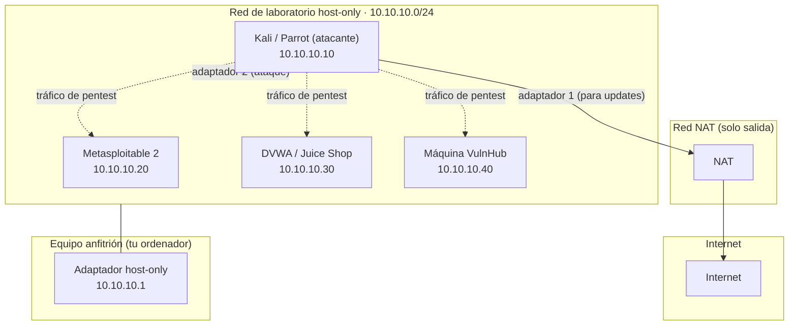

# Laboratorio de red virtual

Un pentester sin laboratorio es como un químico sin laboratorio: no puede practicar sin hacer daño. Esta
página diseña tu **laboratorio aislado**: una red virtual donde tú controlas todo, donde las máquinas
vulnerables **no** están expuestas a Internet y donde puedes romper cosas sin consecuencias.

!!! danger "Recordatorio ético — regla número uno"
    **NUNCA** expongas una máquina vulnerable a Internet. Ni "un momentito". Un objetivo con fallos a la
    vista de Internet es encontrado y comprometido en minutos, y tú serás el responsable. Todo se practica
    **en tu laboratorio o en plataformas autorizadas**:
    **[00 · Ética y legalidad](../00-etica-y-legalidad.md)**.

## Objetivos de aprendizaje

- Explicar qué es un **hipervisor** y los tipos de **red virtual** que ofrece.
- Diferenciar **NAT**, **host-only**, **red interna** y **puente (bridged)** y elegir la correcta.
- Diseñar un laboratorio con **máquina atacante** y **máquinas objetivo**.
- **Aislar** correctamente el laboratorio de tu red real.
- Usar **snapshots** para no perder el estado del laboratorio.
- Conocer las **reglas de seguridad** para no causar daño.

**Tiempo estimado:** 60–90 min.

## Requisitos previos

- **[06 · Montar Kali y Parrot](06-montar-kali-y-parrot.md)**: necesitas al menos tu VM de ataque creada.
- **[04 · Arranque y virtualización](../01-arquitectura-de-ordenadores/04-arranque-y-virtualizacion.md)**.
- Conceptos de **IP y máscara** y de **NAT**:
  **[Direccionamiento IP y MAC](../02-redes/02-direccionamiento-ip-y-mac.md)** y
  **[Dispositivos, topologías y WiFi](../02-redes/09-dispositivos-topologias-y-wifi.md)**.

## Explicación

### La idea: tres zonas separadas

Tu laboratorio tiene tres zonas de red, cada una con un propósito distinto:

1. **Internet (a través del anfitrión):** solo para **actualizar** y descargar herramientas. Debe ser
   **salida**, nunca entrada.
2. **Red de ataque (host-only o interna):** donde se enfrentan tu máquina atacante y los objetivos.
   Aquí ocurre todo.
3. **Tu red real (la de casa/oficina):** debe quedar **fuera**. Si la mezclas con la red de ataque, tus
   escaneos pueden salir a la red de verdad.

### Tipos de red virtual

| Modo | La VM puede… | ¿Se ve desde la red real? | Uso en el laboratorio |
| --- | --- | --- | --- |
| **NAT** | Salir a Internet a través del anfitrión. | No. | Actualizar y descargar. |
| **Host-only** | Hablar con anfitrión y otras VMs host-only. | No. | **Red de ataque recomendada.** |
| **Red interna** | Hablar solo con otras VMs de esa red interna. | No (ni con el anfitrión). | Ataque **más** aislado. |
| **Puente (Bridged)** | Aparece como un equipo **más** en tu red real. | **Sí.** | 🚫 Evitar con máquinas vulnerables. |
| **Solo NAT de red** | Salir a Internet compartiendo una red privada entre VMs. | No. | Alternativa si la necesitas. |

!!! danger "Nunca pongas un objetivo en modo puente"
    Con **bridged**, la máquina vulnerable obtiene una IP de tu red real (la del router de casa, la
    residencia, la oficina). Cualquier persona de esa red puede encontrar y atacar tu objetivo — y,
    además, tu tráfico de ataque **sale** de tu laboratorio. Vulnerable + bridged = accidente esperando.

### Combina NAT + host-only en la máquina atacante

El esquema habitual:

- La **máquina atacante** lleva **dos adaptadores**: uno en **NAT** (para actualizar e instalar
  herramientas) y otro en **host-only** (la red de ataque).
- Las **máquinas objetivo**, **solo** en host-only o en red interna. **Nunca** en NAT ni bridged (una
  máquina vulnerable no tiene por qué salir a Internet).



!!! note "El anfitrión también está en la red host-only"
    En host-only, tu ordenador ve las VMs por su adaptador virtual (`10.10.10.1` en el ejemplo). Es
    cómodo (puedes navegar a DVWA desde el navegador del anfitrión), pero significa que **el anfitrión
    está en la misma red** que los objetivos. Si quieres aislamiento total (ni el anfitrión), usa **red
    interna**.

### Plan de direcciones (ejemplo)

Usar una red privada que **no** choque con tu red real. El rango `10.10.10.0/24` es un buen ejemplo:

| Máquina | Rol | IP (ejemplo) | Red |
| --- | --- | --- | --- |
| Anfitrión | Gateway host-only | `10.10.10.1` | Host-only |
| Kali/Parrot | Atacante | `10.10.10.10` | Host-only (+ NAT) |
| Metasploitable 2 | Objetivo | `10.10.10.20` | Host-only |
| DVWA / Juice Shop | Objetivo web | `10.10.10.30` | Host-only |
| Máquina VulnHub | Objetivo | `10.10.10.40` | Host-only |

!!! tip "Fija las IPs a mano"
    Deja los objetivos con IP **estática** dentro de la red de laboratorio. Así tus notas, tus
    writeups y tus scripts siempre apuntan a la misma dirección y no dependes del DHCP.

### Cómo montarlo — VirtualBox

1. **Archivo → Administrador de red** (o Herramientas) → pestaña **Redes solo-anfitrión** → *Crear*.
   Verás un adaptador tipo `vboxnet0` con una IP (por ejemplo `10.10.10.1`).
2. **VM de ataque → Configuración → Red:** Adaptador 1 = **NAT**; Adaptador 2 = **Red solo-anfitrión**
   (`vboxnet0`).
3. **Máquinas objetivo → Configuración → Red:** Adaptador 1 = **Red solo-anfitrión** (`vboxnet0`).
4. Si quieres máxima separación, cambia host-only por **Red interna** (nombre propio, p. ej. `lab`) en
   **todas** las VMs del laboratorio.

### Cómo montarlo — VMware

1. **Editar → Editor de red virtual** (Virtual Network Editor) para ver/crear las redes `VMnet1`
   (host-only) y `VMnet8` (NAT).
2. **VM de ataque → Configuración → Adaptador de red:** adaptador 1 = **NAT**, adaptador 2 = **Host-only**.
3. **Objetivos →** un único adaptador en **Host-only**.
4. Para aislamiento total, usa un **segmento LAN personalizado / red personalizada**.

!!! warning "PENDIENTE (TODO-UJACKING)"
    Verificar en la documentación oficial de la versión vigente de VirtualBox y VMware los nombres y
    rutas exactos de estos menús (cambian con las versiones) y actualizar este apartado si fuera
    necesario.

### Verificar el aislamiento

Antes de practicar, comprueba dos cosas:

1. **Que la atacante ve al objetivo:**

   ```bash
   ping -c 1 10.10.10.20
   ```

2. **Que el objetivo NO tiene salida a Internet** (no debe responder):

   ```bash
   ping -c 3 8.8.8.8
   ```

   *(Ejecutado **desde el objetivo**)* Si responde, ese objetivo está en NAT o bridged: cámbialo a
   host-only/interna.

!!! danger "Prueba de fuga de red"
    Un laboratorio mal montado no solo es peligroso: puede **filtrar tu tráfico de ataque a la red de
    verdad**. Antes de lanzar un escaneo, pregúntate: *¿qué distintas redes hay en juego y a cuál estoy
    apuntando?* `ip a` y `ip route` en tu atacante te lo dicen.

### Snapshots: la estrategia

- `base-limpia` en la atacante, **antes** de instalar herramientas raras.
- `objetivo-limpio` en cada máquina objetivo, **antes** de atacarla.
- Tras cada práctica: restaura, no "reparas". Así el laboratorio siempre está en buen estado.

### Reglas de seguridad del laboratorio

Estas reglas no son negociables:

1. **Nunca** expongas una máquina vulnerable a Internet ni en modo puente.
2. **Nunca** practiques contra redes, equipos o servicios que no sean tuyos.
3. **Aísla** el laboratorio (host-only o red interna) y verifica el aislamiento.
4. **Desactiva** carpetas compartidas y portapapeles compartido entre el anfitrión y las máquinas
   **objetivo** (una máquina vulnerable puede usarlos para salir).
5. **Snapshots** antes de cada práctica; restaura al terminar.
6. **No** guardes en el laboratorio datos reales, claves ni credenciales personales.
7. **Documenta** lo que haces: es la base de un buen **writeup** y te protege si algo se investiga.

## Ejemplos prácticos

### 1. Ver tus interfaces y rutas en la atacante

```bash
ip -brief address
ip route
```

```text
lo               UNKNOWN        127.0.0.1/8 ::1/128
eth0             UP             10.0.2.15/24
eth1             UP             10.10.10.10/24

default via 10.0.2.2 dev eth0
10.0.2.0/24 dev eth0 proto kernel scope link src 10.0.2.15
10.10.10.0/24 dev eth1 proto kernel scope link src 10.10.10.10
```

*(salida de ejemplo)* `eth0` en `10.0.2.0/24` es la red **NAT** (VirtualBox usa `10.0.2.x` por defecto);
`eth1` en `10.10.10.0/24` es la red de **laboratorio**. La ruta `default` sale por NAT: para Internet; el
tráfico a `10.10.10.0/24` va directo por host-only.

### 2. Descubrir los objetivos de la red de laboratorio

```bash
sudo nmap -sn 10.10.10.0/24
```

```text
Nmap scan report for 10.10.10.1
Host is up (0.00042s latency).
Nmap scan report for 10.10.10.20
Host is up (0.00068s latency).
Nmap scan report for 10.10.10.30
Host is up (0.00055s latency).
```

*(salida de ejemplo)* `-sn` hace un **ping scan**: descubre qué hosts están vivos sin escanear puertos.
Es lo primero que se hace en un pentest (y en un laboratorio). Lo estudiarás a fondo en
**[Nmap en profundidad](../../nivel-2-medio/05-nmap-en-profundidad.md)**.

### 3. Ver los puertos abiertos de un objetivo del laboratorio

```bash
nmap -sV 10.10.10.20
```

```text
PORT     STATE SERVICE     VERSION
21/tcp   open  ftp         vsftpd 2.3.4
22/tcp   open  ssh         OpenSSH 4.7p1
80/tcp   open  http        Apache httpd 2.2.8
```

*(salida de ejemplo, recortada)* Solo se escanea **el objetivo de tu laboratorio**. `-sV` intenta
identificar la versión de cada servicio. Los servicios y versiones varían según la máquina objetivo.

## Errores comunes

| Error | Por qué ocurre | Solución |
| --- | --- | --- |
| El objetivo tiene Internet | Está en NAT o bridged. | Ponlo en host-only/interna y verifica con `ping 8.8.8.8`. |
| La atacante no ve al objetivo | Están en redes distintas. | Revisa que ambas VM compartan el mismo adaptador host-only/interno. |
| Dejé el objetivo en bridged "un momento" | Parecía más cómodo. | Cámbialo **ya**. Nunca bridged con vulnerables. |
| IPs cambiando cada vez | DHCP en la red de laboratorio. | Configura IP **estática** en los objetivos. |
| Rompí el objetivo y no lo recupero | No había snapshot. | Restaura el snapshot `objetivo-limpio`; si no existe, reinstala. |
| El anfitrión es alcanzable desde el objetivo | Host-only incluye al anfitrión. | Usa **red interna** para aislarte también del anfitrión. |
| Portapapeles/carpetas compartidas activas | Comodidad. | Desactívalas en los **objetivos**; son una vía de escape. |

## Ejercicios

1. **Crea la red host-only.** En tu hipervisor, crea una red solo-anfitrión y anota su IP de gateway.
2. **Conecta la atacante.** Añade un segundo adaptador host-only a tu Kali/Parrot y verifica con `ip a`
   que tiene IP en esa red.
3. **Añade un objetivo.** Conecta una VM objetivo **solo** a la red host-only (más adelante, la
   [página 08](08-maquinas-objetivo.md) te da máquinas concretas).
4. **Verifica el aislamiento.** Desde el objetivo, comprueba que **no** hay salida a Internet; desde la
   atacante, comprueba que **sí** la hay (por el adaptador NAT).
5. **Descubre la red.** Desde la atacante, haz `nmap -sn` sobre la red del laboratorio y localiza todas
   las máquinas encendidas.
6. **Snapshots.** Crea un snapshot en cada VM, cambia algo, y restaura. Documenta el proceso.

??? success "Solución"
    1. VirtualBox: Administrador de red → Redes solo-anfitrión → Crear (aparece `vboxnet0`, gateway
       `10.10.10.1` típicamente). VMware: Editor de red virtual → `VMnet1`. Anota la IP.
    2. Añades "Adaptador 2: Red solo-anfitrión" en la configuración de la VM. `ip -brief address` debe
       mostrar dos interfaces con IP (una NAT `10.0.2.x`, otra `10.10.10.x`).
    3. En la VM objetivo, un único adaptador en host-only. Debe obtener IP del mismo rango.
    4. Desde el objetivo: `ping -c 3 8.8.8.8` no debe responder. Desde la atacante: sí debe responder por
       el adaptador NAT. Si el objetivo responde, cambia su red.
    5. `sudo nmap -sn 10.10.10.0/24`. Aparecerán el gateway del anfitrión y cada VM encendida.
    6. En VirtualBox: Herramientas → Instantáneas → *Tomar*. Cambia un fichero, restaura, y verás que
       vuelve al estado anterior. Documenta nombre y momento de cada snapshot.

## Resumen

- El laboratorio tiene tres zonas: **Internet** (solo salida), **red de ataque** (host-only/interna) y
  tu **red real** (fuera).
- La atacante usa **NAT + host-only**; los objetivos, **solo** host-only/interna.
- **Nunca bridged** con máquinas vulnerables, **nunca** expuestas a Internet.
- Verifica siempre el aislamiento (`ping 8.8.8.8` desde el objetivo).
- IPs **estáticas** y **snapshots** antes de cada práctica.
- La **red interna** aísla incluso del anfitrión; host-only es más cómodo pero incluye al anfitrión.

## Checklist

- [ ] Entiendo la diferencia entre NAT, host-only, interna y bridged.
- [ ] Tengo creada una red host-only (o interna) con IP de gateway.
- [ ] Mi atacante tiene adaptador NAT **y** adaptador de laboratorio.
- [ ] Mis objetivos están **solo** en la red de laboratorio.
- [ ] He verificado que un objetivo **no** tiene salida a Internet.
- [ ] Uso IPs estáticas en los objetivos.
- [ ] Tengo snapshots `base-limpia` / `objetivo-limpio`.
- [ ] He desactivado portapapeles/carpetas compartidas en los objetivos.
- [ ] Tengo clara la regla: nada de máquinas vulnerables fuera del laboratorio.

## Para ir más allá

| Recurso | Tipo | Idioma | Precio |
| --- | --- | --- | --- |
| [Documentación de VirtualBox](https://www.virtualbox.org) | Redes virtuales y snapshots | EN | Gratis |
| [Documentación de VMware](https://www.vmware.com) | Redes virtuales y snapshots | EN | Freemium |
| [Nmap](https://nmap.org) | Descubrimiento de red | EN | Gratis |
| [TryHackMe](https://tryhackme.com) | Salas con laboratorios ya montados | EN | Freemium |
| [Hack The Box](https://www.hackthebox.com) | Máquinas y laboratorios online | EN | Freemium |

## Siguiente paso

Red aislada y atacante lista. Ahora, a por los objetivos:
**[08 · Máquinas objetivo](08-maquinas-objetivo.md)**.
