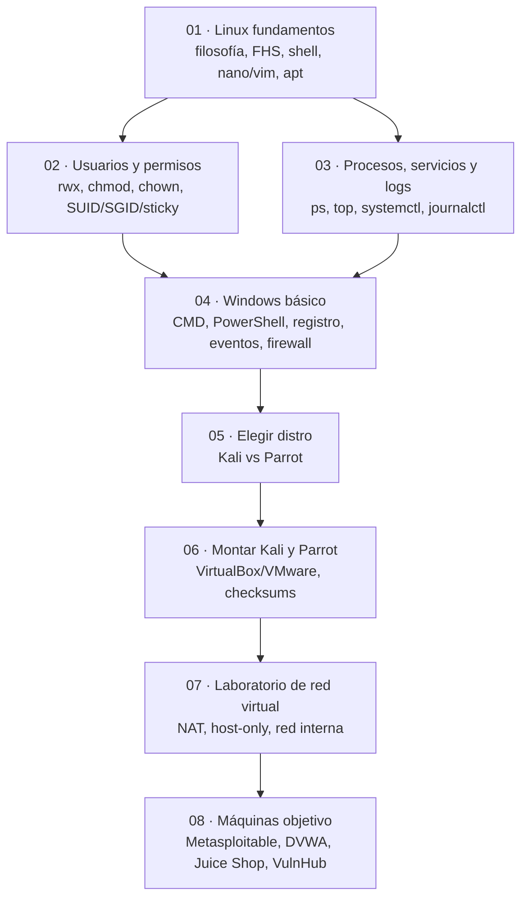

# 03 · Sistemas operativos

**El terreno donde ocurre todo.** Los programas, los usuarios, los permisos y las redes viven dentro
de un sistema operativo. En este módulo aprendes a moverte por **Linux** y **Windows**, entiendes cómo
se organizan, y montas el **laboratorio aislado** con el que practicarás el resto del curso.

Linux es el sistema que usarás como atacante la mayor parte del tiempo; Windows es el sistema que te
encontrarás como objetivo en muchísimas empresas. Necesitas los dos.

[Empezar por Linux · fundamentos](01-linux-fundamentos.md){ .md-button .md-button--primary }

## Objetivos de aprendizaje

Al terminar este módulo serás capaz de:

- Explicar qué es Linux, qué es una distribución y dónde encaja la **shell**.
- Moverte por el árbol de directorios del sistema (estándar **FHS**) y entender para qué sirve cada carpeta.
- Crear, editar y guardar ficheros con **nano** y con **vim** a nivel básico.
- Instalar, actualizar y quitar software con **`apt`**.
- Entender **usuarios, grupos y permisos** en Linux, incluidos los bits especiales **SUID/SGID/sticky**.
- Ver **procesos, servicios y logs** en Linux (ps, top, systemctl, journalctl).
- Moverte con soltura por **Windows** a nivel básico: estructura, permisos, CMD, PowerShell, registro,
  servicios, eventos y firewall.
- Decidir entre **Kali Linux** y **Parrot OS** y entender por qué ninguna es tu sistema diario.
- Montar **tu propio laboratorio virtual aislado** con máquinas atacante y objetivo.

**Tiempo estimado:** 10–14 horas repartidas en varias sesiones (es el módulo más largo de Nivel 1).

## Requisitos previos

- Haber leído **[00 · Ética y legalidad](../00-etica-y-legalidad.md)**: en este módulo empiezas a usar
  herramientas reales y necesitas tener claras las reglas.
- Saber qué es un **sistema de ficheros** y cómo arranca un ordenador:
  **[04 · Arranque y virtualización](../01-arquitectura-de-ordenadores/04-arranque-y-virtualizacion.md)**.
- Un ordenador con **virtualización activada** en la BIOS/UEFI y, a ser posible, **8 GB de RAM** o más.
  Si vas justo de recursos, lo comentamos en el apartado de recursos recomendados.

## Explicación

### El mapa del módulo

Este módulo mezcla **sistema base**, **administración** y **laboratorio**. El orden no es casual: primero
aprendes a caminar por Linux, luego a gestionarlo, después ves Windows, y solo al final montas las
máquinas con las que practicarás.



### Las 8 páginas

| # | Página | Qué resuelve |
| --- | --- | --- |
| 01 | [Linux · fundamentos](01-linux-fundamentos.md) | Filosofía de Linux, jerarquía de directorios, shell, editores y `apt`. |
| 02 | [Linux · usuarios y permisos](02-linux-usuarios-y-permisos.md) | Usuarios, grupos, `rwx`, octal y simbólico, `chmod`, bits especiales. |
| 03 | [Linux · procesos, servicios y logs](03-linux-procesos-servicios-y-logs.md) | `ps`, `top`, `htop`, `kill`, `systemctl`, `/var/log` y `journalctl`. |
| 04 | [Windows · básico](04-windows-basico.md) | Estructura, usuarios y permisos, CMD, PowerShell, registro, eventos y firewall. |
| 05 | [Elegir distro de hacking](05-elegir-distro-de-hacking.md) | Kali vs Parrot: diferencias reales y por qué no son sistemas diarios. |
| 06 | [Montar Kali y Parrot](06-montar-kali-y-parrot.md) | Paso a paso en VirtualBox y VMware, verificando la descarga. |
| 07 | [Laboratorio de red virtual](07-laboratorio-red-virtual.md) | Diseño de la red, aislamiento, snapshots y reglas de seguridad. |
| 08 | [Máquinas objetivo](08-maquinas-objetivo.md) | Metasploitable, DVWA, Juice Shop, WebGoat y VMs de VulnHub. |

!!! info "¿Por qué Linux y también Windows?"
    En ciberseguridad casi nunca eliges "uno de los dos". Atacas **Linux** (servidores web, contenedores,
    la mayoría de Internet), analizas **Windows** (los puestos de trabajo de las empresas) y muchas veces
    usas ambos en el mismo laboratorio. Ver los dos desde el principio te ahorra sorpresas después.

## Ejemplos prácticos

Antes de empezar con la página 01, comprueba en qué sistema estás. Estas órdenes funcionan en cualquier
Linux (si aún no tienes Linux, verás cómo montarlo en la página 06):

```bash
uname -a
```

```text
Linux kali 6.1.0-kali5-amd64 #1 SMP PREEMPT_DYNAMIC Debian 6.1.12-1kali1 x86_64 GNU/Linux
```

*(salida de ejemplo)* Se lee así: nombre del kernel (`Linux`), nombre del equipo (`kali`), versión del
kernel, arquitectura (`x86_64` = 64 bits). No memorices los números; cámbialos por los de tu máquina.

```bash
cat /etc/os-release
```

```text
PRETTY_NAME="Kali GNU/Linux rolling"
NAME="Kali GNU/Linux"
ID=kali
VERSION_ID="2024.1"
ID_LIKE=debian
HOME_URL="https://www.kali.org/"
```

*(salida de ejemplo, recortada)* Aquí ves la **distribución** (no solo el kernel) y su base (`debian`).

## Errores comunes

| Error | Qué pasa | Solución |
| --- | --- | --- |
| Copiar comandos sin leerlos | Ejecutas algo que no entiendes y rompes el sistema. | Lee `man comando` antes de ejecutar algo que no conozcas. |
| Trabajar siempre como `root` | Un error tonto afecta a todo el sistema. | Usa tu usuario normal y `sudo` solo cuando haga falta. |
| Instalar Linux solo "para atacar" | Acabas con un sistema frágil y sin base. | Primero entiende cómo funciona; las herramientas vienen después. |
| Practicar contra redes reales | Es delito, no un juego. | Todo se practica en **tu laboratorio** (páginas 07 y 08). |
| No leer los mensajes de error | Los errores dicen exactamente qué falla. | Lee la última línea del error antes de buscarla en internet. |

## Ejercicios

1. **Localiza tu sistema.** Ejecuta `uname -r` y `cat /etc/os-release`. ¿Qué versión de kernel y qué
   distribución tienes?
2. **Planifica tu equipo.** Anota cuánta RAM y cuánto espacio libre en disco tienes. Según eso, decide
   cuántas máquinas virtuales podrás tener encendidas a la vez.
3. **Verifica virtualización.** Averigua si tu CPU soporta virtualización y si está activada en la
   BIOS/UEFI.
4. **Analiza un error.** Provoca un error a propósito (por ejemplo, `ls /no-existe`) y describe qué
   información te da el mensaje.
5. **Diseña el orden de estudio.** Ordena las 8 páginas de este módulo según lo que crees que te costará
   más, y marca en tu calendario cuándo harás cada una.

??? success "Solución"
    1. En un Linux Debian/Kali verías algo como `6.1.0-kali5-amd64` y `ID=kali`. En Ubuntu, `ID=ubuntu`.
       Lo importante es que sepas **distinguir kernel** (versión del núcleo) de **distribución** (el conjunto).
    2. Regla orientativa: con 8 GB de RAM funciona un laboratorio de 2 VMs ligeras (Kali + una objetivo);
       con 16 GB trabajas cómodo con 3–4. Linux + Windows a la vez es lo que más RAM consume.
    3. En Linux: `lscpu | grep -i virtualization` (muestra `VT-x`/`AMD-V`) o `grep -E "vmx|svm" /proc/cpuinfo`
       (si imprime línea, está soportado). En Windows, Administrador de tareas → Rendimiento → CPU.
       Si el soporte aparece pero no puedes virtualizar, actívalo en la BIOS/UEFI.
    4. El mensaje `ls: cannot access '/no-existe': No such file or directory` te dice **qué** programa
       falló (`ls`), **qué** ruta (`/no-existe`) y **por qué** (no existe). Ese patrón se repite siempre.
    5. No hay una respuesta única. Lo habitual: fundamentos y permisos primero (base), luego procesos y
       logs, después Windows, y al final lab y máquinas objetivo (que consumen recursos).

## Resumen

- Un **sistema operativo** gestiona hardware, ficheros, usuarios, procesos y permisos; es donde vive todo lo demás.
- **Linux** es el sistema del atacante y de la mayoría de servidores; **Windows**, el de la mayoría de puestos de empresa.
- En este módulo pasas de la teoría de ficheros y permisos a un **laboratorio virtual aislado** en marcha.
- **Nunca** practicas fuera de tu laboratorio o de plataformas que lo autorizan explícitamente.
- El orden recomendado es: fundamentos → permisos → procesos/logs → Windows → distro → montaje → red virtual → máquinas objetivo.

## Checklist

- [ ] Sé distinguir **kernel**, **distribución** y **shell**.
- [ ] Conozco un editor de texto en consola y puedo guardar un fichero.
- [ ] Entiendo la diferencia entre usuario normal, `root` y `sudo`.
- [ ] Sé qué son los permisos `rwx` y qué significan los bits SUID/SGID/sticky.
- [ ] Puedo ver procesos y servicios y sé qué son los logs.
- [ ] Me manejo a nivel básico con CMD y PowerShell.
- [ ] He decidido qué distro usar y por qué.
- [ ] Tengo claro que Kali/Parrot van en una **máquina virtual**, no como sistema diario.
- [ ] He leído las reglas de aislamiento del laboratorio (página 07).

## Para ir más allá

| Recurso | Tipo | Idioma | Precio |
| --- | --- | --- | --- |
| [Pagina oficial de Kali Linux](https://www.kali.org) | Documentación y descargas | EN | Gratis |
| [Parrot Security](https://parrotsec.org) | Documentación y descargas | EN | Gratis |
| [Debian](https://www.debian.org) | Sistema base y documentación | Multi | Gratis |
| [Ubuntu](https://ubuntu.com) | Sistema recomendado para el día a día | Multi | Gratis |
| [VirtualBox](https://www.virtualbox.org) | Hipervisor gratuito | EN | Gratis |
| [VMware](https://www.vmware.com) | Hipervisor (versiones gratuitas y de pago) | EN | Freemium |
| [Páginas man de Linux](https://man7.org) | Referencia de comandos | EN | Gratis |
| [Documentación de Docker](https://docs.docker.com) | Imprescindible para las máquinas objetivo web | EN | Gratis |

## Siguiente paso

Empieza por la base: **[01 · Linux · fundamentos](01-linux-fundamentos.md)**.
