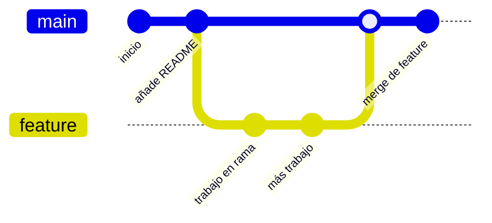

# 01 · Control de versiones

**El control de versiones es la máquina del tiempo de tu trabajo.** Guarda cada cambio que haces en
un proyecto, quién lo hizo y cuándo, y te permite volver a cualquier punto anterior. Esta página
explica el concepto antes de tocar comandos: qué problema resuelve, de dónde viene y por qué Git
(control **distribuido**) se impuso a los sistemas centralizados.

## Objetivos de aprendizaje

Al terminar esta página sabrás:

- Explicar **qué es** el control de versiones y **qué problema resuelve**.
- Reconocer las prácticas de trabajo **sin** control de versiones y sus peligros.
- Distinguir control de versiones **local**, **centralizado** y **distribuido**.
- Entender por qué Git es distribuido y qué ventajas tiene.
- Manejar el **vocabulario básico**: repositorio, commit, rama, merge, remoto.

**Tiempo estimado: 30 min.**

## Requisitos previos

- Ninguno técnico. Idealmente, saber moverte por la terminal
  ([módulo de Bash](../04-bash/index.md)) porque los comandos de Git se ejecutan en ella.

## Explicación

### El problema: "definitivo_v2_final_bueno"

Seguro que has hecho esto alguna vez:

```text
informe.docx
informe_v2.docx
informe_v2_final.docx
informe_v2_final_BUENO.docx
informe_v2_final_BUENO_ESTE_SI.docx
```

Es la forma "manual" de versionar: copiar el fichero, renombrarlo y rezar. Funciona a pequeña escala
y es un desastre en cuanto hay más de una persona o más de un fichero.

Los problemas típicos:

| Problema | Qué ocurre |
| --- | --- |
| No sabes qué cambió | Dos ficheros con nombres parecidos pero sin historial claro. |
| No sabes quién cambió qué | Sin registro de autoría. |
| No puedes volver atrás | Si te cargas algo, adiós. |
| No puedes trabajar en paralelo | Dos personas editando el mismo fichero se pisan. |
| Miedo a experimentar | "Como lo rompa, no hay vuelta". |

### La solución: un sistema de control de versiones (VCS)

Un **VCS** (*Version Control System*) es una herramienta que:

1. **Registra** cada cambio (un *commit*) con autor, fecha y mensaje.
2. **Guarda el historial** completo, no solo la última versión.
3. Permite **volver atrás** a cualquier punto.
4. Permite **trabajar en paralelo** mediante ramas y fusionarlas.
5. Facilita **colaborar** sin pisarse.

Git es hoy el VCS más usado del mundo (gratuito y de código abierto). Nació en 2005, creado por Linus
Torvalds para el desarrollo del kernel de Linux.

### Evolución: local, centralizado, distribuido

**1. Control de versiones local**

Todo pasa en tu ordenador. La primera generación copiaba ficheros enteros; luego aparecieron
herramientas como RCS que guardaban solo los cambios (deltas).

```text
[ Tu equipo ]
   ├── versión 1
   ├── versión 2
   └── versión 3      ← todo en una sola máquina
```

Problema: si se rompe el disco, se pierde **todo** el historial. Y colaborar es imposible.

**2. Control de versiones centralizado (CVCS)**

Hay **un servidor central** con la historia. Los clientes se conectan a él. Ejemplos clásicos:
CVS, **Subversion (SVN)**.

```text
        ┌───────────────────┐
        │  SERVIDOR CENTRAL │  ← el único que tiene TODO el historial
        └─────────┬─────────┘
      ┌───────────┼───────────┐
      ▼           ▼           ▼
  [cliente A] [cliente B] [cliente C]
   (solo copia de trabajo)
```

Ventajas: administración sencilla, todos parten de la misma fuente.
Inconveniente: **punto único de fallo**. Si el servidor cae, nadie trabaja. Y el historial vive solo
ahí.

**3. Control de versiones distribuido (DVCS)**

**Cada copia es un repositorio completo**, con todo el historial incluido. Ejemplos: **Git**,
Mercurial.

```text
   ┌───────────────┐         ┌───────────────┐
   │  REPO A       │◄───────►│  REPO B       │
   │ (historial    │  sync   │ (historial    │
   │  completo)    │         │  completo)    │
   └───────────────┘         └───────────────┘
          ▲
          │
   ┌───────────────┐
   │  REPO C       │
   │ (historial    │
   │  completo)    │
   └───────────────┘
```

Ventajas:

- **No hay punto único de fallo**: si un repositorio desaparece, cualquiera de los otros tiene la
  historia completa.
- Puedes **trabajar sin conexión** (commits locales) y sincronizar después.
- Es **rápido**: la mayoría de operaciones son locales.

!!! note "GitHub no es Git"
    Git es la **herramienta** (local). GitHub es una **plataforma web** que aloja repositorios Git
    remotamente y añade funciones como Pull Requests, Issues, Actions, etc. Puedes usar Git sin
    GitHub y hay alternativas a GitHub (GitLab, Gitea, Bitbucket…), pero en esta web usamos GitHub
    por ser el más popular y gratuito.

### Comparativa rápida

| | Local | Centralizado (SVN) | Distribuido (Git) |
| --- | --- | --- | --- |
| Dónde está el historial | Una máquina | Un servidor | **Todas** las copias |
| Trabajar sin conexión | Sí (pero solo tú) | No (necesitas servidor) | **Sí, con todo** |
| Punto único de fallo | Tu disco | El servidor | Ninguno |
| Ramas | Difícil | Poco ágiles | **Baratas y rápidas** |
| Ejemplos | RCS | SVN, CVS | **Git**, Mercurial |

### Cómo piensa Git: instantáneas, no diferencias

Otra idea clave: otros VCS guardan **listas de cambios** (deltas) entre versiones. Git guarda
**instantáneas**: cada commit es una foto del proyecto completo (con referencias a los ficheros que no
cambiaron). Esto hace las operaciones muy rápidas y las ramas muy baratas.

### Vocabulario básico

| Término | Significado |
| --- | --- |
| **Repositorio (repo)** | La carpeta del proyecto, con su historial oculto en `.git/`. |
| **Commit** | Una "foto" guardada de tu proyecto, con mensaje y autor. |
| **Rama (branch)** | Una línea de desarrollo independiente. La principal suele llamarse `main`. |
| **Merge** | Fusionar una rama con otra. |
| **Remoto (remote)** | Copia del repositorio en un servidor (p. ej. `origin` en GitHub). |
| **Clonar** | Copiar un repositorio completo, con su historial. |
| **Staging area (índice)** | Zona intermedia donde preparas qué incluir en el próximo commit. |



### ¿Y esto para ciberseguridad?

Muchísimo. Lo usarás para:

- **Versionar tus scripts** (los del módulo de Bash) y volver atrás si rompes algo.
- **Escribir writeups** de máquinas y retos en Markdown.
- **Construir tu portfolio** público: un perfil de GitHub con proyectos demuestra lo que sabes hacer.
- **Contribuir a proyectos** de código abierto, incluida esta web.
- Entender cómo **se despliegan** webs (GitHub Pages) y cómo se **gestiona el código** en equipos.

## Ejemplos prácticos

### Ejemplo 1 · Ver si un directorio ya es un repositorio

```bash
ls -la
```

```text
drwxr-xr-x  .git            ← si existe esta carpeta, es un repositorio Git
-rw-r--r--  README.md
```

La carpeta `.git/` es donde Git guarda **toda** la historia. Bórrala y pierdes el historial; el
proyecto seguiría existiendo pero "sin memoria".

### Ejemplo 2 · Dónde se guarda la configuración

```bash
cat ~/.gitconfig
```

```text
[user]
    name = Tu Nombre
    email = tu@email.com
```

Ahí viven tus datos de Git (se configuran en la página siguiente).

### Ejemplo 3 · Ventaja de "distribuido": todo es local

Una vez clonado un repositorio, mira su historial **sin conexión a internet**:

```bash
git log --oneline
```

```text
b4c3d2a Añade chuleta de Bash        (salida de ejemplo)
91f8e7d Corrige enlace roto
2a1b0c9 Primer commit
```

Se ejecuta al instante porque la historia está en tu máquina, no en un servidor remoto.

## Errores comunes

| Error | Causa | Solución |
| --- | --- | --- |
| "Pensar que Git y GitHub son lo mismo" | Son cosas distintas. | Git es local; GitHub aloja repos remotos. |
| "Borrar `.git/` para limpiar" | Elimina todo el historial. | No lo hagas salvo que quieras empezar de cero. |
| "Subir el repo entero a un ZIP" | Duplica espacio y pierde historia. | Usa `git clone`/`git push`. |
| Editar el historial a mano | Corrompe el repo. | Usa los comandos de Git. |
| Confundir commit con guardar | El commit es explícito. | En Git **tú decides** cuándo se guarda cada foto. |

## Ejercicios

1. Explica con tus palabras la diferencia entre control de versiones centralizado y distribuido.
2. Enumera tres problemas de trabajar con `informe_v2_final_BUENO.docx`.
3. ¿Por qué decimos que en Git las ramas son "baratas"?
4. Averigua si el directorio en el que estás es un repositorio Git (pista: busca `.git`).
5. Busca tu configuración de Git y escribe qué campos aparecen (aunque estén vacíos).
6. Investiga en [git-scm.com](https://git-scm.com) (EN, Gratis) qué VCS distribuidos existen además
   de Git y anota uno.

??? success "Solución"

    **1.** En el **centralizado** hay un único servidor con todo el historial y los clientes solo
    tienen una copia de trabajo; si el servidor cae, no se trabaja. En el **distribuido** cada copia
    es un repositorio completo con toda la historia: se puede trabajar sin conexión y no hay punto
    único de fallo.

    **2.** No sabes qué cambió ni quién; no puedes volver atrás con fiabilidad; si varias personas
    editan, se pisan.

    **3.** Porque crear una rama es solo un puntero a un commit; Git no copia todo el proyecto.

    **4.**
    ```bash
    ls -la | grep "\.git"
    ```
    Si aparece `.git`, es un repositorio.

    **5.**
    ```bash
    git config --list
    ```
    Verás `user.name`, `user.email`, etc. (si Git está instalado y configurado).

    **6.** Además de Git: **Mercurial** (y otros como Bazaar, aunque mucho menos usados hoy).

## Resumen

- El control de versiones **guarda el historial** de un proyecto y permite volver atrás y colaborar.
- **Local** → todo en una máquina; **centralizado** (SVN) → un servidor con la historia;
  **distribuido** (Git) → cada copia tiene todo.
- Git es **distribuido**: rápido, sin conexión y sin punto único de fallo.
- Git guarda **instantáneas** (commits), no listas de diferencias.
- Git ≠ GitHub: Git es la herramienta; GitHub aloja repos remotos.
- Vocabulario: repo, commit, rama, merge, remoto, clonar, staging.

## Checklist

- [ ] Sé explicar qué problema resuelve el control de versiones.
- [ ] Distingo local, centralizado y distribuido.
- [ ] Sé por qué Git es distribuido y sus ventajas.
- [ ] Entiendo estos términos: repo, commit, rama, merge, remoto.
- [ ] Tengo claro que Git y GitHub no son lo mismo.

## Para ir más allá

| Recurso | Tipo | Idioma | Precio |
| --- | --- | --- | --- |
| [Documentación oficial de Git](https://git-scm.com/doc) | Referencia y libro gratuito *Pro Git* | EN | Gratis |
| [GitHub Docs](https://docs.github.com) | Documentación de la plataforma | EN | Gratis |
| [Git · sitio oficial](https://git-scm.com) | Descargas y guías | EN | Gratis |

!!! warning "PENDIENTE (TODO-UJACKING)"
    Falta una guía de introducción a Git **en español** con enlace verificado (curso o libro
    gratuito). Debe añadirla un redactor.

## Siguiente paso

Ya entiendes el concepto. Hora de instalar y usar Git:
**[02 · Git básico](02-git-basico.md)**.
