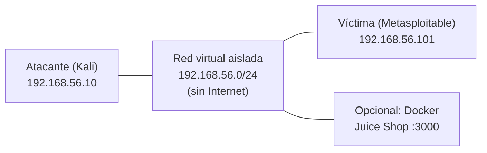

# Tu primer laboratorio (de principio a fin)

**Aquí se junta todo.** Vas a montar un laboratorio aislado, lanzar una máquina objetivo, descubrirla
en la red, escanear sus puertos con Nmap, identificar sus servicios y escribir un informe de pentesting
con tus hallazgos. Es tu primer trabajo completo como pentester, hecho por ti y con herramientas
legales.

## Objetivos de aprendizaje

Al terminar esta página serás capaz de:

- Montar una **red virtual aislada** con una máquina atacante y una víctima.
- Descubrir hosts vivos en tu red con un *ping sweep*.
- Escanear puertos y detectar servicios con **Nmap**, entendiendo cada opción.
- Documentar los hallazgos en una **plantilla de informe** en Markdown.
- Trabajar con la metodología correcta: reconocimiento → enumeración → conclusiones.

**Tiempo estimado:** 90-150 min (incluye montar el laboratorio y hacer tu primer escaneo completo).

## Requisitos previos

Tener montado el laboratorio base es imprescindible. Repasa:

- [03 · Laboratorio de red virtual](03-sistemas-operativos/07-laboratorio-red-virtual.md): cómo crear
  la red aislada (VirtualBox/VMware).
- [03 · Máquinas objetivo](03-sistemas-operativos/08-maquinas-objetivo.md): de dónde sacar la víctima.
- [03 · Montar Kali y Parrot](03-sistemas-operativos/06-montar-kali-y-parrot.md): tu máquina atacante.
- [02 · Herramientas de diagnóstico](02-redes/10-herramientas-de-diagnostico.md): `ping`, `ip`, etc.
- [04 · Comandos esenciales](04-bash/02-comandos-esenciales.md): te mueves por la terminal.

!!! danger "Aviso ético (obligatorio, en serio)"
    Todo lo de esta página se hace **solo** contra tu propio laboratorio aislado o contra plataformas
    que te autorizan por escrito. Escanear, enumerar o atacar sistemas de los que no eres responsable
    es un **delito** en España (y en casi todo el mundo), aunque no "hagas nada más que mirar". Deja tu
    red de laboratorio **sin salida a Internet** y no la conectes jamás a una wifi pública o de la
    universidad.

## Explicación

### La metodología (memorízala desde ya)

Un pentest real sigue un orden. Saltárselo es la marca del aficionado:

```text
1. Reconocimiento   -> ¿qué hay en la red? (¿qué IPs están vivas?)
2. Enumeración      -> ¿qué puertos y servicios tiene cada host?
3. Análisis         -> ¿qué versiones son? ¿hay algo vulnerable?
4. Documentación    -> ¿qué he encontrado? (informe con evidencia)
```

Hoy hacemos las cuatro fases en pequeño. En el Nivel 2 las ampliarás (mira
[Metodología de pentesting](../nivel-2-medio/06-metodologia-de-pentesting.md)).

### El laboratorio que vamos a montar

Tu laboratorio tiene tres piezas:

- **Máquina atacante:** tu Kali/Parrot, donde lanzas las herramientas.
- **Máquina víctima:** una VM vulnerable (Metasploitable, una de VulnHub o similar).
- **Red aislada:** una red virtual "solo-anfitrión" (host-only) o "red interna" (internal), **sin
  Internet**, para que nada se escape.



Y la misma idea en texto, por si prefieres el diagrama ASCII:

```text
   [ KALI - atacante ]                [ METASPLOITABLE - víctima ]
     192.168.56.10                        192.168.56.101
            \                                   /
             \___ Red aislada 192.168.56.0/24 __/
                        (host-only / internal,
                         SIN salida a Internet)
```

Si aún no tienes las VMs, vuelve a
[Laboratorio de red virtual](03-sistemas-operativos/07-laboratorio-red-virtual.md) y
[Máquinas objetivo](03-sistemas-operativos/08-maquinas-objetivo.md). Cuando estén arrancadas y se vean
entre sí, seguimos.

### Nmap en una frase

**Nmap** es el escáner de puertos de referencia: pregunta a un host qué puertos tiene abiertos y qué
servicios escuchan detrás. Lo estudiaremos a fondo en el Nivel 2
([Nmap en profundidad](../nivel-2-medio/05-nmap-en-profundidad.md)); hoy, lo esencial.

## Ejemplos prácticos

### Paso 1 · Comprobar tu red y tus interfaces

Antes de escanear, averigua desde qué interfaz vas a hablar con la víctima:

```bash
ip -brief address
```

```text
lo        UNKNOWN        127.0.0.1/8 ::1/128
eth0      UP             10.0.2.15/24
vboxnet0  UP             192.168.56.1/24            (salida de ejemplo)
```

Explicación línea a línea:

- `lo` — la interfaz de bucle local (*loopback*), siempre presente, IP `127.0.0.1`.
- `eth0` — la interfaz "normal" (puede tener salida a Internet).
- `vboxnet0` — la interfaz de tu red de laboratorio `192.168.56.1/24`: **esta es la que nos interesa**.
- `192.168.56.1/24` significa que tu red es `192.168.56.0` con máscara `/24` (254 hosts posibles).

!!! danger "Aviso ético"
    El host `10.0.2.15` (interfaz `eth0`) suele tener salida a Internet. **Nunca escanees rangos que no
    sean tu `192.168.56.0/24`.** Escanear una red ajena es intrusismo, no práctica.

### Paso 2 · Descubrir hosts vivos (reconocimiento)

Un *ping sweep* pregunta "¿quién está ahí?" sin escanear puertos:

```bash
sudo nmap -sn 192.168.56.0/24
```

```text
Nmap scan report for 192.168.56.1
Host is up (0.00051s latency).
Nmap scan report for 192.168.56.10
Host is up (0.00031s latency).
Nmap scan report for 192.168.56.101
Host is up (0.00042s latency).
... (salida de ejemplo)
Nmap done: 256 IP addresses (3 hosts up) scanned in 4.21 seconds
```

Explicación línea a línea:

- `sudo` — Nmap necesita privilegios para ciertos tipos de sondeo.
- `-sn` — *no port scan*: solo descubre hosts vivos (ping).
- `192.168.56.0/24` — el rango de tu red de laboratorio.
- Cada bloque `Nmap scan report for <IP>` con `Host is up` es un host detectado.
- `.1` suele ser el anfitrión; `.10` eres tú; **`.101` es la víctima** (en tu caso puede ser otra).

Una alternativa clásica es `arp-scan` o `netdiscover`, pero `nmap -sn` es suficiente.

### Paso 3 · Escanear los puertos (enumeración)

Ahora sí: mira qué puertos tiene abiertos la víctima. Tres escaneos, de menos a más profundo.

**3a. Puertos comunes + versiones + scripts básicos (el escaneo "de trabajo"):**

```bash
nmap -sV -sC -oA escaneo_rapido 192.168.56.101
```

- `-sV` — detección de **versión** del servicio (Apache x.y, SSH z…).
- `-sC` — ejecuta los **scripts por defecto** (banner, certificados, algunos fallos conocidos).
- `-oA escaneo_rapido` — guarda la salida en formato normal, XML y grepable con ese prefijo.
- `192.168.56.101` — la IP de la víctima.

**3b. Todos los puertos TCP (más lento, no deja nada sin mirar):**

```bash
nmap -p- --min-rate 2000 192.168.56.101
```

- `-p-` — escanea **los 65535 puertos** TCP (no solo los 1000 habituales).
- `--min-rate 2000` — fuerza al menos 2000 paquetes por segundo (acelera en laboratorio).
- Esta pasada descubre puertos raros que el escaneo por defecto no vería.

**3c. Detección de sistema operativo y todo lo que Nmap pueda:**

```bash
sudo nmap -A -p 22,80,3306 192.168.56.101
```

- `-A` — modo agresivo: incluye `-sV -sC -O` (versión, scripts y detección de SO).
- `-p 22,80,3306` — solo estos puertos (más rápido cuando ya sabes cuáles mirar).

**Ejemplo de salida (resumida, salida de ejemplo):**

```text
Starting Nmap 7.94 ( https://nmap.org ) at 2026-10-18 18:02
Nmap scan report for 192.168.56.101
Host is up (0.00052s latency).
Not shown: 997 closed tcp ports (reset)
PORT     STATE SERVICE     VERSION
22/tcp   open  ssh         OpenSSH 4.7p1 (protocol 2.0)
80/tcp   open  http        Apache httpd 2.2.8 ((Ubuntu))
3306/tcp open  mysql       MySQL 5.0.51a
```

Lectura línea a línea:

- `PORT STATE SERVICE VERSION` — las columnas: puerto, estado, nombre del servicio y versión.
- `open` — el puerto acepta conexiones (esto es lo que buscamos).
- `closed` / `filtered` — cerrado o bloqueado por un firewall.
- Que aparezca **versión** es oro: con ella se buscan vulnerabilidades conocidas (siempre en tu lab).

!!! tip "Guarda siempre la salida"
    Usa `-oA nombre` en cada escaneo. Mañana, cuando escribas tu writeup, tendrás la evidencia sin
    repetir el trabajo.

### Paso 4 · Identificar y verificar servicios

Un puerto abierto con versión es una pista; verifícala. Por ejemplo, si hay un servidor web en el 80:

```bash
curl -sI http://192.168.56.101 | head -n 5
```

```text
HTTP/1.1 200 OK
Server: Apache/2.2.8 (Ubuntu)          (salida de ejemplo)
```

Y para SSH, confirma la versión con su banner:

```bash
nc -v 192.168.56.101 22
```

```text
192.168.56.101 22 open
SSH-2.0-OpenSSH_4.7p1 Debian-8ubuntu1   (salida de ejemplo)
```

Observa que el banner de SSH confirma lo que dijo Nmap. **Verificar siempre** es lo que separa un
informe serio de una lista de puertos.

### Paso 5 · Documentar: plantilla de informe

Un pentest sin informe no existe. Copia esta plantilla en un fichero `informe-lab-01.md` (mejor dentro
de tu repositorio Git, como viste en [Git básico](05-git-y-github/02-git-basico.md)):

```markdown
# Informe de pentesting — Laboratorio 01

- Autor: <tu nombre>
- Fecha: <YYYY-MM-DD>
- Alcance (scope): 192.168.56.101 (laboratorio propio aislado)
- Autorización: laboratorio propio / entorno de práctica autorizado

## 1. Resumen ejecutivo
Dos o tres frases: qué he encontrado y cuán grave es.

## 2. Entorno
- Atacante: Kali 192.168.56.10
- Víctima: Metasploitable 192.168.56.101
- Red: 192.168.56.0/24 (host-only, sin Internet)

## 3. Metodología
Reconocimiento (nmap -sn) -> Enumeración (nmap -sV -sC, -p-) -> Verificación (curl/nc) -> Documentación.

## 4. Hallazgos

### 4.1 Puertos y servicios
| Puerto | Estado | Servicio | Versión |
| --- | --- | --- | --- |
| 22/tcp | open | ssh | OpenSSH 4.7p1 |
| 80/tcp | open | http | Apache 2.2.8 |
| 3306/tcp | open | mysql | MySQL 5.0.51a |

### 4.2 Hallazgo H-01: <título>
- Severidad: Alta / Media / Baja
- Descripción: qué es.
- Evidencia: comando + salida (pegar tal cual).
- Impacto: qué permitiría a un atacante.
- Recomendación: cómo se arregla.

## 5. Conclusiones

## 6. Anexos
- Escaneos en crudo (ficheros generados con -oA).
```

Rellena cada apartado con **evidencia real**. No inventes severidades:

- **Alta:** permitiría acceso o control no autorizado directo.
- **Media:** requiere condiciones o permite información sensible.
- **Baja:** información menor o endurecimiento recomendable.

## Errores comunes

| Error | Causa | Solución |
| --- | --- | --- |
| "Nmap no encuentra la víctima" | Red mal configurada o firewall | Revisa modo host-only y usa `nmap -Pn` |
| "Escaneo lentísimo con `-p-`" | Es normal: son 65.535 puertos | Añade `--min-rate` o hazlo solo una vez |
| "Me sale `filtered` en todo" | Hay firewall | Prueba `-Pn` y otros tipos de escaneo |
| "Escanee el rango 10.0.2.0/24" | Confundiste la interfaz NAT con el lab | Escanea **solo** `192.168.56.0/24` |
| "Informe sin evidencia" | No guardaste la salida | Usa siempre `-oA` |
| "La versión que da Nmap es falsa" | A veces los banners engañan | Verifica con `curl`/`nc` |

## Ejercicios

1. **Monta el laboratorio.** Arranca Kali y la víctima en red host-only y comprueba con `ping` que se
   ven.

    ??? success "Solución"
        ```bash
        ping -c 2 192.168.56.101
        ```

        Debe responder con `64 bytes from ...` (salida de ejemplo). Si no, revisa que ambas VMs estén
        en el **mismo** adaptador host-only.

2. **Descubre los hosts de tu red.** Lanza un *ping sweep* y anota todas las IPs vivas.

    ??? success "Solución"
        ```bash
        sudo nmap -sn 192.168.56.0/24
        ```

        Anota cada `Nmap scan report for <IP>`. Normalmente verás el anfitrión (`.1`), tu atacante y la
        víctima.

3. **Escaneo completo de la víctima.** Obtén puertos abiertos, versiones y scripts por defecto,
   guardando la salida.

    ??? success "Solución"
        ```bash
        nmap -sV -sC -oA escaneo_completo 192.168.56.101
        ```

        Debes ver una tabla `PORT STATE SERVICE VERSION` (salida de ejemplo). Guarda el fichero
        `escaneo_completo.nmap`.

4. **Verifica un servicio web.** Si hay un puerto 80 abierto, confirma el servidor y su versión.

    ??? success "Solución"
        ```bash
        curl -sI http://192.168.56.101 | head -n 5
        ```

        La cabecera `Server:` debe coincidir (o no) con lo que dijo Nmap. Comenta la diferencia en tu
        informe.

5. **Escribe el informe.** Rellena la plantilla `informe-lab-01.md` con al menos **un hallazgo**
   (H-01) con evidencia real.

    ??? success "Solución"
        Respuesta válida: un informe con la tabla de puertos, al menos un hallazgo con severidad,
        descripción, evidencia (comando + salida), impacto y recomendación. La **evidencia pegada tal
        cual** es lo que se evalúa; el texto puede ser más corto o más largo.

6. **Sube el informe a Git.** Versiona tu informe y haz al menos un commit.

    ??? success "Solución"
        ```bash
        cd ~/apuntes-ciberseguridad
        git add informe-lab-01.md
        git commit -m "Informe laboratorio 01: primer escaneo"
        ```

        Comprueba con `git log --oneline` que el commit existe.

7. **Comprueba el aislamiento.** Verifica que tu red de laboratorio no tiene salida a Internet.

    ??? success "Solución"
        ```bash
        ping -c 2 1.1.1.1
        ```

        Desde una red aislada correctamente, este `ping` debe **fallar** (100 % packet loss) o quedarse
        sin respuesta. Si tiene éxito, tu red tiene salida: revisa la configuración de la VM.

## Resumen

- El laboratorio tiene **atacante, víctima y red aislada** (host-only, sin Internet).
- Metodología: **reconocimiento → enumeración → verificación → documentación**.
- `nmap -sn` descubre hosts; `nmap -sV -sC` y `nmap -p-` enumeran puertos y servicios.
- Verifica siempre lo que dice Nmap (`curl`, `nc`).
- Todo pentest termina en un **informe** con evidencia.

## Checklist

- [ ] Tengo el laboratorio montado y aislado de Internet.
- [ ] He confirmado conectividad con la víctima (`ping`).
- [ ] He hecho un *ping sweep* y localizado la víctima.
- [ ] He escaneado puertos y detectado versiones con Nmap.
- [ ] He verificado al menos un servicio con `curl` o `nc`.
- [ ] He escrito un informe con la plantilla y evidencia real.
- [ ] He guardado el informe en mi repositorio Git.
- [ ] Entiendo y respeto el aviso ético: solo laboratorio propio o autorizado.

## Para ir más allá

- **Nmap** — Escáner de puertos. Nivel: todos. Idioma: (EN). **Gratis**.
  [https://nmap.org](https://nmap.org)
- **Nmap en profundidad** (Nivel 2 de UJACKING) — scripting NSE, evasión, rendimiento.
  [Nmap en profundidad](../nivel-2-medio/05-nmap-en-profundidad.md)
- **Metodología de pentesting** (Nivel 2 de UJACKING) — El proceso profesional completo.
  [Metodología de pentesting](../nivel-2-medio/06-metodologia-de-pentesting.md)
- **Cómo hacer writeups** (UJACKING) — Convierte tu informe en una entrada pública.
  [Writeups](../empleabilidad/writeups.md)

## Siguiente paso

Has terminado el contenido del Nivel 1. Toca repasar y medirte:
**[Checklist y autoevaluación](08-checklist-y-autoevaluacion.md)**.
