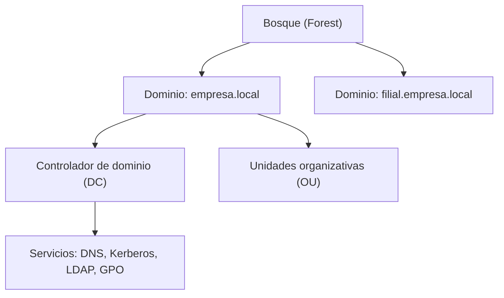
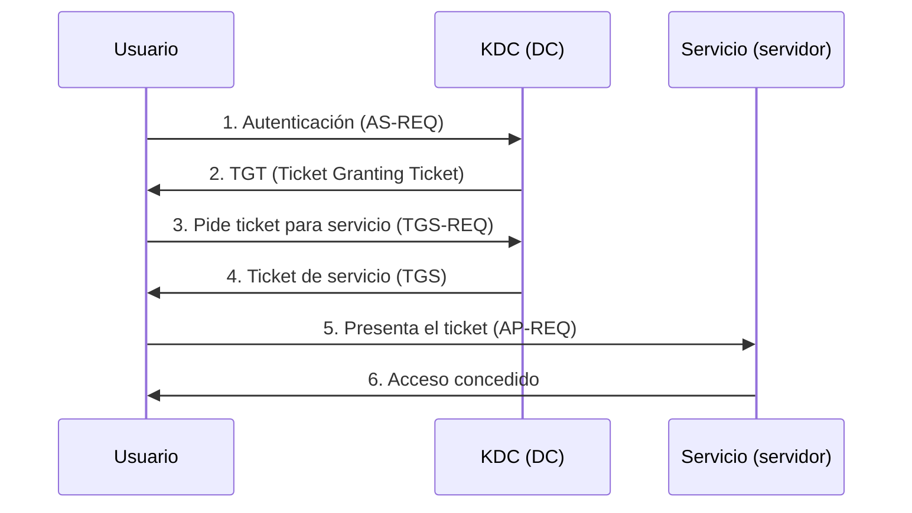

# Windows y Active Directory

En una empresa mediana o grande, el 90 % de los equipos no se administran uno a uno: viven dentro de un
**dominio**. Ese dominio lo gestiona **Active Directory (AD)**, el directorio de identidades de
Microsoft. Para un pentester es el premio mayor: quien controla AD controla la organización entera.

Esta página explica **a alto nivel** cómo funciona AD y cómo se enumera **en laboratorio propio**.

!!! danger "Uso ético y legal"
    La enumeración y el ataque a AD solo se practican contra **tu laboratorio** o plataformas con
    autorización explícita (Hack The Box, TryHackMe, labs propios con VMs). Atacar un dominio ajeno es
    un delito grave. Lee antes [Ética y legalidad](../nivel-1-principiante/00-etica-y-legalidad.md).

## Objetivos de aprendizaje

- Explicar qué es un **dominio**, un **controlador de dominio (DC)** y un **bosque**.
- Diferenciar **usuarios**, **grupos** y **unidades organizativas (OU)**.
- Entender qué son las **GPO** y por qué concentran tanto poder.
- Comprender **Kerberos** y **NTLM** a alto nivel y por qué importan para la seguridad.
- Aprender qué se **enumera** en un dominio y con qué herramientas (conceptual).
- Situar AD en un **pentesting de red interna**.

**Tiempo estimado:** 90–120 min.

## Requisitos previos

- **[Windows básico](../nivel-1-principiante/03-sistemas-operativos/04-windows-basico.md)**: sistema de
  ficheros, usuarios, servicios, `cmd` y PowerShell.
- **[Direccionamiento IP y MAC](../nivel-1-principiante/02-redes/02-direccionamiento-ip-y-mac.md)** y
  **[Protocolos de aplicación](../nivel-1-principiante/02-redes/07-protocolos-de-aplicacion.md)**
  (DNS es clave en AD).
- **Criptografía aplicada** (Nivel 2) ayuda a entender hashes y Kerberos: ver
  [10 · Criptografía aplicada](10-criptografia-aplicada.md).

## Explicación

### El problema que resuelve Active Directory

Imagina 2.000 empleados y 2.000 ordenadores. Sin directorio central, cada equipo tendría sus cuentas,
sus contraseñas y sus políticas. Un caos. AD centraliza todo:

- **Autenticación:** una sola cuenta por persona para todo.
- **Autorización:** qué puede hacer cada cuenta y sobre qué recursos.
- **Gestión:** aplicar políticas de forma masiva a miles de equipos.



| Concepto | Qué es |
| --- | --- |
| **Dominio** | Frontera administrativa y de seguridad. Tiene un nombre DNS (`empresa.local`). |
| **Bosque (forest)** | Conjunto de dominios que comparten esquema y catálogo global. |
| **Árbol** | Dominios con un espacio de nombres común (`a.local`, `b.a.local`). |
| **DC (Domain Controller)** | Servidor que autentica y almacena la base de datos del directorio. |
| **OU (Organizational Unit)** | Carpeta organizativa donde se colocan usuarios/equipos y se aplican GPO. |
| **DN (Distinguished Name)** | Ruta única de un objeto: `CN=Ana,OU=IT,DC=empresa,DC=local`. |
| **SID** | Identificador único de seguridad de cada objeto (`S-1-5-21-...`). |

!!! warning "El DC es la joya de la corona"
    Si un atacante consigue comprometer un DC, tiene todas las credenciales del dominio. Por eso los DC
    están en la red más protegida, con auditoría estricta y sin servicios innecesarios.

### Usuarios, grupos y cuentas especiales

- **Usuarios** de dominio: personas y también *service accounts* (cuentas de servicio).
- **Grupos** de seguridad: agrupan permisos. Los más importantes:
  - `Domain Admins`: administradores del dominio. **Objetivo nº 1**.
  - `Enterprise Admins`: administradores del bosque (solo en el dominio raíz).
  - `Domain Users`: todos los usuarios del dominio.
  - `Administrators`, `Remote Desktop Users`…

Consultar tu contexto:

```powershell
whoami
whoami /all
net user
net group "Domain Admins" /domain
```

### GPO: Group Policy Objects

Una **GPO** es un conjunto de reglas que Windows aplica a usuarios y equipos de una OU. Ejemplos de lo
que hace una GPO:

- Forzar la complejidad de contraseñas.
- Instalar software o mapear unidades de red.
- Deshabilitar la ejecución de scripts con `Software Restriction Policies`.
- Desplegar **scripts de inicio de sesión** o tareas programadas.

Por qué importan a un atacante: si una GPO es **escribible** por un usuario normal, ese usuario puede
ejecutar código como **todos los equipos** de la OU. Es una de las escaladas más potentes de AD.

### Kerberos y NTLM a alto nivel

Windows usa dos protocolos de autenticación principales.

**NTLM**: challenge-response. El servidor envía un reto (*challenge*); el cliente responde con un hash
de la contraseña (*response*). No envía la contraseña en claro, pero el **hash de la contraseña** es
suficiente para autenticarse (por eso existen ataques de *pass-the-hash*). NTLM es antiguo y menos
seguro que Kerberos.

**Kerberos**: basado en **tickets** y en un tercero de confianza (el **KDC**, que corre en el DC).



Términos de Kerberos que oírás siempre:

| Ticket / elemento | Qué es |
| --- | --- |
| **TGT** | *Ticket Granting Ticket*: "carné" inicial que demuestra que te has autenticado. |
| **TGS** | Ticket de servicio: permiso para acceder a **un** servicio concreto. |
| **SPN** | Nombre que identifica un servicio (`MSSQLSvc/sql01.empresa.local`). |
| **KRBTGT** | Cuenta que firma los TGT. Su hash lo compromete todo. |
| **Prefijo `$`** | Cuentas de **equipo** (computer accounts), p. ej. `SRV01$`. |

### AD es un objetivo: por qué

| Factor | Consecuencia |
| --- | --- |
| Un solo dominio de autenticación | Una credencial puede abrir muchas puertas. |
| Delegaciones mal configuradas | Suplantación de usuarios. |
| Contraseñas débiles / cuentas de servicio | Fuerza bruta o *kerberoasting*. |
| GPO escribibles | Ejecución de código masiva. |
| Relaciones de confianza entre dominios | Un dominio débil compromete al bosque. |
| Protocolos heredados (NTLM, SMBv1) | Ataques clásicos de relay. |

### Enumeración conceptual

La primera fase de un pentesting interno es **enumerar** qué hay en el dominio, siempre con las
credenciales o el nivel de acceso que te han autorizado. Herramientas típicas (en laboratorio):

| Herramienta | Qué aporta |
| --- | --- |
| `net` (`net user`, `net group`, `net view`) | Enumeración nativa sin instalar nada. |
| **PowerView** / módulos de PowerShell | Enumeración avanzada desde una sesión de PowerShell. |
| **BloodHound** | Mapea relaciones y caminos hacia Domain Admin (con `SharpHound` como colector). |
| **AD Explorer** / **ldapsearch** | Consultas LDAP crudas. |
| **enum4linux-ng** | Enumeración desde Linux (SMB/RPC/LDAP). |
| **Impacket** | Suite de scripts para protocolos de Windows. |

Un patrón habitual en un laboratorio: consigues unas credenciales de usuario normal, lanzas un colector
tipo SharpHound y cargas los datos en BloodHound para ver el **camino más corto** hasta un grupo
privilegiado.

!!! warning "PENDIENTE (TODO-UJACKING)"
    No existe todavía un **laboratorio AD reproducible propio** en la web. Falta un anexo que describa
    qué VMs montar, cómo promover un DC y qué usuarios/permisos dejar mal configurados a propósito para
    practicar. Debe redactarlo el equipo con capturas del proceso.

### Categorías de ataques (solo mención)

No los detallamos aquí para no convertirlos en un recetario, pero conviene conocer el mapa:

| Categoría | Idea en una línea |
| --- | --- |
| Fuerza bruta / *password spraying* | Probar pocas contraseñas contra muchas cuentas. |
| *Kerberoasting* | Pedir tickets de servicios y crackear su cifrado *offline*. |
| *AS-REP Roasting* | Cuentas sin preautenticación Kerberos. |
| *Pass-the-Hash* | Usar el hash NTLM sin conocer la contraseña. |
| *Relay* NTLM | Reenviar una autenticación a otro servicio. |
| Delegación abusada | Aprovechar configuraciones de delegación. |
| Ataques a certificados (AD CS) | Configuraciones débiles en los servicios de certificados. |

!!! info "Defensa"
    La defensa de AD merece su propio mundo: contraseñas largas, cuentas de servicio gestionadas
    (gMSA), deshabilitar NTLM y SMBv1, segmentación, LAPS para contraseñas locales, auditoría con
    `Advanced Audit Policy` y monitorización con un SIEM. Lo verás en Nivel 3 y en la ruta de
    **[Blue Team](../paths/blue-team-soc.md)**.

## Práctica guiada

En tu laboratorio (una VM Windows Server promovida a DC y una VM de cliente unidas al dominio):

### Ejercicio 1 — Conoce tu identidad

Averigua usuario, SID y grupos.

??? success "Solución"
    ```powershell
    whoami
    whoami /user
    whoami /groups
    ```
    `whoami /user` muestra tu **SID**. Los grupos indican qué te permite hacer el dominio.

### Ejercicio 2 — Enumeración nativa

Sin instalar nada, lista usuarios, grupos y recursos compartidos.

??? success "Solución"
    ```cmd
    net user /domain
    net group /domain
    net group "Domain Admins" /domain
    net view
    ```
    `net view` lista equipos/recursos de la red; requiere el servicio de exploración de red activo.

### Ejercicio 3 — DNS y el dominio

Comprueba el registro del dominio.

??? success "Solución"
    ```cmd
    nslookup empresa.local
    nltest /dsgetdc:empresa.local
    ```
    El DNS es el mapa del dominio: apunta a los DC. Sin DNS el dominio "no existe".

### Ejercicio 4 — Interpreta un DN

Dado `CN=Ana Pérez,OU=Ventas,OU=Madrid,DC=empresa,DC=local`, describe la jerarquía.

??? success "Solución"
    - `CN=Ana Pérez` → objeto (una usuaria).
    - `OU=Ventas` → OU dentro de…
    - `OU=Madrid` → …la OU de la sede de Madrid, dentro de…
    - `DC=empresa,DC=local` → el dominio `empresa.local`.
    Una GPO aplicada a `OU=Madrid` afectaría a todos los objetos que cuelgan de ella.

### Ejercicio 5 — Mapa de un laboratorio AD

Dibuja en un papel: dominio, DC, dos OU, un usuario de cada OU y una GPO. Marca qué GPO aplicaría a
quién.

??? success "Solución"
    Ejemplo:
    ```text
    empresa.local
    ├── DC01 (Windows Server)
    ├── OU=IT
    │    ├── usuario: admin.it
    │    └── GPO: "Contraseñas fuertes IT"
    └── OU=Ventas
         ├── usuario: vendedor1
         └── GPO: "Mapear unidad S:"
    ```
    La GPO de IT solo afecta a los objetos de `OU=IT`, no a los de `OU=Ventas`.

## Para ir más allá

- **Microsoft Learn — Active Directory** — documentación oficial. EN, **Gratis**.
  <https://learn.microsoft.com>
- **BloodHound** — análisis de rutas de ataque en AD. Repositorio, EN, **Gratis**.
  <https://github.com/BloodHoundAD/BloodHound>
- **HackTricks — Active Directory Methodology** — EN, **Gratis**. <https://book.hacktricks.xyz>
- **Hack The Box — módulos de AD** — laboratorios guiados. EN, **Freemium**.
  <https://www.hackthebox.com>
- **TryHackMe — Active Directory** — rutas introductorias. EN, **Freemium**. <https://tryhackme.com>
- **Impacket** — scripts de protocolos Windows. Repositorio, EN, **Gratis**.
  <https://github.com/fortra/impacket>

## Siguiente paso

Con Linux y Windows cubiertos, toca la capa que los une y los protege (o no): la red. Sigue con
**[03 · Redes avanzadas y firewalls](03-redes-avanzadas-y-firewalls.md)**.
