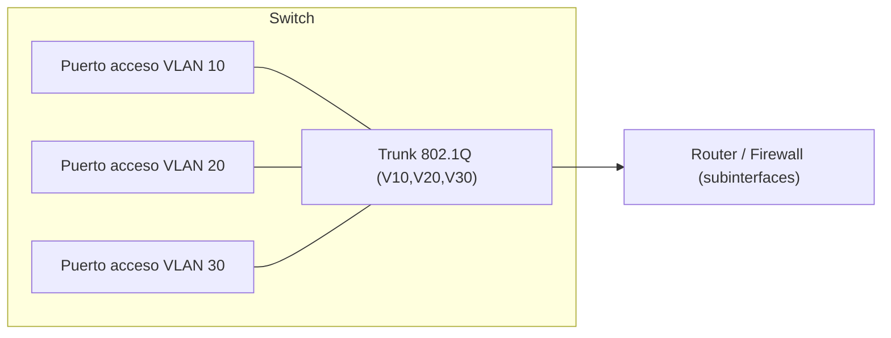

# Redes avanzadas y firewalls

En el Nivel 1 aprendiste a direccionar, hacer subnetting y leer protocolos. Aquí subimos de nivel:
**segmentar** una red con VLANs, **filtrar** tráfico con firewalls (`iptables`/`nftables`), y **encapsular**
comunicaciones con VPNs y proxies. Todo esto es lo que separa una red plana e insegura de una red
defendible… y también lo que hay que entender para evaluarla.

## Objetivos de aprendizaje

- Explicar qué es una **VLAN** y cómo funciona el **trunking** (802.1Q).
- Entender el papel de un **firewall** y sus tipos (stateless, stateful, NGFW).
- Escribir reglas básicas en **`iptables`** y en **`nftables`**.
- Diferenciar **proxy** (forward y reverse) de **VPN**, y sus usos en seguridad.
- Saber qué es un túnel y por qué se usa en pentesting (pivoting), siempre en laboratorio.

**Tiempo estimado:** 90–120 min.

## Requisitos previos

- **[Capa de enlace](../nivel-1-principiante/02-redes/04-capa-de-enlace.md)**: Ethernet, MAC, switch.
- **[Capa de red](../nivel-1-principiante/02-redes/05-capa-de-red.md)** y
  **[Capa de transporte](../nivel-1-principiante/02-redes/06-capa-de-transporte.md)**: IP, TCP/UDP, puertos.
- **[Seguridad en tránsito](../nivel-1-principiante/02-redes/08-seguridad-en-transito.md)**: TLS, túneles.
- **[Dispositivos, topologías y WiFi](../nivel-1-principiante/02-redes/09-dispositivos-topologias-y-wifi.md)**.

## Explicación

### VLANs: dividir un switch en varias redes

Una **VLAN** (Virtual LAN) permite que un mismo switch físico aloje **varias redes lógicas** aisladas.
Cada VLAN es como un switch independiente. Ventajas:

- **Aislamiento**: el tráfico de invitados no ve el de servidores.
- **Rendimiento**: menos dominios de difusión (*broadcast domains*).
- **Seguridad**: obliga a pasar por un router/firewall para hablar entre VLANs.

| Concepto | Significado |
| --- | --- |
| **VLAN de acceso** | Puerto del switch que pertenece a **una** VLAN (ordenador, impresora). |
| **Trunk** | Enlace que transporta **varias** VLANs (switch↔switch, switch↔router). |
| **802.1Q** | Estándar que añade una **etiqueta** de 4 bytes al frame indicando la VLAN. |
| **VLAN nativa** | VLAN del tráfico **sin etiquetar** en un trunk (punto clásico de error). |
| **VLAN 1** | VLAN por defecto en muchos equipos; mala práctica dejarla en uso. |



Cada VLAN suele tener su propia subred IP (por ejemplo, VLAN 10 = `192.168.10.0/24`). La seguridad de
VLAN incluye evitar el **VLAN hopping** (saltar de una VLAN a otra explotando la VLAN nativa o
negociación DTP): en un switch serio, la VLAN nativa se cambia y se desactiva DTP en los puertos.

### Firewalls: filtrar qué pasa

Un **firewall** decide qué tráfico entra y sale según reglas. Tipos:

| Tipo | Cómo funciona |
| --- | --- |
| **Stateless** (sin estado) | Evalúa cada paquete aislado. Rápido, pero tonto. |
| **Stateful** | Recuerda conexiones: permite la respuesta de una salida legítima. |
| **NGFW** (next-gen) | Añade inspección de aplicación, IDS/IPS, control por usuario. |
| **WAF** | Firewall específico para HTTP, protege aplicaciones web. |

Política recomendada: **denegar por defecto**, permitir solo lo necesario (*least privilege*).

### `iptables` con ejemplos

`iptables` es la herramienta clásica de Linux (familia `netfilter`). Organiza reglas en **tablas**
(`filter`, `nat`, `mangle`) y **cadenas** (`INPUT`, `OUTPUT`, `FORWARD`). En la tabla `filter`:

```bash
# Ver las reglas actuales (con contadores)
sudo iptables -L -v -n

# Política por defecto: denegar entrada
sudo iptables -P INPUT DROP

# Permitir tráfico local (loopback)
sudo iptables -A INPUT -i lo -j ACCEPT

# Permitir conexiones ya establecidas o relacionadas
sudo iptables -A INPUT -m conntrack --ctstate ESTABLISHED,RELATED -j ACCEPT

# Permitir SSH (22) desde la red local
sudo iptables -A INPUT -p tcp -s 192.168.1.0/24 --dport 22 -j ACCEPT

# Permitir HTTP/HTTPS desde cualquier origen
sudo iptables -A INPUT -p tcp -m multiport --dports 80,443 -j ACCEPT

# Registrar y descartar el resto (DROP silencioso) — ya lo hace la política -P
sudo iptables -A INPUT -j LOG --log-prefix "INPUT-DROP: "
```

Puntos clave:

- `-A` añade la regla al **final** de la cadena; `-I` la inserta al principio.
- `-j` es la **acción** (`ACCEPT`, `DROP`, `REJECT`, `LOG`…).
- `DROP` descarta en silencio; `REJECT` responde con un error (más informativo y, a veces, más útil).
- **Las reglas de `iptables` no persisten** al reiniciar salvo que las guardes (`iptables-save`,
  `netfilter-persistent`, o el gestor de tu distro).

!!! danger "Cuidado con bloquear tu propio SSH"
    Si estás conectado por SSH y pones `-P INPUT DROP` sin haber permitido tu puerto, te quedas fuera.
    Prueba siempre en una VM, ten consola local y usa `iptables -L` antes de aplicar cambios.

### `nftables`: el reemplazo moderno

`nftables` sustituye a `iptables` en las distros actuales. La sintaxis es distinta pero más limpia:

```bash
sudo nft list ruleset

sudo nft add table inet filtro
sudo nft add chain inet filtro entrada '{ type filter hook input priority 0; policy drop; }'
sudo nft add rule inet filtro entrada iif lo accept
sudo nft add rule inet filtro entrada ct state established,related accept
sudo nft add rule inet filtro entrada tcp dport 22 ip saddr 192.168.1.0/24 accept
sudo nft add rule inet filtro entrada tcp dport { 80, 443 } accept
```

Tabla de equivalencias:

| `iptables` | `nftables` |
| --- | --- |
| `iptables -L` | `nft list ruleset` |
| `-A INPUT` | `add rule ... entrada` |
| `-p tcp --dport 22` | `tcp dport 22` |
| `-s 192.168.1.0/24` | `ip saddr 192.168.1.0/24` |
| `-m conntrack --ctstate` | `ct state` |
| `-P INPUT DROP` | `policy drop` en la cadena |

### VPN, proxies y túneles

| Tecnología | Qué hace | Uso típico |
| --- | --- | --- |
| **VPN** (p. ej. WireGuard, OpenVPN, IPsec) | Túnel cifrado entre dos puntos: te comportas como si estuvieras en la red remota. | Trabajo remoto, unir sedes. |
| **Proxy forward** | Intermediario para tus **salidas**: el cliente le pide que pida por él. | Filtrado de salida, anonimato, pentesting web. |
| **Proxy reverso** | Intermediario para las **entradas**: recibe las peticiones y las reparte a los servidores internos. | Publicar webs, balanceo, WAF, ocultar la infra. |
| **Túnel / pivoting** | Redirigir tráfico a través de una máquina comprometida para llegar a redes internas. | Pentesting interno. |

Diferencia esencial: un proxy **forward** lo configura el **cliente**; uno **reverso** lo configura el
**servidor** y el cliente ni se entera.

El **pivoting** (usar una máquina comprometida como "rampa") es técnica ofensiva: se practica **solo en
laboratorio**. Suele combinarse con *port forwarding* y con proxies SOCKS para tunelizar escaneos.

!!! warning "VPN ≠ anonimato"
    Una VPN comercial oculta tu IP a los sitios que visitas, pero el proveedor de la VPN te ve a ti.
    No es una herramienta de anonimato fuerte. No confundas "cifrado" con "privacidad".

## Práctica guiada

Todo en tu **laboratorio**. Si usas VMs, haz una copia (*snapshot*) antes de trastear con el firewall.

### Ejercicio 1 — Inspecciona las reglas actuales

Muestra las reglas de `iptables` y de `nftables` sin tocar nada.

??? success "Solución"
    ```bash
    sudo iptables -L -v -n
    sudo nft list ruleset
    ```
    Anota qué política tienen las cadenas (`ACCEPT` o `DROP`) y qué puertos están abiertos.

### Ejercicio 2 — Firewall mínimo funcional

Configura una política que permita solo loopback, conexiones establecidas, SSH desde tu LAN y HTTP/HTTPS;
deniega el resto.

??? success "Solución"
    ```bash
    sudo iptables -F
    sudo iptables -P INPUT DROP
    sudo iptables -A INPUT -i lo -j ACCEPT
    sudo iptables -A INPUT -m conntrack --ctstate ESTABLISHED,RELATED -j ACCEPT
    sudo iptables -A INPUT -p tcp -s 192.168.1.0/24 --dport 22 -j ACCEPT
    sudo iptables -A INPUT -p tcp -m multiport --dports 80,443 -j ACCEPT
    sudo iptables -L -v -n
    ```
    Recuerda: al reiniciar se pierde, salvo que lo persistas.

### Ejercicio 3 — Repite con `nftables`

Crea la misma política con `nft`.

??? success "Solución"
    ```bash
    sudo nft flush ruleset
    sudo nft add table inet filtro
    sudo nft add chain inet filtro entrada '{ type filter hook input priority 0; policy drop; }'
    sudo nft add rule inet filtro entrada iif lo accept
    sudo nft add rule inet filtro entrada ct state established,related accept
    sudo nft add rule inet filtro entrada tcp dport 22 ip saddr 192.168.1.0/24 accept
    sudo nft add rule inet filtro entrada tcp dport { 80, 443 } accept
    sudo nft list ruleset
    ```

### Ejercicio 4 — Diseña el direccionamiento de VLANs

Una empresa quiere separar: invitados, empleados, servidores. Propón VLANs, subredes y reglas entre ellas.

??? success "Solución"
    Ejemplo:
    | VLAN | Nombre | Subred | Puede acceder a |
    | --- | --- | --- | --- |
    | 10 | Empleados | `10.0.10.0/24` | Servidores (solo puertos necesarios), Internet |
    | 20 | Invitados | `10.0.20.0/24` | Solo Internet |
    | 30 | Servidores | `10.0.30.0/24` | Internet (salida limitada) |
    Regla de oro: **invitados no** llegan a servidores ni a empleados. Todo el tráfico entre VLANs pasa
    por el firewall.

### Ejercicio 5 — Distingue proxy y VPN

Clasifica: (a) tu navegador con un proxy configurado, (b) nginx que reparte peticiones a tres apps,
(c) WireGuard entre tu casa y la oficina.

??? success "Solución"
    - (a) Proxy **forward** (lo configura el cliente).
    - (b) Proxy **reverso** (nginx delante de las apps).
    - (c) **VPN** (túnel cifrado que te integra en la red remota).

## Para ir más allá

- **Documentación de `nftables`** — proyecto oficial. EN, **Gratis**.
  <https://netfilter.org>
- **`man iptables` / `man nft`** — local. EN, **Gratis**. <https://man7.org>
- **WireGuard** — VPN moderna. Web oficial, EN, **Gratis**. <https://www.wireguard.com>
- **RFC 7348 (VXLAN)** e **IEEE 802.1Q** — estándares. EN, **Gratis**.
  <https://www.rfc-editor.org>
- **TryHackMe — Network Security / Wireshark** — práctica. EN, **Freemium**. <https://tryhackme.com>
- **Tutorial clásico de `iptables`** — referencia histórica. EN, **Gratis**.
  <https://netfilter.org> · PENDIENTE verificar enlace concreto: TODO-UJACKING

!!! warning "PENDIENTE (TODO-UJACKING)"
    Falta una **práctica guiada de segmentación con VLANs** usando un switch gestionable real o un
    switch virtual (GNS3/EVE-NG). El equipo debe decidir la herramienta y documentar la topología y
    los comandos exactos, que dependen del fabricante.

## Siguiente paso

Con la red segmentada y filtrada, vamos a **automatizar** tareas de seguridad con código. Sigue con
**[04 · Python para seguridad](04-python-para-seguridad.md)**.
