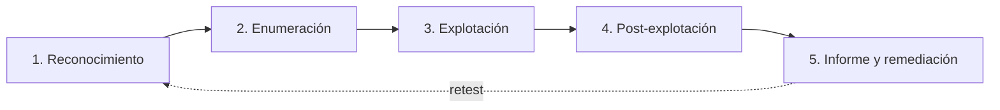

# Metodología de pentesting

Un pentest no es "lanzar exploits y ver qué pasa". Es un **proyecto** con fases, alcance firmado,
documentación y un informe final que el cliente pueda entender y accionar. Esta página te da el método
que se usa en el mundo real y que se espera de ti en cualquier entrevista o certificación.

!!! danger "Ética y legalidad"
    Un pentest **siempre** va precedido de un **contrato y autorización por escrito** que define el
    alcance. Sin ese documento, no es un pentest: es un delito. Esto vale también para tus prácticas:
    laboratorio propio o plataformas que lo autorizan.

## Objetivos de aprendizaje

- Explicar las **fases** de un pentest y qué se hace en cada una.
- Diferenciar pruebas de **caja negra**, **caja gris** y **caja blanca**.
- Redactar un **alcance** y unas **reglas de enfrentamiento (RoE)** realistas.
- Entender la diferencia entre **vulnerabilidad**, **exploit**, **riesgo** y **amenaza**.
- Conocer la estructura de un **informe profesional** y cómo priorizar hallazgos.

**Tiempo estimado:** 60–90 min.

## Requisitos previos

- **[Ética y legalidad](../nivel-1-principiante/00-etica-y-legalidad.md)**: el marco obligatorio.
- **[Nmap en profundidad](05-nmap-en-profundidad.md)**: herramienta base de enumeración.
- Conocer los sistemas operativos: **[Linux](../nivel-1-principiante/03-sistemas-operativos/01-linux-fundamentos.md)**
  y **[Windows](../nivel-1-principiante/03-sistemas-operativos/04-windows-basico.md)**.

## Explicación

### Qué es y qué no es un pentest

Un **pentest** (prueba de penetración) es una **simulación autorizada** de un ataque, con objetivo de
medir el riesgo real y ayudar a priorizar las correcciones. No es:

- Un ataque real.
- Un escaneo automático y a correr.
- Una auditoría de cumplimiento (aunque puede alimentarla).

### Fases



| Fase | Qué haces | Ejemplos de técnicas |
| --- | --- | --- |
| **1. Reconocimiento** | Recopilar información sin tocar (o apenas) el objetivo. | OSINT, `whois`, DNS, Google dorks, Shodan. |
| **2. Enumeración** | Descubrir servicios, versiones, usuarios, rutas, tecnología. | Nmap, `gobuster`, `enum4linux`, lectura de respuestas. |
| **3. Explotación** | Convertir un hallazgo en acceso o en prueba de impacto. | Exploits de versiones conocidas, fallos lógicos, credenciales débiles. |
| **4. Post-explotación** | Medir hasta dónde llega el acceso; escalar y moverse lateralmente (en el alcance acordado). | Privesc, recolección de evidencias, pivoting. |
| **5. Informe** | Documentar hallazgos, impacto y recomendaciones. | Clasificación por riesgo, evidencias, pasos de reproducción. |

!!! info "Recolecta durante, no después"
    Toma notas y capturas **mientras** trabajas: comandos exactos, timestamps, salidas. Reconstruir un
    pentest al final es un infierno y arruina el informe.

### Tipos de pruebas

| Tipo | Qué sabe el auditor | Ventajas | Inconvenientes |
| --- | --- | --- | --- |
| **Caja negra** | Nada (simula un atacante externo). | Realista. | Lento; no cubre todo el sistema. |
| **Caja gris** | Información parcial (credenciales bajas, arquitectura). | Equilibrio realista/eficiente. | Menos "puro". |
| **Caja blanca** | Todo (código, esquemas, credenciales de admin). | Cobertura máxima. | Menos realista. |

La **caja gris** es la más habitual en consultoría real.

### Alcance y Reglas de Enfrentamiento (RoE)

El **alcance** (scope) define **qué** se puede tocar. Las **RoE** definen **cómo**. Ambas se firman
**antes** de empezar.

Alcance (ejemplos):

- Direcciones IP / rangos concretos.
- Nombres de dominio y subdominios incluidos (y **excluidos**).
- Aplicaciones y entornos (producción vs. preproducción).
- Ventanas horarias permitidas.

Reglas de enfrentamiento (ejemplos):

| Aspecto | Ejemplo de regla |
| --- | --- |
| Horario | "Solo entre 22:00 y 06:00". |
| Técnicas prohibidas | "Nada de denial of service ni fuerza bruta a producción". |
| Cuentas de prueba | "Se usarán las cuentas X e Y facilitadas por el cliente". |
| Datos | "No exfiltrar datos reales; usar canarios". |
| Contacto de emergencia | "Si un servicio cae, avisar a <contacto>". |
| Límites de velocidad | "Máximo N peticiones/segundo". |

Deja claro **qué pasa si te sales del alcance**: es la causa nº 1 de conflictos legales en pentesting,
incluso con buena intención.

### Vocabulario que no puedes confundir

- **Activo**: algo con valor (servidor, dato, reputación).
- **Amenaza**: quién o qué puede dañar el activo.
- **Vulnerabilidad**: debilidad que puede ser explotada.
- **Exploit**: técnica o código que aprovecha la vulnerabilidad.
- **Riesgo**: probabilidad × impacto. Es lo que se prioriza.
- **Severidad / CVSS**: puntuación del hallazgo (base + entorno).

Una vulnerabilidad crítica en un sistema de test sin datos puede ser un riesgo **bajo**. Contexto manda.

### Estructura de un informe

Un informe profesional tiene, como mínimo:

1. **Portada y datos**: cliente, fechas, autor(es), versión del documento.
2. **Resumen ejecutivo** (1–2 páginas, sin jerga): qué se probó, qué se encontró, riesgo global,
   prioridades. Lo lee la dirección.
3. **Alcance y metodología**: qué se probó, cómo, con qué limitaciones.
4. **Hallazgos**: uno por uno, con:
   - Título y severidad.
   - Descripción.
   - Evidencia (capturas, comandos).
   - Impacto.
   - **Remediación** concreta.
   - Referencias (CWE / OWASP).
5. **Conclusiones y roadmap**: orden recomendado de corrección.
6. **Anexos**: herramientas, salidas crudas, glosario.

Tabla mínima de un hallazgo:

| Campo | Contenido |
| --- | --- |
| ID | `F-01` |
| Título | "Contraseña de administrador débil en el panel X". |
| Severidad | Alta |
| Descripción | Qué es y por qué ocurre. |
| Evidencia | Captura + comando. |
| Impacto | "Un atacante obtiene acceso total al panel". |
| Remediación | "Forzar política de contraseñas + MFA + bloqueo por intentos". |

!!! tip "Escribe para dos públicos"
    El **resumen ejecutivo** va para quien decide y no es técnico. Los **hallazgos** van para quien
    arregla. Si mezclas ambos, el informe no sirve a nadie.

### Buenas prácticas personales

- **Checklist y notas**: usa Obsidian, CherryTree o Markdown en git.
- **Reproduce cada hallazgo** antes de escribirlo. Nada de "creo que es vulnerable".
- **No inventes severidades**: justifícalas con impacto y explotabilidad.
- **Respeta el alcance aunque "veas" algo tentador fuera de él**. Se documenta y se avisa, no se toca.
- **Retest**: muchos informes incluyen una segunda pasada tras las correcciones.

## Práctica guiada

### Ejercicio 1 — Define un alcance

Tu cliente es "Tienda S.L." con web `tienda.local`, DC `dc.tienda.local` y 3 servidores internos.
Escribe un alcance de una página (qué entra, qué no, horario, contacto).

??? success "Solución"
    Ejemplo de respuesta (resumido):
    ```text
    Alcance INCLUIDO:
    - Web tienda.local (público) y su preproducción.
    - Rango interno 10.0.30.0/24 (3 servidores: web, ficheros, ERP).
    - DC dc.tienda.local: solo desde caja gris con cuenta de usuario estándar.
    EXCLUIDO:
    - Cualquier otro sistema de la red 10.0.0.0/16.
    - Dispositivos médicos / IoT.
    - Pruebas de DoS y de fuerza bruta contra producción.
    HORARIO: 22:00–06:00.
    CONTACTO DE EMERGENCIA: responsable IT (teléfono).
    ```

### Ejercicio 2 — Clasifica pruebas

¿Qué tipo de prueba es cada caso? (a) solo una URL pública; (b) credenciales de usuario normal + esquema
de la red; (c) acceso al código y a la BD.

??? success "Solución"
    - (a) **Caja negra**.
    - (b) **Caja gris**.
    - (c) **Caja blanca**.

### Ejercicio 3 — Escribe un hallazgo

Dado: "El servidor SSH acepta contraseñas y no tiene bloqueo por intentos". Redacta el hallazgo con
severidad, impacto y remediación.

??? success "Solución"
    ```text
    F-01 · Autenticación SSH por contraseña sin bloqueo
    Severidad: Media-Alta
    Descripción: sshd permite login con contraseña y no limita intentos fallidos.
    Evidencia: salida de nmap --script ssh-auth-methods + pruebas de login en laboratorio.
    Impacto: un atacante puede probar credenciales de forma ilimitada hasta acertar.
    Remediación: deshabilitar PasswordAuthentication, usar claves, instalar bloqueo
    (fail2ban), restringir el acceso por red y activar MFA donde se pueda.
    ```

### Ejercicio 4 — Ordena las fases

Coloca en orden: enumeración, informe, reconocimiento, explotación, post-explotación.

??? success "Solución"
    1. Reconocimiento → 2. Enumeración → 3. Explotación → 4. Post-explotación → 5. Informe.

### Ejercicio 5 — RoE ante imprevisto

Durante una prueba cae un servicio del cliente. ¿Qué haces?

??? success "Solución"
    - **Parar** de inmediato la actividad relacionada.
    - **Documentar** hora, acción y efecto.
    - **Avisar** al contacto de emergencia definido en las RoE.
    - **No borrar** evidencia ni reiniciar a lo loco.
    - Reflejarlo en el informe, aunque se resuelva solo.

## Para ir más allá

- **PTES (Penetration Testing Execution Standard)** — estándar metodológico. EN, **Gratis**.
  <http://www.pentest-standard.org>
- **OWASP WSTG** — guía de pruebas web. EN, **Gratis**. <https://owasp.org>
- **NIST SP 800-115** — guía técnica de pruebas. EN, **Gratis**. <https://csrc.nist.gov>
- **MITRE ATT&CK** — tácticas y técnicas de adversarios reales. EN, **Gratis**. <https://attack.mitre.org>
- **PortSwigger — Web Security Academy** — práctica web guiada. EN, **Gratis**.
  <https://portswigger.net/web-security>
- **`report` de Hack The Box / plantillas de informe** — EN, **Freemium**. <https://www.hackthebox.com>

## Siguiente paso

Ya tienes el método. Ahora el terreno donde más dinero y más vulnerabilidades hay: la web. Sigue con
**[07 · Seguridad web y OWASP Top 10](07-seguridad-web-y-owasp-top-10.md)**.
