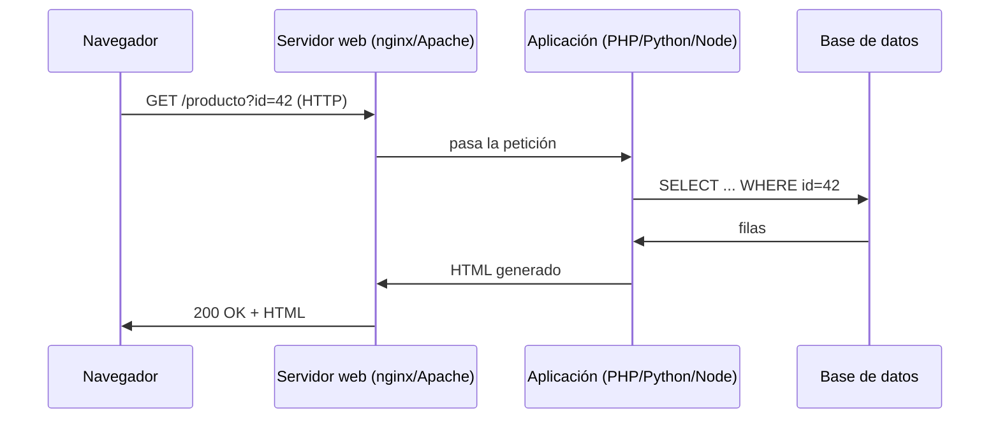

# Seguridad web y OWASP Top 10

La web es el servicio más expuesto de cualquier organización y, por tanto, donde más se ataca. Esta
página explica **cómo funciona una aplicación web** por debajo y repasa el **OWASP Top 10**, la lista de
referencia de las categorías de vulnerabilidad más críticas, con ejemplos conceptuales y su mitigación.

!!! danger "Uso ético y legal"
    Todas las técnicas se practican **solo** contra tu laboratorio o contra plataformas diseñadas para
    ello, como [PortSwigger Web Security Academy](https://portswigger.net/web-security). Atacar una web
    que no es tuya es un delito. Ver [Ética y legalidad](../nivel-1-principiante/00-etica-y-legalidad.md).

## Objetivos de aprendizaje

- Explicar el viaje de una petición web: navegador → HTTP → servidor → aplicación → base de datos.
- Entender **métodos HTTP**, **cookies**, **sesiones** y las tres partes de una URL.
- Conocer las **10 categorías del OWASP Top 10** y qué las causa.
- Reconocer el **patrón** de cada vulnerabilidad y **cómo se mitiga**.
- Practicar en un entorno legal (PortSwigger Academy).

**Tiempo estimado:** 120 min.

## Requisitos previos

- **[Protocolos de aplicación](../nivel-1-principiante/02-redes/07-protocolos-de-aplicacion.md)**: HTTP.
- **[Seguridad en tránsito](../nivel-1-principiante/02-redes/08-seguridad-en-transito.md)**: TLS.
- **[PortSwigger Web Security Academy](../nivel-1-principiante/06-donde-practicar/04-portswigger-web-security-academy.md)**:
  la plataforma de práctica recomendada.
- Nociones de HTML/JS ayudan. También el **[modo desarrollador](../nivel-1-principiante/02-redes/11-wireshark.md)**
  del navegador (pestaña *Network*).

## Explicación

### Cómo funciona la web



Piezas clave:

- **URL**: `https://tienda.com:443/producto?id=42#resenas`
  - `https` = esquema · `tienda.com` = host · `:443` = puerto · `/producto` = ruta · `?id=42` = *query* ·
    `#resenas` = fragmento (solo navegador).
- **Métodos HTTP**: `GET` (leer), `POST` (crear/enviar), `PUT`/`PATCH` (actualizar), `DELETE` (borrar),
  `HEAD`, `OPTIONS`.
- **Cabeceras**: metadatos. En petición, `Host`, `User-Agent`, `Cookie`; en respuesta, `Set-Cookie`,
  `Content-Type`, `Content-Length`.
- **Cookies y sesión**: el servidor entrega un **identificador de sesión** (`Set-Cookie`) y el navegador
  lo devuelve en cada petición. Quien robe esa cookie, roba la sesión.
- **Estado y códigos**: `200` OK, `301/302` redirección, `400` mala petición, `401/403` sin autenticar /
  prohibido, `404` no encontrado, `500` error interno.

### El triángulo de la confianza rota

Casi toda vulnerabilidad web nace de lo mismo: la aplicación **confía** en datos que vienen del usuario
(parámetros, cabeceras, cookies, formularios) sin validarlos ni escaparlos. El atacante introduce datos
maliciosos y el sistema los trata como código o como instrucciones.

### OWASP Top 10

La lista que sigue corresponde a la edición **2021**, la más ampliamente referenciada. OWASP publica
ediciones nuevas cada pocos años; consulta siempre la vigente en su web.

| Código | Categoría | En una frase |
| --- | --- | --- |
| A01 | **Broken Access Control** | Se puede hacer lo que no deberías (ver datos de otros, ser admin). |
| A02 | **Cryptographic Failures** | Cifrado mal usado o ausente: datos sensibles al descubierto. |
| A03 | **Injection** | El input se convierte en código (SQL, comandos, LDAP…). |
| A04 | **Insecure Design** | El fallo está en el diseño, no en la línea de código. |
| A05 | **Security Misconfiguration** | Configuraciones por defecto, cuentas abiertas, errores que revelan. |
| A06 | **Vulnerable and Outdated Components** | Librerías y software desactualizados con fallos conocidos. |
| A07 | **Identification and Authentication Failures** | Login débil, sesiones mal gestionadas. |
| A08 | **Software and Data Integrity Failures** | Confiar en actualizaciones/datos sin verificar su integridad. |
| A09 | **Security Logging and Monitoring Failures** | El ataque ocurre y nadie se enteró. |
| A10 | **Server-Side Request Forgery (SSRF)** | Hacer que el **servidor** haga peticiones en tu nombre. |

!!! warning "PENDIENTE (TODO-UJACKING)"
    Verificar si OWASP ya publicó una edición **posterior a 2021** (por ejemplo, una edición 2025) y, si
    es así, actualizar la tabla y revisar los subapartados para reflejar la pérdida/ganancia de
    categorías. Enlace de referencia: <https://owasp.org/Top10/>.

#### A01 · Broken Access Control

El fallo más común. La aplicación no comprueba **si tú puedes** hacer algo, solo **si estás logueado**.

- Ejemplo conceptual: `/factura?id=1001`. Cambias `id=1002` y ves la factura de otro (IDOR, *Insecure
  Direct Object Reference*).
- Otro: un panel `/admin` protegido solo ocultando el enlace.
- **Mitigación**: autorización en el **servidor** en cada petición, denegar por defecto, referencias
  indirectas, revisar pruebas de acceso con distintos roles.

#### A02 · Cryptographic Failures

Todo lo relacionado con proteger datos "en tránsito" y "en reposo". Antes se llamaba "sensitive data
exposure".

- Ejemplo: contraseñas guardadas con MD5 sin salt, o HTTP en la intranet.
- **Mitigación**: HTTPS con TLS moderno, algoritmos actuales, contraseñas con **funciones de derivación**
  (bcrypt/Argon2), no guardar lo que no necesitas.

#### A03 · Injection

El input del usuario llega a un **intérprete** (SQL, shell, XML, LDAP) sin separar datos de instrucciones.

- Ejemplo: en un campo de búsqueda, `' OR '1'='1` altera la consulta SQL.
- **Mitigación**: **consultas parametrizadas** (prepared statements), validación de entrada,
  **escapado según el contexto**, principio de menor privilegio para la cuenta de BBDD.

!!! danger "Inyección de comandos"
    Cuando una entrada se pasa a `os.system()` o `subprocess` con `shell=True`, el problema es el mismo:
    el texto se vuelve comando. Nunca construyas comandos concatenando input. En Python, pasa listas de
    argumentos y evita `shell=True`.

#### A04 · Insecure Design

No es un bug de implementación: el diseño **nunca previó** la amenaza. Ejemplo: una funcionalidad de
"recuperar contraseña" por preguntas de seguridad que cualquiera puede adivinar. No se arregla con
código, se arregla rediseñando y con **modelado de amenazas**.

#### A05 · Security Misconfiguration

- Contraseñas por defecto (`admin/admin`).
- Directorios listados, errores detallados que filtran rutas y versiones.
- Servicios o puertos de administración expuestos.
- Cabeceras de seguridad ausentes.
- **Mitigación**: *hardening* reproducible (infraestructura como código), eliminar lo que no se usa,
  gestión de secretos, revisar cabeceras. Ver [12 · Hardening básico](12-hardening-basico.md).

#### A06 · Vulnerable and Outdated Components

Usas bibliotecas, frameworks y sistemas con **CVEs conocidos**. El atacante no rompe tu código: explota
el de otros.

- **Mitigación**: inventario de dependencias (SBOM), `npm audit` / `pip-audit`, actualizar y eliminar
  dependencias sin uso, parchear con proceso definido.

#### A07 · Identification and Authentication Failures

- Permitir contraseñas débiles o reutilizadas.
- No limitar intentos (fuerza bruta).
- IDs de sesión predecibles o que no expiran.
- **Mitigación**: MFA, políticas de contraseña, límite de intentos, rotación de sesiones al autenticar,
  almacenamiento seguro de credenciales.

#### A08 · Software and Data Integrity Failures

Confías en artefactos sin verificar su origen o integridad: actualizaciones por HTTP, plugins de
terceros, deserialización de datos no confiables.

- **Mitigación**: firmas digitales, verificación de hashes, repositorios confiables, CI/CD con
  controles de integridad.

#### A09 · Security Logging and Monitoring Failures

El ataque fue posible y, además, **pasó desapercibido**. Sin logs no hay detección, ni respuesta, ni
forense.

- **Mitigación**: registrar eventos de autenticación y de acceso, alertas ante patrones anómalos, un
  SIEM, y **planes de respuesta** probados.

#### A10 · Server-Side Request Forgery (SSRF)

La aplicación hace una petición a una URL **que tú controlas**. Así puede alcanzar servicios internos
que no son accesibles desde fuera (metadatos de la nube, paneles en `127.0.0.1`).

- **Mitigación**: no aceptar URLs arbitrarias, listas blancas de destinos, bloquear rangos internos,
  segmentar la red y quitar credenciales implícitas de los servicios internos.

### Cómo se practica sin hacer daño

[PortSwigger Web Security Academy](https://portswigger.net/web-security) ofrece **labs** de todas estas
categorías, gratis y en el navegador. También hay laboratorios web deliberadamente vulnerables que se
instalan en local (aplicaciones de práctica tipo DVWA/Juice Shop — **TODO-UJACKING**: verificar la URL
oficial vigente antes de enlazar).

## Práctica guiada

Práctica **conceptual** y de lectura de tráfico, toda contra tus propios recursos o labs legales.

### Ejercicio 1 — Anatomía de una petición

En el navegador, abre las herramientas de desarrollo (++f12++), pestaña *Network*, y visita tu web de
laboratorio. Identifica método, ruta, cabeceras clave y código de respuesta.

??? success "Solución"
    Verás algo como:
    ```text
    GET /producto?id=42 HTTP/1.1
    Host: 127.0.0.1:8000
    User-Agent: ...
    Cookie: session=abc123...

    HTTP/1.1 200 OK
    Content-Type: text/html; charset=utf-8
    ```
    Fíjate en la `Cookie` de sesión y en `Set-Cookie` de la respuesta.

### Ejercicio 2 — Clasifica la vulnerabilidad

Un buscador devuelve `.../buscar?q=` y al escribir `'` aparece "SQL syntax error". ¿Qué categoría es y
cómo se mitiga?

??? success "Solución"
    **A03 Injection (SQL Injection)**. Mitigación: **consultas parametrizadas**, no concatenar SQL,
    validar y escapar, y dar a la cuenta de BBDD solo los permisos necesarios.

### Ejercicio 3 — IDOR

En un lab de PortSwigger (o tu app), una URL `/perfil/5` muestra tus datos. Cambias el 5 por 6. ¿Qué es?

??? success "Solución"
    **A01 Broken Access Control**, variante **IDOR**: falta autorización por objeto. Mitigación:
    comprobar en el servidor que el recurso pertenece al usuario, no fiarse del ID enviado.

### Ejercicio 4 — Cabeceras de seguridad

Comprueba qué cabeceras de seguridad tiene tu lab y cuáles faltan.

??? success "Solución"
    ```bash
    curl -sI http://127.0.0.1:8000
    ```
    Busca `Strict-Transport-Security`, `Content-Security-Policy`, `X-Content-Type-Options`,
    `X-Frame-Options`. Las ausentes son mejoras a proponer.

### Ejercicio 5 — SSRF conceptual

Una app tiene un campo "importar imagen desde URL" y hace `GET` a lo que le pongas. ¿Por qué es peligroso?

??? success "Solución"
    **A10 SSRF**: puedes pedir `http://127.0.0.1:8500/admin` o el endpoint de metadatos de la nube para
    alcanzar servicios internos. Mitigación: listas blancas de dominios, bloquear IPs internas, no
    reenviar credenciales implícitas.

### Ejercicio 6 — Tu mini-checklist web

Escribe 6 comprobaciones que harías en una web antes de darla por "básicamente segura".

??? success "Solución"
    Ejemplo:
    - [ ] La autorización se comprueba en servidor (pruebas con dos usuarios).
    - [ ] Formularios y BBDD usan consultas parametrizadas.
    - [ ] HTTPS forzado y cookies con `Secure`/`HttpOnly`.
    - [ ] Cabeceras de seguridad presentes.
    - [ ] Mensajes de error genéricos (sin *stack traces*).
    - [ ] Dependencias sin CVEs conocidos y actualizadas.

## Para ir más allá

- **OWASP** — proyecto y Top 10. EN, **Gratis**. <https://owasp.org>
- **PortSwigger Web Security Academy** — labs gratis de todas las categorías. EN, **Gratis**.
  <https://portswigger.net/web-security>
- **MDN Web Docs** — HTTP, cookies, cabeceras. EN/ES, **Gratis**. <https://developer.mozilla.org>
- **OWASP Juice Shop** — app vulnerable para practicar. EN, **Gratis**. <https://owasp.org>
- **TryHackMe — Web Fundamentals** — teoría y práctica. EN, **Freemium**. <https://tryhackme.com>
- **Hack The Box — Web** — máquinas con servicios web. EN, **Freemium**. <https://www.hackthebox.com>

## Siguiente paso

Para trabajar la web con comodidad necesitas el proxy de interceptación por excelencia: **Burp Suite**.
Sigue con **[08 · Burp Suite](08-burp-suite.md)**.
