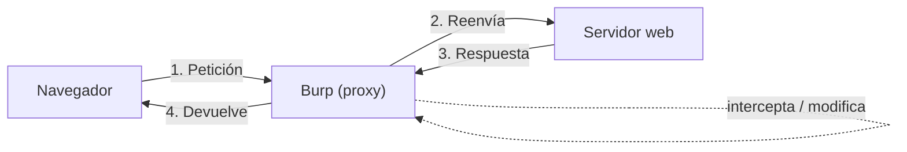
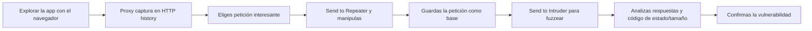

# Burp Suite

Burp Suite es el **proxy de interceptación** de referencia para pentesting web. Se coloca entre tu
navegador y el servidor: ve todo el tráfico HTTP/HTTPS, te deja **modificarlo** y te da herramientas
para analizar, automatizar y repetir peticiones. Si vas a hacer seguridad web en serio, Burp es tu
entorno de trabajo.

!!! danger "Uso ético y legal"
    Interceptar y modificar tráfico solo tiene sentido contra **tu laboratorio** o aplicaciones que
    autorizan las pruebas. Burp configurado mal puede interceptar tu propio tráfico personal: cuida el
    certificado CA y el ámbito (*scope*). Ver
    [Ética y legalidad](../nivel-1-principiante/00-etica-y-legalidad.md).

## Objetivos de aprendizaje

- Entender qué es un **proxy de interceptación** y por qué es imprescindible.
- Configurar Burp con el navegador y el **certificado CA** para HTTPS.
- Usar las herramientas clave: **Proxy**, **Repeater**, **Intruder**, **Decoder**, **Comparer**,
  **Scanner** (según edición) y **extensores**.
- Diferenciar **Community** de **Professional** sin inventarte precios ni funciones.
- Definir un **ámbito** para no salirte del alcance autorizado.

**Tiempo estimado:** 90–120 min.

## Requisitos previos

- **[Seguridad web y OWASP Top 10](07-seguridad-web-y-owasp-top-10.md)**.
- Un navegador moderno y, a ser posible, uno **dedicado solo a pentesting** (perfil limpio o navegador
  integrado de Burp).
- Una app de laboratorio en local (o los labs de PortSwigger Academy).

## Explicación

### Qué es un proxy de interceptación

Un **proxy HTTP(S)** se interpone entre cliente y servidor. Un proxy **de interceptación** añade la
posibilidad de **pausar** cada petición o respuesta, inspeccionarla, modificarla y reenviarla. Eso es lo
que permite ver y manipular lo que el navegador "oculta".

### Configuración básica

1. Burp escucha por defecto en `127.0.0.1:8080` (compruébalo en *Proxy → Options*).
2. Configura tu **navegador** para usar ese proxy (o usa el navegador integrado de Burp).
3. Para **HTTPS**, instala el **certificado CA de Burp** en el navegador. Burp genera su propia CA y
   firma al vuelo los certificados de los sitios: por eso el navegador debe confiar en esa CA.

!!! warning "El certificado CA y la confianza"
    La CA de Burp solo debe instalarse en un perfil de navegador dedicado a pruebas. No la instales en
    tu navegador de banca/correo. Si confías en una CA, quien la controle puede leer tus conexiones
    "seguras".

### Ámbito (Scope)

Define el objetivo en *Target → Scope* (por ejemplo `http://127.0.0.1:8000` o tu lab). Con el ámbito
activo, Burp registra y muestra solo lo relevante, y herramientas como el *Scanner* no salen de él. Un
ámbito bien puesto evita accidentes y ruido.

### Las herramientas clave

| Herramienta | Para qué sirve |
| --- | --- |
| **Proxy** | Intercepta el tráfico en vivo; es la puerta de entrada. |
| **HTTP history** | Historial de todo lo que ha pasado por el proxy. |
| **Target / Site map** | Mapa de la aplicación: hosts, rutas, parámetros. |
| **Repeater** | Repite y modifica una petición a mano, tantas veces como quieras. |
| **Intruder** | Automatiza peticiones con **payloads** (fuzzing de parámetros, fuerza bruta de login…). |
| **Decoder** | Codifica/decodifica Base64, URL, hex, hashes… |
| **Comparer** | Compara dos peticiones/respuestas (útil en ciegos). |
| **Scanner** | Análisis automático (según edición). |
| **Extender / BApp Store** | Instala extensiones (por ejemplo, autorización, JWT). |

#### Flujo típico de trabajo

#### Repeater

Ideal para probar a mano una hipótesis: cambias un parámetro, un ID, una cabecera, y observas la
respuesta. Es donde se confirman la mayoría de hallazgos (nada de fiarse solo de un escáner).

#### Intruder

Permite marcar **posiciones** (los puntos del payload) y elegir un **tipo de ataque**:

| Tipo | Qué hace |
| --- | --- |
| **Sniper** | Un conjunto de payloads en una posición cada vez. |
| **Battering ram** | El mismo payload en todas las posiciones a la vez. |
| **Pitchfork** | Recorre varios conjuntos **en paralelo** (uno por posición). |
| **Cluster bomb** | Todas las combinaciones de todos los conjuntos. |

Ejemplos de uso: fuzzear un parámetro con una lista de valores, probar rutas, o un login con un
diccionario. En Community, la velocidad de Intruder está limitada; es una de las diferencias típicas
entre ediciones.

!!! warning "Fuerza bruta con cabeza"
    Un Intruder a máxima velocidad contra un login de producción puede bloquear cuentas o disparar
    alertas. En un pentest autorizado, respeta los límites de las RoE y empieza despacio.

#### Decoder y Comparer

- **Decoder**: pasar de un valor a otro formato. Muy útil con token JWT, cookies Base64 o parámetros
  codificados.
- **Comparer**: cuando dos respuestas se parecen y sospechas de un *blind* (a ciegas), ver las
  diferencias byte a byte ayuda mucho.

### Community vs Professional

Ambas ediciones comparten las herramientas básicas (Proxy, Repeater, Intruder, Decoder, Comparer,
Extender). La versión **Professional** añade funciones de automatización y análisis que no están en
Community. Las capacidades exactas cambian con las versiones: **no te fíes de listas de precios ni de
características de memoria**; consulta la comparativa oficial.

!!! info "Comprueba la comparativa oficial"
    Consulta en la web del fabricante qué incluye cada edición **en la versión vigente** y si existe una
    licencia **gratuita para estudiantes** o ediciones específicas. Enlace: <https://portswigger.net/burp>
    · PENDIENTE confirmar condiciones vigentes de licencia: TODO-UJACKING.

### Extensiones (BApp Store)

El ecosistema de extensiones es una de las grandes ventajas de Burp. Ejemplos de categorías:

| Extensión (ejemplos) | Utilidad |
| --- | --- |
| Complementos de **autorización** | Comparar respuestas entre usuarios para detectar IDOR. |
| **JWT** | Analizar y manipular tokens JWT. |
| **Param Miner** | Descubrir cabeceras y parámetros ocultos. |
| **Logger** | Historial ampliado y filtrable. |

Instálalas desde *Extender → BApp Store*. Muchas son gratuitas y algunas requieren la edición Pro.

## Práctica guiada

Contra un **lab propio** o de PortSwigger Academy.

### Ejercicio 1 — Intercepta tu primera petición

Configura el proxy y captura una petición de tu app de laboratorio.

??? success "Solución"
    1. Burp escuchando en `127.0.0.1:8080`.
    2. Configura el proxy del navegador a esa dirección.
    3. Activa *Intercept is on* en *Proxy → Intercept*.
    4. Navega a `http://127.0.0.1:8000` y observa la petición pausada.
    5. Pulsa *Forward* para dejarla pasar. Desactiva la intercepción y revisa *HTTP history*.

### Ejercicio 2 — HTTPS con el CA

Haz que Burp vea tráfico HTTPS sin errores de certificado.

??? success "Solución"
    1. Con el proxy configurado, visita `http://burp` (o descarga el CA desde *Proxy → Options →
       Import/Export CA certificate*).
    2. Importa el certificado en el **almacén de autoridades** del navegador dedicado a pruebas.
    3. Repite la visita HTTPS: Burp mostrará la petición en claro.
    Recuerda: solo en el navegador de pruebas.

### Ejercicio 3 — Repeater: cambia un parámetro

Captura `GET /producto?id=1`, mándalo a Repeater y prueba `id=2`, `id=0`, `id=1'`.

??? success "Solución"
    1. Clic derecho en la petición → *Send to Repeater*.
    2. Cambia el valor de `id` y pulsa *Send*.
    3. Observa código de estado, longitud y cuerpo. Diferencias raras (200 con datos ajenos, errores SQL)
       son pistas. **Confirma** que es un fallo real, no una casualidad.

### Ejercicio 4 — Intruder: fuzzea un parámetro

Marca un parámetro y usa una lista de valores para ver qué respuestas cambian.

??? success "Solución"
    1. *Send to Intruder*.
    2. En *Positions*, marca el valor (por ejemplo `id=§1§`) y elige ataque **Sniper**.
    3. En *Payloads*, carga una lista de números o strings.
    4. Lanza y ordena por *Length* / *Status* para localizar respuestas distintas.

### Ejercicio 5 — Decoder: decodifica un Base64

Toma un valor Base64 (por ejemplo de una cookie o un JWT) y decodifícalo.

??? success "Solución"
    Pega el valor en *Decoder*, elige *Decode as → Base64*. En un JWT, separa por puntos y decodifica
    cada parte. Nunca asumas que un JWT está "firmado y seguro" solo por estar en Base64.

### Ejercicio 6 — Define tu ámbito

Configura Burp para capturar solo tu lab y descartar el resto.

??? success "Solución"
    *Target → Scope → Add*, añade `http://127.0.0.1:8000` (o el dominio del lab). Activa el filtro
    "Show only in-scope items" en *HTTP history*. Así no mezclas tu navegación personal con las pruebas.

## Para ir más allá

- **PortSwigger — Burp Suite** — documentación y descargas. EN, **Freemium**.
  <https://portswigger.net/burp>
- **PortSwigger Web Security Academy** — labs para usar con Burp. EN, **Gratis**.
  <https://portswigger.net/web-security>
- **Web Security Academy — rutas de aprendizaje** — EN, **Gratis**. <https://portswigger.net/web-security>
- **OWASP ZAP** — alternativa libre a Burp. EN, **Gratis**. <https://www.zaproxy.org>
- **Hack The Box / TryHackMe** — máquinas con web para practicar Burp. EN, **Freemium**.
  <https://www.hackthebox.com> · <https://tryhackme.com>

## Siguiente paso

Con Burp controlas la web. Para explotar infraestructura y servicios, el framework clásico es
Metasploit. Sigue con **[09 · Introducción a Metasploit](09-introduccion-a-metasploit.md)**.
