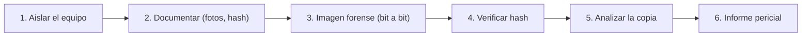

# Forense digital y OSINT

Dos caras de la misma moneda: **reconstruir lo que pasó** (forense) y **recolectar lo que es público**
(OSINT). El forense digital investiga un incidente con evidencia que aguante en un juicio. El OSINT
recopila información de fuentes abiertas para entender un objetivo, siempre dentro de la legalidad. Aquí
verás los fundamentos de ambos.

## Objetivos de aprendizaje

- Explicar la **cadena de custodia** y por qué una sola manipulación invalida una prueba.
- Realizar una **imagen forense** y entender por qué se trabaja sobre la copia.
- Conocer **artefactos** básicos de Windows y Linux.
- Definir **OSINT** y clasificar sus fuentes.
- Usar **Google dorks** y entender qué es **Shodan** (a nivel conceptual).
- Aplicar **ética y legalidad** al OSINT (qué es público y qué no se debe tocar).

**Tiempo estimado:** 90–120 min.

## Requisitos previos

- **[Comandos esenciales](../nivel-1-principiante/04-bash/02-comandos-esenciales.md)** y
  **[tuberías y filtros](../nivel-1-principiante/04-bash/03-tuberias-redirecciones-y-filtros.md)**.
- **[Sistemas operativos](../nivel-1-principiante/03-sistemas-operativos/index.md)**: estructura de disco.
- **[Ética y legalidad](../nivel-1-principiante/00-etica-y-legalidad.md)**: obligatorio antes del OSINT.

## Explicación

### Forense digital: el principio de no contaminar

El objetivo del forense es **preservar la evidencia**, no "arreglar" el sistema. La regla de oro: **no
trabajes sobre el original**. Se hace una **copia bit a bit** (imagen) y se analiza la copia, dejando el
original intacto y precintado.



#### Cadena de custodia

Es el **registro** de quién ha tenido la evidencia, cuándo, dónde y para qué, desde su recogida hasta el
juicio. Si hay un hueco (la evidencia estuvo "una tarde encima de la mesa de alguien"), la defensa puede
cuestionar su integridad. La cadena incluye:

- Identificación de la evidencia (número, descripción).
- Persona que la recoge y a quién se entrega.
- Fechas, horas y propósito de cada transferencia.
- **Hashes** de verificación en cada paso.

#### Integridad con hashes

Se calcula un hash (por ejemplo **SHA-256**) del disco/imagen **antes y después** de manipularlo. Si
coinciden, no ha cambiado. Este hash es el "sello" de la evidencia.

```bash
# Hash de un dispositivo (laboratorio)
sha256sum /dev/sdb

# Ver hash de una imagen creada
sha256sum imagen.dd
```

#### Crear una imagen

Herramientas (todas **para uso en laboratorio o con autorización**):

| Herramienta | Notas |
| --- | --- |
| `dd` | Universal, simple; hay que ir con mucho cuidado de no invertir `if`/`of`. |
| `dcfldd` | Variante de `dd` con hashing y progreso. |
| `dc3dd` | Similar, pensada para forense. |
| **FTK Imager** | GUI, muy usada en Windows. |
| **Guymager** | GUI en Linux. |

Ejemplo con `dd` (¡ojo a los nombres!):

```bash
# Imagen de un dispositivo a un fichero (laboratorio)
sudo dd if=/dev/sdb of=imagen.dd bs=4M status=progress conv=noerror,sync
sha256sum /dev/sdb imagen.dd   # comparar hashes
```

!!! danger "`dd` no perdona"
    Si intercambias `if` (entrada) y `of` (salida), **destruyes** el disco original. Primero comprueba
    con `lsblk` qué dispositivo es cuál, y practica con un USB vacío.

#### Artefactos básicos

Los **artefactos** son los rastros que dejan los sistemas. Algunos imprescindibles:

**Windows**

| Artefacto | Qué revela |
| --- | --- |
| **Registro** (`NTUSER.DAT`, `SOFTWARE`, `SYSTEM`) | Configuración, programas, USB, cuentas. |
| **Prefetch** (`C:\Windows\Prefetch`) | Programas ejecutados y cuándo. |
| **Event Logs** (`C:\Windows\System32\winevt\Logs`) | Logins, errores, auditoría. |
| **$MFT / $UsnJrnl** | Actividad del sistema de ficheros NTFS. |
| **Papelera / Jump Lists / LNK** | Ficheros abiertos o borrados. |
| **Navegador (historial, cookies, caché)** | Actividad web del usuario. |

**Linux**

| Artefacto | Qué revela |
| --- | --- |
| `/var/log/auth.log`, `/var/log/secure` | Autenticaciones, `sudo`, SSH. |
| `~/.bash_history` | Comandos ejecutados. |
| `journalctl` | Logs del sistema (systemd). |
| `/etc/passwd`, `/etc/shadow` | Usuarios y hashes de contraseña. |
| `cron` (`/etc/crontab`, `/var/spool/cron`) | Tareas programadas. |
| Timestamps (`atime`, `mtime`, `ctime`) | Cuándo se accedió/modificó/cambió. |

```bash
# Ejemplos de lectura en el sistema (no forense, pero útiles)
last -f /var/log/wtmp
sudo journalctl -u ssh
grep "sudo" /var/log/auth.log 2>/dev/null | tail
```

#### Orden de volatilidad

Al recoger evidencia, primero lo que **desaparece antes**:

1. Memoria RAM (los registros, conexiones, claves en memoria).
2. Caché, conexiones de red activas.
3. Ficheros temporales.
4. Disco (más persistente).
5. Respaldos y medios externos.

### OSINT: inteligencia de fuentes abiertas

**OSINT** (*Open Source Intelligence*) es la recopilación y análisis de información **pública**: webs,
documentos, redes sociales, registros, imágenes, DNS… No implica acceso no autorizado. Si algo requiere
"colarse" o no es público, ya **no** es OSINT.

La OSINT tiene dos caras: el **reconocimiento legítimo** (auditorías, periodismo, verificación) y el
**acoso o doxxing** (usar datos públicos para dañar a una persona). La segunda es **delito o falta** según
el país: la información sea pública no da derecho a usarla para hostigar.

#### Tipos de fuentes

| Tipo | Ejemplos |
| --- | --- |
| **Motores de búsqueda** | Google, Bing, DuckDuckGo, Yandex. |
| **Redes sociales** | Publicaciones, perfiles, imágenes con metadatos. |
| **Registros públicos** | Dominios (`whois`), empresas, registros mercantiles, patentes. |
| **Infraestructura** | DNS, certificados, servidores expuestos. |
| **Datos filtrados (públicos)** | Solo consultar fuentes legales; nunca acceder a datos robados. |
| **Imágenes y geolocalización** | Análisis visual, GEOINT. |
| **Buscadores especializados** | Shodan, Censys, motores de código. |

#### OSINT Framework

Existe un proyecto comunitario llamado **OSINT Framework** que organiza por categorías cientos de
fuentes y herramientas, ideal para decidir por dónde empezar.

!!! warning "PENDIENTE (TODO-UJACKING)"
    Verificar y fijar la URL oficial vigente de **OSINT Framework** antes de enlazarla (históricamente en
    `osintframework.com`). Confirmar que el sitio sigue activo y estable antes de publicarlo.

#### Google dorks

Los **dorks** son búsquedas con **operadores** que afinan los resultados. Bien usados encuentran
documentos indexados que no deberían estarlo. Solo deben usarse para **verificar** qué expone tu propia
organización (o en el marco de un pentest autorizado).

| Operador | Qué hace |
| --- | --- |
| `site:` | Limita a un dominio (`site:miempresa.com`). |
| `filetype:` | Busca un tipo de fichero (`filetype:pdf`). |
| `intitle:` | Palabra en el título. |
| `inurl:` | Palabra en la URL. |
| `-` | Excluye (`site:miempresa.com -inurl:blog`). |
| `"..."` | Frase exacta. |
| `OR` | Alternativa. |

Ejemplos (todos sobre **tu** dominio, para revisar tu propia exposición):

```text
site:miempresa.com filetype:xls
site:miempresa.com intitle:"index of"
site:miempresa.com inurl:admin
"miempresa.com" -site:miempresa.com
```

En pentests, los dorks se usan para descubrir ficheros y paneles públicos; sirven también para que una
organización detecte lo que ha dejado al descubierto sin querer.

#### Shodan (idea general)

**Shodan** es un buscador de dispositivos conectados a Internet: indexa **banners** de servicios
(cámaras, routers, bases de datos expuestas, servidores). En lugar de buscar "páginas", buscas
"servicios". Permite filtrar por país, producto, puerto o cabeceras.

Su uso **legítimo**: comprobar si **tu** organización tiene servicios expuestos que no debería. Su uso
fuera del alcance autorizado para localizar objetivos ajenos es, como mínimo, cuestionable y, si acaba
en acceso, delictivo.

!!! danger "Ética del OSINT"
    - No interactúes con sistemas ajenos. **Mirar** banners públicos no es lo mismo que **entrar**.
    - Nada de acceder a datos filtrados de terceros: aunque estén "por ahí", usarlos puede ser delito.
    - No uses datos personales para acosar, doxear o perfilar a nadie.
    - Documenta **fuente y fecha**: una captura sin contexto no vale como prueba.

## Práctica guiada

### Ejercicio 1 — Hash de integridad

Crea una imagen de un USB (o de un fichero grande) y verifica su hash.

??? success "Solución"
    ```bash
    # Con un USB vacío identificado como /dev/sdb
    lsblk                       # confirmar el dispositivo
    sudo dd if=/dev/sdb of=usb.dd bs=4M status=progress
    sha256sum /dev/sdb
    sha256sum usb.dd
    ```
    Los dos hashes deben coincidir. Si no, algo cambió durante la copia.

### Ejercicio 2 — Artefactos de autenticación en Linux

Revisa inicios de sesión y comandos `sudo`.

??? success "Solución"
    ```bash
    last -f /var/log/wtmp | head
    sudo journalctl _COMM=sudo --no-pager | tail
    cat ~/.bash_history | tail
    ```
    Cada artefacto cuenta una parte de la historia: **quién**, **cuándo** y **qué**.

### Ejercicio 3 — Google dorks sobre tu dominio

Supón que administras `midominio.example`. Escribe 4 búsquedas para detectar exposición.

??? success "Solución"
    ```text
    site:midominio.example filetype:pdf
    site:midominio.example intitle:"index of"
    site:midominio.example inurl:login
    site:midominio.example filetype:sql
    ```
    El objetivo es encontrar documentos, listados de directorios, paneles de login y ficheros sensibles
    que estén indexados por error.

### Ejercicio 4 — Huella DNS pública

Obtén información pública de un dominio **tuyo**.

??? success "Solución"
    ```bash
    whois midominio.example
    dig midominio.example MX
    dig midominio.example TXT
    ```
    Los registros `MX` y `TXT` (SPF, DMARC) revelan infraestructura de correo y políticas; útiles tanto
    para OSINT como para saber si te pueden suplantar el correo.

### Ejercicio 5 — Metadatos de una imagen

Extrae los metadatos EXIF de una foto **tuya** y observa qué se filtra.

??? success "Solución"
    ```bash
    exiftool mi-foto.jpg
    # o, si no tienes exiftool:
    identify -verbose mi-foto.jpg 2>/dev/null | head
    ```
    Cámara, fecha y, a veces, **coordenadas GPS**. Muchas webs eliminan los metadatos al subir imágenes;
    otras no. Es un vector clásico de fuga.

### Ejercicio 6 — Ética aplicada

Un compañero te enseña una base de datos con millones de emails de una filtración y te pide cruzarla
con un objetivo. ¿Qué haces?

??? success "Solución"
    - **No** usarla: es material obtenido ilícitamente; usarlo puede ser delito y contamina cualquier
      investigación.
    - **Documentar** el hecho y avisar a quien corresponda (seguridad/compliance).
    - Si el objetivo es proteger a la organización, se trabaja con **fuentes legales** y con los datos
      que la propia organización puede tratar.

## Para ir más allá

- **Wireshark** — análisis de tráfico (forense de red). EN, **Gratis**. <https://www.wireshark.org>
- **SANS — recursos forenses** — EN, **Gratis** / **De pago** (cursos). <https://www.sans.org>
- **The Sleuth Kit / Autopsy** — suite forense libre. EN, **Gratis**. <https://www.sleuthkit.org>
- **Volatility** — análisis de memoria RAM. EN, **Gratis**. <https://www.volatilityfoundation.org>
- **OSINT Framework** — índice de fuentes (ver pendiente de URL). EN, **Gratis**.
- **Shodan** — buscador de servicios. EN, **Freemium**.
  <https://www.shodan.io> · PENDIENTE confirmar política de uso educativa vigente: TODO-UJACKING
- **Have I Been Pwned** — comprobación de filtraciones. EN, **Gratis**. <https://haveibeenpwned.com>
- **Ruta de OSINT de la web** — [paths/osint.md](../paths/osint.md).

## Siguiente paso

Tras ver el ataque y la investigación, toca **defenderse**. Sigue con
**[12 · Hardening básico](12-hardening-basico.md)**.
