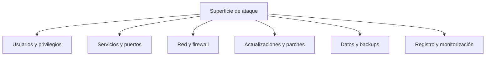

# Hardening básico

**Hardening** (endurecimiento) es reducir la superficie de ataque de un sistema: quitar lo que sobra,
cerrar lo que no se usa, limitar quién puede qué y mantenerlo todo actualizado. No es una tarea puntual,
es un hábito. Esta página te da una base sólida para Linux y Windows, y para los servicios que expones.

## Objetivos de aprendizaje

- Aplicar una **línea base** de hardening en Linux: usuarios, SSH, firewall, actualizaciones.
- Entender qué hace **fail2ban** a nivel conceptual (y por qué no es magia).
- Endurecer Windows: **BitLocker**, **Defender**, políticas de cuenta y de aplicación.
- Eliminar **servicios innecesarios** y entender por qué es la medida más rentable.
- Diseñar una estrategia de **backups** que de verdad sirva (regla 3-2-1).
- Verificar el endurecimiento con una **checklist**.

**Tiempo estimado:** 90–120 min.

## Requisitos previos

- **[Linux · usuarios y permisos](../nivel-1-principiante/03-sistemas-operativos/02-linux-usuarios-y-permisos.md)**.
- **[Linux · procesos, servicios y logs](../nivel-1-principiante/03-sistemas-operativos/03-linux-procesos-servicios-y-logs.md)**.
- **[Windows básico](../nivel-1-principiante/03-sistemas-operativos/04-windows-basico.md)**.
- **[Redes avanzadas y firewalls](03-redes-avanzadas-y-firewalls.md)**: `iptables`/`nftables`.

## Explicación

### El principio: mínima funcionalidad

Cada programa, puerto y usuario es una puerta. El hardening consiste en **cerrar puertas**:



### Hardening de Linux

#### Usuarios y privilegios

- Cuentas **de servicio** sin shell (`/usr/sbin/nologin`) y sin login.
- Usar `sudo` con reglas concretas, no `ALL=(ALL) NOPASSWD: ALL`.
- Contraseñas largas o, mejor, **claves SSH**.
- Revisar quién está en `sudo`, `adm`, `docker`, `lxd`.
- Bloquear cuentas sin uso.

```bash
# Ver usuarios con shell válida
awk -F: '$7 !~ /(nologin|false)$/ {print $1, $7}' /etc/passwd

# Ver quién puede usar sudo
sudo grep -r . /etc/sudoers /etc/sudoers.d/ 2>/dev/null

# Ver grupos peligrosos
getent group sudo adm docker lxd
```

#### SSH

El servicio más atacado de cualquier servidor expuesto.

| Medida | Cómo |
| --- | --- |
| Deshabilitar login de `root` | `PermitRootLogin no` en `/etc/ssh/sshd_config`. |
| Deshabilitar contraseñas | `PasswordAuthentication no` (y usar claves). |
| Limitar usuarios | `AllowUsers ana ops` (o `AllowGroups`). |
| Cambiar el puerto | `Port 2222` (reduce ruido, no es seguridad por sí sola). |
| Solo versión 2 | `Protocol 2`. |
| Timeouts | `ClientAliveInterval`, `LoginGraceTime`. |
| `Fail2ban` | Bloquea IPs tras intentos fallidos. |

```bash
# Editar y validar antes de reiniciar
sudo sshd -t                    # comprueba la sintaxis
sudo systemctl restart ssh
```

!!! danger "No te auto-bloquees por SSH"
    Antes de deshabilitar `PasswordAuthentication`, asegúrate de que tu **clave pública** funciona y está
    instalada. Si no, te quedas fuera de tu propio servidor. Ten siempre acceso por consola (o una
    sesión abierta) mientras cambias SSH.

#### Actualizaciones

La mayoría de las brechas reales explotan **fallos ya parcheados**. Automatizar actualizaciones de
seguridad es básico.

```bash
# Debian/Ubuntu
sudo apt update && sudo apt upgrade
sudo apt install unattended-upgrades
sudo dpkg-reconfigure --priority=low unattended-upgrades
```

En servidores, aplica actualizaciones de seguridad automáticamente y reinicia en ventanas controladas.

#### Firewall

Denegar por defecto y abrir solo lo necesario (ver
[03 · Redes avanzadas y firewalls](03-redes-avanzadas-y-firewalls.md)):

```bash
sudo nft add table inet filtro
sudo nft add chain inet filtro entrada '{ type filter hook input priority 0; policy drop; }'
sudo nft add rule inet filtro entrada iif lo accept
sudo nft add rule inet filtro entrada ct state established,related accept
sudo nft add rule inet filtro entrada tcp dport 22 accept
```

#### fail2ban (conceptual)

**fail2ban** lee los **logs** y, cuando detecta un patrón de abuso (por ejemplo, N fallos de SSH desde
una IP), añade una **regla de firewall temporal** para bloquear esa IP. Puntos clave:

- No evita el ataque; **reduce la velocidad** y el ruido.
- Depende de que los logs estén bien configurados.
- Un atacante con muchas IPs (botnet) puede esquivar los límites.
- Complétalo con claves SSH y `DenyUsers`.

 ```text
 Configuración típica (resumen):
 - jail: sshd
 - maxretry: 5
 - bantime: 10m
 - findtime: 10m
 ```

!!! warning "PENDIENTE (TODO-UJACKING)"
    Añadir un ejemplo **completo y verificado** de `/etc/fail2ban/jail.local` (con la ruta de log real
    según la distro) y de una comprobación con `fail2ban-client status`. Debe validarlo el equipo en una
    VM concreta antes de publicarlo.

#### Superficie de servicios

```bash
# Qué escucha y en qué interfaz
sudo ss -tulpn

# Servicios activos
systemctl list-units --type=service --state=running
```

Todo lo que no necesites, fuera. Un servicio que no corre no se puede explotar.

### Hardening de Windows

#### Cifrado de disco: BitLocker

**BitLocker** cifra el disco para que, si roban el equipo, no puedan leer los datos arrancando el disco
en otro sistema. Requiere TPM o una contraseña de arranque. Guardas las claves de recuperación de forma
segura (Active Directory/Microsoft Entra) y **auditas** quién puede revelarlas.

#### Defender

Windows Defender incluye antivirus y opciones de protección como:
- **Protección en tiempo real**.
- **Controlled Folder Access** (evita que programas no confiables modifiquen carpetas sensibles).
- **Exploit protection** (mitigaciones de memoria).
- **Firewall de Windows**.

Mantén las **definiciones actualizadas** y revisa las **exclusiones**: un atacante intenta añadir
exclusiones para pasar desapercibido.

#### Políticas

| Área | Medida |
| --- | --- |
| Cuentas | Longitud/complejidad de contraseña, bloqueo por intentos. |
| Privilegios | Mínimo privilegio, sin administradores locales innecesarios, **LAPS**. |
| Aplicaciones | Restringir software no autorizado (AppLocker/WDAC). |
| Scripts | Limitar PowerShell (políticas + registro). |
| RDP | No exponer a Internet; usar VPN y NLA. |
| SMB | Deshabilitar SMBv1, firmar SMB. |
| USB | Restringir dispositivos de almacenamiento si aplica. |
| Auditoría | Activar logs de inicio de sesión y de cambios. |

```powershell
# Ejemplos de consulta (PowerShell como admin)
Get-MpComputerStatus | Select-Object AntivirusEnabled, RealTimeProtectionEnabled
Get-NetFirewallProfile | Select-Object Name, Enabled
Enable-PSRemoting -SkipNetworkProfileCheck   # solo si se necesita y está autorizado
```

### Servicios innecesarios

La medida con mejor relación coste/beneficio. Un ejemplo clásico: un servidor web que además corre
FTP, `telnet` o una base de datos escuchando en `0.0.0.0`. Cada uno es una puerta. Pregúntate siempre:
**¿esto hace falta?, ¿quién necesita llegar?, ¿por qué red?**

### Backups: la regla 3-2-1

| Número | Significado |
| --- | --- |
| **3** copias | Original + 2 copias. |
| **2** medios distintos | Por ejemplo, disco local + nube/otra ubicación. |
| **1** fuera de sitio | Si el edificio se inunda o hay ransomware, esa copia sobrevive. |

Además:

- **Probar las restauraciones**. Un backup que nunca se ha restaurado no es un backup.
- Al menos una copia **offline o inmutable**: el ransomware cifra lo que alcanza.
- Cifrar los backups y proteger sus credenciales.

## Práctica guiada

En tu laboratorio (una VM de Linux y, si tienes, una de Windows).

### Ejercicio 1 — Auditoría rápida de Linux

Enumera puertos abiertos, servicios activos y usuarios con shell.

??? success "Solución"
    ```bash
    sudo ss -tulpn
    systemctl list-units --type=service --state=running
    awk -F: '$7 !~ /(nologin|false)$/ {print $1, $7}' /etc/passwd
    getent group sudo
    ```
    Anota qué está escuchando en `0.0.0.0` (visible desde la red) y qué en `127.0.0.1` (solo local).

### Ejercicio 2 — Endurece SSH

Aplica: sin root, sin contraseñas, solo tu usuario, y timeouts.

??? success "Solución"
    En `/etc/ssh/sshd_config`:
    ```text
    PermitRootLogin no
    PasswordAuthentication no
    PubkeyAuthentication yes
    AllowUsers tu_usuario
    LoginGraceTime 30
    ClientAliveInterval 300
    ClientAliveCountMax 2
    ```
    Valida y reinicia:
    ```bash
    sudo sshd -t && sudo systemctl restart ssh
    ```
    Prueba desde **otra** terminal antes de cerrar la actual.

### Ejercicio 3 — Firewall mínimo

Deja solo SSH y HTTP desde tu red.

??? success "Solución"
    ```bash
    sudo nft flush ruleset
    sudo nft add table inet filtro
    sudo nft add chain inet filtro entrada '{ type filter hook input priority 0; policy drop; }'
    sudo nft add rule inet filtro entrada iif lo accept
    sudo nft add rule inet filtro entrada ct state established,related accept
    sudo nft add rule inet filtro entrada tcp dport 22 ip saddr 192.168.1.0/24 accept
    sudo nft add rule inet filtro entrada tcp dport 80 accept
    sudo nft list ruleset
    ```

### Ejercicio 4 — ¿BitLocker o no?

Un portátil con contabilidad y otro con datos médicos: justifica si cifrar y qué precauciones añadir.

??? success "Solución"
    Ambos **sí**: cualquier portátil puede perderse o ser robado. Además:
    - Guardar las **claves de recuperación** en el directorio/gestor corporativo.
    - Auditar quién puede **revelar** claves.
    - Combinar con **contraseña de arranque** (PIN) en equipos muy sensibles.
    - Recordar que BitLocker protege **en reposo**; con la sesión abierta, los datos están accesibles:
      bloqueo de sesión automático y pantallas que pidan credenciales.

### Ejercicio 5 — Diseña un plan de backups

Para una PYME con una base de datos y documentos: propón copias, medios y frecuencias.

??? success "Solución"
    Ejemplo:
    | Dato | Copias | Medios | Frecuencia |
    | --- | --- | --- | --- |
    | Base de datos | Diaria completa + incrementales | Disco local + nube cifrada | Cada 24 h |
    | Documentos | Sincronización continua | NAS + nube | Continua |
    | Copia offline | Semanal | Disco externo guardado fuera | Semanal |
    Y lo más importante: **restaurar de prueba** cada 3–6 meses y documentar el resultado.

### Ejercicio 6 — Checklist final

Marca lo que ya has aplicado en tu laboratorio.

??? success "Solución"
    - [ ] Usuarios de servicio sin shell.
    - [ ] `sudo` con reglas concretas.
    - [ ] SSH sin root y sin contraseñas.
    - [ ] Actualizaciones automáticas de seguridad.
    - [ ] Firewall con política DROP por defecto.
    - [ ] Servicios innecesarios eliminados.
    - [ ] Backups 3-2-1 probados.

## Para ir más allá

- **CIS Benchmarks** — guías de configuración segura por sistema. EN, **Gratis** (registro).
  <https://www.cisecurity.org>
- **NIST — SP 800-123 (guía de seguridad de servidores)** y otras. EN, **Gratis**.
  <https://csrc.nist.gov>
- **Ubuntu — Security** — guías oficiales. EN, **Gratis**. <https://ubuntu.com/security>
- **Debian — Security Information** — EN, **Gratis**. <https://www.debian.org/security>
- **Microsoft Learn — Security / BitLocker / Defender** — EN, **Gratis**. <https://learn.microsoft.com>
- **fail2ban** — documentación. EN, **Gratis**. <https://github.com/fail2ban/fail2ban>
- **Lynis** — auditor de hardening en Linux. EN, **Gratis**. <https://cisofy.com/lynis>
- **NIST Cybersecurity Framework** — marco de gestión. EN, **Gratis**. <https://www.nist.gov>

## Siguiente paso

Has terminado el **Nivel 2**. El siguiente salto, orientado a certificaciones y especialización, está en
**[Nivel 3 · Avanzado](../nivel-3-avanzado/index.md)**. Y si quieres una ruta concreta (pentesting web,
blue team, forense…), explora los **[Paths](../paths/index.md)**.
