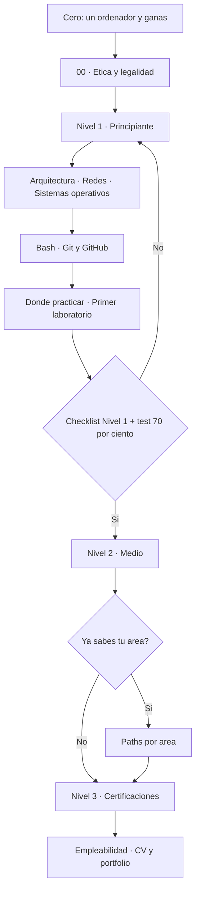

# Ruta perfecta: de cero a tus primeras prácticas

**Resumen.** Este es el itinerario que nos habría gustado tener el primer día: un plan de **12 semanas**
(6–8 horas por semana) que te lleva de no saber nada a tener un **laboratorio propio**, saber usar Linux y
Bash, entender las redes y haber resuelto tu primera máquina **sin saltarte los fundamentos**. No hay
atajos honestos: hay orden.

!!! danger "Antes de nada: ética y legalidad"
    Todo lo que practiques debe ser **contra tu propio laboratorio** o contra plataformas que lo
    autorizan expresamente (TryHackMe, Hack The Box, OverTheWire, PortSwigger Academy, VulnHub…).
    Atacar sistemas de los que no eres responsable es un **delito**. Empieza siempre por
    [00 · Ética y legalidad](nivel-1-principiante/00-etica-y-legalidad.md).

## ¿A quién va dirigida?

- A quien **nunca** ha tocado la ciberseguridad y no sabe por dónde empezar.
- A estudiantes que acumulan vídeos y cursos sueltos pero no tienen una línea clara.
- A quien viene de programación, sistemas o redes y quiere reordenar lo que ya sabe.
- A quien busca **salida laboral** y quiere saber qué aprender y en qué orden.

No hace falta saber programar ni tener conocimientos previos. Sí hace falta constancia y ganas de
**tocar el ordenador**, no solo leer.

## ¿Qué necesitas?

| Necesitas | Detalle |
| --- | --- |
| Un ordenador | 8 GB de RAM como mínimo; 16 GB si vas a virtualizar con comodidad. |
| Internet | Para descargar máquinas virtuales y practicar en plataformas online. |
| Tiempo | 6–8 horas por semana, repartidas en días. Mejor poco y frecuente que un maratón. |
| Software gratuito | Un virtualizador (VirtualBox o VMware) y una distribución Linux. Todo gratis. |
| Actitud | Ética, paciencia y ganas de ensuciarte las manos **solo** en tu laboratorio. |

## Cómo usar esta ruta

- Cada semana tiene un **objetivo**, una lista de **páginas que leer** (todas del
  [Nivel 1 · Principiante](nivel-1-principiante/index.md)), **dónde practicar**, las **horas estimadas**
  y un **hito evaluable**: algo concreto que debes saber hacer o haber producido al terminar la semana.
- Los **hitos son la brújula**. Si no puedes cumplir el hito, repite o repasa esa semana antes de seguir.
  Es normal tardar un poco más en subnetting o en Linux: no es fracasar, es aprender.
- Hay semanas más cargadas que otras. Si te llevas más de 8 horas, déjalo y continúa: la ruta no es un
  examen con cronómetro.

### Vista rápida

| Semana | Tema | Horas |
| --- | --- | --- |
| 1 | Ética y arquitectura de ordenadores (I) | 6–8 h |
| 2 | Bits, arranque y virtualización + empieza a practicar | 6–8 h |
| 3 | Redes I: modelos y direccionamiento | 6–8 h |
| 4 | Redes II: subnetting y capa de enlace | 6–8 h |
| 5 | Redes III: capa de red y transporte | 6–8 h |
| 6 | Redes IV: protocolos de aplicación y seguridad en tránsito | 6–8 h |
| 7 | Redes V: dispositivos, diagnóstico y Wireshark (+ HTB y OverTheWire) | 6–8 h |
| 8 | Linux I: fundamentos, usuarios y permisos | 6–8 h |
| 9 | Linux II, Windows y distros de hacking | 6–8 h |
| 10 | Tu laboratorio + primer laboratorio guiado | 6–8 h |
| 11 | Bash: de la terminal a tus primeros scripts | 6–8 h |
| 12 | Git/GitHub, cierre y autoevaluación | 6–8 h |

## Plan de 12 semanas

### Semana 1 — Ética y arquitectura de ordenadores (I)

- **Objetivo:** entender para qué sirve el hacking ético, dónde está el límite legal y cómo es un
  ordenador por dentro.
- **Leer:**
    - [00 · Ética y legalidad](nivel-1-principiante/00-etica-y-legalidad.md)
    - [Arquitectura de ordenadores](nivel-1-principiante/01-arquitectura-de-ordenadores/index.md)
    - [Componentes del ordenador](nivel-1-principiante/01-arquitectura-de-ordenadores/01-componentes-del-ordenador.md)
    - [Sistemas de numeración](nivel-1-principiante/01-arquitectura-de-ordenadores/02-sistemas-de-numeracion.md)
- **Practicar:** preparar el equipo (comprobar la RAM, instalar un editor de texto y un navegador).
  Todavía no hay plataforma: primero entiende qué es un byte y por qué existen el binario y el hexadecimal.
- **Horas:** 6–8 h.
- **Hito evaluable:** explicas con tus palabras la diferencia entre hacking ético y delito, y conviertes
  a mano **tres números** entre binario, decimal y hexadecimal sin calculadora.

### Semana 2 — Bits, arranque y virtualización + empieza a practicar

- **Objetivo:** comprender cómo se representan los datos y qué pasa desde que pulsas el botón de encendido
  hasta que arranca el sistema; crear tu primera máquina virtual.
- **Leer:**
    - [Bits, bytes y representación](nivel-1-principiante/01-arquitectura-de-ordenadores/03-bits-bytes-y-representacion.md)
    - [Arranque y virtualización](nivel-1-principiante/01-arquitectura-de-ordenadores/04-arranque-y-virtualizacion.md)
    - [Dónde practicar](nivel-1-principiante/06-donde-practicar/index.md)
    - [TryHackMe](nivel-1-principiante/06-donde-practicar/01-tryhackme.md)
- **Practicar:** crear una máquina virtual e instalar **Ubuntu** en
  [VirtualBox](https://www.virtualbox.org) o [VMware](https://www.vmware.com). Crear cuenta en
  [TryHackMe](https://tryhackme.com) y hacer su contenido introductorio.
- **Horas:** 6–8 h.
- **Hito evaluable:** tienes una VM Linux arrancando y has completado la primera sala de introducción de
  TryHackMe.

### Semana 3 — Redes I: modelos y direccionamiento

- **Objetivo:** entender cómo se organiza la comunicación en capas y cómo se identifica cada equipo en la red.
- **Leer:**
    - [Redes](nivel-1-principiante/02-redes/index.md)
    - [Modelos OSI y TCP/IP](nivel-1-principiante/02-redes/01-modelos-osi-y-tcp-ip.md)
    - [Direccionamiento IP y MAC](nivel-1-principiante/02-redes/02-direccionamiento-ip-y-mac.md)
- **Practicar:** TryHackMe (contenido de redes para principiantes) y la terminal de tu VM.
- **Horas:** 6–8 h.
- **Hito evaluable:** sitúas **10 protocolos** en su capa correcta (OSI/TCP-IP) y conviertes una dirección
  IPv4 a binario indicando si es privada o pública.

### Semana 4 — Redes II: subnetting y capa de enlace

- **Objetivo:** dominar el subnetting, esa habilidad que todo el mundo evita y todos acaban necesitando.
- **Leer:**
    - [Subnetting](nivel-1-principiante/02-redes/03-subnetting.md)
    - [Capa de enlace](nivel-1-principiante/02-redes/04-capa-de-enlace.md)
- **Practicar:** ejercicios de subnetting **en papel** y, en tu VM, observa tu dirección MAC e interfaces
  con `ip link`.
- **Horas:** 6–8 h.
- **Hito evaluable:** divides `192.168.10.0/24` en **4 subredes** indicando, para cada una, dirección de red,
  máscara, broadcast y rango de hosts válidos.

### Semana 5 — Redes III: capa de red y transporte

- **Objetivo:** entender cómo viajan los paquetes entre redes (IP) y cómo se garantiza la entrega (TCP/UDP).
- **Leer:**
    - [Capa de red](nivel-1-principiante/02-redes/05-capa-de-red.md)
    - [Capa de transporte](nivel-1-principiante/02-redes/06-capa-de-transporte.md)
- **Practicar:** en tu VM usa `ping` y `traceroute` para ver el camino de un paquete, y `ss` para listar
  conexiones y puertos abiertos.
- **Horas:** 6–8 h.
- **Hito evaluable:** explicas el **three-way handshake** de TCP y pones un ejemplo real de uso de TCP y
  otro de UDP.

### Semana 6 — Redes IV: protocolos de aplicación y seguridad en tránsito

- **Objetivo:** conocer los protocolos que usas cada día (DNS, HTTP, correo…) y cómo se protegen (TLS).
- **Leer:**
    - [Protocolos de aplicación](nivel-1-principiante/02-redes/07-protocolos-de-aplicacion.md)
    - [Seguridad en tránsito](nivel-1-principiante/02-redes/08-seguridad-en-transito.md)
- **Practicar:** resuelve nombres con `dig` o `nslookup`, abre una web y examina su certificado TLS, y haz
  alguna sala de TryHackMe sobre protocolos.
- **Horas:** 6–8 h.
- **Hito evaluable:** describes qué ocurre desde que escribes una URL hasta que ves la página
  (DNS → conexión TCP → TLS → petición HTTP).

### Semana 7 — Redes V: dispositivos, diagnóstico y Wireshark

- **Objetivo:** identificar los dispositivos de red, entender WiFi y **ver** el tráfico con tus propios ojos.
- **Leer:**
    - [Dispositivos, topologías y WiFi](nivel-1-principiante/02-redes/09-dispositivos-topologias-y-wifi.md)
    - [Herramientas de diagnóstico](nivel-1-principiante/02-redes/10-herramientas-de-diagnostico.md)
    - [Wireshark](nivel-1-principiante/02-redes/11-wireshark.md)
    - [Hack The Box](nivel-1-principiante/06-donde-practicar/02-hack-the-box.md)
    - [OverTheWire](nivel-1-principiante/06-donde-practicar/03-overthewire.md)
- **Practicar:** [Wireshark](https://www.wireshark.org) en tu VM (captura un `ping` y una consulta DNS),
  crea cuenta en [Hack The Box](https://www.hackthebox.com) y empieza el wargame **Bandit** de
  [OverTheWire](https://overthewire.org).
- **Horas:** 6–8 h.
- **Hito evaluable:** capturas tráfico y localizas origen, destino y protocolo de un `ping` y de un DNS, y
  has superado los primeros niveles de OverTheWire Bandit.

### Semana 8 — Linux I: fundamentos, usuarios y permisos

- **Objetivo:** manejarte por la terminal con soltura y entender el modelo de usuarios y permisos de Linux.
- **Leer:**
    - [Sistemas operativos](nivel-1-principiante/03-sistemas-operativos/index.md)
    - [Linux · fundamentos](nivel-1-principiante/03-sistemas-operativos/01-linux-fundamentos.md)
    - [Linux · usuarios y permisos](nivel-1-principiante/03-sistemas-operativos/02-linux-usuarios-y-permisos.md)
- **Practicar:** sigue con **OverTheWire Bandit** (es la mejor gimnasia de terminal que existe) y practica
  en tu VM.
- **Horas:** 6–8 h.
- **Hito evaluable:** te mueves por el sistema de ficheros, creas usuarios y ajustas permisos con `chmod` y
  `chown` sin mirar los apuntes.

### Semana 9 — Linux II, Windows y distros de hacking

- **Objetivo:** entender procesos, servicios y logs en Linux, conocer lo básico de Windows y elegir tu
  distribución de trabajo.
- **Leer:**
    - [Linux · procesos, servicios y logs](nivel-1-principiante/03-sistemas-operativos/03-linux-procesos-servicios-y-logs.md)
    - [Windows · básico](nivel-1-principiante/03-sistemas-operativos/04-windows-basico.md)
    - [Elegir distro de hacking](nivel-1-principiante/03-sistemas-operativos/05-elegir-distro-de-hacking.md)
    - [Montar Kali y Parrot](nivel-1-principiante/03-sistemas-operativos/06-montar-kali-y-parrot.md)
- **Practicar:** monta [Kali Linux](https://www.kali.org) o [Parrot OS](https://parrotsec.org) en una VM,
  arranca un servicio y revisa sus registros.
- **Horas:** 6–8 h.
- **Hito evaluable:** tienes Kali o Parrot funcionando y sabes comprobar el estado de un servicio y leer
  su log.

### Semana 10 — Tu laboratorio + primer laboratorio guiado

- **Objetivo:** montar un laboratorio aislado y seguro y resolver tu primer escenario de principio a fin.
- **Leer:**
    - [Laboratorio de red virtual](nivel-1-principiante/03-sistemas-operativos/07-laboratorio-red-virtual.md)
    - [Máquinas objetivo](nivel-1-principiante/03-sistemas-operativos/08-maquinas-objetivo.md)
    - [Primer laboratorio](nivel-1-principiante/07-primer-laboratorio.md)
    - [PortSwigger Web Security Academy](nivel-1-principiante/06-donde-practicar/04-portswigger-web-security-academy.md)
    - [CTFs](nivel-1-principiante/06-donde-practicar/05-ctfs.md)
    - [Otras plataformas](nivel-1-principiante/06-donde-practicar/06-otras-plataformas.md)
- **Practicar:** monta una red virtual con tu máquina atacante y una máquina objetivo
  (por ejemplo, una VM de [VulnHub](https://www.vulnhub.com)), haz un escaneo básico con
  [Nmap](https://nmap.org) y redacta el informe del [primer laboratorio](nivel-1-principiante/07-primer-laboratorio.md).
  Echa un vistazo a [PortSwigger Academy](https://portswigger.net/web-security) para lo web.
- **Horas:** 6–8 h.
- **Hito evaluable:** tu laboratorio tiene atacante y víctima que se ven por red, y has completado el primer
  laboratorio guiado con su informe.

### Semana 11 — Bash: de la terminal a tus primeros scripts

- **Objetivo:** pasar de escribir comandos sueltos a automatizar tareas con scripts.
- **Leer:**
    - [Bash](nivel-1-principiante/04-bash/index.md)
    - [Terminal, shell y consola](nivel-1-principiante/04-bash/01-terminal-shell-y-consola.md)
    - [Comandos esenciales](nivel-1-principiante/04-bash/02-comandos-esenciales.md)
    - [Tuberías, redirecciones y filtros](nivel-1-principiante/04-bash/03-tuberias-redirecciones-y-filtros.md)
    - [Scripts en Bash](nivel-1-principiante/04-bash/04-scripts-bash.md)
    - [Chuleta de Bash](nivel-1-principiante/04-bash/05-chuleta-bash.md)
- **Practicar:** en tu VM escribe scripts de tareas reales (recorrer ficheros, filtrar con `grep`, guardar
  la salida) y sigue con OverTheWire Bandit.
- **Horas:** 6–8 h.
- **Hito evaluable:** escribes y ejecutas un **script en Bash** que automatice una tarea: leer un conjunto
  de ficheros, filtrar por un patrón y guardar el resultado.

### Semana 12 — Git/GitHub, cierre y autoevaluación

- **Objetivo:** aprender control de versiones, publicar tu trabajo y medir objetivamente si has terminado
  el Nivel 1.
- **Leer:**
    - [Git y GitHub](nivel-1-principiante/05-git-y-github/index.md)
    - [Control de versiones](nivel-1-principiante/05-git-y-github/01-control-de-versiones.md)
    - [Git básico](nivel-1-principiante/05-git-y-github/02-git-basico.md)
    - [Ramas, merge y conflictos](nivel-1-principiante/05-git-y-github/03-ramas-merge-y-conflictos.md)
    - [GitHub, forks y Pull Requests](nivel-1-principiante/05-git-y-github/04-github-forks-y-pull-requests.md)
    - [GitHub Pages y perfil](nivel-1-principiante/05-git-y-github/05-github-pages-y-perfil.md)
    - [Checklist y autoevaluación](nivel-1-principiante/08-checklist-y-autoevaluacion.md)
- **Practicar:** crea un repositorio en [GitHub](https://github.com), sube tu **writeup** del primer
  laboratorio y publícalo con GitHub Pages. Haz el test de autoevaluación del Nivel 1.
- **Horas:** 6–8 h.
- **Hito evaluable:** tienes publicado un repositorio con tu primer writeup y sacas **≥ 70 %** en el test de
  [checklist y autoevaluación](nivel-1-principiante/08-checklist-y-autoevaluacion.md).

## Diagrama del recorrido completo

## ¿Cuándo estás listo para pasar al Nivel 2?

No lo decide el calendario, sino tus pruebas. Pasa al **[Nivel 2 · Medio](nivel-2-medio/index.md)** cuando
puedas decir **sí** a todo esto:

- [ ] He marcado **todas** las casillas de la [checklist del Nivel 1](nivel-1-principiante/08-checklist-y-autoevaluacion.md).
- [ ] Saco **≥ 70 %** en el test de autoevaluación del Nivel 1.
- [ ] Calculo subredes (subnetting) **sin ayuda** y explico el modelo OSI/TCP-IP con mis palabras.
- [ ] Me manejo por la terminal de Linux y leo/escribo permisos con soltura.
- [ ] Tengo un **laboratorio propio** funcionando: atacante y máquina objetivo comunicándose.
- [ ] He publicado al menos un **writeup** de una máquina o reto.

Si te falta algo, no es un problema: repite la semana correspondiente. Cimentar bien el Nivel 1 te ahorrará
semanas de frustración después.

## Consejos para no abandonar

!!! tip "La constancia gana a la intensidad"
    Dos horas tres días por semana baten a un maratón de sábado que te deja agotado. Fija un **horario
    fijo** y trátalo como una clase a la que no puedes faltar.

- **Toca el teclado siempre.** Por cada hora de vídeo, dos de práctica. Leer sin ejecutar crea la ilusión
  de entender.
- **Toma apuntes en Markdown.** Explica cada tema con tus palabras. Si no puedes explicarlo, no lo entiendes
  del todo. De paso practicas Git y construyes tu portfolio.
- **Únete a la comunidad.** Pregunta sin vergüenza en el [Discord de UJACKING](https://discord.gg/Gc4fhMn5bG)
  y participa en los [canales de la comunidad](quienes-somos/normas-comunidad.md). Aprender acompañado
  multiplica las ganas.
- **No te compares con quien lleva años.** Compárate con tu versión de la semana pasada.
- **Celebra los hitos.** Cada vez que cumplas el hito de una semana, apúntalo. Ver el progreso motiva más
  que cualquier vídeo motivacional.
- **Si fallas una semana, retoma sin culpa.** Lo importante no es la racha perfecta, sino no parar del todo.
- **Descansa.** Estudiar cansado es tiempo perdido. Duerme, sal a caminar y vuelve con la cabeza fresca.

## Recursos de apoyo

Todos gratuitos o con plan gratuito suficiente para esta ruta. Etiquetamos el coste y el idioma; **(EN)**
indica que el contenido está principalmente en inglés.

| Recurso | Enlace | Coste | Idioma |
| --- | --- | --- | --- |
| TryHackMe (rutas para principiantes) | [tryhackme.com](https://tryhackme.com) | Freemium | EN |
| Hack The Box (máquinas y retos) | [hackthebox.com](https://www.hackthebox.com) | Freemium | EN |
| OverTheWire (wargames, p. ej. Bandit) | [overthewire.org](https://overthewire.org) | Gratis | EN |
| PortSwigger Web Security Academy | [portswigger.net/web-security](https://portswigger.net/web-security) | Gratis | EN |
| VulnHub (máquinas virtuales vulnerables) | [vulnhub.com](https://www.vulnhub.com) | Gratis | EN |
| picoCTF (CTF para principiantes) | [picoctf.org](https://picoctf.org) | Gratis | EN |
| VirtualBox (virtualización) | [virtualbox.org](https://www.virtualbox.org) | Gratis | Multi |
| VMware (virtualización) | [vmware.com](https://www.vmware.com) | Freemium | Multi |
| Kali Linux | [kali.org](https://www.kali.org) | Gratis | EN |
| Parrot OS | [parrotsec.org](https://parrotsec.org) | Gratis | EN |
| Ubuntu | [ubuntu.com](https://ubuntu.com) | Gratis | Multi |
| Wireshark (analizador de tráfico) | [wireshark.org](https://www.wireshark.org) | Gratis | EN |
| Nmap (escaneo de red) | [nmap.org](https://nmap.org) | Gratis | EN |
| Git (control de versiones) | [git-scm.com](https://git-scm.com) | Gratis | Multi |
| MDN Web Docs (web y protocolos) | [developer.mozilla.org](https://developer.mozilla.org) | Gratis | Multi (ES incluido) |
| RFC Editor (estándares de Internet) | [rfc-editor.org](https://www.rfc-editor.org) | Gratis | EN |
| OWASP (seguridad web) | [owasp.org](https://owasp.org) | Gratis | EN |
| Discord de UJACKING | [discord.gg/Gc4fhMn5bG](https://discord.gg/Gc4fhMn5bG) | Gratis | ES |

!!! warning "PENDIENTE (TODO-UJACKING)"
    Los planes **gratuitos** de TryHackMe y Hack The Box limitan el contenido accesible sin suscripción y
    esas condiciones cambian con el tiempo. La asociación debe revisar periódicamente qué se puede hacer
    gratis en cada una antes de prometer una ruta 100 % gratuita.

!!! warning "PENDIENTE (TODO-UJACKING)"
    Validar el ritmo de 12 semanas con alumnado real y, si procede, añadir testimonios o ajustes por
    perfil (viene de redes, viene de programación, etc.).

## Siguiente paso

¿Listo? Empieza por **[00 · Ética y legalidad](nivel-1-principiante/00-etica-y-legalidad.md)** y luego ve
al **[Nivel 1 · Principiante](nivel-1-principiante/index.md)**. Y ten el
**[Glosario](glosario.md)** a mano: cada vez que te pierdas con un término, consúltalo.
